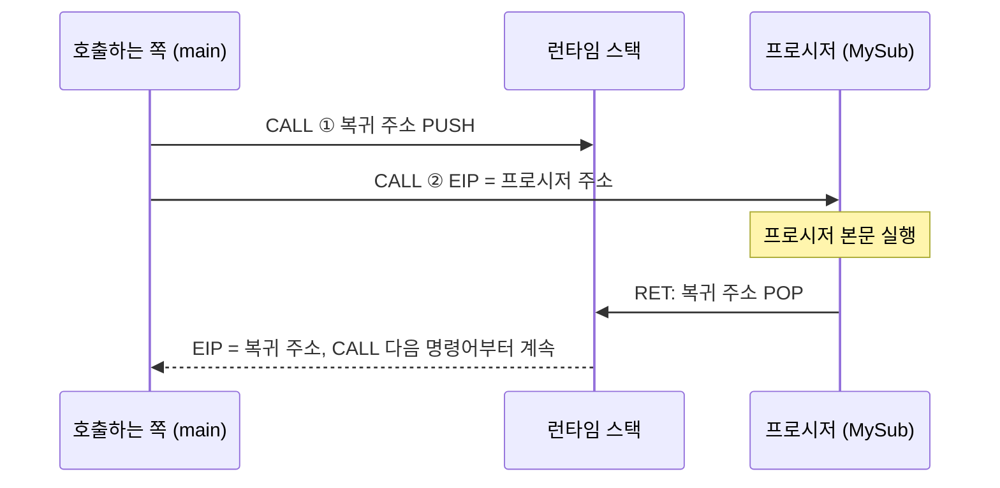
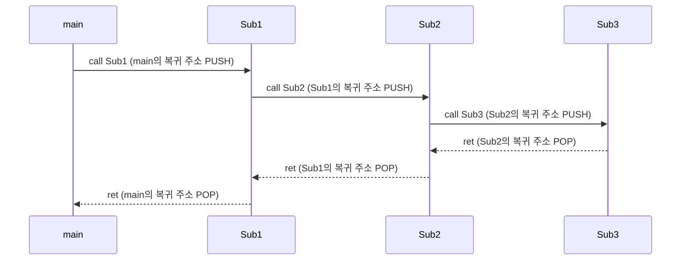
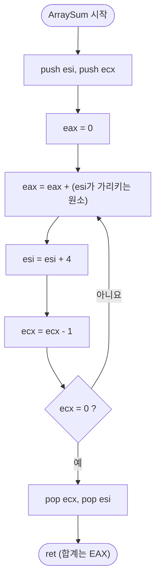
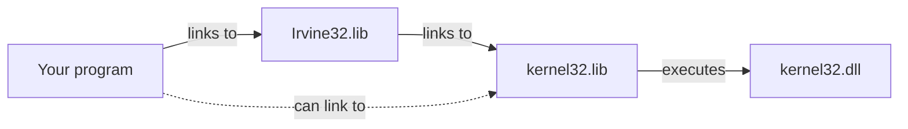
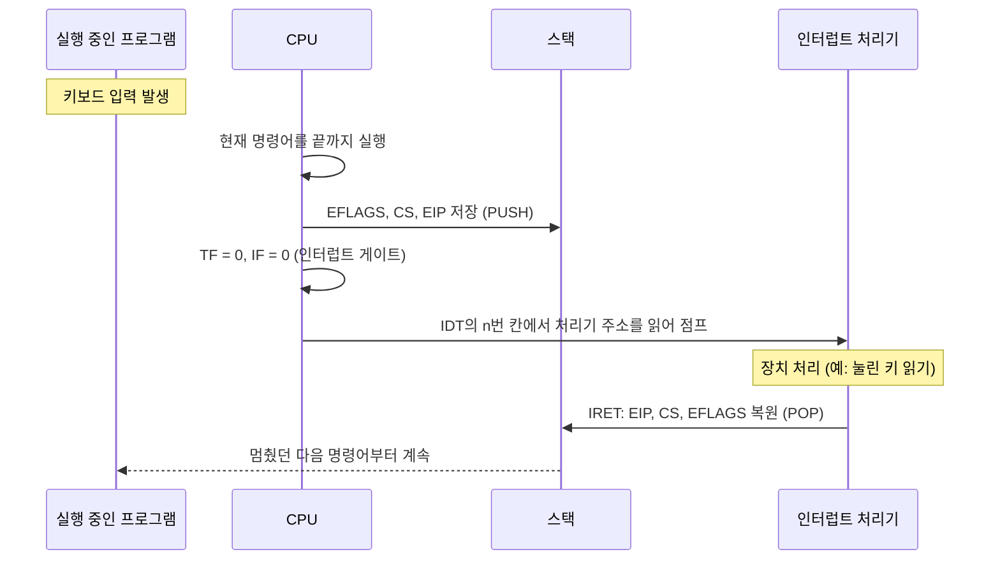
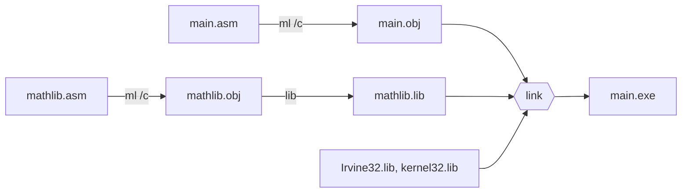
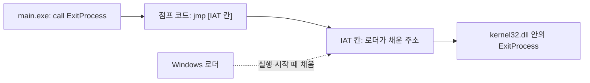
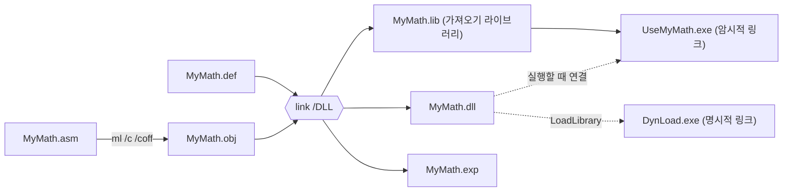

# x86 어셈블리: 프로시저 (Procedures)


> Kip R. Irvine, *Assembly Language for x86 Processors* — Chapter 5. Procedures 강의 정리
>
> 슬라이드 내용을 절 순서대로 정리하고, 슬라이드에 없는 동작 원리, 추가 예제, 자주 하는 실수를 보충했다. 슬라이드에서 빠진 64비트 프로그래밍(5.5절)도 넣었다.
> 발표 주제인 **인터럽트, 라이브러리, DLL, DLL 만드는 방법**은 [부록 B](#부록-b-인터럽트-interrupt)부터 [부록 E](#부록-e-dll-만드는-방법)까지 따로 자세히 다룬다.
> 슬라이드의 오타는 본문에 정정 박스로 표시하고 [부록 J](#부록-j-슬라이드-정정-사항-모음)에 모아 두었다.
> 예제 코드의 주석에 적힌 값과 실행 결과는 직접 어셈블하고 실행해서 확인한 것이다([예제 값 확인 방법](#예제-값-확인-방법)).

---

## 한눈에 보기 (TL;DR)

- **런타임 스택**은 CPU가 ESP 레지스터로 직접 관리하는 메모리 영역이다. 낮은 주소 쪽으로 자라고, ESP는 항상 마지막으로 넣은 값을 가리킨다.
- `PUSH`는 ESP를 먼저 줄이고 그 자리에 값을 쓴다. `POP`은 값을 먼저 읽고 ESP를 늘린다. 나중에 넣은 값이 먼저 나온다(LIFO).
- `PUSHFD`/`POPFD`는 EFLAGS를, `PUSHAD`/`POPAD`는 범용 레지스터 8개를 한 번에 저장하고 복원한다. `POPAD`는 반환값이 든 EAX까지 되돌려 버리므로 값을 돌려주는 프로시저에서는 조심해야 한다.
- 프로시저는 `PROC`/`ENDP`로 정의하고 `RET`으로 끝낸다. `CALL`은 복귀 주소를 스택에 넣고 프로시저로 점프하며, `RET`은 그 주소를 꺼내 돌아간다.
- 프로시저 안의 레이블은 기본적으로 그 프로시저 안에서만 보인다. 이름 뒤에 `::`를 붙이면 전역 레이블이 된다.
- 인자는 레지스터로 넘기고(예: ESI = 배열 주소, ECX = 원소 개수) 결과는 EAX로 돌려받는다. 프로시저가 바꾸는 레지스터는 저장했다가 복원하되 반환값 레지스터는 예외다. `USES` 연산자가 이 PUSH/POP을 대신 만들어 준다.
- 링크 라이브러리(.lib)는 미리 어셈블해 둔 프로시저 모음이다. 링커가 필요한 코드를 실행 파일에 넣고 주소를 채운다. Irvine32.lib는 kernel32.lib를 거쳐 kernel32.dll에 있는 Windows 함수를 부른다.
- Irvine32 라이브러리는 콘솔 입출력, 난수, 시간 측정, 글자색, 파일 처리 프로시저를 레지스터 인자 방식으로 제공한다.
- 64비트 Windows에서는 인자 4개를 RCX, RDX, R8, R9로 넘기고, 호출하는 쪽이 32바이트 섀도 공간을 마련하며, CALL 직전에 RSP를 16의 배수로 맞춘다.

---

## 목차

| 구분 | 내용 |
|---|---|
| [들어가며](#들어가며-4장에서-5장으로) | 4장과의 연결, C 함수와 어셈블리 프로시저의 대응 |
| [5.1 스택 연산](#51-스택-연산-stack-operations) | 런타임 스택, PUSH와 POP, PUSHFD와 POPFD, PUSHAD와 POPAD, 문자열 뒤집기, 레지스터 보존과 중첩 루프 |
| [5.2 프로시저 정의와 사용](#52-프로시저-정의와-사용-defining-and-using-procedures) | PROC 디렉티브, 레이블의 범위, SumOf, 문서화, CALL과 RET, 중첩 호출, 레지스터 인자, ArraySum, USES |
| [5.3 외부 라이브러리 링크](#53-외부-라이브러리-링크-linking-to-an-external-library) | 링크 라이브러리, 링커 명령, Irvine32.lib에서 kernel32.dll까지, `INCLUDE Irvine32.inc`의 정체 |
| [5.4 Irvine32 라이브러리](#54-irvine32-라이브러리-the-irvine32-library) | 만든 이유, 프로시저 전체 표, 색 상수, 프로시저별 예제, 테스트 프로그램 3개 |
| [5.5 64비트 어셈블리 프로그래밍](#55-64비트-어셈블리-프로그래밍-64-bit-assembly-programming) | Irvine64 라이브러리, x64 호출 규약, CallProc_64 예제 |
| [부록 A](#부록-a-명령어와-디렉티브-요약) | 명령어와 디렉티브 요약 |
| [부록 B](#부록-b-인터럽트-interrupt) | 인터럽트 — 발표 주제 |
| [부록 C](#부록-c-라이브러리-library) | 라이브러리 — 발표 주제 |
| [부록 D](#부록-d-dll-dynamic-link-library) | DLL — 발표 주제 |
| [부록 E](#부록-e-dll-만드는-방법) | DLL 만드는 방법 — 발표 주제 |
| [부록 F](#부록-f-자주-하는-실수와-오류-메시지) | 자주 하는 실수와 오류 메시지 |
| [부록 G](#부록-g-핵심-용어-정리) | 핵심 용어 정리 |
| [부록 H](#부록-h-셀프-체크-퀴즈) | 셀프 체크 퀴즈 (정답 접기) |
| [부록 I](#부록-i-프로그래밍-연습-풀이-포함) | 프로그래밍 연습 (풀이 포함) |
| [부록 J](#부록-j-슬라이드-정정-사항-모음) | 슬라이드 정정 사항 모음 |
| [참고 자료](#참고-자료) | 예제 값 확인 방법, 교재, 공식 문서 |

---

## 들어가며: 4장에서 5장으로

4장까지는 모든 코드를 `main` 하나에 차례로 적었다. 프로그램이 길어지면 같은 코드가 여러 번 나오고, 어디서 무엇을 하는지 알아보기 어려워진다. 고급 언어에서 함수로 코드를 나누듯이 어셈블리에서는 **프로시저**(procedure)로 나눈다. 5장은 프로시저를 만들고 부르는 방법과, 그 밑바탕이 되는 **스택**을 다룬다.

| C 언어 | 어셈블리 (5장) | 설명 |
|---|---|---|
| `int sum(int a, int b, int c) { ... }` | `SumOf PROC` … `SumOf ENDP` | 프로시저 정의 |
| `return a + b + c;` | 결과를 EAX에 넣고 `ret` | 반환값은 보통 EAX로 돌려준다 |
| `x = sum(1, 2, 3);` | 인자를 레지스터에 넣고 `call SumOf`, 그다음 `mov x,eax` | 호출과 반환값 받기 |
| 매개변수, 지역 변수 | 이 장에서는 레지스터로 인자를 넘긴다 | 스택 매개변수와 지역 변수는 8장 |
| `#include <stdio.h>` | `INCLUDE Irvine32.inc` | 프로시저 선언(PROTO)을 가져온다 |
| `printf`, `scanf` | `WriteInt`, `WriteString`, `ReadInt` 등 | 라이브러리 프로시저 (5.4절) |
| 컴파일러가 알아서 붙이는 라이브러리 | `Irvine32.lib`, `kernel32.lib` | 링크 라이브러리 (5.3절) |

이 장은 다음 순서로 진행된다.

1. **스택** (5.1) — CPU가 직접 관리하는 LIFO 메모리다. 레지스터를 잠시 맡겨 두거나 복귀 주소를 보관하는 데 쓴다.
2. **프로시저** (5.2) — CALL과 RET이 스택에 복귀 주소를 넣고 빼면서 호출과 복귀가 이루어진다.
3. **라이브러리** (5.3, 5.4) — 이미 만들어진 프로시저를 링크해서 쓴다. Irvine32로 화면 입출력을 해 본다.
4. **64비트** (5.5) — 같은 개념이 64비트 Windows의 호출 규약에서는 어떻게 달라지는지 본다.

---

## 5.1 스택 연산 (Stack Operations)

### 스택이란: 나중에 넣은 것이 먼저 나온다

접시를 쌓아 올리는 모습을 떠올리면 된다(교재 Figure 5-1). 새 접시는 맨 위에 올리고, 꺼낼 때도 맨 위에서 꺼낸다. 맨 아래 접시를 빼려면 위에 있는 접시를 모두 먼저 치워야 한다. 이런 구조를 **LIFO**(Last-In, First-Out, 후입선출)라고 한다.

```text
   +------------+
   |     10     |  <-- Top     (가장 나중에 넣은 것, 가장 먼저 꺼낸다)
   +------------+
   |      9     |
   +------------+
   |     ...    |
   +------------+
   |      2     |
   +------------+
   |      1     |  <-- Bottom  (가장 먼저 넣은 것)
   +------------+
```

"스택"이라는 말은 두 가지 뜻으로 쓰인다. 자료구조 수업에서 배우는 스택과 CPU가 쓰는 스택은 원리가 같지만 만드는 주체가 다르다.

| 구분 | 스택 자료구조 (stack ADT) | 런타임 스택 (runtime stack) |
|---|---|---|
| 누가 만드나 | 프로그래머가 배열이나 연결 리스트로 구현한다 | **CPU**가 ESP 레지스터로 직접 관리한다 |
| 연산 | push, pop, peek, isEmpty 등 | `PUSH`, `POP`, `CALL`, `RET` 같은 명령어 |
| 주로 쓰는 곳 | 괄호 짝 검사, 수식 계산, 되돌리기 기능 | 복귀 주소 보관, 레지스터 임시 저장, 인자 전달, 지역 변수 |

이 장에서 "스택"이라고 하면 런타임 스택을 말한다.

### 런타임 스택 (Runtime Stack, 32비트 모드)

런타임 스택은 **CPU가 ESP(extended stack pointer) 레지스터를 이용해 직접 관리하는 메모리 배열**이다. 그래서 ESP를 스택 포인터 레지스터라고 부른다.

- ESP는 항상 **마지막으로 넣은 값**, 즉 스택의 맨 위(top)를 가리킨다.
- 32비트 모드에서 스택의 한 칸은 4바이트다.
- 프로그램이 ESP 값을 직접 바꾸는 일은 드물다. `PUSH`, `POP`, `CALL`, `RET` 같은 명령어가 ESP를 알아서 바꾼다.

아래 그림은 값 하나(00000006h)가 들어 있는 스택이다(교재 Figure 5-2).

```text
  Offset      Stack
           +----------+
 00001000  | 00000006 | <-- ESP = 00001000h
           +----------+
 00000FFC  |          |
           +----------+
 00000FF8  |          |
           +----------+
 00000FF4  |          |
           +----------+
 00000FF0  |          |
           +----------+
```

> [!NOTE]
> **스택 그림은 위아래를 뒤집어 그린다.** 보통 메모리 그림은 위쪽이 낮은 주소, 아래쪽이 높은 주소다. 스택 그림은 반대로 위쪽에 높은 주소를 둔다. 그래야 값을 넣을수록 아래(낮은 주소)로 내려가는 모습, 즉 스택이 "아래로 자라는" 모습이 자연스럽게 보인다.

> [!TIP]
> 그림의 00001000h는 설명을 위해 고른 주소다. 실제 프로그램의 ESP 값은 운영체제가 정하며 실행 환경마다 다르다. Visual Studio 디버거의 레지스터 창(디버그 → 창 → 레지스터)에서 한 줄씩 실행하며 ESP가 바뀌는 모습을 직접 보면 금방 익숙해진다.

### PUSH 연산 (Push Operation)

32비트 push 연산은 **ESP를 4 감소시킨 다음, ESP가 가리키는 위치에 값을 복사**한다. 순서가 중요하다. 먼저 자리를 만들고(ESP − 4) 그 자리에 쓴다.

아래는 00000006h가 들어 있는 스택에 000000A5h를 push한 모습이다(교재 Figure 5-3).

```text
  Before                               After (push 000000A5h)
           +----------+                         +----------+
 00001000  | 00000006 | <-- ESP       00001000  | 00000006 |
           +----------+                         +----------+
 00000FFC  |          |               00000FFC  | 000000A5 | <-- ESP
           +----------+                         +----------+
 00000FF8  |          |               00000FF8  |          |
           +----------+                         +----------+
 00000FF4  |          |               00000FF4  |          |
           +----------+                         +----------+
 00000FF0  |          |               00000FF0  |          |
           +----------+                         +----------+
```

이어서 00000001h과 00000002h를 차례로 push하면 다음과 같다(교재 Figure 5-4). ESP는 00000FF4h가 된다.

```text
           +----------+
 00001000  | 00000006 |
           +----------+
 00000FFC  | 000000A5 |
           +----------+
 00000FF8  | 00000001 |
           +----------+
 00000FF4  | 00000002 | <-- ESP
           +----------+
 00000FF0  |          |
           +----------+
```

같은 과정을 코드로 확인해 보자. 주석의 `[esp]`는 ESP가 가리키는 4바이트, `[esp+4]`는 그 바로 위 칸이다.

```asm
mov  eax,6
push eax                    ; [esp] = 00000006h
push 0A5h                   ; [esp] = 000000A5h, [esp+4] = 00000006h
push 1
push 2                      ; [esp] = 00000002h, [esp+4] = 00000001h, [esp+8] = 000000A5h
```

### POP 연산 (Pop Operation)

pop 연산은 스택에서 값을 꺼낸다. **ESP가 가리키는 값을 복사한 다음, ESP를 스택 원소 크기(32비트면 4)만큼 증가**시킨다. 그러면 ESP는 바로 위, 즉 한 칸 높은 주소의 값을 가리킨다(교재 Figure 5-5).

```text
  Before                               After (pop)
           +----------+                         +----------+
 00001000  | 00000006 |               00001000  | 00000006 |
           +----------+                         +----------+
 00000FFC  | 000000A5 |               00000FFC  | 000000A5 |
           +----------+                         +----------+
 00000FF8  | 00000001 |               00000FF8  | 00000001 | <-- ESP
           +----------+                         +----------+
 00000FF4  | 00000002 | <-- ESP       00000FF4  |          |
           +----------+                         +----------+
 00000FF0  |          |               00000FF0  |          |
           +----------+                         +----------+
```

PUSH 두 번과 POP 두 번이 ESP를 얼마나 바꾸는지 직접 재 볼 수 있다. 처음 ESP를 EBX에 기억해 두고 나중 값과 빼 보면 된다.

```asm
mov  ebx,esp                ; 처음 ESP를 기억해 둔다
push eax
push eax
mov  ecx,ebx
sub  ecx,esp                ; ECX = 8
pop  eax
pop  eax
sub  ebx,esp                ; EBX = 0
```

PUSH 두 번 뒤에는 ESP가 처음보다 8 작고, POP 두 번 뒤에는 처음 값으로 돌아온다. **PUSH와 POP의 개수가 맞아야 스택이 원래 자리로 돌아온다**는 점이 이 장 전체에서 가장 중요한 규칙이다.

> [!NOTE]
> **꺼낸 값은 지워지지 않는다.** 그림의 After에서 00000FF4h 칸을 비워 두었지만, 실제로는 00000002h가 메모리에 그대로 남아 있다. POP은 값을 지우지 않고 ESP만 옮긴다. ESP보다 아래(낮은 주소)는 "논리적으로 빈" 영역이라서 다음 PUSH나 CALL이 덮어쓴다.
>
> ```asm
> push 2                      ; [esp] = 2
> pop  eax                    ; EAX = 2
> mov  ebx,[esp-4]            ; EBX = 2
> ```
>
> 세 번째 줄은 방금 꺼낸 자리를 다시 읽어서 값이 남아 있음을 보여 준다. 다만 이 영역은 언제 덮어써질지 모르므로 **실제 프로그램에서는 ESP 아래를 읽으면 안 된다.**

### 스택은 어디에 쓰이나 (Stack Applications)

| 쓰임 | 설명 | 다루는 곳 |
|---|---|---|
| 레지스터 임시 저장 (Register Saving) | 레지스터를 다른 용도로 잠깐 쓰기 전에 값을 넣어 두었다가 끝나면 꺼내 복원한다 | 5.1, 5.2 (`USES`) |
| 복귀 주소 저장 (Return Address Storage) | `CALL`이 실행될 때 CPU가 돌아올 주소를 스택에 넣는다 | 5.2 CALL과 RET |
| 인자 전달 (Argument Passing) | 프로시저를 부를 때 인자를 스택에 넣어 넘긴다 | 8장 (이 장은 레지스터로 넘긴다) |
| 지역 변수 (Local Variable Storage) | 프로시저 안에서만 쓰는 변수를 스택에 잠깐 만든다 | 8장 |

### PUSH와 POP 명령어

**PUSH** 명령어는 ESP를 먼저 감소시킨 다음 원본 피연산자를 스택에 복사한다. 피연산자가 32비트면 ESP를 4, 16비트면 2 감소시킨다.

```text
PUSH reg/mem16
PUSH reg/mem32
PUSH imm32
```

**POP** 명령어는 ESP가 가리키는 스택 원소를 16비트 또는 32비트 목적지 피연산자로 복사한 다음 ESP를 증가시킨다.

```text
POP reg/mem16
POP reg/mem32
```

| 예 | ESP 변화 | 설명 |
|---|:---:|---|
| `push eax` | −4 | 32비트 레지스터 |
| `push myDword` | −4 | 32비트 메모리 피연산자 (DWORD 변수) |
| `push 5` | −4 | 즉시값은 32비트로 넣는다 (`00000005h`) |
| `push ax` | −2 | 16비트 레지스터. 32비트 프로그램에서는 피한다 |
| `pop ebx` | +4 | 맨 위 값을 EBX로 꺼낸다 |
| `push al` | — | **어셈블 오류.** 8비트 값은 넣고 뺄 수 없다 |

즉시값은 크기와 상관없이 4바이트로 들어간다. 음수는 부호 확장되어 들어간다.

```asm
push 5                      ; [esp] = 00000005h
push -1                     ; [esp] = 0FFFFFFFFh
push 1234h                  ; [esp] = 00001234h
add  esp,12                 ; 세 값을 POP 없이 한꺼번에 버린다
```

마지막 줄처럼 꺼낸 값이 필요 없을 때는 `add esp,n`으로 ESP만 올려서 버릴 수도 있다. 넣은 바이트 수(여기서는 4 × 3 = 12)를 정확히 맞춰야 한다.

16비트 피연산자는 ESP를 2만 바꾼다. 이렇게 되면 ESP가 4의 배수에서 어긋나서 이후의 32비트 PUSH/POP이 정렬되지 않은 주소를 쓰게 된다. 32비트 프로그램에서는 PUSH/POP을 32비트로 맞추는 것이 원칙이다.

```asm
mov  ebx,esp
push ax                     ; 16비트 PUSH
sub  ebx,esp                ; EBX = 2
pop  ax
```

**PUSH와 POP은 플래그를 바꾸지 않는다.** 그래서 플래그를 확인하기 직전에 레지스터를 넣고 빼도 안전하다.

```asm
stc                         ; CF = 1
push eax
pop  eax                    ; CF = 1
```

PUSH와 POP이 하는 일을 명령어 두 개로 풀어 쓰면 동작이 더 분명해진다.

| 명령어 | 풀어 쓴 명령어 | 차이 |
|---|---|---|
| `push eax` | `sub esp,4` 다음 `mov [esp],eax` | SUB는 플래그를 바꾸지만 PUSH는 바꾸지 않는다 |
| `pop eax` | `mov eax,[esp]` 다음 `add esp,4` | ADD는 플래그를 바꾸지만 POP은 바꾸지 않는다 |

```asm
mov  eax,11111111h
sub  esp,4                  ; PUSH 1단계: 자리를 만든다
mov  [esp],eax              ; [esp] = 11111111h
mov  ebx,[esp]              ; POP 1단계: 값을 읽는다
add  esp,4                  ; EBX = 11111111h
```

스택은 넣은 순서의 반대로 나오므로, 두 레지스터를 넣은 순서대로 다시 꺼내면 값이 맞바뀐다. 4장의 `XCHG`와 같은 효과다.

```asm
mov  eax,1111h
mov  ebx,2222h
push eax
push ebx
pop  eax                    ; EAX = 2222h
pop  ebx                    ; EBX = 1111h
```

> [!WARNING]
> **PUSH와 POP은 짝을 맞춰야 한다.** 프로시저 안에서 PUSH를 한 번 더 하고 POP을 빠뜨리면, `RET`이 복귀 주소 대신 그 값을 꺼내 엉뚱한 곳으로 점프한다. 대부분 프로그램이 접근 위반(access violation)으로 멈춘다. 반대로 POP을 더 하면 복귀 주소를 꺼내 버린다.

### PUSHFD와 POPFD 명령어

**PUSHFD**는 32비트 EFLAGS 레지스터를 스택에 넣고, **POPFD**는 스택에서 꺼낸 값을 EFLAGS에 넣는다.

```text
pushfd
popfd
```

`MOV`로는 EFLAGS를 읽거나 쓸 수 없으므로 플래그 전체를 저장하고 복원하려면 이 두 명령어를 쓴다. 16비트 프로그램에서는 16비트 FLAGS 레지스터를 다루는 `PUSHF`/`POPF`를 쓴다.

어떤 코드가 플래그를 바꾸더라도 원래 플래그를 지키고 싶을 때 앞뒤를 PUSHFD와 POPFD로 감싼다.

```asm
stc                         ; CF = 1
pushfd                      ; 플래그 저장
clc                         ; CF = 0  (중간 코드가 플래그를 바꿨다고 하자)
popfd                       ; CF = 1
```

> [!CAUTION]
> PUSHFD와 POPFD 사이에서 점프로 POPFD를 건너뛰면 스택에 플래그 값이 하나 남아 짝이 깨진다. 실행 경로가 POPFD를 건너뛰지 않는지 꼭 확인하자.

교재는 실수를 줄이는 방법으로 플래그를 **변수에 저장**하는 방법도 소개한다. PUSHFD로 넣은 값을 바로 POP으로 변수에 옮겨 두면, 스택에 값이 남아 있지 않으므로 중간에 점프가 있어도 스택 짝이 깨지지 않는다.

```asm
.data
saveFlags DWORD ?
.code
    stc
    pushfd                  ; 플래그를 스택에 넣고
    pop  saveFlags          ; 변수로 옮긴다
    mov  eax,saveFlags
    and  eax,1              ; EAX = 1
    clc                     ; CF = 0
    push saveFlags          ; 저장한 플래그를 스택에 넣고
    popfd                   ; CF = 1
```

`and eax,1`은 저장한 값의 비트 0, 즉 CF만 남긴 것이다. 1이 남았으므로 저장 시점에 CF가 1이었음을 알 수 있다.

### PUSHAD, PUSHA, POPAD, POPA

**PUSHAD**는 32비트 범용 레지스터 8개를 **EAX, ECX, EDX, EBX, ESP(PUSHAD 실행 전의 값), EBP, ESI, EDI** 순서로 스택에 넣는다. **POPAD**는 같은 레지스터를 반대 순서로 꺼낸다. 레지스터 8개 × 4바이트 = 32바이트를 쓴다.

순서가 알파벳순이 아니라 A, C, D, B인 점에 주의하자. 이 순서는 레지스터의 내부 번호(EAX = 0, ECX = 1, EDX = 2, EBX = 3, ESP = 4, EBP = 5, ESI = 6, EDI = 7)를 따른 것이다. PUSHAD 직후의 스택은 다음과 같다.

```text
            +-----------------------------+
 [ESP+28]   | EAX                         |   <-- first pushed
            +-----------------------------+
 [ESP+24]   | ECX                         |
            +-----------------------------+
 [ESP+20]   | EDX                         |
            +-----------------------------+
 [ESP+16]   | EBX                         |
            +-----------------------------+
 [ESP+12]   | ESP (value before PUSHAD)   |
            +-----------------------------+
 [ESP+8]    | EBP                         |
            +-----------------------------+
 [ESP+4]    | ESI                         |
            +-----------------------------+
 [ESP]      | EDI                         |   <-- ESP (last pushed)
            +-----------------------------+
```

코드로 확인해 보자. PUSHAD 다음에 각 칸을 읽어 보면 위 그림대로 들어 있다.

```asm
mov  eax,0Ah
mov  ecx,0Ch
mov  edx,0Dh
mov  ebx,0Bh
mov  esi,51h
mov  edi,0D1h
pushad
mov  eax,[esp+28]           ; EAX = 0Ah
mov  eax,[esp+24]           ; EAX = 0Ch
mov  eax,[esp+20]           ; EAX = 0Dh
mov  eax,[esp+16]           ; EAX = 0Bh
mov  eax,[esp+4]            ; EAX = 51h
mov  eax,[esp]              ; EAX = 0D1h
mov  ecx,[esp+12]           ; 저장된 ESP 값
mov  edx,esp
add  edx,32                 ; PUSHAD 전의 ESP = 지금 ESP + 32
sub  ecx,edx                ; ECX = 0
mov  ebx,0                  ; EBX를 바꿔 놓아도
popad                       ; EBX = 0Bh, EAX = 0Ah, ECX = 0Ch
```

- `[esp+12]`에 저장된 ESP는 PUSHAD를 실행하기 **전**의 ESP다(지금 ESP + 32와 같다).
- POPAD는 그 ESP 값을 꺼내지만 ESP에 넣지 않고 버린다. ESP는 꺼낸 바이트 수만큼 올라가며 자연히 원래 값이 된다.
- 중간에 레지스터를 어떻게 바꾸었든 POPAD 뒤에는 PUSHAD 시점의 값으로 모두 돌아온다.

**PUSHA**와 **POPA**는 80286 시절에 생긴 16비트 레지스터용 명령어다. 16비트 코드에서는 AX, CX, DX, BX, SP, BP, SI, DI를 같은 순서로 넣고 빼며 16바이트를 쓴다(교재의 설명).

> [!NOTE]
> Intel 설명서에 따르면 PUSHA와 PUSHAD는 같은 기계어(60h)이고, 실제로 넣는 크기는 그 코드의 피연산자 크기로 정해진다. MASM은 32비트 세그먼트(`.model flat`)에서 `pusha`를 PUSHAD로 어셈블한다. 그래서 이 수업의 32비트 프로그램에서 `pusha`라고 쓰면 실제로는 32비트 레지스터 8개(32바이트)가 들어간다(이 문서의 어셈블 결과도 `60h` 한 바이트였다). 헷갈리지 않도록 32비트 코드에서는 이름이 뜻을 분명히 드러내는 PUSHAD/POPAD를 쓰자. 64비트 모드에는 PUSHAD/POPAD가 아예 없다.

**언제 쓰나?** 여러 레지스터를 바꾸는 프로시저라면 처음에 PUSHAD, 끝에 POPAD를 두어 레지스터를 한꺼번에 보존할 수 있다(슬라이드의 `MySub`).

```text
MySub PROC
    pushad                  ; save general-purpose registers
    .
    .
    mov eax,...
    mov edx,...
    mov ecx,...
    .
    .
    popad                   ; restore general-purpose registers
    ret
MySub ENDP
```

**중요한 예외:** 레지스터로 값을 돌려주는 프로시저에는 PUSHAD/POPAD를 쓰면 안 된다. 슬라이드의 `ReadValue`처럼 EAX에 반환값을 넣어도, POPAD가 EAX를 호출 전 값으로 되돌려서 반환값이 사라진다.

```asm
ReadValue PROC
    pushad                  ; save general-purpose registers
    mov  eax,1234h          ; EAX에 반환값을 넣었지만
    popad                   ; EAX = 0  (호출 전 값으로 되돌아가 반환값이 사라진다)
    ret
ReadValue ENDP
```

위 코드는 EAX = 0인 상태에서 `call ReadValue`를 했을 때를 가정했다. 해결 방법은 세 가지다.

1. PUSHAD 대신 실제로 바꾸는 레지스터만 PUSH/POP한다. 5.2절의 `USES` 연산자를 쓰면 편하다. 가장 일반적인 방법이다.
2. 반환값을 변수에 저장했다가 POPAD 뒤에 다시 EAX로 읽는다.
3. POPAD 직전에 스택에 저장된 EAX 자리(`[esp+28]`)를 반환값으로 덮어쓴다. 그러면 POPAD가 그 값을 EAX로 꺼낸다.

```asm
ReadValue PROC
    pushad
    mov  eax,1234h
    mov  [esp+28],eax       ; 저장된 EAX 자리를 반환값으로 덮어쓴다
    popad                   ; EAX = 1234h
    ret
ReadValue ENDP
```

### 예제: 문자열 뒤집기 (Reversing a String)

스택은 LIFO이므로 문자열의 글자를 앞에서부터 차례로 넣었다가 꺼내면 거꾸로 나온다. 슬라이드의 예제를 완성된 프로그램으로 옮기면 다음과 같다(교재 RevString.asm의 문자열만 슬라이드대로 바꿨다).

```asm
; Reversing a String (RevString.asm)
.386
.model flat,stdcall
.stack 4096
ExitProcess PROTO, dwExitCode:DWORD

.data
aName BYTE "I like StarII",0
nameSize = ($ - aName) - 1          ; nameSize = 13

.code
main PROC
; Push the name on the stack.
    mov  ecx,nameSize               ; ECX = 13
    mov  esi,0
L1: movzx eax,aName[esi]            ; get character
    push eax                        ; push on stack
    inc  esi
    loop L1

; Pop the name from the stack in reverse
; and store it in the aName array.
    mov  ecx,nameSize
    mov  esi,0
L2: pop  eax                        ; get character
    mov  aName[esi],al              ; store in string
    inc  esi
    loop L2

    INVOKE ExitProcess,0            ; aName = "IIratS ekil I"
main ENDP
END main
```

> [!WARNING]
> **슬라이드 정정**
> - 슬라이드는 `aName BYTE “I like StarII",0`처럼 여는 따옴표가 둥근 따옴표(“)로 되어 있다. 워드프로세서에서 자동으로 바뀐 문자라서 그대로 복사하면 어셈블 오류가 난다. 키보드의 곧은 따옴표(`"`)로 바꿔야 한다.
> - 주석의 `nameSize = 12`는 틀렸다. "I like StarII"는 공백을 포함해 **13글자**이므로 nameSize는 13이다(어셈블러의 리스팅 파일에서도 0Dh로 나온다).

코드를 한 줄씩 살펴보자.

- `nameSize = ($ - aName) - 1` — `$`는 현재 위치 카운터다. 문자열과 널 바이트까지 정의한 직후이므로 `$ - aName`은 14(13글자 + 널 1바이트)이고, 1을 빼면 글자 수 13이 된다. 3장의 "배열과 문자열의 크기 계산"에서 본 방법이다.
- `movzx eax,aName[esi]` — PUSH는 8비트 값을 넣을 수 없으므로 글자(1바이트)를 EAX로 0 확장한 뒤 32비트로 넣는다. 그래서 글자 하나가 스택에서 4바이트를 차지한다. 13글자면 52바이트다.
- 두 번째 루프 전에 `mov ecx,nameSize`를 다시 하는 이유 — 첫 번째 LOOP가 끝나면 ECX는 0이다. 다시 채우지 않으면 두 번째 LOOP는 ECX가 0에서 1을 빼 FFFFFFFFh부터 세게 되어 엉뚱하게 돈다(4장 LOOP 주의 사항).
- `mov aName[esi],al` — EAX에 꺼낸 값 중 하위 바이트(AL)가 글자다.

첫 번째 루프가 끝나면 스택 맨 위에는 마지막 글자(aName[12]의 `'I'`)가, 맨 아래에는 첫 글자(aName[0])가 있다. 두 번째 루프는 맨 위부터 꺼내 aName[0]부터 채운다. aName을 덮어쓰는 동안에도 원래 글자는 스택에 안전하게 남아 있으므로 문제가 없다.

| L2 반복 | 꺼낸 글자 (원래 위치) | 저장 위치 | 저장 직후 aName |
|:---:|---|---|---|
| 1 | `'I'` (aName[12]) | aName[0] | `I like StarII` (원래 첫 글자도 I라서 그대로) |
| 2 | `'I'` (aName[11]) | aName[1] | `IIlike StarII` |
| 3 | `'r'` (aName[10]) | aName[2] | `IIrike StarII` |
| 4 | `'a'` (aName[9]) | aName[3] | `IIrake StarII` |
| 5 | `'t'` (aName[8]) | aName[4] | `IIrate StarII` |
| 6 | `'S'` (aName[7]) | aName[5] | `IIratS StarII` |
| … | … | … | … |
| 13 | `'I'` (aName[0]) | aName[12] | `IIratS ekil I` |

PUSH 13번과 POP 13번으로 짝이 맞으므로 프로그램이 끝날 때 ESP는 시작할 때와 같다.

결과를 화면에서 보고 싶다면 5.4절의 Irvine32 라이브러리를 써서 앞뒤로 출력하면 된다.

```asm
; RevString with output (Irvine32)
INCLUDE Irvine32.inc

.data
aName BYTE "I like StarII",0
nameSize = ($ - aName) - 1

.code
main PROC
    mov  edx,OFFSET aName
    call WriteString                ; 뒤집기 전
    call Crlf

    mov  ebx,esp                    ; 시작할 때의 ESP
    mov  ecx,nameSize
    mov  esi,0
L1: movzx eax,aName[esi]
    push eax
    inc  esi
    loop L1

    mov  ecx,nameSize
    mov  esi,0
L2: pop  eax
    mov  aName[esi],al
    inc  esi
    loop L2
    sub  ebx,esp                    ; EBX = 0

    mov  edx,OFFSET aName
    call WriteString                ; 뒤집은 뒤
    call Crlf
    exit
main ENDP
END main
```

```text
I like StarII
IIratS ekil I
```

`sub ebx,esp`의 결과가 0이라는 것은 스택이 시작할 때와 같은 위치로 돌아왔다는 뜻이다.

### PUSH/POP 활용: 레지스터 보존과 중첩 루프

**레지스터를 잠깐 다른 용도로 쓸 때.** 슬라이드 왼쪽 코드는 Irvine32의 `DumpMem`을 부르기 위해 ESI, ECX, EBX를 준비한다. 그런데 이 세 레지스터는 호출하는 쪽에서 이미 다른 값을 담고 쓰던 중일 수 있다. 그래서 준비하기 전에 PUSH로 맡겨 두고, 끝나면 **넣은 순서의 반대로** POP한다.

```asm
INCLUDE Irvine32.inc
.data
dwordVal DWORD 1,2,3
.code
main PROC
    mov  esi,1111h                  ; 호출하는 쪽에서 쓰던 값이라고 하자
    mov  ecx,2222h
    mov  ebx,3333h

    push esi                        ; push registers
    push ecx
    push ebx

    mov  esi,OFFSET dwordVal        ; display some memory
    mov  ecx,LENGTHOF dwordVal
    mov  ebx,TYPE dwordVal
    call DumpMem

    pop  ebx                        ; EBX = 3333h
    pop  ecx                        ; ECX = 2222h
    pop  esi                        ; ESI = 1111h
    exit
main ENDP
END main
```

```text
Dump of offset 00406000
-------------------------------
00000001  00000002  00000003
```

`Dump of offset` 뒤의 주소는 dwordVal의 주소라서 실행 환경마다 다르다.

> [!TIP]
> 여기서 PUSH/POP이 필요한 이유는 DumpMem이 레지스터를 망가뜨려서가 아니다. DumpMem을 비롯한 대부분의 Irvine32 프로시저는 결과를 돌려주는 레지스터 말고는 값을 보존한다(예외는 5.4절 개요 참고). 레지스터를 바꾸는 것은 **DumpMem을 부르려고 우리가 직접 실행한 세 줄의 MOV**다. 그 MOV가 덮어쓰기 전에 원래 값을 맡겨 두는 것이다.

**중첩 루프에서 ECX 보존.** LOOP는 ECX 하나만 카운터로 쓰므로, 루프 안에 루프를 넣으면 안쪽 루프가 바깥 루프의 카운터를 덮어쓴다. 4장에서는 변수에 저장했지만, 스택을 쓰면 변수 없이 해결된다. 슬라이드 오른쪽 코드에 카운터 변수를 하나 붙여서 안쪽 루프가 실제로 몇 번 도는지 세어 보자.

```asm
.data
count DWORD 0
.code
    mov  ecx,100                    ; set outer loop count
L1:                                 ; begin the outer loop
    push ecx                        ; save outer loop count

    mov  ecx,20                     ; set inner loop count
L2:                                 ; begin the inner loop
    inc  count                      ; (안쪽 루프에서 할 일)
    loop L2                         ; repeat the inner loop

    pop  ecx                        ; restore outer loop count
    loop L1                         ; repeat the outer loop
    mov  eax,count                  ; EAX = 2000
```

바깥 100번 × 안쪽 20번 = 2000번이다. 바깥 루프가 돌 때마다 `push ecx`로 바깥 카운터를 맡기고 안쪽 루프가 끝나면 `pop ecx`로 되찾는다. PUSH 한 번에 POP 한 번이 짝을 이루므로 반복이 끝나도 스택은 처음 상태다.

---

## 5.2 프로시저 정의와 사용 (Defining and Using Procedures)

### 프로시저란

프로시저(procedure)는 **이름이 붙은 명령어 묶음이고, RET 명령어로 끝난다.** 다른 언어의 함수(function)나 메서드(method)에 해당한다. 서브루틴(subroutine)이라고도 부른다. 어떤 일을 하는 코드를 한 곳에 만들어 두고, 필요할 때마다 이름으로 불러 쓴다.

| 언어 | 부르는 이름 |
|---|---|
| 어셈블리 (MASM) | 프로시저 (procedure), 서브루틴 |
| C, C++ | 함수 (function) |
| Java, C# | 메서드 (method) |
| 옛 BASIC, FORTRAN | 서브루틴 (subroutine) |

프로시저로 나누면 좋은 점은 고급 언어의 함수와 같다.

- 같은 코드를 여러 곳에서 다시 쓸 수 있다(코드 중복 감소).
- 큰 문제를 작은 문제로 나눠 하나씩 만들고 따로 시험할 수 있다.
- 이름만 보고 무슨 일을 하는지 알 수 있어 읽기 쉽다.

### PROC 디렉티브 (Defining a Procedure)

프로시저는 `PROC` 디렉티브로 시작하고 `ENDP` 디렉티브로 끝낸다. 두 디렉티브 앞에 같은 이름을 쓴다.

```text
main PROC                   sample PROC
    .                           .
    .                           .
main ENDP                       ret
                            sample ENDP
```

- **main은 시작 프로시저**(startup procedure)다. `END main`으로 지정한 프로시저부터 프로그램이 실행된다. main은 `RET`이 아니라 `INVOKE ExitProcess,0`(Irvine32에서는 `exit`)로 끝내서 운영체제에 실행을 돌려준다.
- main이 아닌 프로시저는 **`RET`으로 끝낸다.** RET은 CPU를 그 프로시저를 부른 곳으로 돌려보낸다.
- 프로시저 이름은 그 프로시저 첫 명령어의 주소를 나타내는 레이블이다. 기본적으로 공개(PUBLIC)되므로 다른 소스 파일에서도 부를 수 있다(5.3절의 링크 라이브러리가 이 성질을 이용한다).

> [!IMPORTANT]
> **ENDP는 기계어를 만들지 않는다.** ENDP는 "프로시저가 여기서 끝난다"고 어셈블러에게 알려 주는 표시일 뿐이다. RET을 빠뜨리면 CPU는 ENDP를 그냥 지나쳐 메모리상 바로 다음에 있는 코드, 보통은 다음 프로시저를 이어서 실행한다.

RET을 빠뜨렸을 때 무슨 일이 생기는지 직접 보자. `Sub1`은 EAX에 1만 더해야 하는데, RET이 없어서 아래에 붙어 있는 `Sub2`까지 실행되어 2가 더 더해진다.

```asm
; RET을 빠뜨린 프로시저
.386
.model flat,stdcall
.stack 4096
ExitProcess PROTO, dwExitCode:DWORD

.code
main PROC
    mov  eax,0
    call Sub1                       ; EAX = 3   (1을 기대했지만 3이 된다)
    INVOKE ExitProcess,0
main ENDP

Sub1 PROC
    add  eax,1
    ; ret을 빠뜨렸다!
Sub1 ENDP

Sub2 PROC
    add  eax,2
    ret                             ; 이 RET이 Sub1의 호출까지 끝내 버린다
Sub2 ENDP
END main
```

어셈블러는 이 실수를 잡아 주지 않는다. 문법상 아무 문제가 없기 때문이다. 디버거로 한 줄씩 실행하면 Sub1의 마지막 줄 다음에 Sub2로 넘어가는 것이 보인다.

### 프로시저 안의 레이블 (Labels in Procedures)

**코드 레이블은 기본적으로 선언된 프로시저 안에서만 보인다(지역 레이블).** 그래서 `jmp Destination`의 `Destination`은 JMP 명령어와 같은 프로시저 안에 있어야 한다. LOOP도 마찬가지다.

교재의 예를 보자. main의 `jmp L2`는 다른 프로시저(sub2)의 지역 레이블 L2를 가리키므로 어셈블 오류가 난다.

```text
main PROC
    jmp L2                  ; error!  (L2는 sub2 안의 지역 레이블)
L1::                        ; global label
    exit
main ENDP

sub2 PROC
L2:                         ; local label
    jmp L1                  ; ok  (L1은 전역 레이블)
    ret
sub2 ENDP
```

- MASM은 `jmp L2`에서 **error A2006: undefined symbol : L2**를 낸다. main 안에서는 L2가 보이지 않으니 정의되지 않은 이름으로 보는 것이다.
- 레이블 이름 뒤에 콜론을 두 개(`::`) 붙이면 **전역 레이블**(global label)이 되어 어느 프로시저에서나 보인다.
- 지역 레이블 덕분에 **서로 다른 프로시저에서 같은 레이블 이름을 써도 된다.** 5.4절의 TestLib2에서 `Rand1`과 `Rand2`가 둘 다 `L1`을 쓰는 것이 그 예다.

> [!CAUTION]
> 전역 레이블로 다른 프로시저 안으로 점프할 수는 있지만 **프로그램 설계상 좋지 않다.** 프로시저는 CALL로 들어가고 RET으로 나오면서 스택(복귀 주소)을 자동으로 관리한다. 점프로 프로시저를 드나들면 복귀 주소가 스택에 남거나 엉뚱한 값을 복귀 주소로 꺼내게 되어 런타임 스택이 쉽게 망가진다.

### 예제: 세 정수의 합 (SumOf)

EAX, EBX, ECX에 든 세 정수의 합을 EAX로 돌려주는 프로시저다.

```text
SumOf PROC
    add  eax,ebx
    add  eax,ecx
    ret
SumOf ENDP
```

부르는 쪽(슬라이드 18)과 합쳐서 완전한 프로그램으로 만들면 다음과 같다. SumOf 위에는 다음 절에서 설명할 설명 주석을 붙였다.

```asm
; SumOf 호출 예
.386
.model flat,stdcall
.stack 4096
ExitProcess PROTO, dwExitCode:DWORD

.data
theSum DWORD ?

.code
main PROC
    mov  eax,10000h                 ; argument
    mov  ebx,20000h                 ; argument
    mov  ecx,30000h                 ; argument
    call SumOf                      ; EAX = 00060000h  (EAX + EBX + ECX)
    mov  theSum,eax                 ; theSum = 00060000h
    INVOKE ExitProcess,0
main ENDP

;---------------------------------------------------------
; SumOf
;
; Calculates and returns the sum of three 32-bit integers.
; Receives: EAX, EBX, ECX, the three integers. May be
;           signed or unsigned.
; Returns:  EAX = sum
;---------------------------------------------------------
SumOf PROC
    add  eax,ebx
    add  eax,ecx
    ret
SumOf ENDP
END main
```

> [!NOTE]
> 슬라이드 18은 `call Sumof`라고 쓰고 프로시저 이름은 `SumOf`다. MASM은 기본 설정에서 식별자의 대소문자를 구분하지 않으므로 그대로 동작한다. 하지만 `OPTION CASEMAP:NONE`을 쓰거나 대소문자를 구분하는 옵션(`/Cp`)으로 어셈블하면 `Sumof`를 찾지 못해 오류가 난다. **이름은 정의한 그대로 쓰는 습관**을 들이자.

### 프로시저 문서화 (Documenting Procedures)

프로시저 앞에는 설명 주석을 붙이는 것이 좋다. 어셈블리는 코드만 보고 무엇을 받고 무엇을 돌려주는지 알기 어렵기 때문이다. 교재가 권하는 항목은 네 가지다.

| 항목 | 표시 예 | 적는 내용 |
|---|---|---|
| 하는 일 (Describe Tasks) | 첫 줄 설명 | 프로시저가 수행하는 모든 작업 |
| 입력 (List Input Parameters) | `Receives:` | 입력 매개변수와 쓰임. 입력값에 조건이 있으면 함께 적는다 |
| 반환값 (Describe Return Values) | `Returns:` | 프로시저가 돌려주는 값 |
| 사전 조건 (List Preconditions) | `Requires:` | 호출 전에 만족해야 하는 조건 |

`Requires`의 예를 들면, 그래픽 선을 그리는 프로시저라면 "비디오 어댑터가 이미 그래픽 모드여야 한다"를 적는다. 이 장의 ArraySum이라면 "ECX는 1 이상이어야 한다"가 좋은 사전 조건이다(ECX = 0이면 LOOP가 0에서 1을 빼 FFFFFFFFh가 되므로 2³²번, 약 43억 번 반복하기 때문이다). Receives, Returns, Requires라는 이름은 정해진 규칙이 아니라 관례이므로 팀에서 정한 다른 이름을 써도 된다.

```text
;---------------------------------------------------------
; 프로시저 이름
;
; 하는 일을 한두 문장으로 적는다.
; Receives: 입력 레지스터와 의미
; Returns:  출력 레지스터와 의미
; Requires: 호출 전 조건 (없으면 생략)
;---------------------------------------------------------
```

### CALL과 RET 명령어

- **CALL** 명령어는 프로세서가 새 메모리 위치에서 실행을 시작하게 해서 프로시저를 호출한다.
- 프로시저는 **RET**(return from procedure) 명령어로 프로세서를 프로시저가 호출된 지점으로 돌려보낸다.

기계적으로 보면 CALL과 RET은 다음 일을 한다.

| 명령어 | CPU가 하는 일 |
|---|---|
| `CALL 프로시저` | ① 복귀 주소(CALL 다음 명령어의 주소)를 스택에 PUSH한다. ② 호출할 프로시저의 주소를 EIP에 넣는다. |
| `RET` | 스택에서 복귀 주소를 POP해서 EIP에 넣는다. |

32비트 모드에서 CPU는 EIP(명령어 포인터)가 가리키는 메모리의 명령어를 실행한다. 그러니 EIP를 바꾸는 것이 곧 실행 위치를 바꾸는 것이다. 16비트 모드에서는 IP가 그 역할을 한다.



### CALL과 RET의 동작 예 (Call and Return Example)

main의 00000020h에 `call MySub`가 있고, 바로 다음 명령어는 00000025h에 있다고 하자. MySub의 첫 명령어는 00000040h에 있다.

```text
            main PROC
 00000020       call MySub
 00000025       mov  eax,ebx
                .
                .
            MySub PROC
 00000040       mov  eax,edx
                .
                .
                ret
            MySub ENDP
```

`call MySub`는 5바이트 명령어(E8 + 4바이트)라서 다음 명령어의 주소, 즉 복귀 주소가 00000020h + 5 = 00000025h가 된다. CALL이 실행되면 00000025h가 스택에 들어가고 EIP에는 00000040h가 들어간다(교재 Figure 5-6).

```text
      Stack                              EIP
   +----------+                     +----------+
   |   ????   |                     | 00000040 |
   +----------+                     +----------+
   | 00000025 | <-- ESP
   +----------+
```

MySub의 RET이 실행되면 ESP가 가리키는 00000025h가 EIP로 들어가고(1단계), ESP는 4 증가한다(2단계, 교재 Figure 5-7). 그러면 CPU는 00000025h의 `mov eax,ebx`부터 실행을 이어 간다.

```text
  Step 1: EIP <- [ESP]                    Step 2: ESP <- ESP + 4
   +----------+                             +----------+
   |   ????   |                             |   ????   | <-- ESP
   +----------+                             +----------+
   | 00000025 | <-- ESP                     |          |
   +----------+                             +----------+
        |
        v
   EIP = 00000025
```

> [!TIP]
> **CALL의 기계어에는 목적지 주소가 그대로 들어가지 않는다.** 4장의 JMP처럼 "다음 명령어로부터의 거리"가 들어간다. 위 예를 어셈블하면 `call MySub`는 `E8 1B000000`이 된다. 1Bh = 40h − 25h다. 그래서 프로그램이 메모리의 어느 위치에 놓여도 CALL은 같은 기계어로 동작한다.

CALL과 RET이 정말 "PUSH + 점프"와 "POP + 점프"인지 직접 흉내 내 볼 수 있다. 아래 프로그램은 같은 프로시저를 한 번은 CALL로, 한 번은 PUSH와 JMP로 부른다. 두 경우 모두 MySub의 RET이 스택에서 꺼낸 주소로 정확히 돌아온다.

```asm
; CALL을 PUSH + JMP로 흉내 내기
.386
.model flat,stdcall
.stack 4096
ExitProcess PROTO, dwExitCode:DWORD

.code
main PROC
    call MySub                      ; EAX = 5   (보통의 호출)

    mov  eax,0
    push OFFSET backHere            ; CALL ① 복귀 주소를 스택에 넣는다
    jmp  MySub                      ; CALL ② 프로시저로 간다
backHere:
    mov  ebx,eax                    ; EBX = 5   (RET이 backHere로 돌아왔다)

    INVOKE ExitProcess,0
main ENDP

MySub PROC
    mov  eax,5
    ret                             ; 스택 맨 위의 주소로 돌아간다
MySub ENDP
END main
```

RET은 자신이 CALL로 불렸는지 JMP로 들어왔는지 모른다. **스택 맨 위에 있는 값을 무조건 복귀 주소로 믿는다.** 앞에서 "PUSH와 POP의 짝이 안 맞으면 RET이 엉뚱한 곳으로 간다"고 한 이유가 이것이다.

> [!NOTE]
> RET에는 `RET n` 형태도 있다. 복귀한 뒤 ESP에 n을 더해서 스택에 넣어 둔 인자 n바이트를 치운다. 스택으로 인자를 넘기는 8장에서 다룬다.

### 중첩 프로시저 호출 (Nested Procedure Calls)

호출된 프로시저가 RET하기 전에 다른 프로시저를 호출하는 것을 **중첩 프로시저 호출**이라고 한다. main이 Sub1을, Sub1이 Sub2를, Sub2가 Sub3를 부르면 복귀 주소가 하나씩 스택에 쌓인다(교재 Figure 5-8).



Sub3가 실행될 때 스택에는 복귀 주소 세 개가 들어 있다. Sub3가 RET하면 맨 위의 "Sub2로 돌아갈 주소"가 빠지고, 이어서 Sub2와 Sub1이 RET할 때마다 하나씩 빠진다. 가장 나중에 부른 프로시저가 가장 먼저 돌아오는 LIFO 순서가 스택 구조와 정확히 맞아떨어진다.

```text
  inside Sub3              back in Sub2             back in Sub1
 +---------------+        +---------------+        +---------------+
 | (ret to main) |        | (ret to main) |        | (ret to main) | <-- ESP
 +---------------+        +---------------+        +---------------+
 | (ret to Sub1) |        | (ret to Sub1) | <-- ESP
 +---------------+        +---------------+
 | (ret to Sub2) | <-- ESP
 +---------------+
```

복귀 주소가 정말 세 개 쌓이는지 ESP로 재 보자. main에서 ESP를 변수에 저장해 두고, 가장 깊은 Sub3에서 그 값과 지금 ESP의 차이를 구한다.

```asm
; 중첩 호출에서 쌓이는 복귀 주소 세기
.386
.model flat,stdcall
.stack 4096
ExitProcess PROTO, dwExitCode:DWORD

.data
baseESP DWORD ?
depth   DWORD ?

.code
main PROC
    mov  baseESP,esp                ; main에서의 ESP
    call Sub1
    mov  eax,depth                  ; EAX = 12
    mov  ebx,baseESP
    sub  ebx,esp                    ; EBX = 0   (모두 돌아온 뒤에는 원래 위치)
    INVOKE ExitProcess,0
main ENDP

Sub1 PROC
    call Sub2
    ret
Sub1 ENDP

Sub2 PROC
    call Sub3
    ret
Sub2 ENDP

Sub3 PROC
    mov  eax,baseESP
    sub  eax,esp                    ; EAX = 12  (복귀 주소 3개 × 4바이트)
    mov  depth,eax
    ret
Sub3 ENDP
END main
```

> [!NOTE]
> 프로시저가 자기 자신을 부르는 것을 **재귀**(recursion)라고 한다. 재귀도 중첩 호출의 한 종류라서 호출할 때마다 복귀 주소가 4바이트씩 쌓인다. 끝나는 조건 없이 계속 자신을 부르면 스택이 가득 차서 **스택 오버플로**(Windows에서는 Stack overflow 예외)로 프로그램이 멈춘다. [부록 I](#부록-i-프로그래밍-연습-풀이-포함)의 재귀 문제에서 LOOP만으로 재귀 횟수를 제한하는 방법을 다룬다.

### 레지스터로 인자 넘기기 (Passing Register Arguments to Procedures)

배열의 합을 구하는 프로시저를 만든다고 하자. 프로시저 안에서 `myArray` 같은 특정 변수 이름을 직접 쓰면 그 배열 하나에만 쓸 수 있다. 더 좋은 방법은 **배열의 주소와 원소 개수를 프로시저에 넘기는 것**이다. 이렇게 넘기는 값을 **인자**(argument) 또는 입력 매개변수(input parameter)라고 한다.

어셈블리에서는 **범용 레지스터에 인자를 담아 넘기는 방법**이 흔하다. SumOf는 EAX, EBX, ECX로 세 수를 받았고, 다음 절의 ArraySum은 ESI로 배열 주소를, ECX로 원소 개수를 받는다.

| 장점 | 단점 |
|---|---|
| 빠르다. 메모리를 거치지 않는다 | 레지스터가 몇 개 없어서 인자가 많으면 곤란하다 |
| 코드가 짧고 이해하기 쉽다 | 어떤 레지스터에 무엇을 넣는지 문서로 꼭 남겨야 한다 |
| Irvine32 라이브러리가 이 방식을 쓴다 | 호출하는 쪽이 쓰던 레지스터 값을 덮어쓰게 된다 |

인자가 많거나 C 언어와 함께 쓰는 경우에는 스택으로 인자를 넘기는데, 8장에서 다룬다.

### 예제: 정수 배열의 합 (Summing an Integer Array)

ESI에 배열 주소, ECX에 원소 개수를 받아 32비트 정수 배열의 합을 EAX로 돌려주는 프로시저다. 슬라이드 19–21의 코드를 하나로 합친 프로그램이다(TestArraySum.asm).

```asm
; Testing the ArraySum procedure (TestArraySum.asm)
.386
.model flat,stdcall
.stack 4096
ExitProcess PROTO, dwExitCode:DWORD

.data
array  DWORD 10000h,20000h,30000h,40000h,50000h
theSum DWORD ?

.code
main PROC
    mov  esi,OFFSET array           ; ESI points to array
    mov  ecx,LENGTHOF array         ; ECX = array count
    call ArraySum                   ; EAX = 000F0000h  (calculate the sum)
    mov  theSum,eax                 ; theSum = 000F0000h
    INVOKE ExitProcess,0
main ENDP

;-----------------------------------------------------
; ArraySum
;
; Calculates the sum of an array of 32-bit integers.
; Receives: ESI = the array offset
;           ECX = number of elements in the array
; Returns:  EAX = sum of the array elements
;-----------------------------------------------------
ArraySum PROC
    push esi                        ; save ESI, ECX
    push ecx
    mov  eax,0                      ; set the sum to zero
L1:
    add  eax,[esi]                  ; add each integer to sum
    add  esi,TYPE DWORD             ; point to next integer
    loop L1                         ; repeat for array size
    pop  ecx                        ; restore ECX, ESI
    pop  esi
    ret                             ; sum is in EAX
ArraySum ENDP
END main
```

반복할 때마다 레지스터가 어떻게 바뀌는지 따라가 보자.

| 반복 | 더하는 원소 | 더한 뒤 EAX | 다음 ESI | LOOP 뒤 ECX |
|:---:|---|---|---|:---:|
| 1 | array[0] = 10000h | 00010000h | array + 4 | 4 |
| 2 | array[1] = 20000h | 00030000h | array + 8 | 3 |
| 3 | array[2] = 30000h | 00060000h | array + 12 | 2 |
| 4 | array[3] = 40000h | 000A0000h | array + 16 | 1 |
| 5 | array[4] = 50000h | 000F0000h | array + 20 | 0 (반복 끝) |



- 합계는 1 + 2 + 3 + 4 + 5 = 15 = Fh에 10000h를 곱한 000F0000h(10진수 983,040)다.
- 프로시저 안에서 ESI와 ECX를 바꾸지만, 처음에 PUSH하고 끝에 POP하므로 호출한 쪽에서 보면 두 레지스터가 그대로다.
- `add esi,TYPE DWORD`는 `add esi,4`와 같다. 숫자 대신 TYPE을 쓰면 원소 크기가 4바이트라는 의도가 드러난다.

인자를 레지스터로 받으므로 **어떤 DWORD 배열에도 그대로 쓸 수 있다.** 같은 프로시저로 두 배열의 합을 구해 보자.

```asm
.data
array1 DWORD 1,2,3,4
array2 DWORD 100h,200h
.code
    mov  esi,OFFSET array1
    mov  ecx,LENGTHOF array1
    call ArraySum                   ; EAX = 10
    mov  esi,OFFSET array2
    mov  ecx,LENGTHOF array2
    call ArraySum                   ; EAX = 300h
```

### 레지스터 저장과 복원 (Saving and Restoring Registers)

ArraySum은 시작할 때 ESI와 ECX를 PUSH하고 끝날 때 POP했다. 레지스터를 바꾸는 프로시저 대부분이 이렇게 한다. 원칙은 다음과 같다.

> **프로시저가 바꾸는 레지스터는 항상 저장했다가 복원한다.** 그래야 호출한 쪽이 자기 레지스터 값이 덮어써지지 않았다고 믿을 수 있다.
>
> **예외: 반환값으로 쓰는 레지스터(보통 EAX)는 PUSH와 POP을 하지 않는다.**

#### USES 연산자

**USES** 연산자는 PROC 디렉티브와 함께 쓰며, 프로시저 안에서 바꾸는 레지스터 이름을 나열한다. USES는 어셈블러에게 두 가지 일을 시킨다.

1. 프로시저가 시작할 때 레지스터를 스택에 저장하는 **PUSH 명령어를 만든다.**
2. 프로시저가 끝날 때 레지스터 값을 복원하는 **POP 명령어를 만든다.**

USES는 PROC 바로 뒤에 쓰고, 레지스터 이름은 **쉼표 없이 공백이나 탭으로** 구분한다. ArraySum을 USES로 바꾸면 다음과 같다(슬라이드 23).

```text
ArraySum PROC USES esi ecx
    mov  eax,0              ; set the sum to zero
L1:
    add  eax,[esi]          ; add each integer to sum
    add  esi,TYPE DWORD     ; point to next integer
    loop L1                 ; repeat for array size
    ret                     ; sum is in EAX
ArraySum ENDP
```

어셈블러가 실제로 만든 기계어를 역어셈블해 보면 PUSH와 POP이 들어가 있다. 직접 PUSH/POP을 쓴 처음 버전과 기계어가 같다.

```text
ArraySum:
    push  esi               ; USES가 만든 코드
    push  ecx               ; USES가 만든 코드
    mov   eax,0
L1: add   eax,[esi]
    add   esi,4
    loop  L1
    pop   ecx               ; USES가 RET 앞에 만든 코드 (PUSH의 반대 순서)
    pop   esi               ; USES가 만든 코드
    ret
```

- POP은 PUSH의 **반대 순서**로 자동으로 만들어진다. 순서를 헷갈릴 일이 없다.
- 프로시저에 RET이 여러 개 있으면 **RET마다 앞에 POP이 붙는다.**
- 레지스터 이름 사이에 쉼표를 넣으면(`USES esi, ecx`) 쉼표 뒤를 매개변수 목록으로 해석해서 어셈블 오류가 난다.

> [!TIP]
> USES가 만든 숨은 명령어는 소스에 보이지 않는다. Visual Studio에서 디버깅 중에 **디버그 → 창 → 디스어셈블리**를 열면 어셈블러가 만든 PUSH/POP을 직접 볼 수 있다. 리스팅 파일(.lst)에서 보려면 어셈블러가 만든 코드까지 적도록 `/Sg` 옵션을 켜야 한다.

USES가 편한 이유는 "레지스터 목록 한 줄"만 고치면 되기 때문이다. 직접 PUSH/POP을 쓰면 프로시저를 고칠 때마다 시작과 끝, RET이 여러 개면 그 앞까지 모두 맞춰 고쳐야 한다.

#### 반환값 레지스터는 예외

반환값을 담는 레지스터까지 저장하고 복원하면 결과가 사라진다. 슬라이드 23 오른쪽의 SumOf가 그 예다. EAX를 PUSH해 두고 합을 계산한 다음 POP하면 EAX가 원래 값으로 돌아가서 합이 없어진다.

```asm
SumOf PROC                          ; sum of three integers
    push eax                        ; save EAX
    add  eax,ebx                    ; calculate the sum
    add  eax,ecx                    ; of EAX, EBX, ECX
    pop  eax                        ; EAX = 00010000h  (lost the sum!)
    ret
SumOf ENDP
```

EAX = 10000h, EBX = 20000h, ECX = 30000h로 호출하면 합 60000h가 아니라 원래 EAX인 10000h가 돌아온다. 그러므로 **EAX는 USES 목록에도 넣지 않는다.**

#### 누가 레지스터를 지키나: 호출 규약 맛보기 (보충)

"어떤 레지스터를 누가 보존하는가"에 대한 약속을 **호출 규약**(calling convention)이라고 한다. 어떤 코드를 부르느냐에 따라 약속이 다르므로 알아 두자.

| 부르는 대상 | 호출 뒤 값이 바뀔 수 있는 레지스터 | 보존되는 레지스터 |
|---|---|---|
| 이 장에서 직접 만든 프로시저 | 문서(Returns)에 적은 반환값 레지스터 | 나머지 전부 (USES나 PUSH/POP으로 지킨다) |
| Irvine32 라이브러리 프로시저 | 결과를 돌려주는 레지스터 (예: ReadInt의 EAX). 단, 파일 프로시저와 WriteWindowsMsg는 ECX, EDX도 바뀔 수 있다 | 그 밖의 범용 레지스터 |
| Windows API, 32비트 C 함수 | EAX, ECX, EDX | EBX, ESI, EDI, EBP, ESP |

마지막 줄은 11장에서 Windows API를 직접 부를 때 중요하다. Windows 함수를 부르면 ECX와 EDX가 바뀔 수 있으므로, LOOP 카운터를 ECX에 둔 채 API를 부르려면 미리 저장해 두어야 한다. 플래그는 어느 경우든 프로시저를 부르고 나면 바뀌었다고 생각하는 것이 안전하다.

---

## 5.3 외부 라이브러리 링크 (Linking to an External Library)

### 링크 라이브러리란 (Background Information)

**링크 라이브러리**(link library)는 이미 기계어로 어셈블된 프로시저(서브루틴)를 담은 파일이다.

- 링크 라이브러리는 하나 이상의 소스 파일에서 시작한다. 소스 파일을 어셈블해서 오브젝트 파일(.obj)을 만든다.
- 오브젝트 파일들을 링커(linker)가 알아보는 특별한 형식의 파일 하나에 모은 것이 라이브러리(.lib)다.

라이브러리의 프로시저를 부르는 과정을 `WriteString`으로 따라가 보자.

1. 소스에 `WriteString PROTO`가 있어야 한다. 어셈블러에게 "WriteString이라는 프로시저가 어딘가에 있다"고 알려 주는 선언이다. `INCLUDE Irvine32.inc`를 쓰면 이 선언이 들어온다.
2. `call WriteString`을 어셈블할 때 어셈블러는 WriteString의 주소를 모른다. 그래서 **CALL의 주소 자리를 비워 두고**(0으로 채우고) "여기에 WriteString의 주소를 채워 달라"는 표시(재배치 정보)를 오브젝트 파일에 남긴다.
3. 링커가 라이브러리에서 WriteString을 찾아 그 기계어를 실행 파일에 복사하고, 비워 둔 CALL의 주소 자리를 채운다.
4. 링크 라이브러리에서 프로시저를 찾지 못하면 링커는 오류를 내고 실행 파일을 만들지 않는다(Visual Studio에서는 `LNK2019: unresolved external symbol`).

아래는 짧은 프로그램을 어셈블한 오브젝트 파일과, 그것을 링크한 실행 파일을 직접 역어셈블한 결과다.

```asm
INCLUDE Irvine32.inc
.data
msg BYTE "Hello",0
.code
main PROC
    mov  edx,OFFSET msg
    call WriteString
    exit
main ENDP
END main
```

```text
; 어셈블 직후의 오브젝트 파일 (hello.obj)
0:  BA 00000000      mov  edx,0          ; 재배치: _msg            (주소를 아직 모른다)
5:  E8 00000000      call ...            ; 재배치: _WriteString@0  (주소를 아직 모른다)
A:  6A 00            push 0
C:  E8 00000000      call ...            ; 재배치: _ExitProcess@4

; 링크한 뒤의 실행 파일 (hello.exe)
401000: BA 00404000  mov  edx,404000h    ; msg의 주소가 채워졌다
401005: E8 0F0F0000  call 401F19h        ; 실행 파일 안에 복사된 WriteString
40100A: 6A 00        push 0
40100C: E8 E20F0000  call 401FF3h        ; ExitProcess로 가는 점프 코드
401011: CC           int  3              ; 남는 공간은 CC로 채워져 있다 (부록 B)
401FF3: FF25 B8304000  jmp dword ptr [4030B8h]   ; 주소 표(IAT)를 거쳐 kernel32.dll로
```

- 어셈블 직후에는 주소 자리가 모두 0이다. 링커가 이 자리를 채운다.
- **WriteString**은 Irvine32.lib에 있던 기계어가 실행 파일 안(401F19h)으로 복사되었다.
- **ExitProcess**는 기계어가 복사되지 않았다. 실행 파일에는 `jmp dword ptr [4030B8h]`라는 짧은 점프 코드만 있다. 4030B8h는 **가져오기 주소 표**(IAT, Import Address Table)의 한 칸으로, 프로그램을 실행할 때 Windows 로더가 kernel32.dll 안의 진짜 ExitProcess 주소로 채운다. 이것이 동적 링크다([부록 D](#부록-d-dll-dynamic-link-library)).

> [!NOTE]
> 위 결과는 MASM 호환 어셈블러(JWasm)와 MSVC 호환 링커(lld-link)로 Irvine32.lib, kernel32.lib를 실제로 링크해서 얻었다. Visual Studio의 link.exe로 만들면 주소 값은 다를 수 있지만 구조는 같다. 역어셈블 표기는 읽기 쉽게 조금 다듬었다.

**`_WriteString@0`은 무엇일까?** `.model flat, stdcall`에서는 프로시저 이름이 오브젝트 파일에 **장식된 이름**(decorated name)으로 기록된다. 앞에 밑줄(`_`)을 붙이고, 뒤에 `@`와 스택 인자의 바이트 수를 붙인다. WriteString은 스택 인자가 없어서 `@0`, ExitProcess는 DWORD 인자 하나를 받아서 `@4`다. 링크 오류 메시지에 이런 이름이 보이면 "어느 프로시저를 찾지 못했는지" 알 수 있다.

### 링커 명령 옵션 (Linker Command Options)

명령줄에서 링커를 직접 실행한다면 다음처럼 오브젝트 파일과 라이브러리를 함께 적는다.

```text
link hello.obj irvine32.lib kernel32.lib
```

- `hello.obj` — 우리 프로그램을 어셈블한 오브젝트 파일
- `irvine32.lib` — Irvine32 라이브러리 (WriteString 등)
- `kernel32.lib` — Windows의 kernel32.dll 함수에 연결해 주는 라이브러리

Visual Studio 프로젝트에서는 이 목록을 **프로젝트 속성 → 링커 → 입력 → 추가 종속성**에 적고(`irvine32.lib;kernel32.lib;user32.lib`), 라이브러리가 있는 폴더(예: `C:\Irvine`)를 **링커 → 일반 → 추가 라이브러리 디렉터리**에 적는다. 교재가 제공하는 예제 프로젝트에는 이미 들어 있다.

> [!TIP]
> 소스 파일 안에서 링크할 라이브러리를 지정할 수도 있다. `INCLUDELIB irvine32.lib`처럼 쓰면 어셈블러가 오브젝트 파일에 "이 라이브러리도 찾아보라"는 지시를 남기고, 링커가 그것을 읽는다. Irvine32.inc 안에는 INCLUDELIB가 없으므로 Irvine32 라이브러리는 위의 프로젝트 설정으로 연결한다.

### 32비트 프로그램 링크 (Linking 32-Bit Programs)

**kernel32.lib**는 Microsoft Windows Platform SDK에 들어 있는 파일로, **kernel32.dll**에 있는 시스템 함수에 연결하기 위한 정보를 담고 있다. kernel32.dll은 Windows의 기본 구성 요소로 **동적 링크 라이브러리**(dynamic link library, DLL)라고 부른다. 문자 기반 입출력을 하는 실행 함수들이 이 안에 있다.



교재 Figure 5-9를 옮긴 그림이다. 우리 프로그램은 Irvine32.lib의 프로시저를 부르고, Irvine32 프로시저는 kernel32.lib를 통해 kernel32.dll의 함수를 부른다. 우리 프로그램이 kernel32 함수를 직접 부를 수도 있다(점선, 11장).

| 파일 | 종류 | 들어 있는 것 | 실행 파일에 포함되나 |
|---|---|---|---|
| Irvine32.lib | 정적 라이브러리 | 프로시저의 **기계어 자체** | 링크할 때 복사되어 포함된다 |
| kernel32.lib | 가져오기 라이브러리 (import library) | 함수 이름과 "kernel32.dll에 있다"는 **연결 정보** | 점프 코드와 주소 표만 포함된다 |
| kernel32.dll | 동적 링크 라이브러리 | 함수의 실제 기계어 | 포함되지 않는다. 실행할 때 메모리에 올라온다 |

Irvine32 라이브러리가 실제로 kernel32.dll의 어떤 함수를 쓰는지는 실행 파일의 **가져오기 목록**(import table)을 보면 알 수 있다. 5.4절의 InputLoop 프로그램을 Irvine32.lib와 링크해서 만든 실행 파일을 살펴보면 다음과 같다.

| DLL | 가져오는 함수 |
|---|---|
| KERNEL32.dll (26개) | CloseHandle, CreateFileA, ExitProcess, FlushConsoleInputBuffer, FormatMessageA, GetCommandLineA, GetConsoleMode, GetConsoleScreenBufferInfo, GetLastError, GetLocalTime, GetStdHandle, GetSystemTime, LocalFree, PeekConsoleInputA, ReadConsoleA, ReadConsoleInputA, ReadFile, SetConsoleCursorPosition, SetConsoleMode, SetConsoleTextAttribute, Sleep, SystemTimeToFileTime, WriteConsoleA, WriteConsoleOutputAttribute, WriteConsoleOutputCharacterA, WriteFile |
| USER32.dll (1개) | MessageBoxA |

InputLoop은 파일도 열지 않고 메시지 상자도 띄우지 않는데 CreateFileA나 MessageBoxA까지 들어 있다. 링커가 라이브러리에서 코드를 **오브젝트 모듈 단위로** 가져오기 때문이다. Irvine32.lib에는 오브젝트 모듈이 Irvine32.obj와 floatio.obj 두 개뿐이고 대부분의 프로시저가 Irvine32.obj 하나에 들어 있다. 그래서 WriteString 하나만 써도 Irvine32.obj 전체가 따라 들어오고, 그 안의 프로시저들이 쓰는 Windows 함수도 모두 목록에 오른다(라이브러리 설계에 관한 이야기는 [부록 C](#부록-c-라이브러리-library) 참고).

> [!NOTE]
> 이 표는 이 문서를 만들면서 교재 라이브러리 파일로 직접 링크해 확인한 결과다(lld-link 사용). 사용하는 Irvine32.lib 버전에 따라 목록이 조금 다를 수 있다. Visual Studio에서는 `dumpbin /imports InputLoop.exe`로 같은 정보를 볼 수 있다.

### `INCLUDE Irvine32.inc`가 하는 일 (보충)

3장과 4장의 프로그램은 매번 다음 네 줄로 시작했다.

```text
.386
.model flat,stdcall
.stack 4096
ExitProcess PROTO, dwExitCode:DWORD
```

Irvine32 라이브러리를 쓰는 프로그램은 이 네 줄 대신 `INCLUDE Irvine32.inc` 한 줄로 시작한다. INCLUDE 디렉티브는 지정한 파일의 내용을 그 자리에 그대로 끼워 넣는다. Irvine32.inc(와 그 안에서 다시 INCLUDE하는 SmallWin.inc)에는 다음이 들어 있다.

| 들어 있는 것 | 예 | 덕분에 할 수 있는 일 |
|---|---|---|
| CPU와 메모리 모델 지정 | `.686P`, `.MODEL flat, stdcall`, `.STACK 4096` | `.386`, `.model`, `.stack`을 따로 쓰지 않아도 된다 |
| Windows API 선언과 상수 | `ExitProcess PROTO, ...`, `STD_OUTPUT_HANDLE` 등 | Windows 함수를 바로 부를 수 있다 (11장) |
| `exit` 정의 | `exit EQU <INVOKE ExitProcess,0>` | `exit` 한 단어로 프로그램을 끝낸다 |
| Irvine32 프로시저 선언 | `WriteString PROTO`, `ReadInt PROTO` 등 | `call WriteString`처럼 바로 부른다 |
| 색 상수 | `black = 0000b` … `white = 1111b` | `SetTextColor`에 이름으로 색을 넘긴다 |

> [!IMPORTANT]
> `exit`는 명령어가 아니라 **텍스트 매크로**(EQU)다. 어셈블러가 `exit`를 `INVOKE ExitProcess,0`으로 바꿔 넣는다. 그래서 Irvine32.inc 없이 `exit`를 쓰면 어셈블 오류가 난다.

---

## 5.4 Irvine32 라이브러리 (The Irvine32 Library)

### 라이브러리를 만든 이유 (Motivation for Creating the Library)

- 어셈블리 언어에는 Microsoft가 공식으로 제공하는 **표준 라이브러리가 없다.** C의 `printf`나 Java의 `System.out.println` 같은 것이 없다.
- Windows의 32비트 모드에서 입출력 라이브러리를 만들려면 **운영체제(Windows API)를 직접 호출**해야 한다. 배울 것이 많고, 처음 배우는 사람에게는 어렵다.
- 그래서 교재 저자가 초보자도 쉽게 입출력을 할 수 있도록 간단한 인터페이스를 가진 **Irvine32 라이브러리**를 만들었다.

얼마나 간단해지는지 비교해 보자. 화면에 문자열 하나를 출력할 때 Windows API를 직접 쓰면 출력 핸들을 얻고, 인자 다섯 개짜리 함수를 불러야 한다(11장에서 배운다). Irvine32로는 두 줄이면 된다.

```text
; Windows API를 직접 호출 (11장)
    INVOKE GetStdHandle, STD_OUTPUT_HANDLE        ; 콘솔 출력 핸들
    mov    consoleHandle,eax
    INVOKE WriteConsole, consoleHandle, ADDR msg, msgLength, ADDR bytesWritten, 0

; Irvine32 라이브러리 사용
    mov  edx,OFFSET msg
    call WriteString
```

Irvine32의 WriteString도 내부에서는 결국 위의 Windows 함수를 부른다(5.3절의 가져오기 목록 참고). 복잡한 부분을 라이브러리가 대신 처리해 주는 것이다.

### 개요 (Overview)

- **콘솔 창**(console window)에서 동작한다. 콘솔 창은 명령 프롬프트처럼 글자만 표시되는 창으로, Windows가 만들어 준다.
- 인자는 **레지스터로** 넘긴다. 필요한 레지스터를 채우고 `call 프로시저이름`으로 부른다. 결과도 레지스터(대부분 EAX)나 플래그로 돌려받는다.
- 대부분의 프로시저는 결과를 돌려주는 레지스터를 빼면 **레지스터 값을 보존한다.** 예외는 Windows API를 그대로 부르는 파일 프로시저(CreateOutputFile, OpenInputFile, ReadFromFile, WriteToFile, CloseFile)와 WriteWindowsMsg로, ECX와 EDX가 바뀔 수 있다. 루프 안에서 이 프로시저들을 부를 때는 ECX를 직접 PUSH/POP하자. 플래그는 어느 프로시저를 부르든 바뀔 수 있다고 생각하자.
- `INCLUDE Irvine32.inc`로 선언을 가져오고, 링크할 때 Irvine32.lib, kernel32.lib, user32.lib를 함께 링크한다(5.3절).

아래 표는 슬라이드에 나온 Irvine32 프로시저 전체 목록에 **입력과 출력 레지스터**를 덧붙인 것이다. 프로시저를 쓸 때 가장 자주 찾아보게 될 표다.

| 프로시저 | 하는 일 | 입력 | 출력 |
|---|---|---|---|
| CloseFile | 파일을 닫는다 | EAX = 파일 핸들 | EAX ≠ 0이면 성공 |
| Clrscr | 화면을 지우고 커서를 왼쪽 위로 옮긴다 | — | — |
| CreateOutputFile | 쓰기용 새 파일을 만든다 | EDX = 파일 이름 주소 | EAX = 파일 핸들 (실패: INVALID_HANDLE_VALUE) |
| Crlf | 줄을 바꾼다 (0Dh, 0Ah 출력) | — | — |
| Delay | n밀리초 동안 멈춘다 | EAX = 밀리초 | — |
| DumpMem | 메모리 구간을 16진수로 출력 | ESI = 시작 주소, ECX = 개수, EBX = 단위 크기(1, 2, 4) | — |
| DumpRegs | 레지스터와 주요 플래그를 16진수로 출력 | — | — |
| GetCommandTail | 명령줄 인자를 바이트 배열로 복사 | EDX = 버퍼 주소 (129바이트 이상) | 인자가 없으면 CF = 1 |
| GetDateTime | 현재 날짜와 시간 | 스택 인자 (11장) | — |
| GetMaxXY | 콘솔 버퍼의 행 수와 열 수 | — | AX = 행 수, DX = 열 수 |
| GetMseconds | 자정 이후 지난 밀리초 | — | EAX = 밀리초 |
| GetTextColor | 현재 글자색과 배경색 | — | AL = 배경색 × 16 + 글자색 |
| Gotoxy | 커서를 지정한 행, 열로 옮긴다 | DH = 행, DL = 열 | — |
| IsDigit | AL이 '0'–'9'인지 검사 | AL = 문자 | 숫자면 ZF = 1 |
| MsgBox | 메시지 상자를 띄운다 | EDX = 메시지, EBX = 제목 (0이면 없음) | — |
| MsgBoxAsk | 예/아니요 질문 상자를 띄운다 | EDX = 질문, EBX = 제목 | EAX = IDYES(6) 또는 IDNO(7) |
| OpenInputFile | 읽기용으로 파일을 연다 | EDX = 파일 이름 주소 | EAX = 파일 핸들 (실패: INVALID_HANDLE_VALUE) |
| ParseDecimal32 | 부호 없는 10진 문자열 → 정수 | EDX = 문자열, ECX = 길이 | EAX = 값, 실패하면 CF = 1 |
| ParseInteger32 | 부호 있는 10진 문자열 → 정수 | EDX = 문자열, ECX = 길이 | EAX = 값, 실패하면 OF = 1 |
| Random32 | 32비트 난수 (0 – FFFFFFFFh) | — | EAX = 난수 |
| Randomize | 난수 시드를 현재 시각으로 정한다 | — | — |
| RandomRange | 0 – (n − 1) 범위의 난수 | EAX = n | EAX = 난수 |
| ReadChar | 키 하나를 입력받는다 (기다림, 화면 표시 없음) | — | AL = 문자 (AH = 스캔 코드) |
| ReadDec | 부호 없는 10진 정수 입력 (Enter로 끝) | — | EAX = 값, 실패하면 CF = 1 |
| ReadFromFile | 파일을 버퍼로 읽는다 | EAX = 핸들, EDX = 버퍼, ECX = 최대 바이트 수 | CF = 0: EAX = 읽은 바이트 수, CF = 1: EAX = 오류 코드 |
| ReadHex | 16진 정수 입력 (Enter로 끝) | — | EAX = 값 |
| ReadInt | 부호 있는 10진 정수 입력 (Enter로 끝) | — | EAX = 값, 실패하면 OF = 1 |
| ReadKey | 키 입력이 있는지 확인 (기다리지 않음) | — | 키가 없으면 ZF = 1. 있으면 ZF = 0, AL = ASCII 코드, AH = 스캔 코드, DX = 가상 키 코드, EBX = 키보드 상태 |
| ReadString | 문자열 입력 (Enter로 끝) | EDX = 버퍼, ECX = 버퍼 크기 (널 포함) | EAX = 입력한 글자 수 |
| SetTextColor | 이후 출력의 글자색과 배경색을 정한다 | EAX = 글자색 + 배경색 × 16 | — |
| Str_compare, Str_copy, Str_length, Str_trim, Str_ucase | 문자열 비교, 복사, 길이, 끝 문자 제거, 대문자 변환 | 스택 인자 (9장) | — |
| WaitMsg | "Press any key to continue..." 출력 후 키를 기다린다 | — | — |
| WriteBin | 2진수 출력 (4비트마다 띄움) | EAX = 값 | — |
| WriteBinB | 1, 2, 4바이트 크기의 2진수 출력 | EAX = 값, EBX = 크기 | — |
| WriteChar | 문자 하나 출력 | AL = 문자 | — |
| WriteDec | 부호 없는 10진수 출력 | EAX = 값 | — |
| WriteHex | 16진수 8자리 출력 | EAX = 값 | — |
| WriteHexB | 1, 2, 4바이트 크기의 16진수 출력 | EAX = 값, EBX = 크기 | — |
| WriteInt | 부호 있는 10진수 출력 (+, − 표시) | EAX = 값 | — |
| WriteStackFrame, WriteStackFrameName | 현재 프로시저의 스택 프레임 출력 | 스택 인자 (8장) | — |
| WriteString | 널로 끝나는 문자열 출력 | EDX = 문자열 주소 | — |
| WriteToFile | 버퍼를 파일에 쓴다 | EAX = 핸들, EDX = 버퍼, ECX = 바이트 수 | EAX = 쓴 바이트 수 |
| WriteWindowsMsg | Windows의 마지막 오류 메시지 출력 | — | — |

> [!NOTE]
> 입력과 출력 레지스터는 교재 설명과 Irvine32 라이브러리 소스(Irvine32.asm)를 함께 보고 정리했다. Str_ 계열은 9장, WriteStackFrame 계열은 8장, GetDateTime은 11장에서 다룬다.

### 글자색과 배경색 (색 상수)

Irvine32.inc에는 16가지 색 이름이 상수로 정의되어 있다. 값은 Windows 콘솔의 색 번호와 같다.

| 값 | 이름 | 값 | 이름 |
|:---:|---|:---:|---|
| 0 | black | 8 | gray |
| 1 | blue | 9 | lightBlue |
| 2 | green | 10 | lightGreen |
| 3 | cyan | 11 | lightCyan |
| 4 | red | 12 | lightRed |
| 5 | magenta | 13 | lightMagenta |
| 6 | brown | 14 | yellow |
| 7 | lightGray | 15 | white |

`SetTextColor`에 넘기는 색 속성은 1바이트로, **하위 4비트가 글자색, 상위 4비트가 배경색**이다. 그래서 **배경색에 16을 곱해서 글자색에 더한다.** 16을 곱하는 것은 4비트 왼쪽으로 옮기는 것과 같다.

```text
 bit:  7   6   5   4   3   2   1   0
     +---+---+---+---+---+---+---+---+
     |  background   |  foreground   |
     +---+---+---+---+---+---+---+---+
       yellow + (blue * 16) = 0Eh + 10h = 1Eh = 0001 1110b
```

슬라이드 34의 예제로 노란 글자를 파란 배경에 출력해 보자.

```asm
INCLUDE Irvine32.inc
.data
str1 BYTE "Color output is easy!",0
.code
main PROC
    mov  eax,yellow + (blue * 16)   ; EAX = 1Eh
    call SetTextColor
    mov  edx,OFFSET str1
    call WriteString
    call Crlf
    exit
main ENDP
END main
```

```text
Color output is easy!
```

(화면에서는 이 줄이 파란 배경에 노란 글자로 보인다.)

- `yellow + (blue * 16)`은 어셈블할 때 계산되는 상수식이다. 실행 중에 곱셈을 하는 것이 아니다.
- 색은 SetTextColor를 부른 **뒤에 출력하는 글자부터** 적용된다. 이미 화면에 있는 글자는 바뀌지 않는다. 화면 전체를 그 색으로 칠하려면 SetTextColor 다음에 Clrscr를 부른다(5.4절 Test #1).
- 프로그램이 끝나기 전에 `lightGray + (black * 16)`(콘솔 기본색, 07h)으로 되돌려 놓는 것이 예의다.

### 문자와 문자열 출력: Crlf, WriteChar, WriteString

WriteString은 EDX가 가리키는 **널로 끝나는**(null-terminated) 문자열을 출력한다. 줄을 바꾸는 방법은 두 가지다(슬라이드 32).

```asm
; 문자열을 출력하고 줄을 바꾸는 두 가지 방법
INCLUDE Irvine32.inc
.data
str1 BYTE "Assembly language is easy!",0
str2 BYTE "Assembly language is easy!",0Dh,0Ah,0
.code
main PROC
    mov  edx,OFFSET str1
    call WriteString                ; 문자열만 출력하고
    call Crlf                       ; 줄 바꿈은 Crlf로

    mov  edx,OFFSET str2
    call WriteString                ; 문자열 끝의 0Dh,0Ah가 줄을 바꾼다

    mov  al,'A'
    call WriteChar                  ; 문자 하나 출력
    mov  al,'B'
    call WriteChar
    call Crlf
    exit
main ENDP
END main
```

```text
Assembly language is easy!
Assembly language is easy!
AB
```

- 0Dh는 CR(carriage return, 커서를 줄 맨 앞으로), 0Ah는 LF(line feed, 다음 줄로)다. Crlf는 이 두 바이트를 출력하는 프로시저다.
- 문자열 끝의 `,0`(널 바이트)을 빠뜨리면 WriteString은 문자열이 어디서 끝나는지 몰라서, 뒤에 있는 메모리 내용을 0이 나올 때까지 계속 출력한다.

### 정수 출력: WriteDec, WriteInt, WriteHex, WriteBin

같은 32비트 값이라도 어떤 프로시저로 출력하느냐에 따라 다르게 보인다. EAX = −42(FFFFFFD6h)를 여러 방식으로 출력해 보자.

```asm
; 같은 값을 여러 형식으로 출력하기
INCLUDE Irvine32.inc
.code
main PROC
    mov  eax,-42                    ; EAX = FFFFFFD6h
    call WriteInt                   ; 부호 있는 10진수
    call Crlf
    call WriteDec                   ; 부호 없는 10진수
    call Crlf
    call WriteHex                   ; 16진수 8자리
    call Crlf
    call WriteBin                   ; 2진수 32자리 (4비트씩)
    call Crlf

    mov  ebx,TYPE BYTE              ; 하위 1바이트만
    call WriteHexB
    call Crlf
    call WriteBinB
    call Crlf
    mov  ebx,TYPE WORD              ; 하위 2바이트만
    call WriteHexB
    call Crlf

    mov  eax,295
    call WriteDec
    call Crlf
    call WriteInt                   ; 양수에도 + 부호가 붙는다
    call Crlf
    exit
main ENDP
END main
```

```text
-42
4294967254
FFFFFFD6
1111 1111 1111 1111 1111 1111 1101 0110
D6
1101 0110
FFD6
295
+295
```

| 프로시저 | 해석 | 형식 |
|---|---|---|
| WriteInt | 부호 있는 정수 | 부호(+ 또는 −)를 붙이고 앞의 0은 쓰지 않는다 |
| WriteDec | 부호 없는 정수 | 앞의 0을 쓰지 않는다. FFFFFFD6h는 4,294,967,254가 된다 |
| WriteHex / WriteHexB | 비트 패턴 | 크기(4, 2, 1바이트)만큼의 자릿수를 0으로 채워 쓴다 |
| WriteBin / WriteBinB | 비트 패턴 | 4비트마다 공백을 넣는다 |

4장에서 "CPU는 부호를 모른다"고 했던 것과 같은 이야기다. 메모리에 있는 비트는 똑같고, **해석은 출력하는 쪽이 정한다.**

### 키보드 입력: ReadString, ReadInt, ReadDec, ReadHex, ReadChar

```asm
; 키보드 입력 프로시저 사용 예
INCLUDE Irvine32.inc
.data
buffer  BYTE 21 DUP(0)              ; 최대 20글자 + 널
prompt1 BYTE "Name? ",0
prompt2 BYTE "Signed integer? ",0
prompt3 BYTE "Hex integer? ",0
.code
main PROC
    mov  edx,OFFSET prompt1
    call WriteString
    mov  edx,OFFSET buffer          ; 입력을 받을 버퍼
    mov  ecx,SIZEOF buffer          ; 버퍼 크기 (널 문자 자리 포함)
    call ReadString                 ; EAX = 입력한 글자 수
    call WriteDec
    call Crlf

    mov  edx,OFFSET prompt2
    call WriteString
    call ReadInt                    ; 부호 있는 10진 정수 입력
    call WriteInt
    call Crlf

    mov  edx,OFFSET prompt3
    call WriteString
    call ReadHex                    ; 16진 정수 입력
    call WriteDec
    call Crlf
    exit
main ENDP
END main
```

`Kim Irvine`, `-123`, `7FFF`를 입력하면 화면은 다음과 같다. 입력한 글자는 콘솔이 화면에 보여 주고, Enter를 누르면 다음 줄로 넘어간다.

```text
Name? Kim Irvine
10
Signed integer? -123
-123
Hex integer? 7FFF
32767
```

**ReadString의 ECX.** ECX에는 **버퍼 크기**(널 문자 자리 포함)를 넣는다. 사용자는 ECX − 1글자까지 입력할 수 있고, 그보다 많이 입력하면 넘치는 글자는 버려진다. 끝에는 ReadString이 널 바이트를 붙여 준다. 위 예처럼 21바이트 버퍼에 `SIZEOF buffer`(21)를 넣으면 20글자까지 받는다.

슬라이드 33의 코드는 ECX에 한 바이트를 더 뺀 값을 넣는다.

```text
.data
fileName BYTE 80 DUP(0)
.code
    mov  edx,OFFSET fileName
    mov  ecx,SIZEOF fileName - 1    ; 0 is appended
    call ReadString
```

이렇게 해도 버퍼를 넘칠 일은 없고 최대 78글자까지 받는다. 한 글자 덜 받는 대신 확실히 안전한 쪽을 고른 것이다.

> [!WARNING]
> **슬라이드 정정:** 슬라이드 33의 `SIZEOF fileName – 1`에 쓰인 `–`는 하이픈(`-`)이 아니라 긴 대시(en dash, U+2013)다. 슬라이드에서 복사해 붙이면 어셈블 오류가 나므로 키보드의 `-`로 바꿔 써야 한다.

입력 프로시저들의 동작을 정리하면 다음과 같다.

| 프로시저 | 동작 | 잘못 입력했을 때 |
|---|---|---|
| ReadInt | 앞의 공백은 건너뛰고, + 또는 − 부호를 하나 허용한다. 숫자가 아닌 글자가 나오면 거기까지만 변환한다 (`123abc` → 123) | 숫자로 시작하지 않거나 32비트 부호 있는 범위를 넘으면 오류 메시지를 출력하고 OF = 1, EAX = 0 |
| ReadDec | 앞의 공백은 건너뛰고 숫자가 아닌 글자 앞까지 변환한다 | 빈 입력이거나 2³² − 1을 넘으면 CF = 1, EAX = 0 |
| ReadHex | 앞의 공백은 건너뛰고 16진수 숫자(0–9, A–F, a–f)를 읽는다 | 빈 입력이면 CF = 1. 잘못된 글자나 9자리 이상 입력은 검사하지 않는다 |
| ReadChar | 키 하나를 기다렸다가 AL로 돌려준다. 화면에 표시하지 않는다 | — |

### 레지스터와 메모리 들여다보기: DumpRegs, DumpMem

DumpRegs와 DumpMem은 디버거 없이 레지스터와 메모리 상태를 화면에 찍어 보는 프로시저다. 프로그램이 어디서 잘못되는지 찾을 때 유용하다.

```asm
; DumpRegs와 DumpMem 사용 예
INCLUDE Irvine32.inc
.data
arr WORD 1,2,3,0FFFFh
.code
main PROC
    mov  eax,12345678h
    mov  ebx,0ABCDh
    mov  ecx,0FFh
    mov  edx,0
    mov  esi,OFFSET arr
    mov  edi,2000h
    add  eax,0                      ; CF = 0, ZF = 0, SF = 0, OF = 0, AF = 0, PF = 1
    call DumpRegs                   ; 레지스터와 플래그 출력

    mov  esi,OFFSET arr             ; 시작 주소
    mov  ecx,LENGTHOF arr           ; 원소 개수
    mov  ebx,TYPE arr               ; 원소 크기 (2바이트)
    call DumpMem                    ; 메모리 출력
    exit
main ENDP
END main
```

```text
  EAX=12345678  EBX=0000ABCD  ECX=000000FF  EDX=00000000
  ESI=00406000  EDI=00002000  EBP=0019FF80  ESP=0019FF74
  EIP=0040102E  EFL=00000206  CF=0  SF=0  ZF=0  OF=0  AF=0  PF=1


Dump of offset 00406000
-------------------------------
0001 0002 0003 FFFF
```

- ESI, EBP, ESP, EIP 값과 DumpMem의 주소는 실행 환경마다 다르다. 위 값은 예시다.
- **EIP**는 `call DumpRegs` **다음** 명령어의 주소다. DumpRegs가 스택에 들어 있는 복귀 주소를 읽어서 보여 주기 때문이다.
- **ESP**는 `call DumpRegs`를 실행하기 직전의 ESP 값이다(복귀 주소를 넣기 전).
- **EFL**은 EFLAGS 전체 값이다. 00000206h = 0010 0000 0110b로, 비트 1(항상 1), 비트 2(PF), 비트 9(IF, 인터럽트 허용 플래그)가 1이다. 그 뒤에 주요 상태 플래그 여섯 개를 따로 풀어서 보여 준다.
- `add eax,0`은 플래그 값을 정해 두려고 넣었다. 결과 12345678h의 하위 바이트 78h(0111 1000b)에 1이 4개(짝수)라서 PF = 1이다.
- DumpMem은 **EBX의 단위 크기**에 맞춰 출력한다. 1이면 바이트를 16개씩 한 줄에, 2면 4자리, 4면 8자리 16진수로 출력한다.

슬라이드 32의 첫 번째 예는 화면을 지우고, 0.5초(500밀리초) 기다린 뒤 레지스터를 출력한다.

```asm
    call Clrscr
    mov  eax,500
    call Delay
    call DumpRegs                   ; EAX = 000001F4h (500)이 출력된다
```

### 화면 제어: Clrscr, Gotoxy, GetMaxXY, WaitMsg

| 프로시저 | 쓰는 법 |
|---|---|
| Clrscr | `call Clrscr` — 현재 배경색으로 화면 전체를 지우고 커서를 (0, 0)으로 |
| Gotoxy | `mov dh,행` / `mov dl,열` / `call Gotoxy` — 행과 열은 0부터 센다 |
| GetMaxXY | `call GetMaxXY` — AX = 행 수, DX = 열 수 (콘솔 버퍼 크기) |
| WaitMsg | `call WaitMsg` — 안내문을 출력하고 키 입력을 기다린다 |

교재의 예처럼 화면 크기를 얻은 뒤 커서를 원하는 위치로 옮길 수 있다.

```asm
.data
rows BYTE ?
cols BYTE ?
.code
    call GetMaxXY                   ; AX = 행 수, DX = 열 수
    mov  rows,al
    mov  cols,dl
    mov  dh,10                      ; row 10
    mov  dl,20                      ; column 20
    call Gotoxy                     ; 커서를 10행 20열로 옮긴다
```

> [!TIP]
> Visual Studio 설정에 따라서는 프로그램이 끝나자마자 콘솔 창이 닫혀 출력을 볼 틈이 없을 수 있다. 출력을 확인할 시간이 필요하면 `exit` 앞에 `call WaitMsg`를 넣자. 프로그램 마지막에 Clrscr를 부르는 경우에도 그 앞에 WaitMsg가 있어야 출력을 볼 수 있다.

### 난수: Random32, RandomRange, Randomize

컴퓨터의 난수는 정해진 공식으로 만든 **의사 난수**(pseudorandom number)다. 공식에 넣는 처음 값을 **시드**(seed)라고 하며, 매번 결과를 다음 시드로 쓴다. 그래서 시드가 같으면 항상 같은 수열이 나온다.

| 프로시저 | 하는 일 |
|---|---|
| Random32 | 0 – FFFFFFFFh 범위의 난수를 EAX로 돌려준다 |
| RandomRange | EAX = n을 받아 0 – (n − 1) 범위의 난수를 EAX로 돌려준다 |
| Randomize | 시드를 현재 시각으로 정한다. 프로그램 시작 부분에서 **한 번만** 부르면 된다 |

슬라이드 33의 예제는 0 – 99 범위의 난수 10개를 출력한다.

```asm
INCLUDE Irvine32.inc
.code
main PROC
    mov  ecx,10                     ; loop counter
L1: mov  eax,100                    ; ceiling value
    call RandomRange                ; generate random int
    call WriteInt                   ; display signed int
    call Crlf                       ; goto next display line
    loop L1                         ; repeat loop
    exit
main ENDP
END main
```

```text
+94
+2
+67
+57
+7
+40
+58
+48
+73
+94
```

- RandomRange의 결과는 0 – 99이므로 음수가 나오지 않는다. WriteInt로 출력해서 앞에 `+`가 붙었다.
- 이 프로그램은 Randomize를 부르지 않았다. 그러면 라이브러리의 시드가 항상 같은 값에서 출발하므로 **몇 번을 실행해도 같은 수열**이 나온다. 위 출력은 교재 라이브러리의 난수 공식으로 얻은 값이다. 실행할 때마다 다른 수를 원하면 처음에 `call Randomize`를 한 번 넣는다.
- 디버깅할 때는 오히려 Randomize를 빼는 것이 편하다. 매번 같은 값이 나오므로 버그를 다시 재현하기 쉽다.

> [!TIP]
> **원하는 범위의 난수 만들기:** RandomRange는 0부터 시작한다. 하한을 바꾸려면 범위의 폭으로 RandomRange를 부른 뒤 하한을 더하거나 뺀다. 예를 들어 −50 – +49는 `mov eax,100` / `call RandomRange` / `sub eax,50`이다(5.4절 TestLib2). [부록 I](#부록-i-프로그래밍-연습-풀이-포함)의 BetterRandomRange 문제가 이것을 프로시저로 만든다.

### 시간 측정: GetMseconds와 Delay

GetMseconds는 자정 이후 지난 밀리초를 EAX로 돌려준다. 어떤 코드의 앞뒤에서 부르고 두 값을 빼면 걸린 시간을 잴 수 있다.

```text
.data
startTime DWORD ?
.code
    call GetMseconds
    mov  startTime,eax
    ; ... 시간을 잴 코드 ...
    call GetMseconds
    sub  eax,startTime              ; EAX = 걸린 시간(밀리초)
```

자정을 넘기는 순간에는 값이 0으로 돌아가므로 계산이 틀릴 수 있다는 점만 주의하면 된다. Delay는 EAX에 넣은 밀리초만큼 프로그램을 멈춘다(내부에서 Windows의 Sleep 함수를 부른다).

### 문자 검사와 문자열 변환: IsDigit, ParseInteger32, ParseDecimal32

IsDigit은 AL이 숫자 문자인지 검사해서 **ZF로** 알려 준다. 결과를 레지스터가 아니라 플래그로 돌려주는 예다. 6장의 조건 점프(`jz`, `jnz`)와 함께 쓴다.

```asm
INCLUDE Irvine32.inc
.data
numStr BYTE "-2048",0
.code
main PROC
    mov  al,'7'
    call IsDigit                    ; ZF = 1
    mov  al,'A'
    call IsDigit                    ; ZF = 0

    mov  edx,OFFSET numStr
    mov  ecx,LENGTHOF numStr - 1    ; 널을 뺀 문자열 길이
    call ParseInteger32             ; EAX = -2048
    exit
main ENDP
END main
```

ParseInteger32와 ParseDecimal32는 ReadInt, ReadDec이 내부에서 쓰는 변환 프로시저다. 키보드가 아니라 이미 메모리에 있는 문자열(파일에서 읽은 내용 등)을 숫자로 바꿀 때 직접 부른다.

### 팝업 창: MsgBox와 MsgBoxAsk

콘솔 프로그램에서도 Windows의 그래픽 메시지 상자를 띄울 수 있다. 교재의 예를 보자.

```asm
INCLUDE Irvine32.inc
.data
caption  BYTE "Dialog Title",0
HelloMsg BYTE "This is a pop-up message box.",0Dh,0Ah
         BYTE "Click OK to continue...",0
question BYTE "Would you like to receive the results?",0
.code
main PROC
    mov  ebx,OFFSET caption         ; 제목 (0이면 제목 없음)
    mov  edx,OFFSET HelloMsg        ; 메시지
    call MsgBox

    mov  ebx,OFFSET caption
    mov  edx,OFFSET question
    call MsgBoxAsk                  ; 예를 누르면 EAX = IDYES(6), 아니요는 IDNO(7)
    exit
main ENDP
END main
```

MsgBox는 확인 버튼만 있는 상자를, MsgBoxAsk는 예/아니요 버튼이 있는 상자를 띄운다. 상자를 닫을 때까지 프로그램이 기다린다. 메시지 안에 0Dh, 0Ah를 넣으면 상자 안에서도 줄이 바뀐다.

### 파일 입출력: CreateOutputFile, WriteToFile, OpenInputFile, ReadFromFile, CloseFile

파일 프로시저는 **파일 핸들**(file handle)을 주고받는다. 파일을 만들거나 열면 Windows가 그 파일을 가리키는 번호(핸들)를 EAX로 돌려주고, 이후의 쓰기, 읽기, 닫기에서는 그 핸들을 EAX에 넣어 넘긴다.

```asm
; 파일에 쓰고 다시 읽기
INCLUDE Irvine32.inc
.data
fileName   BYTE "output.txt",0
text       BYTE "Hello, file!",0Dh,0Ah
TEXT_LEN = ($ - text)
buffer     BYTE 100 DUP(0)
fileHandle DWORD ?
.code
main PROC
; 1) 새 파일을 만들어 쓴다
    mov  edx,OFFSET fileName
    call CreateOutputFile           ; EAX = 파일 핸들
    mov  fileHandle,eax
    mov  edx,OFFSET text
    mov  ecx,TEXT_LEN
    call WriteToFile                ; EAX = 14   (쓴 바이트 수)
    mov  eax,fileHandle
    call CloseFile

; 2) 같은 파일을 열어 읽는다
    mov  edx,OFFSET fileName
    call OpenInputFile
    mov  fileHandle,eax
    mov  edx,OFFSET buffer
    mov  ecx,SIZEOF buffer - 1      ; 끝에 널이 남도록 1바이트 덜 읽는다
    call ReadFromFile               ; EAX = 14, CF = 0
    mov  eax,fileHandle
    call CloseFile

; 3) 읽은 내용을 화면에 출력한다
    mov  edx,OFFSET buffer
    call WriteString
    exit
main ENDP
END main
```

```text
Hello, file!
```

- TEXT_LEN은 `"Hello, file!"`(12바이트)과 0Dh, 0Ah를 더한 14다.
- 실제 프로그램이라면 CreateOutputFile과 OpenInputFile 뒤에 EAX가 `INVALID_HANDLE_VALUE`인지(파일을 못 열었는지) 검사해야 한다. 조건 분기는 6장에서 배운다. 실패했을 때 WriteWindowsMsg를 부르면 "Error 2: The system cannot find the file specified."처럼 Windows의 오류 설명을 출력해 준다.
- ReadFromFile은 문자열 끝에 널을 붙여 주지 않는다. 그래서 버퍼를 0으로 초기화하고, 한 바이트 덜 읽어서 끝에 0이 남게 했다.

### 라이브러리 테스트 프로그램 (Library Test Programs)

#### Test #1: 정수 입출력 (InputLoop.asm)

Clrscr, Crlf, DumpMem, ReadInt, SetTextColor, WaitMsg, WriteBin, WriteHex, WriteString을 한꺼번에 시험한다(슬라이드 35–37).

```asm
; Library Test #1: Integer I/O (InputLoop.asm)
; Tests the Clrscr, Crlf, DumpMem, ReadInt, SetTextColor,
; WaitMsg, WriteBin, WriteHex, and WriteString procedures.

INCLUDE Irvine32.inc

.data
COUNT = 4
BlueTextOnGray = blue + (lightGray * 16)     ; BlueTextOnGray = 71h
DefaultColor = lightGray + (black * 16)      ; DefaultColor = 7
arrayD SDWORD 12345678h,1A4B2000h,3434h,7AB9h
prompt BYTE "Enter a 32-bit signed integer: ",0

.code
main PROC
; Select blue text on a light gray background
    mov  eax,BlueTextOnGray
    call SetTextColor
    call Clrscr                     ; clear the screen

; Display an array using DumpMem.
    mov  esi,OFFSET arrayD          ; starting OFFSET
    mov  ebx,TYPE arrayD            ; doubleword = 4 bytes
    mov  ecx,LENGTHOF arrayD        ; number of units in arrayD
    call DumpMem                    ; display memory

; Ask the user to input a sequence of signed integers
    call Crlf                       ; new line
    mov  ecx,COUNT
L1: mov  edx,OFFSET prompt
    call WriteString
    call ReadInt                    ; input integer into EAX
    call Crlf                       ; new line

; Display the integer in decimal, hexadecimal, and binary
    call WriteInt                   ; display in signed decimal
    call Crlf
    call WriteHex                   ; display in hexadecimal
    call Crlf
    call WriteBin                   ; display in binary
    call Crlf
    call Crlf
    loop L1                         ; repeat the loop

; Return the console window to default colors
    call WaitMsg                    ; "Press any key..."
    mov  eax,DefaultColor
    call SetTextColor
    call Clrscr
    exit
main ENDP
END main
```

`-42`, `12345`, `2147483647`, `-2147483648`을 차례로 입력했을 때의 화면이다(WaitMsg에서 키를 누르기 직전).

```text
Dump of offset 00406000
-------------------------------
12345678  1A4B2000  00003434  00007AB9

Enter a 32-bit signed integer: -42

-42
FFFFFFD6
1111 1111 1111 1111 1111 1111 1101 0110

Enter a 32-bit signed integer: 12345

+12345
00003039
0000 0000 0000 0000 0011 0000 0011 1001

Enter a 32-bit signed integer: 2147483647

+2147483647
7FFFFFFF
0111 1111 1111 1111 1111 1111 1111 1111

Enter a 32-bit signed integer: -2147483648

-2147483648
80000000
1000 0000 0000 0000 0000 0000 0000 0000

Press any key to continue...
```

프로그램을 따라가며 보자.

- `COUNT = 4`, `BlueTextOnGray = ...`, `DefaultColor = ...`는 `.data` 아래에 있지만 메모리를 차지하지 않는 **상수**다. 3장의 등호 디렉티브다.
- 처음에 `SetTextColor` 다음 `Clrscr`를 부르므로 화면 전체가 연회색 바탕에 파란 글자가 된다. 마지막에는 기본색(07h)으로 되돌리고 다시 화면을 지운다.
- **WaitMsg가 꼭 필요한 이유:** 마지막 Clrscr가 화면을 지워 버리므로, 그 전에 키를 누를 때까지 기다려야 결과를 볼 수 있다.
- 루프 안에서 ReadInt, WriteInt 등을 여러 번 부르는데도 LOOP의 카운터 ECX가 망가지지 않는다. 여기서 쓴 Irvine32 프로시저들이 ECX를 보존하기 때문이다. 직접 만든 프로시저를 루프 안에서 부를 때도 같은 원칙(USES)을 지켜야 한다.
- `2147483647`(7FFFFFFFh)과 `-2147483648`(80000000h)은 32비트 부호 있는 정수의 최댓값과 최솟값이다. 이보다 크거나 작은 값, 또는 `abc`처럼 숫자가 아닌 값을 입력하면 ReadInt가 오류 메시지를 출력하고 EAX = 0을 돌려준다.

#### Test #2: 난수 (TestLib2.asm)

Random32로 부호 없는 난수 10개를, RandomRange로 −50 – +49 범위의 부호 있는 난수 10개를 출력한다(슬라이드 38–39).

```asm
; Link Library Test #2 (TestLib2.asm)
; Testing the Irvine32 Library procedures.

INCLUDE Irvine32.inc

TAB = 9                             ; ASCII code for Tab

.code
main PROC
    call Randomize                  ; init random generator
    call Rand1
    call Rand2
    exit
main ENDP

Rand1 PROC
; Generate ten pseudo-random integers.
    mov  ecx,10                     ; loop 10 times
L1: call Random32                   ; generate random int
    call WriteDec                   ; write in unsigned decimal
    mov  al,TAB                     ; horizontal tab
    call WriteChar                  ; write the tab
    loop L1
    call Crlf
    ret
Rand1 ENDP

Rand2 PROC
; Generate ten pseudo-random integers from -50 to +49
    mov  ecx,10                     ; loop 10 times
L1: mov  eax,100                    ; values 0-99
    call RandomRange                ; generate random int
    sub  eax,50                     ; values -50 to +49
    call WriteInt                   ; write signed decimal
    mov  al,TAB                     ; horizontal tab
    call WriteChar                  ; write the tab
    loop L1
    call Crlf
    ret
Rand2 ENDP
END main
```

실행 예(Randomize가 시각으로 시드를 정하므로 실행할 때마다 값이 다르다):

```text
1795981235	2195755248	1034935381	209120467	2684130133	3861776345	286892585	2420202407	327894504	2326278898
-27	-49	-20	+12	-43	+18	-13	+39	-20	-18
```

- `TAB = 9`는 탭 문자의 ASCII 코드다. 숫자 사이에 탭을 넣어 열을 맞춘다.
- Rand1과 Rand2가 **둘 다 L1이라는 레이블**을 쓴다. 레이블이 프로시저 안에서만 보이는 지역 레이블이라서 가능하다(5.2절).
- main은 시작과 끝만 맡고 실제 일은 Rand1과 Rand2에 나눠 맡겼다. 프로시저로 프로그램을 나누는 전형적인 모습이다.
- Random32의 결과는 부호 없는 수로 보고 WriteDec로, `sub eax,50`의 결과는 음수가 될 수 있으므로 WriteInt로 출력했다.

> [!NOTE]
> 교재 라이브러리의 SmallWin.inc에도 `TAB = 9`가 정의되어 있다. 그런데도 오류가 나지 않는 이유는 등호 디렉티브(`=`)로 만든 상수는 다시 정의할 수 있기 때문이다(3장). 반면 EQU로 다른 값을 주면(예: `TAB EQU 8`) 기호 재정의(symbol redefinition) 오류가 난다.

#### Test #3: 실행 시간 측정 (TestLib3.asm)

중첩 루프를 실행하는 데 걸린 시간을 GetMseconds로 잰다(슬라이드 40–41).

```asm
; Link Library Test #3 (TestLib3.asm)
; Calculate the elapsed execution time of a nested loop

INCLUDE Irvine32.inc

.data
OUTER_LOOP_COUNT = 3
startTime DWORD ?
msg1 BYTE "Please wait...",0dh,0ah,0
msg2 BYTE "Elapsed milliseconds: ",0

.code
main PROC
    mov  edx,OFFSET msg1            ; "Please wait..."
    call WriteString

; Save the starting time
    call GetMSeconds
    mov  startTime,eax

; Start the outer loop
    mov  ecx,OUTER_LOOP_COUNT
L1: call innerLoop
    loop L1

; Calculate the elapsed time
    call GetMSeconds
    sub  eax,startTime

; Display the elapsed time
    mov  edx,OFFSET msg2            ; "Elapsed milliseconds: "
    call WriteString
    call WriteDec                   ; write the milliseconds
    call Crlf
    exit
main ENDP

innerLoop PROC
    push ecx                        ; save current ECX value
    mov  ecx,0FFFFFFFh              ; set the loop counter
L1: mul  eax                        ; use up some cycles
    mul  eax
    mul  eax
    loop L1                         ; repeat the inner loop
    pop  ecx                        ; restore ECX's saved value
    ret
innerLoop ENDP
END main
```

```text
Please wait...
Elapsed milliseconds: 3252
```

- 걸린 시간은 CPU 속도에 따라 크게 다르다. 위 값은 이 문서를 만들 때 실행한 예시다.
- innerLoop는 0FFFFFFFh(약 2억 6천8백만)번 돌고, main이 그것을 3번 부른다. `mul eax`는 결과를 쓰지 않고 시간만 쓰려고 넣은 명령어다(MUL은 7장).
- **innerLoop가 ECX를 PUSH/POP하는 이유:** main의 LOOP가 ECX를 바깥 루프 카운터로 쓰고 있기 때문이다. 5.1절 중첩 루프와 같은 원리를 프로시저 단위로 적용했다.
- **startTime을 레지스터가 아니라 변수에 둔 이유:** innerLoop의 MUL이 EAX와 EDX를 계속 바꾼다. 시작 시각을 레지스터에 두었다면 덮어써졌을 것이다.
- 슬라이드는 `GetMSeconds`라고 썼지만 라이브러리의 이름은 `GetMseconds`다. 대소문자를 구분하지 않는 기본 설정이라서 그대로 동작한다(5.2절 SumOf의 주의 참고).

> [!WARNING]
> **슬라이드 정정:** 슬라이드 40의 `; "Elapsed milliseconds: "` 주석과 슬라이드 41의 `; restore ECX's saved value` 주석은 글상자 폭 때문에 줄이 바뀌어 있다(`"`와 `value`가 다음 줄 맨 앞에 혼자 있다). 그대로 복사하면 그 줄이 명령어로 해석되어 어셈블 오류가 나므로 주석을 한 줄로 이어 써야 한다.

---

## 5.5 64비트 어셈블리 프로그래밍 (64-Bit Assembly Programming)

> 슬라이드에는 없는 교재 5.5절 내용이다. 32비트에서 배운 스택과 프로시저가 64비트에서는 어떻게 달라지는지 정리한다.

### 32비트와 64비트에서 달라지는 점

| 항목 | 32비트 (이 장의 본문) | 64비트 |
|---|---|---|
| 스택 한 칸 | 4바이트, ESP | **8바이트**, RSP |
| PUSH / POP 피연산자 | 16비트, 32비트 | 16비트, **64비트** (`push eax`는 어셈블 오류) |
| PUSHAD / POPAD | 있다 | **없다** (어셈블 오류) |
| CALL이 넣는 복귀 주소 | 4바이트 | 8바이트 |
| 인자 전달 | 이 장에서는 레지스터를 자유롭게 정해서 | Windows 호출 규약: RCX, RDX, R8, R9 + 스택 |
| 프로그램 앞부분 | `.386`, `.model`, `.stack`, `INCLUDE` | 모두 쓰지 않고 `PROTO` 선언만 둔다 |
| 프로그램 끝내기 | `INVOKE ExitProcess,0` 또는 `exit` | `mov ecx,0` / `call ExitProcess` (64비트 MASM에는 INVOKE가 없다) |

### Irvine64 라이브러리

교재는 64비트용으로 기능을 줄인 **Irvine64** 라이브러리를 제공한다. 사용법은 Irvine32와 비슷하다. 정해진 레지스터에 값을 넣고 CALL한다.

| 프로시저 | 하는 일 | 입력 | 출력 |
|---|---|---|---|
| Crlf | 줄 바꿈을 출력한다 | — | — |
| Random64 | 0 – FFFFFFFFFFFFFFFFh 범위의 64비트 난수 | — | RAX = 난수 |
| Randomize | 난수 시드를 현재 시각으로 정한다 | — | — |
| RandomRange | 0 – (n − 1) 범위의 난수 | RAX = n | RAX = 난수 |
| ReadInt64 | 부호 있는 64비트 정수를 입력받는다 | — | RAX = 값, 실패하면 OF = 1 |
| ReadString | 문자열을 입력받는다 | RDX = 버퍼, RCX = 버퍼 크기 (널 포함) | RAX = 입력한 글자 수 |
| Str_compare | 두 문자열을 비교한다 | RSI, RDI = 두 문자열 | 플래그 (CMP처럼) |
| Str_copy | 문자열을 복사한다 | RSI = 원본, RDI = 대상 | — |
| Str_length | 문자열 길이를 구한다 | RCX = 문자열 주소 | RAX = 길이 |
| WriteInt64 | 부호 있는 64비트 정수를 10진수로 출력한다 | RAX = 값 | — |
| WriteHex64 | 64비트 정수를 16진수 16자리로 출력한다 | RAX = 값 | — |
| WriteHexB | 1, 2, 4, 8바이트 크기로 16진수를 출력한다 | RAX = 값, RBX = 크기 | — |
| WriteString | 널로 끝나는 문자열을 출력한다 | RDX = 문자열 주소 | — |

교재는 Irvine64 프로시저가 RBX, RBP, RDI, RSI, R12, R13, R14, R15를 보존한다고 설명한다. 이 레지스터들은 아래 x64 호출 규약에서도 "보존해야 하는 레지스터"로 정해져 있다.

### 64비트 서브루틴 부르기 (Calling 64-Bit Subroutines)

64비트 프로그램에는 Irvine32.inc 같은 include 파일이 없으므로 **부를 프로시저를 PROTO로 직접 선언**한다. 인자 목록은 적지 않는다.

```text
ExitProcess PROTO           ; located in the Windows API
WriteHex64  PROTO           ; located in the Irvine64 library
```

그다음 정해진 레지스터에 값을 넣고 CALL한다.

```asm
mov  rax,12345678h
call WriteHex64                     ; 0000000012345678 출력
```

### x64 호출 규약 (The x64 Calling Convention)

64비트 Windows의 C/C++ 프로그램과 Windows API는 **Microsoft x64 호출 규약**을 따른다. Windows 함수(예: ExitProcess)를 부를 때는 우리도 이 규칙을 지켜야 한다.

1. **CALL은 RSP에서 8을 뺀다.** 복귀 주소가 64비트이기 때문이다.
2. **처음 네 개의 정수·포인터 인자는 왼쪽부터 RCX, RDX, R8, R9로** 넘긴다. 다섯 번째부터는 스택으로 넘긴다.
3. 호출하는 쪽은 인자가 네 개보다 적더라도 **레지스터 인자 네 개를 저장할 공간(32바이트)을 스택에 마련**해야 한다. 이것을 **섀도 공간**(shadow space) 또는 홈 공간(home space)이라고 한다. 호출된 함수가 필요하면 RCX, RDX, R8, R9를 이곳에 저장한다.
4. **CALL을 실행하는 순간 RSP는 16의 배수**여야 한다(16바이트 정렬).
5. 함수가 돌아온 뒤 스택에 마련한 공간을 정리하는 것은 **호출하는 쪽**의 일이다.
6. 64비트 이하의 정수 반환값은 **RAX**로 돌려준다.
7. RAX, RCX, RDX, R8, R9, R10, R11은 **휘발성**(volatile)이다. 함수를 부르면 바뀔 수 있으므로 지켜야 할 값이 있으면 호출하는 쪽이 저장한다. RBX, RBP, RDI, RSI, RSP, R12 – R15는 **비휘발성**(nonvolatile)이라서 이 레지스터를 쓰는 함수가 저장하고 복원해야 한다.

CALL 직전의 스택은 다음과 같다(위가 높은 주소).

```text
            +--------------------------+
            |  ... caller's data ...   |
            +--------------------------+  <-- RSP at main entry (RSP mod 16 = 8)
            |  padding (8 bytes)       |      sub rsp,8
            +--------------------------+  <-- RSP mod 16 = 0
            |  R9 home    (8 bytes)    |
            |  R8 home    (8 bytes)    |      sub rsp,20h
            |  RDX home   (8 bytes)    |      (shadow space, 32 bytes)
            |  RCX home   (8 bytes)    |
            +--------------------------+  <-- RSP at CALL (mod 16 = 0)
            |  return address (8)      |      pushed by CALL
            +--------------------------+  <-- RSP at callee entry
```

**왜 `sub rsp,8`부터 하나?** main도 Windows의 시작 코드가 CALL로 부른 함수다. 그래서 main에 들어온 순간 스택에는 8바이트 복귀 주소가 들어 있고, RSP를 16으로 나눈 나머지는 8이다. 여기서 8을 빼면 16의 배수가 되고, 섀도 공간 32바이트(16의 배수)를 더 빼도 정렬이 유지된다. 그래서 두 줄을 합쳐 `sub rsp,28h`(40)로 쓰기도 한다.

### 예제: 프로시저를 부르는 64비트 프로그램 (CallProc_64.asm)

네 인자를 x64 규약대로 RCX, RDX, R8, R9로 넘겨 합을 RAX로 돌려받는다. 결과를 보려고 교재 예제에 WriteInt64와 Crlf 호출을 덧붙였다.

```asm
; Calling a subroutine in 64-bit mode (CallProc_64.asm)
ExitProcess PROTO                   ; located in the Windows API
WriteInt64  PROTO                   ; located in the Irvine64 library
Crlf        PROTO                   ; located in the Irvine64 library

.code
main PROC
    sub  rsp,8                      ; align the stack pointer
    sub  rsp,20h                    ; reserve 32 bytes for shadow parameters

    mov  rcx,1                      ; pass four parameters, in order
    mov  rdx,2
    mov  r8,3
    mov  r9,4
    call AddFour                    ; RAX = 10  (look for return value in RAX)
    call WriteInt64                 ; display the number
    call Crlf

    mov  ecx,0
    call ExitProcess
main ENDP

AddFour PROC
    mov  rax,rcx
    add  rax,rdx
    add  rax,r8
    add  rax,r9                     ; sum is in RAX
    ret
AddFour ENDP
END
```

```text
+10
```

- AddFour는 x64 규약대로 RCX, RDX, R8, R9로 인자를 받고 RAX로 결과를 돌려준다.
- WriteInt64는 Irvine64 라이브러리 규칙대로 RAX의 값을 출력한다. AddFour의 결과가 이미 RAX에 있으므로 바로 부를 수 있다.
- 교재의 64비트 예제는 `END` 뒤에 시작 프로시저 이름을 쓰지 않는다. 대신 Visual Studio 프로젝트의 링커 설정에서 진입점(entry point)을 main으로 지정해 둔다.
- AddFour 같은 **잎 함수**(leaf function, 다른 함수를 부르지 않는 함수)는 스택을 쓰지 않으므로 정렬을 신경 쓸 필요가 없다. 정렬 규칙이 중요한 것은 Windows API처럼 남이 만든 함수를 부를 때다.

> [!NOTE]
> 이 문서의 64비트 예제는 리눅스에서 동작을 확인했다. 리눅스는 프로그램 시작 시 RSP 정렬 상태가 Windows와 다르므로, 위의 "main 진입 시 RSP 나머지 8" 설명은 Microsoft 문서를 근거로 적었다.

---

## 부록 A. 명령어와 디렉티브 요약

### 스택 명령어

| 명령어 | 동작 | ESP 변화 (32비트) | 플래그 |
|---|---|:---:|---|
| `PUSH reg/mem32` / `PUSH imm32` | ESP −= 4, [ESP] = 값 | −4 | 안 바뀜 |
| `PUSH reg/mem16` | ESP −= 2, [ESP] = 값 | −2 | 안 바뀜 |
| `POP reg/mem32` | 값 = [ESP], ESP += 4 | +4 | 안 바뀜 |
| `POP reg/mem16` | 값 = [ESP], ESP += 2 | +2 | 안 바뀜 |
| `PUSHFD` | EFLAGS를 넣는다 | −4 | 안 바뀜 |
| `POPFD` | 꺼낸 값을 EFLAGS에 넣는다 | +4 | **꺼낸 값으로 바뀜** (사용자 모드에서는 IF, IOPL처럼 바꿀 권한이 없는 비트는 그대로) |
| `PUSHF` / `POPF` | 16비트 FLAGS를 넣고 뺀다 | −2 / +2 | POPF는 바뀜 |
| `PUSHAD` | EAX, ECX, EDX, EBX, ESP(원래 값), EBP, ESI, EDI 순서로 넣는다 | −32 | 안 바뀜 |
| `POPAD` | EDI, ESI, EBP, (ESP 자리는 버림), EBX, EDX, ECX, EAX 순서로 꺼낸다 | +32 | 안 바뀜 |
| `PUSHA` / `POPA` | 16비트 코드에서는 16비트 레지스터 8개. 32비트 세그먼트에서는 MASM이 PUSHAD/POPAD로 어셈블한다 | −16 / +16 (16비트 코드) | 안 바뀜 |

### 프로시저 명령어

| 명령어 | 동작 | ESP 변화 |
|---|---|:---:|
| `CALL 프로시저` | 복귀 주소(다음 명령어 주소)를 PUSH하고 EIP = 프로시저 주소 | −4 |
| `RET` | EIP = POP한 복귀 주소 | +4 |
| `RET n` | 복귀한 뒤 ESP += n (스택 인자 정리, 8장) | +4+n |

### 디렉티브와 연산자

| 이름 | 쓰는 법 | 뜻 |
|---|---|---|
| `PROC` / `ENDP` | `이름 PROC` … `이름 ENDP` | 프로시저의 시작과 끝을 표시한다. ENDP는 기계어를 만들지 않는다 |
| `USES` | `이름 PROC USES esi ecx` | 시작에 PUSH, RET 앞에 POP을 자동으로 만든다. 레지스터는 공백으로 구분 |
| `PROTO` | `WriteString PROTO` | 다른 곳에 있는 프로시저를 선언한다 |
| `INCLUDE` | `INCLUDE Irvine32.inc` | 다른 소스 파일의 내용을 그 자리에 끼워 넣는다 |
| `INCLUDELIB` | `INCLUDELIB mathlib.lib` | 링커가 찾아볼 라이브러리를 오브젝트 파일에 기록한다 |
| `END` | `END main` | 소스 파일의 끝. 뒤에 쓴 이름이 프로그램 진입점이 된다 |
| `레이블::` | `L1::` | 전역 레이블 (모든 프로시저에서 보인다) |

---

## 부록 B. 인터럽트 (Interrupt)

> **발표 주제 1.** CPU가 하던 일을 잠시 멈추고 급한 일을 먼저 처리하게 만드는 신호

### 개요

**인터럽트**(interrupt)는 CPU가 실행 중인 프로그램을 잠시 멈추고, 현재 상태를 저장한 뒤, 그 사건을 처리하는 특별한 루틴으로 실행을 옮기게 하는 신호다. 처리가 끝나면 저장해 둔 상태를 복원하고 멈췄던 프로그램을 이어서 실행한다. 이 특별한 루틴을 **인터럽트 처리기**(interrupt handler) 또는 **인터럽트 서비스 루틴**(ISR, Interrupt Service Routine)이라고 한다.

책을 읽다가 전화가 오는 상황에 비유할 수 있다. 읽던 쪽에 책갈피를 끼우고(상태 저장), 전화를 받고(처리기 실행), 끊은 뒤 책갈피 위치부터 다시 읽는다(복원과 재개).

인터럽트가 필요한 이유는 다음과 같다.

- 키보드, 타이머, 디스크, 네트워크 같은 장치는 **언제 CPU의 관심이 필요할지 미리 알 수 없다.**
- 0으로 나누기처럼 **명령어를 실행하다가 생긴 문제**를 운영체제가 처리해야 한다.
- 응용 프로그램이 **운영체제의 기능**(시스템 호출)을 부를 통로가 필요하다.

### 폴링과 인터럽트

장치의 상태를 알아내는 방법은 두 가지다.

| 방식 | 동작 | 장점 | 단점 |
|---|---|---|---|
| 폴링 (polling) | CPU가 장치 상태를 주기적으로 계속 확인한다 | 구현이 단순하다 | 일이 없어도 확인하느라 CPU 시간을 낭비한다. 확인 주기 사이의 사건에는 늦게 반응한다 |
| 인터럽트 (interrupt) | 일이 생기면 장치가 CPU에 신호를 보낸다 | 일이 있을 때만 CPU를 쓴다. 바로 반응한다 | 하드웨어 지원과 처리기 작성이 필요하다 |

Irvine32의 `ReadKey`는 키가 눌렸는지 기다리지 않고 확인만 한다. 이것을 루프 안에서 반복해 부르면 프로그램 수준의 폴링이 된다.

### 인터럽트의 종류

| 종류 | 원인 | 예 |
|---|---|---|
| **하드웨어 인터럽트** (외부 인터럽트) | 장치가 CPU의 인터럽트 신호선으로 알린다 | 키를 눌렀다, 타이머가 울렸다, 디스크 읽기가 끝났다 |
| **소프트웨어 인터럽트** | 프로그램이 `INT n` 명령어를 실행한다 | `INT 21h`(MS-DOS 기능 호출), `INT 80h`(32비트 리눅스 시스템 호출) |
| **예외** (exception) | 명령어를 실행하던 CPU가 오류나 특별한 상황을 발견한다 | 0으로 나누기, 정의되지 않은 명령어, 접근할 수 없는 메모리 |

하드웨어 인터럽트는 다시 둘로 나뉜다.

- **마스크 가능 인터럽트**(maskable interrupt): EFLAGS의 **IF**(Interrupt Flag)가 0이면 CPU가 받지 않고 미룬다. `CLI`는 IF를 0으로, `STI`는 1로 만든다. 다만 Windows는 사용자 프로그램에 이 명령어를 쓸 권한(IOPL)을 주지 않으므로, 보통의 프로그램에서 실행하면 Privileged instruction(0xC0000096) 예외가 난다.
- **NMI**(Non-Maskable Interrupt): IF와 상관없이 항상 받는다. 하드웨어 고장처럼 무시하면 안 되는 사건에 쓴다.

예외는 처리가 끝난 뒤 어디서부터 다시 실행하느냐에 따라 세 가지로 나뉜다.

| 분류 | 처리 후 재개 위치 | 예 |
|---|---|---|
| **폴트** (fault) | 예외를 일으킨 **그 명령어**를 다시 실행한다. 원인을 고치면 정상 진행이 가능하다 | 페이지 폴트(디스크에 있던 페이지를 메모리로 올린 뒤 다시 실행) |
| **트랩** (trap) | 예외를 일으킨 명령어의 **다음 명령어**부터 실행한다 | `INT 3` 중단점, `INTO` 오버플로 검사 |
| **어보트** (abort) | 재개할 수 없다. 프로그램이나 시스템을 끝낸다 | 이중 폴트(double fault), 머신 체크 |

### 인터럽트 번호와 벡터 테이블

인터럽트에는 0부터 255까지 번호가 붙어 있다. 이 번호를 **인터럽트 벡터**(interrupt vector) 번호라고 한다. CPU는 번호를 보고 **처리기 주소가 적힌 표**에서 n번째 칸을 찾아간다. 0번부터 31번까지는 Intel이 예외와 NMI용으로 예약해 두었고, 32번부터 255번까지는 하드웨어 장치와 운영체제가 자유롭게 쓴다.

| 번호 | 이름 | 원인 | 분류 |
|:---:|---|---|---|
| 0 | #DE (Divide Error) | DIV, IDIV에서 0으로 나누거나 몫이 목적지에 들어가지 않을 때 | fault |
| 1 | #DB (Debug) | 한 명령어씩 실행(EFLAGS의 TF = 1), 디버그 레지스터 조건 | fault 또는 trap |
| 2 | NMI | 마스크할 수 없는 외부 인터럽트 | 인터럽트 |
| 3 | #BP (Breakpoint) | `INT 3` 명령어 (기계어 CCh 한 바이트) | trap |
| 4 | #OF (Overflow) | OF = 1일 때 `INTO` 명령어 (32비트 모드) | trap |
| 6 | #UD (Invalid Opcode) | 정의되지 않은 명령어 | fault |
| 8 | #DF (Double Fault) | 예외를 처리하다가 또 예외가 발생 | abort |
| 13 | #GP (General Protection) | 권한 위반 등 보호 규칙 위반 | fault |
| 14 | #PF (Page Fault) | 메모리에 올라와 있지 않거나 접근 권한이 없는 페이지 | fault |

처리기 주소를 담은 표는 CPU의 동작 모드에 따라 다르다.

| 모드 | 표 이름 | 위치 | 한 칸의 크기와 내용 |
|---|---|---|---|
| 실제 주소 모드 (16비트, MS-DOS) | **IVT** (Interrupt Vector Table) | 메모리 맨 앞 0000:0000 – 0000:03FF (1KB) | 4바이트: 처리기의 오프셋(2) + 세그먼트(2). n번 처리기 주소는 n × 4 위치에 있다 |
| 보호 모드 (32비트) | **IDT** (Interrupt Descriptor Table) | 어디든 둘 수 있다. **IDTR** 레지스터가 위치와 크기를 가리킨다(`LIDT`로 설정) | 8바이트 게이트 디스크립터: 처리기 주소, 세그먼트 셀렉터, 종류(인터럽트 게이트, 트랩 게이트 등), 권한 |
| 64비트 모드 | IDT | 위와 같다 | 16바이트 게이트 디스크립터 |

예를 들어 MS-DOS에서 `INT 21h`를 실행하면 CPU는 21h × 4 = 84h번지의 4바이트를 읽어 처리기 주소로 쓴다.

### 인터럽트가 처리되는 과정

보호 모드에서 인터럽트가 발생하면 CPU는 다음 순서로 움직인다(실제 주소 모드에서는 EFLAGS·CS·EIP 대신 16비트 FLAGS·CS·IP를 넣는다).

1. 외부 인터럽트라면 **실행 중인 명령어를 끝까지 마친다.** 마스크 가능 인터럽트는 IF = 1일 때만 받는다.
2. 인터럽트 번호 n을 얻는다. 장치는 인터럽트 컨트롤러를 통해, `INT n`은 명령어 자체로, 예외는 CPU가 정한 번호로 알려 준다.
3. **스택에 EFLAGS, CS, EIP를 PUSH한다.** 일부 예외는 오류 코드도 넣는다. 사용자 모드에서 커널 모드로 넘어가는 경우에는 커널 스택으로 바꾸면서 원래의 SS와 ESP도 함께 저장한다.
4. **TF를 0으로** 만들고, 인터럽트 게이트를 거쳐 들어가는 경우에는 **IF도 0으로** 만든다. 처리기가 한 명령어씩 실행 모드로 돌거나, 실행 중에 다른 마스크 가능 인터럽트가 끼어들지 못하게 하기 위해서다.
5. IDT의 n번 칸에서 처리기 주소를 읽어 **CS:EIP에 넣는다.** 이제 처리기가 실행된다.
6. 처리기는 **`IRET`**(32비트는 IRETD)으로 끝난다. IRET은 스택에서 EIP, CS, EFLAGS(필요하면 ESP, SS까지)를 꺼내 원래 프로그램으로 돌아간다.



### CALL/RET과 INT/IRET 비교 (이 장과의 연결)

인터럽트도 이 장에서 배운 **스택에 복귀 정보를 넣고 나중에 꺼내는 원리**로 동작한다. 차이는 저장하는 정보의 양과 시작하는 주체다.

| 항목 | CALL / RET | INT n / IRET |
|---|---|---|
| 누가 시작하나 | 프로그램 (명령어) | 프로그램(INT n), 하드웨어 장치, CPU 예외 |
| 어디로 가나 | 명령어에 적힌 프로시저 주소 | 벡터 테이블의 n번째 칸에 적힌 처리기 주소 |
| 스택에 저장하는 것 | 복귀 주소 (EIP) | **EFLAGS**, CS, EIP (경우에 따라 오류 코드, SS, ESP) |
| 플래그 | 바꾸지 않는다 | TF를 0으로, 인터럽트 게이트면 IF도 0으로 만든다 |
| 돌아가는 명령어 | `RET` (EIP만 꺼냄) | `IRET` (EIP, CS, EFLAGS를 꺼냄) |

인터럽트가 걸리면 CPU가 EFLAGS까지 저장하므로, 처리기가 플래그를 바꾸더라도 원래 프로그램으로 돌아갈 때 플래그가 그대로 복원된다. 하드웨어 인터럽트는 프로그램의 어떤 명령어 사이에서든 끼어들 수 있으므로 이것이 꼭 필요하다. 처리기를 RET으로 끝내면 EFLAGS와 CS가 스택에 남아 짝이 깨진다.

### 소프트웨어 인터럽트로 운영체제 부르기

**MS-DOS와 BIOS (16비트 실제 주소 모드).** 예전에는 `INT` 명령어로 운영체제와 BIOS의 기능을 직접 불렀다. AH 레지스터에 기능 번호를 넣고 `INT 21h`를 실행하는 식이다(교재 14장).

| 인터럽트 | 제공하는 쪽 | 대표 기능 |
|---|---|---|
| `INT 10h` | BIOS | 화면 출력, 커서 이동, 비디오 모드 |
| `INT 16h` | BIOS | 키보드 입력 |
| `INT 21h` | MS-DOS | AH = 01h 문자 입력, 02h 문자 출력, 09h 문자열 출력, 4Ch 프로그램 종료 |

```text
; MS-DOS (16비트) 프로그램: 64비트 Windows에서는 DOSBox 같은 에뮬레이터가 필요하다
.model small
.stack 100h
.data
msg BYTE "Hello, DOS!$"            ; 함수 09h는 '$'를 문자열의 끝으로 본다
.code
main PROC
    mov  ax,@data
    mov  ds,ax                      ; DS = 데이터 세그먼트
    mov  ah,9                       ; 함수 09h: 문자열 출력
    mov  dx,OFFSET msg              ; DS:DX = 출력할 문자열
    int  21h
    mov  ax,4C00h                   ; 함수 4Ch: 종료 (AL = 0)
    int  21h
main ENDP
END main
```

**리눅스.** 32비트 리눅스는 `INT 80h`로 시스템 호출을 한다. EAX에 시스템 호출 번호를, EBX, ECX, EDX에 인자를 넣는다. 64비트 리눅스는 INT 대신 더 빠른 `SYSCALL` 명령어를 쓴다(RAX에 번호, RDI, RSI, RDX에 인자).

**Windows.** Windows 응용 프로그램은 INT 명령어로 커널을 직접 부르지 않는다. kernel32.dll 같은 DLL의 API 함수를 부르면, 그 안에서 ntdll.dll을 거쳐 `SYSENTER`나 `SYSCALL` 명령어로 커널에 들어간다(오래된 Windows NT는 `INT 2Eh`를 썼다). 커널의 시스템 호출 번호는 Windows 버전마다 달라지므로 프로그램은 번호 대신 바뀌지 않는 API 함수를 부른다. **Irvine32가 kernel32.dll의 함수를 부르는 이유**가 이것이다(5.3절).


### 실습: 리눅스에서 INT 80h로 문자열 출력하기

아래 프로그램은 라이브러리 없이 `INT 80h`만으로 문자열을 출력하고 끝낸다. **리눅스용**이라서 Visual Studio에서는 실행할 수 없지만, 이 문서의 예제를 확인할 때 쓴 리눅스 환경에서 실제로 실행해 보았다.

```asm
; Linux 32-bit: write와 exit 시스템 호출 (Visual Studio에서는 실행할 수 없다)
.386
.model flat,stdcall
.data
msg BYTE "Hello from int 80h!",0Ah
MSG_LEN = ($ - msg)
.code
main PROC
    mov  eax,4                      ; 시스템 호출 4번: write
    mov  ebx,1                      ; 파일 디스크립터 1: 표준 출력
    mov  ecx,OFFSET msg             ; 출력할 데이터 주소
    mov  edx,MSG_LEN                ; 바이트 수
    int  80h                        ; EAX = 20   (쓴 바이트 수)
    mov  eax,1                      ; 시스템 호출 1번: exit
    mov  ebx,0                      ; 종료 코드 0
    int  80h
main ENDP
END main
```

```text
Hello from int 80h!
```

INT 80h를 실행하면 CPU는 IDT의 80h번 처리기(리눅스 커널의 시스템 호출 처리기)로 들어간다. 커널이 EAX의 번호를 보고 해당 기능을 실행한 뒤 결과를 EAX에 담아 돌아온다. write는 실제로 쓴 바이트 수(문자 19개 + 줄 바꿈 1개 = 20)를 돌려준다.

### 예외 체험: 0으로 나누기와 INT 3

**0으로 나누기.** DIV 명령어(7장)의 나누는 수가 0이면 CPU가 0번 예외(#DE)를 일으킨다.

```asm
mov  eax,10
mov  edx,0
mov  ebx,0
div  ebx                            ; 0으로 나누기: 0번 예외(#DE) 발생!
```

- Windows는 이 예외를 받아 프로그램에 **0xC0000094 (Integer division by zero)** 예외로 알린다. Visual Studio에서 디버깅 중이라면 이 줄에서 멈추고 예외 메시지를 보여 준다.
- 리눅스는 같은 예외를 SIGFPE 신호로 바꿔 프로그램을 끝낸다("Floating point exception"). 이 문서를 만들 때 리눅스에서 실행해 보면 실제로 그렇게 끝났다.
- 잘못된 메모리 주소를 읽고 쓸 때 보게 되는 **Access violation**(0xC0000005)도 CPU의 #PF나 #GP 예외를 Windows가 프로그램에 알려 주는 것이다.

**INT 3.** `INT 3`은 기계어가 CCh 한 바이트인 특별한 소프트웨어 인터럽트다. 디버거가 중단점(breakpoint)을 거는 방법이 바로 이것이다. 중단점을 걸면 디버거가 그 위치의 첫 바이트를 잠시 CCh로 바꿔 두고, 실행이 거기에 닿아 3번 예외가 생기면 프로그램을 멈춘다. 5.3절에서 역어셈블한 실행 파일의 프로시저 사이 빈 공간이 CC로 채워져 있었는데, 실행이 잘못해서 그곳으로 흘러가면 곧바로 멈추게 하려는 것이다.

### 정리

| 질문 | 답 |
|---|---|
| 인터럽트란? | CPU가 하던 일을 멈추고 처리기를 실행한 뒤 돌아오게 하는 신호 |
| 종류는? | 하드웨어 인터럽트, 소프트웨어 인터럽트(INT n), 예외(fault, trap, abort) |
| 처리기 주소는 어디에? | 실제 주소 모드는 IVT(메모리 0번지부터 1KB), 보호 모드는 IDT(IDTR이 가리킴) |
| 무엇을 저장하나? | EFLAGS, CS, EIP를 스택에 PUSH (RET과 달리 IRET으로 복원) |
| Windows 프로그램은 INT를 쓰나? | 직접 쓰지 않는다. kernel32.dll 같은 API를 부르면 그 안에서 커널로 들어간다 |

---

## 부록 C. 라이브러리 (Library)

> **발표 주제 2.** 여러 프로그램이 다시 쓸 수 있도록 미리 만들어 묶어 둔 코드

### 라이브러리란

**라이브러리**(library)는 여러 프로그램에서 다시 쓸 수 있도록 프로시저(함수)를 모아 둔 것이다. 직접 만들지 않아도 이름만 알면 불러 쓸 수 있다. 이 장에서 쓴 Irvine32, C 언어의 `printf`가 들어 있는 C 표준 라이브러리, Windows API가 모두 라이브러리다.

| 장점 | 설명 |
|---|---|
| 재사용 | 한 번 만든 코드를 여러 프로그램에서 쓴다 |
| 신뢰성 | 이미 많이 쓰이며 검증된 코드를 쓴다 |
| 분업 | 쓰는 쪽은 사용법(인터페이스)만 알면 되고, 내부 구현은 몰라도 된다 |
| 빠른 빌드 | 이미 어셈블(컴파일)된 상태라서 매번 다시 번역하지 않는다 |

라이브러리는 보통 두 부분으로 나눠 배포한다. Irvine32가 좋은 예다.

| 부분 | Irvine32의 경우 | C의 경우 | 쓰이는 때 |
|---|---|---|---|
| 선언 (인터페이스) | Irvine32.inc (`PROTO`, 상수) | stdio.h (함수 원형) | 어셈블·컴파일할 때 |
| 구현 (기계어) | Irvine32.lib | libc의 .lib / .a | 링크할 때 |

### 정적 라이브러리와 동적 라이브러리

| 항목 | 정적 라이브러리 (static library) | 동적 라이브러리 (dynamic library) |
|---|---|---|
| 확장자 | Windows `.lib`, 리눅스 `.a` | Windows `.dll`, 리눅스 `.so` |
| 연결 시점 | **링크할 때** 기계어를 실행 파일에 복사한다 | **실행할 때** 운영체제가 연결한다 |
| 실행 파일 크기 | 커진다 | 작다 |
| 실행에 필요한 파일 | 실행 파일 하나 | 실행 파일과 DLL |
| 라이브러리를 고치면 | 프로그램을 다시 링크해야 반영된다 | DLL만 바꾸면 반영된다 |
| 메모리 | 프로그램마다 따로 복사본을 가진다 | 여러 프로그램이 한 복사본을 공유한다 |
| 이 장의 예 | Irvine32.lib | kernel32.dll |

kernel32.lib는 확장자가 .lib이지만 기계어가 아니라 "이 함수는 kernel32.dll에 있다"는 연결 정보만 담은 **가져오기 라이브러리**(import library)다([부록 D](#부록-d-dll-dynamic-link-library)). 확장자만 보고 정적 라이브러리라고 착각하기 쉽다.

### 정적 라이브러리가 만들어지고 링크되는 과정



1. 라이브러리로 만들 소스를 어셈블해서 오브젝트 파일을 만든다.
2. **LIB** 도구로 오브젝트 파일(여러 개일 수 있다)을 라이브러리 파일 하나로 묶는다.
3. 프로그램을 링크할 때 라이브러리를 함께 넘긴다. 링커는 프로그램에서 아직 주소가 정해지지 않은 이름(예: `_SumOf3@0`)을 라이브러리에서 찾아, **그 이름이 들어 있는 오브젝트 모듈을 통째로** 실행 파일에 넣는다.

마지막 단계 때문에 라이브러리를 어떻게 나누느냐가 중요하다. 5.3절에서 본 것처럼 Irvine32.lib는 대부분의 프로시저가 Irvine32.obj 하나에 들어 있어서, 하나만 써도 전부 따라 들어온다. C 표준 라이브러리처럼 함수 하나마다 오브젝트 모듈을 따로 만들어 묶으면, 실제로 쓴 함수만 실행 파일에 들어간다.

### 직접 만들어 보기: MASM으로 정적 라이브러리 만들기

**1단계: 라이브러리 소스 (mathlib.asm).** 이 장에서 만든 SumOf와 ArraySum을 라이브러리로 묶어 보자. main이 없고 `END` 뒤에 진입점도 쓰지 않는다. 프로시저는 기본적으로 PUBLIC이므로 다른 모듈에서 부를 수 있다.

```asm
; mathlib.asm - 정적 라이브러리로 만들 프로시저 모음
.386
.model flat,stdcall

.code
;-----------------------------------------------------
; SumOf3
; Receives: EAX, EBX, ECX = 세 정수
; Returns:  EAX = EAX + EBX + ECX
;-----------------------------------------------------
SumOf3 PROC
    add  eax,ebx
    add  eax,ecx
    ret
SumOf3 ENDP

;-----------------------------------------------------
; ArraySum
; Receives: ESI = DWORD 배열 주소, ECX = 원소 개수
; Returns:  EAX = 배열 원소의 합
;-----------------------------------------------------
ArraySum PROC USES esi ecx
    mov  eax,0
L1: add  eax,[esi]
    add  esi,TYPE DWORD
    loop L1
    ret
ArraySum ENDP
END
```

**2단계: 선언 파일 (mathlib.inc).** 라이브러리를 쓰는 쪽이 INCLUDE할 선언이다.

```text
; mathlib.inc - mathlib.lib에 든 프로시저 선언
SumOf3   PROTO
ArraySum PROTO
```

**3단계: 라이브러리를 쓰는 프로그램 (main.asm).**

```asm
; main.asm - mathlib.lib를 쓰는 프로그램
INCLUDE Irvine32.inc
INCLUDE mathlib.inc
INCLUDELIB mathlib.lib

.data
nums DWORD 10,20,30,40

.code
main PROC
    mov  eax,1
    mov  ebx,2
    mov  ecx,3
    call SumOf3                     ; EAX = 6
    call WriteInt
    call Crlf

    mov  esi,OFFSET nums
    mov  ecx,LENGTHOF nums
    call ArraySum                   ; EAX = 100
    call WriteInt
    call Crlf
    exit
main ENDP
END main
```

```text
+6
+100
```

**4단계: 빌드.** Visual Studio의 **Developer Command Prompt**(개발자 명령 프롬프트)에서 다음을 실행한다. Irvine32 파일이 `C:\Irvine`에 있다고 가정했다.

```text
ml /c /coff mathlib.asm                 → mathlib.obj
lib /OUT:mathlib.lib mathlib.obj        → mathlib.lib (정적 라이브러리)
lib /LIST mathlib.lib                   → 라이브러리에 든 오브젝트 모듈 목록: mathlib.obj

ml /c /coff /I C:\Irvine main.asm       → main.obj
link /SUBSYSTEM:CONSOLE /LIBPATH:C:\Irvine main.obj irvine32.lib kernel32.lib user32.lib
                                        → main.exe (mathlib.lib는 INCLUDELIB로 지정했다)
```

- `ml /c`는 어셈블만 하고 링크는 하지 않는다는 뜻이다. `/coff`는 Windows용 오브젝트 형식(COFF)으로 만든다.
- `lib`는 오브젝트 파일을 라이브러리로 묶는 Microsoft 라이브러리 관리 도구다.
- main.asm에 `INCLUDELIB mathlib.lib`를 썼으므로 link 명령에 mathlib.lib를 따로 적지 않아도 된다.
- Visual Studio 프로젝트로 하려면 라이브러리 프로젝트의 **구성 형식**을 **정적 라이브러리**(.lib)로 바꾸면 빌드 결과가 .lib로 나온다. 쓰는 쪽 프로젝트에는 링커의 추가 종속성에 mathlib.lib를 넣는다.

> [!NOTE]
> 이 예제는 MASM 호환 어셈블러와 MSVC 호환 도구(llvm-lib, lld-link)로 위 순서대로 빌드해 main.exe까지 만들어 보았다(링크 맵에서 `_SumOf3@0`과 `_ArraySum@0`이 `mathlib.lib`의 `mathlib.obj`에서 왔음을 확인했다). 실행 결과(+6, +100)는 같은 소스를 리눅스용으로 빌드해서 확인했다.

### 모듈 사이에서 이름 공유하기: PUBLIC, EXTERN, PROTO, EXTERNDEF

여러 소스 파일(모듈)로 나눈 프로그램에서는 "어떤 이름을 밖에 공개하고, 어떤 이름을 밖에서 가져다 쓰는지"를 어셈블러에게 알려 줘야 한다.

| 디렉티브 | 쓰는 쪽 | 뜻 | 예 |
|---|---|---|---|
| `PUBLIC` | 정의하는 모듈 | 이 이름을 다른 모듈에 공개한다. 프로시저는 따로 쓰지 않아도 기본이 공개다 | `PUBLIC count` |
| `EXTERN` | 사용하는 모듈 | 다른 모듈에 정의된 이름을 쓴다 | `EXTERN count:DWORD` |
| `PROTO` | 사용하는 모듈 | 다른 곳에 있는 프로시저를 선언한다. 인자 목록까지 적을 수 있어 INVOKE로 부를 수 있다 | `WriteString PROTO` |
| `EXTERNDEF` | 양쪽 | 정의한 모듈에서는 PUBLIC, 쓰는 모듈에서는 EXTERN처럼 동작한다. 공용 .inc 파일에 넣기 좋다 | `EXTERNDEF count:DWORD` |

### 정리

| 질문 | 답 |
|---|---|
| 라이브러리란? | 다시 쓸 수 있도록 미리 만들어 묶어 둔 프로시저 모음 |
| 정적 라이브러리는? | 링크할 때 기계어가 실행 파일에 복사된다 (.lib, .a) |
| 동적 라이브러리는? | 실행할 때 연결되고 여러 프로그램이 공유한다 (.dll, .so) |
| 어떻게 만드나? | 소스 → `ml /c` → .obj → `lib` → .lib |
| 어떻게 쓰나? | .inc로 선언(PROTO)을 가져오고, 링크할 때 .lib를 넘기거나 INCLUDELIB로 지정한다 |

---

## 부록 D. DLL (Dynamic-Link Library)

> **발표 주제 3.** 프로그램이 실행될 때 연결되고 여러 프로그램이 함께 쓰는 라이브러리

### DLL이란

**DLL**(Dynamic-Link Library, 동적 링크 라이브러리)은 실행할 때 프로그램에 연결되는 라이브러리다. 정적 라이브러리처럼 기계어를 실행 파일에 복사해 넣지 않는다. 프로그램이 실행될 때 Windows가 DLL을 메모리에 올리고 프로그램과 연결해 준다. 리눅스의 공유 라이브러리(.so)가 같은 역할을 한다.

Windows 자체가 수많은 DLL로 이루어져 있다.

| DLL | 들어 있는 기능 |
|---|---|
| kernel32.dll | 메모리, 파일, 프로세스와 스레드, 콘솔 입출력 (Irvine32가 쓰는 함수 대부분) |
| user32.dll | 창, 메시지, 메뉴, 메시지 상자 (Irvine32의 MsgBox가 쓰는 MessageBoxA) |
| gdi32.dll | 그래픽 출력 (선, 도형, 글꼴) |
| ntdll.dll | 커널로 들어가는 가장 낮은 층 (부록 B) |
| ucrtbase.dll | C 런타임 라이브러리 (`printf` 등) |

### 장점과 단점

| 장점 | 단점 |
|---|---|
| 여러 프로그램이 같은 DLL을 메모리에 **한 번만** 올려 공유한다 | 실행할 때 DLL이 없으면 프로그램이 시작되지 않는다 |
| 실행 파일이 작다 | 같은 이름의 DLL 버전이 서로 맞지 않으면 문제가 생긴다 ("DLL 지옥") |
| DLL만 바꿔서 기능을 고치거나 업데이트할 수 있다 | 실행할 때 연결하는 시간이 조금 든다 |
| 언어와 상관없이 쓸 수 있다 (어셈블리, C, C#에서 같은 DLL을 부른다) | 함수 이름과 호출 규약을 정확히 맞춰야 한다 |
| 필요할 때만 불러오는 플러그인 구조를 만들 수 있다 | 배포할 때 DLL도 함께 챙겨야 한다 |

DLL을 찾지 못하면 Windows는 프로그램을 시작하지 않고 "XXX.dll이(가) 없어 코드 실행을 진행할 수 없습니다"와 같은 메시지를 띄운다. Visual C++로 만든 프로그램을 다른 컴퓨터에서 실행할 때 자주 보는 메시지다.

### DLL을 연결하는 두 가지 방법

| 방식 | 연결 시점 | 쓰는 법 | 실행 파일의 가져오기 목록 |
|---|---|---|---|
| **로드 타임 동적 링크** (암시적 링크) | 프로그램이 메모리에 올라갈 때 Windows 로더가 연결한다 | 가져오기 라이브러리(.lib)를 링크하고 함수를 그냥 CALL/INVOKE한다 | DLL 이름과 함수 이름이 들어 있다 |
| **런타임 동적 링크** (명시적 링크) | 프로그램이 실행 중에 직접 불러온다 | `LoadLibrary`로 DLL을 올리고 `GetProcAddress`로 함수 주소를 얻어 부른 뒤 `FreeLibrary`로 내린다 | 그 DLL은 들어 있지 않다 |

이 장의 프로그램이 kernel32.dll을 쓰는 방식이 로드 타임 동적 링크다. 런타임 동적 링크는 DLL이 없을 수도 있는 경우(선택 기능, 플러그인)에 쓴다. 두 방식의 예제는 [부록 E](#부록-e-dll-만드는-방법)에 있다.

### 실행 파일 안에서 일어나는 일: 가져오기 표와 내보내기 표

5.3절에서 실행 파일을 역어셈블했을 때, `call ExitProcess`는 실행 파일 안의 짧은 점프 코드(`jmp dword ptr [IAT 칸]`)로 가고 있었다. 로드 타임 동적 링크는 다음과 같이 이루어진다.



- **가져오기 표**(import table): 실행 파일이 "어느 DLL의 어느 함수가 필요한지"를 적어 둔 목록이다. 5.3절의 InputLoop 표가 이것이다.
- **IAT**(Import Address Table, 가져오기 주소 표): 필요한 함수마다 주소 칸이 하나씩 있다. 링크할 때는 아직 실제 주소를 모르므로 함수 이름(또는 번호)을 가리키는 값이 들어 있고, 프로그램을 실행할 때 Windows 로더가 DLL을 메모리에 올린 뒤 실제 주소로 덮어쓴다.
- **내보내기 표**(export table): DLL 쪽에 있는 목록이다. "이 DLL이 밖에 제공하는 함수의 이름(또는 번호)과 주소"를 담는다. 로더는 이 표에서 이름을 찾아 IAT를 채운다.

kernel32.lib 같은 **가져오기 라이브러리**는 링커에게 "ExitProcess는 kernel32.dll의 내보내기 표에 ExitProcess라는 이름으로 있다"는 정보와 위의 점프 코드를 제공하는 역할을 한다.

### DLL을 찾는 순서

암시적 링크든 `LoadLibrary`든 DLL 이름만 주면 Windows가 정해진 순서로 폴더를 찾는다. 기본 설정(안전한 DLL 검색 모드)에서 데스크톱 프로그램이 찾는 순서를 단순화하면 다음과 같다.

1. 실행 파일(.exe)이 있는 폴더
2. 시스템 폴더 (`C:\Windows\System32`)
3. 16비트 시스템 폴더 (`C:\Windows\System`)
4. Windows 폴더 (`C:\Windows`)
5. 현재 작업 폴더
6. PATH 환경 변수에 있는 폴더들

이 앞에 "이미 메모리에 올라온 DLL"과 "KnownDLLs로 등록된 시스템 DLL"을 먼저 확인하는 등 세부 규칙이 더 있다. 직접 만든 DLL은 **실행 파일과 같은 폴더에 두는 것**이 가장 확실하다.

> [!NOTE]
> 64비트 Windows에서 32비트 프로그램이 `C:\Windows\System32`를 찾으면 실제로는 32비트 DLL이 있는 `C:\Windows\SysWOW64`로 연결된다(파일 시스템 리디렉션). 32비트 프로그램은 32비트 DLL만, 64비트 프로그램은 64비트 DLL만 불러올 수 있다.

### DLL의 진입점: DllMain

DLL에는 진입점 함수(보통 이름이 `DllMain`)를 둘 수 있다. Windows는 DLL을 프로세스에 붙이거나 뗄 때 이 함수를 불러 알려 준다. 두 번째 인자(이유 코드)로 어떤 상황인지 알 수 있다.

| 이유 코드 | 값 | 언제 |
|---|:---:|---|
| DLL_PROCESS_ATTACH | 1 | DLL이 프로세스에 처음 연결될 때 (초기화할 일이 있으면 여기서) |
| DLL_THREAD_ATTACH | 2 | 프로세스에 새 스레드가 생길 때 |
| DLL_THREAD_DETACH | 3 | 스레드가 끝날 때 |
| DLL_PROCESS_DETACH | 0 | DLL이 프로세스에서 떨어질 때 (정리할 일이 있으면 여기서) |

DLL_PROCESS_ATTACH에서 TRUE(0이 아닌 값)를 돌려주면 초기화 성공, FALSE(0)를 돌려주면 실패로 본다. LoadLibrary로 불러온 경우라면 LoadLibrary가 NULL(0)을 돌려주고, 암시적 링크라면 프로그램이 아예 시작되지 못한다. 할 일이 없으면 그냥 TRUE를 돌려주면 된다.

### DLL을 살펴보는 도구

| 도구 | 쓰는 법 | 보여 주는 것 |
|---|---|---|
| dumpbin (Visual Studio에 포함) | `dumpbin /exports MyMath.dll` | DLL의 내보내기 함수 목록 |
| | `dumpbin /imports UseMyMath.exe` | 실행 파일이 가져오는 DLL과 함수 |
| | `dumpbin /dependents UseMyMath.exe` | 실행 파일이 필요로 하는 DLL 이름 |
| Dependencies (무료 공개 도구) | GUI | DLL 의존 관계를 트리로 보여 준다 (예전 Dependency Walker의 후속) |
| tasklist | `tasklist /m` | 실행 중인 프로세스가 올려 둔 DLL 목록 |

### 정리

| 질문 | 답 |
|---|---|
| DLL이란? | 실행할 때 연결되어 여러 프로그램이 함께 쓰는 라이브러리 |
| 정적 라이브러리와 차이는? | 기계어를 실행 파일에 복사하지 않고, 실행 파일에는 가져오기 표만 남는다 |
| 연결 방법은? | 로드 타임(가져오기 라이브러리 + CALL), 런타임(LoadLibrary + GetProcAddress) |
| 함수를 어떻게 찾나? | 로더가 DLL의 내보내기 표에서 이름을 찾아 실행 파일의 IAT를 채운다 |
| 진입점은? | DllMain. 붙을 때와 뗄 때 불리며, TRUE를 돌려주면 성공 |

---

## 부록 E. DLL 만드는 방법

> **발표 주제 4.** MASM으로 DLL을 만들고, 어셈블리 프로그램에서 두 가지 방법으로 불러 쓰기

### 전체 흐름



### 1단계: DLL 소스 작성 (MyMath.asm)

두 정수의 합과 차를 구하는 함수 두 개를 DLL로 만든다. DLL 함수는 C 같은 다른 언어에서도 부를 수 있도록 **스택으로 인자를 받는 stdcall 방식**으로 만드는 것이 보통이다. PROC 뒤에 매개변수를 적으면 어셈블러가 스택에서 인자를 꺼내는 코드를 만들어 준다(자세한 원리는 8장).

```asm
; MyMath.asm - DLL로 만들 소스
.386
.model flat,stdcall

.code
;-----------------------------------------------------
; DllMain
; DLL의 진입점. Windows가 DLL을 붙이고 뗄 때 부른다.
; Returns: EAX = TRUE(1) -> 초기화 성공
;-----------------------------------------------------
DllMain PROC hinstDLL:DWORD, fdwReason:DWORD, lpvReserved:DWORD
    mov  eax,1                      ; TRUE
    ret
DllMain ENDP

;-----------------------------------------------------
; AddTwo
; Receives: a, b (스택 인자)
; Returns:  EAX = a + b
;-----------------------------------------------------
AddTwo PROC a:DWORD, b:DWORD
    mov  eax,a
    add  eax,b
    ret
AddTwo ENDP

;-----------------------------------------------------
; SubTwo
; Receives: a, b (스택 인자)
; Returns:  EAX = a - b
;-----------------------------------------------------
SubTwo PROC a:DWORD, b:DWORD
    mov  eax,a
    sub  eax,b
    ret
SubTwo ENDP

END DllMain                         ; DLL의 진입점 = DllMain
```

- `END DllMain` — 프로그램의 `END main`처럼 진입점을 지정한다. 어셈블러가 이 정보를 오브젝트 파일에 기록하고 링커가 읽는다.
- 매개변수가 있는 PROC는 어셈블러가 앞뒤에 코드를 덧붙인다. 실제로 만들어진 AddTwo를 역어셈블하면 다음과 같다. `ret 8`은 복귀한 뒤 인자 두 개(8바이트)를 스택에서 치우는 명령어다(부록 A의 `RET n`).

```text
AddTwo:
    push ebp                        ; 어셈블러가 만든 코드
    mov  ebp,esp                    ; 어셈블러가 만든 코드
    mov  eax,[ebp+8]                ; a
    add  eax,[ebp+12]               ; b
    leave                           ; 어셈블러가 만든 코드 (mov esp,ebp + pop ebp)
    ret  8                          ; 인자 8바이트 정리
```

### 2단계: 모듈 정의 파일 작성 (MyMath.def)

**모듈 정의 파일**(.def)은 링커에게 DLL의 이름과 **밖으로 내보낼 함수 목록**을 알려 준다.

```text
LIBRARY MyMath
EXPORTS
    AddTwo
    SubTwo
```

- `LIBRARY` 다음에 DLL 이름을 쓴다.
- `EXPORTS` 아래에 내보낼 함수 이름을 한 줄에 하나씩 쓴다. 여기에 없는 함수(DllMain 등)는 DLL 밖에서 부를 수 없다.
- 오브젝트 파일 안의 실제 이름은 `_AddTwo@8`(stdcall 장식 이름)이지만, .def에 `AddTwo`라고 쓰면 링커가 짝을 찾아 **장식 없는 이름 AddTwo로 내보낸다.** Windows 시스템 DLL이 `ExitProcess`처럼 장식 없는 이름으로 함수를 내보내는 것과 같은 방식이다.

### 3단계: 빌드

**명령줄(Developer Command Prompt)에서:**

```text
ml /c /coff MyMath.asm
link /DLL /DEF:MyMath.def /SUBSYSTEM:WINDOWS MyMath.obj
```

| 만들어지는 파일 | 용도 |
|---|---|
| MyMath.dll | DLL 본체. 실행할 때 필요하다 |
| MyMath.lib | 가져오기 라이브러리. DLL을 쓰는 프로그램을 **링크할 때** 필요하다 |
| MyMath.exp | 내보내기 정보 파일. 보통은 쓸 일이 없다 |

`/DLL`은 실행 파일 대신 DLL을 만들라는 옵션이고, `/DEF`는 모듈 정의 파일을 지정한다.

**Visual Studio에서:**

1. 새 프로젝트 → **빈 프로젝트**(C++)를 만든다. 이름은 MyMath.
2. 프로젝트를 우클릭 → **빌드 종속성 → 빌드 사용자 지정**에서 **masm**을 체크한다.
3. 소스 파일에 MyMath.asm을 추가하고, 프로젝트에 MyMath.def도 추가한다.
4. 프로젝트 속성 → **구성 속성 → 일반 → 구성 형식**을 **동적 라이브러리**(.dll)로 바꾼다.
5. **링커 → 입력 → 모듈 정의 파일**에 `MyMath.def`를 적는다(.def를 프로젝트에 추가하면 자동으로 들어가기도 한다).
6. 플랫폼을 **x86**(Win32)으로 맞추고 빌드한다. 출력 폴더(예: Debug)에 MyMath.dll과 MyMath.lib가 생긴다.

### 4단계: 내보내기 확인

```text
dumpbin /exports MyMath.dll
```

출력의 함수 목록에 `AddTwo`와 `SubTwo`가 서수(ordinal) 1, 2번으로 보이면 성공이다. 이 문서를 만들 때 MSVC 호환 링커로 위 소스와 .def를 링크해 보니, DLL의 내보내기 표에 AddTwo(서수 1)와 SubTwo(서수 2)가 들어 있었고 진입점은 DllMain이었다. 함께 만들어진 가져오기 라이브러리 MyMath.lib에는 `_AddTwo@8`과 `__imp__AddTwo@8`이라는 이름이 들어 있었다.

### 5단계: DLL 사용하기 ① 암시적 링크

가장 쉬운 방법이다. 함수를 PROTO로 선언하고, 가져오기 라이브러리를 링크한 다음, 평소처럼 INVOKE(또는 CALL)한다.

```asm
; UseMyMath.asm - MyMath.dll을 쓰는 프로그램 (암시적 링크)
INCLUDE Irvine32.inc
INCLUDELIB MyMath.lib               ; 가져오기 라이브러리

AddTwo PROTO, a:DWORD, b:DWORD      ; DLL 함수 선언 (stdcall)
SubTwo PROTO, a:DWORD, b:DWORD

.code
main PROC
    INVOKE AddTwo, 5, 6             ; EAX = 11
    call WriteInt
    call Crlf
    INVOKE SubTwo, 10, 3            ; EAX = 7
    call WriteInt
    call Crlf
    exit
main ENDP
END main
```

```text
+11
+7
```

- `INVOKE AddTwo, 5, 6`은 `push 6` / `push 5` / `call AddTwo`로 바뀐다. stdcall은 인자를 오른쪽부터 넣는다(8장).
- 실행할 때는 **MyMath.dll이 UseMyMath.exe와 같은 폴더**에 있어야 한다.
- 링크해서 만든 UseMyMath.exe의 가져오기 표에는 KERNEL32.dll, USER32.dll과 함께 **MyMath.dll의 AddTwo, SubTwo**가 들어 있다.

### 6단계: DLL 사용하기 ② 명시적 링크 (LoadLibrary)

실행 중에 DLL을 직접 불러오는 방법이다. 가져오기 라이브러리가 필요 없고, DLL이 없을 때 프로그램이 직접 대처할 수 있다.

```asm
; DynLoad.asm - 실행 중에 DLL을 불러 쓰기 (명시적 링크)
INCLUDE Irvine32.inc

LoadLibraryA   PROTO, lpLibFileName:PTR BYTE
GetProcAddress PROTO, hModule:DWORD, lpProcName:PTR BYTE
FreeLibrary    PROTO, hLibModule:DWORD

.data
dllName  BYTE "MyMath.dll",0
funcName BYTE "AddTwo",0
hLib     DWORD ?                    ; DLL 핸들
pAddTwo  DWORD ?                    ; AddTwo 함수의 주소

.code
main PROC
    INVOKE LoadLibraryA, ADDR dllName       ; DLL을 메모리에 올린다
    mov  hLib,eax                           ; 실패하면 EAX = 0
    INVOKE GetProcAddress, hLib, ADDR funcName
    mov  pAddTwo,eax                        ; 실패하면 EAX = 0

    push 6                                  ; 인자를 오른쪽부터 넣고
    push 5
    call pAddTwo                            ; 변수에 든 주소로 간접 호출
    call WriteInt                           ; +11
    call Crlf

    INVOKE FreeLibrary, hLib                ; DLL을 내린다
    exit
main ENDP
END main
```

- LoadLibraryA, GetProcAddress, FreeLibrary는 kernel32.dll의 함수다. Irvine32.inc에는 선언이 없어서 직접 PROTO를 적었다.
- GetProcAddress에는 .def의 EXPORTS에 쓴 이름(`AddTwo`)을 그대로 넘긴다.
- `call pAddTwo`는 pAddTwo 변수에 **들어 있는 주소**로 가는 간접 호출이다. 실제 기계어도 `call dword ptr [pAddTwo]`로 만들어진다.
- 실제 프로그램이라면 LoadLibraryA와 GetProcAddress의 결과가 0인지(실패했는지) 6장의 조건 분기로 검사해야 한다.
- 링크해서 만든 DynLoad.exe의 가져오기 표에는 MyMath.dll이 **없다.** KERNEL32.dll의 LoadLibraryA, GetProcAddress, FreeLibrary만 있다. MyMath.dll은 실행 중에 연결되기 때문이다.

### (보충) C 언어에서 같은 DLL 쓰기

DLL은 언어와 상관없이 쓸 수 있다. C에서는 함수를 `__stdcall`로 선언하고 MyMath.lib를 링크하면 된다.

```c
// UseMyMath.c
#include <stdio.h>

__declspec(dllimport) int __stdcall AddTwo(int a, int b);

int main(void)
{
    printf("%d\n", AddTwo(5, 6));   // 11
    return 0;
}
```

### 자주 겪는 문제

| 증상 | 원인 | 해결 |
|---|---|---|
| 실행하면 "MyMath.dll이(가) 없어 …" 메시지 | DLL을 찾지 못했다 | DLL을 .exe와 같은 폴더에 둔다 |
| 링크할 때 `LNK2019: unresolved external symbol _AddTwo@8` | 가져오기 라이브러리를 링크하지 않았거나 선언의 인자 개수가 다르다 | MyMath.lib를 링크하고, PROTO의 인자 개수를 DLL과 맞춘다 (`@8` = 인자 8바이트) |
| GetProcAddress가 0을 돌려준다 | 넘긴 이름이 내보낸 이름과 다르다 | `dumpbin /exports`로 실제 이름을 확인한다 (.def 없이 만들면 `_AddTwo@8` 같은 장식 이름일 수 있다) |
| 함수를 부른 뒤 프로그램이 이상하게 멈춘다 | 호출 규약이 다르다 (예: cdecl로 선언) | stdcall은 함수가, cdecl은 호출한 쪽이 스택 인자를 정리한다. 양쪽 선언을 일치시킨다 |
| LoadLibrary가 실패한다 | 32비트 프로그램이 64비트 DLL을 불렀다 (또는 반대) | 비트 수를 맞춘다 |
| DLL을 올리자마자 실패한다 | DllMain이 FALSE(0)를 돌려줬다 | DLL_PROCESS_ATTACH에서 TRUE를 돌려준다 |

> [!NOTE]
> 이 부록의 MyMath.dll, UseMyMath.exe, DynLoad.exe는 MASM 호환 어셈블러(JWasm)와 MSVC 호환 링커(lld-link)로 직접 빌드해 내보내기 표와 가져오기 표를 확인했다. Windows가 없는 환경이라 실행까지는 하지 못했다. AddTwo와 SubTwo의 계산 결과(+11, +7)는 같은 코드를 리눅스에서 실행해 확인했다.

---

## 부록 F. 자주 하는 실수와 오류 메시지

### 어셈블할 때 걸리는 오류

| 잘못 쓴 코드 | 무엇이 문제인가 | 고치는 법 |
|---|---|---|
| `push al` / `pop bl` | 8비트 PUSH/POP은 없다. "invalid instruction operands" 오류 | `movzx eax,al` 다음 `push eax` |
| main에서 `jmp L2` (L2는 다른 프로시저 안) | 지역 레이블은 다른 프로시저에서 보이지 않는다. **A2006: undefined symbol : L2** | 그 코드를 프로시저로 만들어 CALL한다 (꼭 필요하면 `L2::` 전역 레이블) |
| INCLUDE 없이 `call WriteString` | 선언(PROTO)이 없다. **A2006: undefined symbol : WriteString** | 맨 위에 `INCLUDE Irvine32.inc` |
| INCLUDE 없이 `exit` | `exit`는 Irvine32.inc(가 포함하는 SmallWin.inc)에 정의된 텍스트 매크로다. 문법 오류(**A2008: syntax error**)가 난다 | `INCLUDE Irvine32.inc` 또는 `INVOKE ExitProcess,0` |
| `ArraySum PROC USES esi, ecx` | USES 목록에 쉼표를 넣으면 쉼표 뒤를 매개변수로 읽는다. 문법 오류 | `USES esi ecx` (공백으로 구분) |
| `aName BYTE “I like StarII",0` | 워드프로세서의 둥근 따옴표(“ ”)는 MASM이 문자열 따옴표로 인식하지 않는다 | 곧은 따옴표 `"` |
| `SIZEOF fileName – 1` | 긴 대시(–)는 빼기 연산자가 아니다 | 하이픈 `-` |
| 주석이 다음 줄로 넘어감 (`value`만 한 줄에 남음) | 주석이 아닌 줄로 읽혀 문법 오류 | 주석은 한 줄에 이어 쓴다 |
| `OPTION CASEMAP:NONE` 상태에서 `call Sumof` | 대소문자를 구분하면 `SumOf`와 다른 이름이다. A2006 | 정의한 그대로 `SumOf` |

### 링크할 때 걸리는 오류

| 메시지 | 원인 | 고치는 법 |
|---|---|---|
| **LNK2019**: unresolved external symbol _WriteString@0 referenced in function _main@0 | 선언은 있는데 그 코드를 담은 라이브러리를 링크하지 않았다 | 링커 → 입력 → 추가 종속성에 irvine32.lib (DLL 함수라면 그 가져오기 라이브러리) |
| **LNK1120**: 1 unresolved externals | LNK2019 같은 오류가 몇 개인지 알려 주는 요약 | 위의 LNK2019를 고친다 |
| **LNK1104**: cannot open file 'irvine32.lib' | 라이브러리 파일을 찾지 못했다 | 링커 → 일반 → 추가 라이브러리 디렉터리에 `C:\Irvine` |
| **LNK2005**: _SumOf@0 already defined in … | 같은 이름의 프로시저가 두 모듈에 있다 | 이름을 바꾸거나 한쪽을 지운다 |
| **LNK2026**: module unsafe for SAFESEH image | 안전한 예외 처리기(SAFESEH) 정보가 없는 모듈을 /SAFESEH로 링크했다 | 링커 → 고급의 **이미지에 안전한 예외 처리기 포함**(Image Has Safe Exception Handlers)을 **아니요**(/SAFESEH:NO)로 |

### 어셈블도 링크도 되지만 틀리게 동작하는 실수

| 실수 | 증상 | 바르게 |
|---|---|---|
| 프로시저 안에서 PUSH와 POP의 개수가 다르다 | RET이 엉뚱한 값을 복귀 주소로 꺼내 프로그램이 죽는다 (Access violation) | PUSH마다 POP을 맞추거나 USES를 쓴다 |
| POP 순서를 PUSH와 같은 순서로 했다 | 레지스터 값이 서로 바뀐다 | 넣은 순서의 **반대로** 꺼낸다 |
| RET을 빠뜨렸다 | ENDP를 지나 다음 프로시저가 이어서 실행된다 | 프로시저는 반드시 RET으로 끝낸다 |
| 값을 돌려주는 프로시저에서 PUSHAD/POPAD, 또는 `USES eax` | POPAD(POP)가 반환값을 덮어써서 결과가 사라진다 | 반환값 레지스터는 저장·복원하지 않는다 |
| 루프 안에서 ECX를 바꾸는 프로시저를 부른다 | LOOP 횟수가 엉망이 된다 (무한 반복이 되기도 한다) | 프로시저에 `USES ecx`, 또는 부르기 전후로 PUSH/POP |
| 전역 레이블로 프로시저 안팎을 점프한다 | 복귀 주소가 스택에 남거나 사라져 RET이 잘못 돌아간다 | 프로시저는 CALL로 들어가 RET으로 나온다 |
| 프로그램 마지막에 Clrscr | 결과를 보기 전에 화면이 지워진다 | 그 앞에 WaitMsg |
| ReadString 전에 ECX를 설정하지 않았다 | ECX에 남아 있던 값을 버퍼 크기로 써서 버퍼를 넘치거나 한 글자도 못 받는다 | ECX = 버퍼 크기 (`SIZEOF buffer`) |
| Randomize를 부르지 않았다 | 실행할 때마다 같은 "난수"가 나온다 | 시작할 때 `call Randomize` 한 번 |
| Randomize를 루프 안에서 반복해 부른다 | 짧은 시간 안에 같은 시드가 반복되어 같은 값이 이어질 수 있다 | 프로그램 시작에서 한 번만 부른다 |
| 문자열 끝의 `,0`을 빠뜨렸다 | WriteString이 뒤쪽 메모리까지 계속 출력한다 | 문자열은 널(0)로 끝낸다 |
| ESP 아래(이미 POP한 영역)의 값을 다시 읽는다 | 다음 PUSH나 CALL이 덮어써서 값이 바뀔 수 있다 | 필요한 값은 변수나 레지스터에 둔다 |

---

## 부록 G. 핵심 용어 정리

| 용어 | 뜻 |
|---|---|
| 스택 (stack) | 나중에 넣은 값이 먼저 나오는(LIFO) 자료 구조 |
| LIFO | Last-In, First-Out. 후입선출 |
| 런타임 스택 (runtime stack) | CPU가 ESP 레지스터로 직접 관리하는 메모리 배열 |
| 스택 포인터 (ESP, RSP) | 스택의 맨 위(마지막으로 넣은 값)를 가리키는 레지스터 |
| 푸시 / 팝 (push / pop) | 스택에 값을 넣는 연산 / 꺼내는 연산 |
| 프로시저 (procedure) | 이름이 붙은 명령어 묶음. RET으로 끝난다. 함수, 서브루틴과 같은 개념 |
| 시작 프로시저 (startup procedure) | 프로그램이 처음 실행하는 프로시저 (`END main`의 main) |
| 복귀 주소 (return address) | CALL 다음 명령어의 주소. CALL이 스택에 넣고 RET이 꺼낸다 |
| 중첩 프로시저 호출 (nested call) | 호출된 프로시저가 RET하기 전에 다른 프로시저를 부르는 것 |
| 재귀 (recursion) | 프로시저가 자기 자신을 부르는 것 |
| 지역 레이블 (local label) | 선언된 프로시저 안에서만 보이는 레이블 (기본값) |
| 전역 레이블 (global label) | `이름::`처럼 콜론 두 개로 선언해 모든 프로시저에서 보이는 레이블 |
| 인자 (argument) | 프로시저에 넘기는 입력값. 입력 매개변수(input parameter)라고도 한다 |
| 사전 조건 (precondition) | 프로시저를 부르기 전에 만족해야 하는 조건 (`Requires:`) |
| USES 연산자 | PROC에 붙여 레지스터 저장(PUSH)과 복원(POP) 코드를 자동으로 만들게 하는 연산자 |
| 호출 규약 (calling convention) | 인자 전달 방법, 반환값 위치, 레지스터 보존 책임 등에 관한 약속 |
| 휘발성 / 비휘발성 레지스터 | 함수를 부르면 바뀔 수 있는 레지스터 / 함수가 보존해야 하는 레지스터 |
| 섀도 공간 (shadow space) | x64 호출 규약에서 호출하는 쪽이 마련하는 32바이트 공간 |
| 링크 라이브러리 (link library) | 이미 어셈블된 프로시저를 모아 둔 파일 (.lib) |
| 정적 라이브러리 (static library) | 링크할 때 기계어가 실행 파일에 복사되는 라이브러리 |
| 가져오기 라이브러리 (import library) | DLL 함수의 이름과 위치 정보만 담아 링크에 쓰는 .lib (예: kernel32.lib) |
| DLL (dynamic link library) | 실행할 때 연결되어 여러 프로그램이 함께 쓰는 라이브러리 |
| 장식된 이름 (decorated name) | 오브젝트 파일에 기록되는 이름. stdcall은 `_이름@바이트수` (예: `_ExitProcess@4`) |
| 가져오기 / 내보내기 표 (import / export table) | 실행 파일이 필요로 하는 DLL 함수 목록 / DLL이 제공하는 함수 목록 |
| IAT (Import Address Table) | DLL 함수의 실제 주소를 로더가 채워 넣는 실행 파일 안의 주소 표 |
| 콘솔 창 (console window) | 글자만 표시되는 Windows 창 (명령 프롬프트) |
| 파일 핸들 (file handle) | 열린 파일을 가리키는 번호. 파일 프로시저가 주고받는다 |
| 의사 난수 / 시드 (pseudorandom / seed) | 공식으로 만든 난수 / 그 공식의 시작값 |
| 인터럽트 (interrupt) | CPU가 하던 일을 멈추고 처리기를 실행하게 하는 신호 |
| 인터럽트 벡터 테이블 (IVT, IDT) | 인터럽트 번호별 처리기 주소를 담은 표 |
| 예외 (exception) | 명령어 실행 중 CPU가 감지한 오류나 특수 상황 (fault, trap, abort) |

---

## 부록 H. 셀프 체크 퀴즈

각 문제의 **정답 보기**를 누르면 답과 해설이 펼쳐진다. 답에 나오는 레지스터 값과 출력은 실행해서 확인했다.

### 스택

**Q1.** 32비트 모드에서 런타임 스택을 관리하는 레지스터는 무엇이고, 그 레지스터는 항상 무엇을 가리키는가?

<details>
<summary>정답 보기</summary>

ESP(스택 포인터 레지스터). 항상 스택의 맨 위, 즉 **마지막으로 넣은 값**을 가리킨다.

</details>

**Q2.** ESP = 00001000h일 때 `push eax`를 실행하면 ESP는 얼마가 되고, EAX의 값은 어느 주소에 저장되는가?

<details>
<summary>정답 보기</summary>

ESP = 00000FFCh. PUSH는 ESP를 먼저 4 줄인 다음 그 위치에 쓰므로 EAX는 00000FFCh – 00000FFFh의 4바이트에 저장된다.

</details>

**Q3.** 다음 코드를 실행한 뒤 EAX, EBX, ECX의 값은?

```text
mov  eax,1
mov  ebx,2
mov  ecx,3
push eax
push ebx
push ecx
pop  eax
pop  ebx
pop  ecx
```

<details>
<summary>정답 보기</summary>

EAX = 3, EBX = 2, ECX = 1. 마지막에 넣은 ECX(3)가 처음으로 꺼내져 EAX에 들어간다.

```asm
mov  eax,1
mov  ebx,2
mov  ecx,3
push eax
push ebx
push ecx
pop  eax                    ; EAX = 3
pop  ebx                    ; EBX = 2
pop  ecx                    ; ECX = 1
```

</details>

**Q4.** 다음 중 어셈블 오류가 나는 것을 고르라. ① `push eax` ② `push 1000h` ③ `push al` ④ `pop ax`

<details>
<summary>정답 보기</summary>

③. 8비트 피연산자는 PUSH/POP할 수 없다. ②의 즉시값은 32비트로 들어가고, ④는 16비트 POP이라 문법상 문제없다(다만 32비트 프로그램에서는 피하는 것이 좋다).

</details>

**Q5.** 32비트 프로그램에서 `push 5`를 실행하면 스택에 몇 바이트가 들어가고, 그 값은 무엇인가?

<details>
<summary>정답 보기</summary>

4바이트, 00000005h. 32비트 모드에서 즉시값은 32비트로 넣는다.

```asm
push 5                      ; [esp] = 00000005h
pop  eax                    ; EAX = 5
```

</details>

**Q6.** PUSHAD가 레지스터를 넣는 순서를 쓰라. PUSHAD 직후 `[esp+16]`에는 어느 레지스터의 값이 있는가?

<details>
<summary>정답 보기</summary>

EAX, ECX, EDX, EBX, ESP(PUSHAD 직전 값), EBP, ESI, EDI 순서다. 마지막에 넣은 EDI가 `[esp]`, ESI가 `[esp+4]`, EBP가 `[esp+8]`, ESP가 `[esp+12]`, **EBX**가 `[esp+16]`이다.

```asm
mov  ebx,0B0Bh
pushad
mov  eax,[esp+16]           ; EAX = 0B0Bh
popad
```

</details>

**Q7.** 다음 프로시저는 count 변수의 값을 EAX로 돌려주려고 한다. 무엇이 문제이고 어떻게 고쳐야 하는가?

```text
GetCount PROC
    pushad
    mov  eax,count
    popad
    ret
GetCount ENDP
```

<details>
<summary>정답 보기</summary>

POPAD가 EAX를 호출 전 값으로 되돌려서 반환값이 사라진다. PUSHAD/POPAD를 지우고 실제로 바꾸는 레지스터만 저장하면 된다. 이 프로시저는 EAX 말고는 바꾸는 레지스터가 없으므로 `mov eax,count` / `ret`만 남기면 된다.

</details>

**Q8.** PUSHFD와 POPFD 사이에 있는 점프 명령어가 POPFD를 건너뛰면 어떤 문제가 생기는가?

<details>
<summary>정답 보기</summary>

스택에 넣은 EFLAGS 값(4바이트)이 꺼내지지 않고 남는다. 그 상태로 RET을 만나면 복귀 주소 대신 그 플래그 값을 꺼내 엉뚱한 곳으로 간다. 플래그를 변수에 저장하는 방법(`pushfd` 다음 바로 `pop saveFlags`)을 쓰면 이 위험이 없다.

</details>

### 프로시저와 CALL/RET

**Q9.** `call MySub`가 00401010h에 있는 5바이트 명령어다. MySub의 첫 명령어가 실행되기 직전에 `[esp]`에는 어떤 값이 있는가?

<details>
<summary>정답 보기</summary>

00401015h. CALL은 다음 명령어의 주소(00401010h + 5)를 복귀 주소로 넣는다.

</details>

**Q10.** RET 명령어가 하는 일을 레지스터 이름을 넣어 설명하라.

<details>
<summary>정답 보기</summary>

ESP가 가리키는 값(복귀 주소)을 EIP로 꺼내고 ESP를 4 증가시킨다. 즉 `pop eip`에 해당하는 일을 한다(실제로 `pop eip`라는 명령어는 없다).

</details>

**Q11.** main이 A를, A가 B를, B가 C를 불렀고 아직 아무도 RET하지 않았다. C가 실행 중일 때 스택에 쌓인 복귀 주소는 몇 개이고, 맨 위에 있는 것은 어디로 돌아가는 주소인가?

<details>
<summary>정답 보기</summary>

3개. 맨 위에는 **B로 돌아가는 주소**(B 안의 `call C` 다음 명령어 주소)가 있다. 그 아래에 A로 돌아가는 주소, 맨 아래에 main으로 돌아가는 주소가 있다.

</details>

**Q12.** 다음 코드를 실행하면 EAX는 얼마인가?

```text
main PROC
    mov  eax,10
    call Step1
    ...
main ENDP

Step1 PROC
    add  eax,1
Step1 ENDP

Step2 PROC
    add  eax,100
    ret
Step2 ENDP
```

<details>
<summary>정답 보기</summary>

EAX = 111이다. Step1에 RET이 없어서 ENDP를 지나 Step2까지 실행된다. Step2의 RET이 main으로 돌아간다.

```asm
.code
main PROC
    mov  eax,10
    call Step1                      ; EAX = 111
    INVOKE ExitProcess,0
main ENDP

Step1 PROC
    add  eax,1
Step1 ENDP

Step2 PROC
    add  eax,100
    ret
Step2 ENDP
```

</details>

**Q13.** 프로시저 안에 선언한 레이블 `L1:`은 기본적으로 어디에서 보이는가? 다른 프로시저에서도 보이게 하려면 어떻게 쓰는가? 그렇게 하는 것을 권하지 않는 이유는?

<details>
<summary>정답 보기</summary>

그 프로시저 안에서만 보인다(지역 레이블). `L1::`처럼 콜론을 두 개 붙이면 전역 레이블이 된다. 하지만 점프로 프로시저를 드나들면 CALL/RET이 관리하는 복귀 주소가 스택에 남거나 사라져 스택이 망가지기 쉽다.

</details>

**Q14.** `ArraySum PROC USES esi ecx`라고 쓰면 어셈블러는 어떤 명령어를 어디에 만들어 넣는가?

<details>
<summary>정답 보기</summary>

프로시저 시작에 `push esi`, `push ecx`를, **RET마다 그 앞에** `pop ecx`, `pop esi`를 넣는다. POP은 PUSH의 반대 순서다.

</details>

**Q15.** 다음 SumOf를 EAX = 1, EBX = 2, ECX = 3으로 호출하면 돌아온 뒤 EAX는?

```text
SumOf PROC
    push eax
    add  eax,ebx
    add  eax,ecx
    pop  eax
    ret
SumOf ENDP
```

<details>
<summary>정답 보기</summary>

EAX = 1이다. 합(6)을 계산했지만 `pop eax`가 처음에 저장한 1로 되돌린다. 반환값 레지스터는 저장·복원하지 않아야 한다.

```asm
    mov  eax,1
    mov  ebx,2
    mov  ecx,3
    call SumOf                      ; EAX = 1
```

</details>

**Q16.** 본문의 ArraySum(ESI = 배열 주소, ECX = 개수, EAX = 합)을 다음과 같이 부르면 EAX는?

```text
.data
arr DWORD 5,10,15,20
.code
    mov  esi,OFFSET arr + 4
    mov  ecx,2
    call ArraySum
```

<details>
<summary>정답 보기</summary>

EAX = 25다. `OFFSET arr + 4`는 두 번째 원소(10)의 주소이고, 거기서부터 2개(10, 15)를 더한다. 프로시저가 배열 이름이 아니라 주소와 개수를 받기 때문에 배열의 일부만 더할 수도 있다.

```asm
.data
arr DWORD 5,10,15,20
.code
    mov  esi,OFFSET arr + 4
    mov  ecx,2
    call ArraySum                   ; EAX = 25
```

</details>

### 라이브러리와 Irvine32

**Q17.** Irvine32.lib와 kernel32.lib는 둘 다 .lib 파일이다. 무엇이 다른가?

<details>
<summary>정답 보기</summary>

Irvine32.lib는 프로시저의 **기계어를 담은 정적 라이브러리**라서 링크할 때 코드가 실행 파일에 복사된다. kernel32.lib는 "이 함수는 kernel32.dll에 있다"는 연결 정보만 담은 **가져오기 라이브러리**라서, 실행 파일에는 점프 코드와 주소 표만 들어가고 실제 코드는 실행할 때 kernel32.dll에서 가져온다.

</details>

**Q18.** 링크할 때 `LNK2019: unresolved external symbol _WriteString@0`이 나왔다. 무엇을 확인해야 하는가? `@0`은 무슨 뜻인가?

<details>
<summary>정답 보기</summary>

선언(PROTO)은 있는데 WriteString의 코드를 담은 irvine32.lib가 링크되지 않은 것이다. 링커의 추가 종속성과 라이브러리 디렉터리를 확인한다. `@0`은 stdcall 장식 이름에 붙는 스택 인자 바이트 수로, WriteString은 스택 인자가 없다는 뜻이다.

</details>

**Q19.** `mov eax,lightRed + (white * 16)` / `call SetTextColor`를 실행하면 EAX의 값은 얼마이고 화면은 어떻게 되는가?

<details>
<summary>정답 보기</summary>

lightRed = 12(0Ch), white = 15(0Fh)이므로 12 + 15 × 16 = 252 = FCh. 이후 출력하는 글자가 흰 배경에 밝은 빨간 글자로 나온다.

```asm
    mov  eax,lightRed + (white * 16)    ; EAX = 0FCh
    call SetTextColor
```

</details>

**Q20.** EAX = FFFFFFFFh일 때 WriteDec, WriteInt, WriteHex는 각각 무엇을 출력하는가?

<details>
<summary>정답 보기</summary>

`4294967295`, `-1`, `FFFFFFFF`. 같은 비트를 부호 없는 수, 부호 있는 수, 16진수로 해석한 결과다.

```asm
INCLUDE Irvine32.inc
.code
main PROC
    mov  eax,0FFFFFFFFh
    call WriteDec
    call Crlf
    call WriteInt
    call Crlf
    call WriteHex
    call Crlf
    exit
main ENDP
END main
```

```text
4294967295
-1
FFFFFFFF
```

</details>

**Q21.** 21바이트 버퍼로 ReadString을 부를 때 ECX에는 무엇을 넣어야 하고, 사용자는 최대 몇 글자를 입력할 수 있는가?

<details>
<summary>정답 보기</summary>

ECX = 21(`SIZEOF buffer`). ECX는 널 문자 자리를 포함한 버퍼 크기이므로 최대 20글자를 입력할 수 있고, ReadString이 끝에 널을 붙인다.

</details>

**Q22.** 주사위 값(1 – 6)을 EAX에 만드는 코드를 Irvine32 프로시저로 쓰라.

<details>
<summary>정답 보기</summary>

RandomRange는 0 – (n − 1)을 돌려주므로 n = 6으로 부르고 1을 더한다.

```asm
    mov  eax,6
    call RandomRange                ; EAX: 0 – 5 중 하나
    inc  eax                        ; EAX: 1 – 6 중 하나
```

</details>

### 64비트와 발표 주제

**Q23.** Microsoft x64 호출 규약에서 처음 네 인자를 넘기는 레지스터와, CALL 직전에 호출하는 쪽이 지켜야 할 스택 조건 두 가지를 쓰라.

<details>
<summary>정답 보기</summary>

RCX, RDX, R8, R9. 스택에는 **32바이트 섀도 공간**을 마련하고, CALL을 실행하는 순간 **RSP는 16의 배수**여야 한다.

</details>

**Q24.** 인터럽트 처리기는 왜 RET이 아니라 IRET으로 끝나야 하는가?

<details>
<summary>정답 보기</summary>

인터럽트가 발생하면 CPU는 복귀 주소(EIP)뿐 아니라 EFLAGS와 CS까지 스택에 넣는다. IRET은 이 셋을 모두 꺼내 복원하지만 RET은 EIP만 꺼내므로 스택에 값이 남아 짝이 깨지고 플래그도 복원되지 않는다.

</details>

**Q25.** DLL 함수를 쓰는 두 가지 방법을 말하고, 각 방법으로 만든 실행 파일의 가져오기 표가 어떻게 다른지 설명하라.

<details>
<summary>정답 보기</summary>

- **로드 타임(암시적) 링크:** 가져오기 라이브러리(.lib)를 링크하고 함수를 그냥 호출한다. 실행 파일의 가져오기 표에 그 DLL과 함수 이름이 들어 있고, 실행할 때 로더가 연결한다.
- **런타임(명시적) 링크:** 실행 중에 LoadLibrary로 DLL을 올리고 GetProcAddress로 주소를 얻어 부른다. 가져오기 표에는 그 DLL이 없고 kernel32.dll의 LoadLibrary, GetProcAddress, FreeLibrary만 있다.

</details>

**Q26.** DLL을 만들 때 .def 파일의 `EXPORTS`는 어떤 역할을 하는가? 빠뜨리면 어떻게 되는가?

<details>
<summary>정답 보기</summary>

DLL 밖으로 내보낼 함수 이름을 링커에게 알려 준다. 링커는 이 목록으로 DLL의 내보내기 표와 가져오기 라이브러리를 만든다. 내보내기를 하나도 지정하지 않으면 DLL 밖에서 부를 수 있는 함수가 없고 가져오기 라이브러리(.lib)도 만들어지지 않는다.

</details>

---

## 부록 I. 프로그래밍 연습 (풀이 포함)

교재 5.9절 Programming Exercises와 같은 유형의 문제를 이 장까지 배운 명령어와 Irvine32 라이브러리로 풀어 본다. 실제 과제로 나온 문제의 번호와 조건은 교재에서 확인하자. 먼저 직접 풀어 본 다음 **풀이 보기**를 펼쳐 비교해 보자. 모든 풀이는 그대로 붙여 넣어 실행할 수 있는 완전한 프로그램이고, 실행 결과를 확인했다(난수를 쓰는 문제는 출력 형식과 범위를 확인했다).

**연습 1. 네 가지 색으로 출력하기.** 같은 문자열을 루프를 이용해 네 가지 다른 색으로 출력하라. SetTextColor를 사용한다.

<details>
<summary>풀이 보기</summary>

색 번호를 DWORD 배열에 넣어 두고 ESI로 하나씩 꺼낸다. 배경색은 black(0)이라서 글자색 값이 곧 색 속성이다. 끝나면 콘솔 기본색으로 되돌린다.

```asm
; 연습 1: 같은 문자열을 네 가지 색으로 출력하기
INCLUDE Irvine32.inc

.data
msg    BYTE "Assembly language is fun!",0
colors DWORD lightRed, lightGreen, yellow, lightCyan

.code
main PROC
    mov  esi,OFFSET colors
    mov  ecx,LENGTHOF colors
L1: mov  eax,[esi]                  ; 글자색 (배경은 black)
    call SetTextColor
    mov  edx,OFFSET msg
    call WriteString
    call Crlf
    add  esi,TYPE colors            ; 다음 색
    loop L1

    mov  eax,lightGray + (black * 16)   ; 기본색으로 되돌린다
    call SetTextColor
    exit
main ENDP
END main
```

```text
Assembly language is fun!
Assembly language is fun!
Assembly language is fun!
Assembly language is fun!
```

화면에서는 네 줄이 차례로 밝은 빨강, 밝은 초록, 노랑, 밝은 청록으로 보인다.

</details>

**연습 2. 링크를 따라가며 문자 모으기.** 시작 인덱스 `start`, 문자 배열 `chars`, 링크 인덱스 배열 `links`가 주어진다. `start`에서 출발해 `links`가 가리키는 순서대로 문자를 찾아 새 배열에 복사하라. 인덱스는 0부터 시작하고, chars는 BYTE, links는 DWORD 배열이다.

```text
start = 1
chars: H  A  C  E  B  D  F  G
links: 0  4  5  6  2  3  7  0
```

<details>
<summary>풀이 보기</summary>

현재 인덱스를 ESI에 두고, `chars[ESI]`를 복사한 다음 `links[ESI*4]`를 새 ESI로 삼는다. links가 DWORD 배열이므로 인덱스에 4를 곱하는 스케일 인덱스(4장)를 쓴다. 문자 개수만큼 반복하면 A, B, C, … 순서로 모인다.

```asm
; 연습 2: 링크를 따라가며 문자 모으기
INCLUDE Irvine32.inc

start = 1
.data
chars  BYTE  'H','A','C','E','B','D','F','G'
links  DWORD 0,4,5,6,2,3,7,0
outStr BYTE  LENGTHOF chars DUP(?),0

.code
main PROC
    mov  esi,start                  ; ESI = 현재 인덱스
    mov  edi,0                      ; EDI = outStr에 쓸 위치
    mov  ecx,LENGTHOF chars         ; 문자 개수만큼 반복
L1: mov  al,chars[esi]              ; 현재 문자
    mov  outStr[edi],al             ; 결과 배열에 복사
    inc  edi
    mov  esi,links[esi*4]           ; 다음 인덱스
    loop L1

    mov  edx,OFFSET outStr
    call WriteString                ; outStr = "ABCDEFGH"
    call Crlf
    exit
main ENDP
END main
```

```text
ABCDEFGH
```

인덱스는 1 → 4 → 2 → 5 → 3 → 6 → 7 → 0 순서로 이동하고, 그 위치의 문자가 A, B, C, D, E, F, G, H다.

</details>

**연습 3. 간단한 덧셈.** (1) 화면을 지우고 커서를 화면 가운데 근처로 옮긴 다음, 두 정수를 입력받아 합을 출력하는 프로그램을 만들라. (2) 이 과정을 루프로 세 번 반복하되, 반복할 때마다 화면을 지우라.

<details>
<summary>풀이 보기</summary>

한 번의 덧셈을 프로시저 `AddTwoInts`로 만들고 main에서 세 번 부른다. AddTwoInts는 EAX, EBX, EDX를 바꾸므로 USES로 보존한다. main의 루프 카운터 ECX는 AddTwoInts도, Irvine32 프로시저도 바꾸지 않으므로 안전하다. 결과를 볼 수 있도록 매번 WaitMsg로 기다린다.

```asm
; 연습 3: 두 정수를 입력받아 더하기 (세 번 반복)
INCLUDE Irvine32.inc

.data
prompt1 BYTE "Enter the first integer:  ",0
prompt2 BYTE "Enter the second integer: ",0
sumMsg  BYTE "Sum: ",0

.code
main PROC
    mov  ecx,3                      ; 세 번 반복
L1: call AddTwoInts
    call WaitMsg                    ; 결과를 볼 시간을 준다
    loop L1
    exit
main ENDP

;-----------------------------------------------------
; AddTwoInts
; 화면을 지우고 가운데 근처에서 두 정수를 입력받아 합을 출력한다.
; Receives: 없음
; Returns:  없음 (레지스터 보존)
;-----------------------------------------------------
AddTwoInts PROC USES eax ebx edx
    call Clrscr
    mov  dh,10                      ; 10행
    mov  dl,20                      ; 20열
    call Gotoxy
    mov  edx,OFFSET prompt1
    call WriteString
    call ReadInt
    mov  ebx,eax                    ; 첫 번째 수

    mov  dh,11
    mov  dl,20
    call Gotoxy
    mov  edx,OFFSET prompt2
    call WriteString
    call ReadInt
    add  ebx,eax                    ; 두 수의 합

    mov  dh,13
    mov  dl,20
    call Gotoxy
    mov  edx,OFFSET sumMsg
    call WriteString
    mov  eax,ebx
    call WriteInt
    call Crlf
    ret
AddTwoInts ENDP
END main
```

첫 번째 반복에서 `25`와 `-7`을 입력하면 화면 가운데 근처에 다음과 같이 나온다.

```text
Enter the first integer:  25
Enter the second integer: -7

Sum: +18
```

- `mov edx,OFFSET prompt1`이 DH, DL을 덮어쓰므로 Gotoxy를 부른 **다음에** EDX를 설정해야 한다.
- 화면 크기에 맞춰 정확히 가운데에 두고 싶다면 GetMaxXY로 행과 열의 수를 얻어 계산하면 된다(나눗셈은 7장).

</details>

**연습 4. BetterRandomRange.** RandomRange는 0 – (N − 1) 범위의 난수를 만든다. M – (N − 1) 범위의 난수를 만드는 `BetterRandomRange`를 작성하라. 호출하는 쪽은 M을 EBX, N을 EAX로 넘긴다. M = −300, N = 100으로 50번 호출해 결과를 출력하는 시험 프로그램도 만들라.

<details>
<summary>풀이 보기</summary>

범위의 크기는 N − M이다. 그 크기로 RandomRange를 불러 0 – (N − M − 1)을 얻은 뒤 M을 더하면 M – (N − 1)이 된다. 음수도 2의 보수로 같은 방식으로 계산된다.

```asm
; 연습 4: 범위를 지정하는 난수 BetterRandomRange
INCLUDE Irvine32.inc

.code
main PROC
    call Randomize
    mov  ecx,50                     ; 50번 시험
L1: mov  ebx,-300                   ; lower bound (M)
    mov  eax,100                    ; upper bound (N)
    call BetterRandomRange
    call WriteInt
    mov  al,' '
    call WriteChar
    loop L1
    call Crlf
    exit
main ENDP

;-----------------------------------------------------
; BetterRandomRange
; M 이상 N 미만의 의사 난수를 만든다.
; Receives: EBX = M (하한), EAX = N (상한, 포함하지 않음)
; Returns:  EAX = M .. N-1 범위의 난수
; Requires: M < N
;-----------------------------------------------------
BetterRandomRange PROC
    sub  eax,ebx                    ; EAX: N - M (범위의 크기)
    call RandomRange                ; EAX: 0 .. N-M-1
    add  eax,ebx                    ; EAX: M .. N-1
    ret
BetterRandomRange ENDP
END main
```

실행 예(실행할 때마다 다르다):

```text
-33 -128 +90 -41 -166 -18 -257 -281 -261 -196 -236 +73 -43 +95 -36 -30 ...
```

N − M = 100 − (−300) = 400이므로 RandomRange(400)의 결과 0 – 399에 −300을 더해 −300 – +99가 된다. 50개 모두 이 범위 안에 있는지 확인했다.

</details>

**연습 5. 무작위 문자열.** 길이 L인 무작위 대문자(A – Z) 문자열을 만드는 프로시저를 작성하라. L은 EAX로, 문자열을 저장할 바이트 배열의 주소는 ESI로 넘긴다. 이 프로시저를 20번 불러 길이 10인 문자열 20개를 출력하는 시험 프로그램도 만들라.

<details>
<summary>풀이 보기</summary>

RandomRange(26)은 0 – 25를 돌려주므로 `'A'`(41h)를 더하면 `'A'` – `'Z'`가 된다. 프로시저 안에서 ECX를 루프 카운터로 쓰므로, main의 루프 카운터를 지키기 위해 USES에 ECX를 넣었다. 이 규칙을 지키지 않으면 main의 LOOP가 망가진다.

```asm
; 연습 5: 무작위 대문자 문자열 20개 만들기
INCLUDE Irvine32.inc

STR_LEN = 10
.data
buffer BYTE STR_LEN DUP(?),0

.code
main PROC
    call Randomize
    mov  ecx,20                     ; 문자열 20개
L1: mov  eax,STR_LEN                ; 문자열 길이
    mov  esi,OFFSET buffer          ; 문자열을 저장할 곳
    call RandomString
    mov  edx,OFFSET buffer
    call WriteString
    call Crlf
    loop L1
    exit
main ENDP

;-----------------------------------------------------
; RandomString
; 대문자(A-Z)로 된 무작위 문자열을 만든다.
; Receives: EAX = 길이 L, ESI = 저장할 바이트 배열 주소
; Returns:  배열에 L개의 대문자 (널은 붙이지 않는다)
; Requires: L > 0
;-----------------------------------------------------
RandomString PROC USES eax ecx esi
    mov  ecx,eax                    ; 반복 횟수 = 길이
L1: mov  eax,26
    call RandomRange                ; EAX: 0 .. 25
    add  eax,'A'                    ; EAX: 'A' .. 'Z'
    mov  [esi],al
    inc  esi
    loop L1
    ret
RandomString ENDP
END main
```

실행 예(앞부분, 실행할 때마다 다르다):

```text
DMUPKUAVJH
XQUBSIPBVR
WNQCMKFBUR
...
```

</details>

**연습 6. 화면의 무작위 위치에 문자 찍기.** 화면의 무작위 위치 100곳에 문자 하나씩을 출력하라. 출력할 때마다 100밀리초 쉰다. 화면 크기는 GetMaxXY로 알아낸다.

<details>
<summary>풀이 보기</summary>

GetMaxXY로 행 수와 열 수를 얻어 RandomRange의 범위로 쓴다. Gotoxy는 DH = 행, DL = 열을 받는다. DH를 정한 뒤 EAX를 다시 쓰더라도 DH는 EDX의 일부라서 그대로 남는다.

```asm
; 연습 6: 화면의 무작위 위치에 문자 100개 찍기
INCLUDE Irvine32.inc

.data
rows BYTE ?
cols BYTE ?

.code
main PROC
    call Randomize
    call Clrscr
    call GetMaxXY                   ; AX = 행 수, DX = 열 수
    mov  rows,al
    mov  cols,dl

    mov  ecx,100
L1: movzx eax,rows
    call RandomRange                ; 0 .. 행 수-1
    mov  dh,al                      ; 행
    movzx eax,cols
    call RandomRange                ; 0 .. 열 수-1
    mov  dl,al                      ; 열
    call Gotoxy
    mov  al,'*'
    call WriteChar
    mov  eax,100
    call Delay                      ; 0.1초 쉬기
    loop L1

    mov  dh,0                       ; 커서를 왼쪽 위로
    mov  dl,0
    call Gotoxy
    call WaitMsg
    exit
main ENDP
END main
```

- GetMaxXY는 창이 아니라 **콘솔 버퍼**의 크기를 돌려준다. 버퍼가 창보다 크면 별이 스크롤해야 보이는 아래쪽에 찍힐 수도 있다.
- rows와 cols를 BYTE로 저장했으므로 버퍼가 255행보다 크면 하위 바이트만 남는다. 교재의 GetMaxXY 예제와 같은 방식이다.

</details>

**연습 7. 색 조합 표.** 문자 하나를 글자색 16가지와 배경색 16가지의 모든 조합(256가지)으로 출력하라. 색 번호는 0 – 15이므로 중첩 루프로 만든다.

<details>
<summary>풀이 보기</summary>

바깥 루프는 배경색, 안쪽 루프는 글자색이다. 5.1절처럼 바깥 카운터를 PUSH/POP으로 지킨다. 배경색 × 16은 곱셈 대신 바깥 루프마다 16씩 더해서 EBX에 유지했다.

```asm
; 연습 7: 글자색 16가지 x 배경색 16가지
INCLUDE Irvine32.inc

.code
main PROC
    mov  ebx,0                      ; EBX = 배경색 x 16
    mov  ecx,16                     ; 바깥 루프: 배경색 16가지
L1: push ecx                        ; 바깥 카운터 저장
    mov  edi,0                      ; EDI = 글자색
    mov  ecx,16                     ; 안쪽 루프: 글자색 16가지
L2: mov  eax,ebx
    add  eax,edi                    ; EAX = 글자색 + 배경색 x 16
    call SetTextColor
    mov  al,'X'
    call WriteChar
    inc  edi
    loop L2
    pop  ecx                        ; 바깥 카운터 복원

    mov  eax,lightGray + (black * 16)
    call SetTextColor               ; 줄 바꿈은 기본색으로
    call Crlf
    add  ebx,16                     ; 다음 배경색
    loop L1
    mov  eax,ebx                    ; EAX = 256  (16 x 16)
    exit
main ENDP
END main
```

화면에는 X가 16개씩 16줄 출력된다. 각 줄은 배경색이 같고, 왼쪽부터 글자색이 0번부터 15번까지 바뀐다. 글자색과 배경색이 같은 칸(대각선)은 X가 보이지 않는다.

</details>

**연습 8. 재귀 프로시저.** 자기 자신을 부르는 프로시저를 만들라. 불릴 때마다 카운터 변수를 1 늘려 실행 횟수를 확인할 수 있게 한다. ECX에 허용할 횟수를 넣고, 조건 점프(6장) 없이 **LOOP 명령어만으로** 재귀 횟수를 제한하라.

<details>
<summary>풀이 보기</summary>

LOOP는 ECX를 1 줄이고 0이 아니면 점프한다. 이것을 "아직 더 불러도 되는가"를 판단하는 데 쓴다. ECX가 0이 아니면 L1로 가서 자신을 다시 부르고, 0이 되면 바로 RET한다.

```asm
; 연습 8: LOOP만으로 재귀 횟수 제한하기
INCLUDE Irvine32.inc

.data
count DWORD 0

.code
main PROC
    mov  ecx,10                     ; 10번까지 허용
    call Recurse
    mov  eax,count                  ; EAX = 10
    call WriteDec
    call Crlf
    exit
main ENDP

;-----------------------------------------------------
; Recurse
; 처음 호출을 포함해 ECX번 실행되도록 자기 자신을 부른다.
; Receives: ECX = 허용할 실행 횟수 (1 이상)
; Returns:  count = 실행된 횟수
;-----------------------------------------------------
Recurse PROC
    inc  count                      ; 불릴 때마다 1 증가
    loop L1                         ; ECX를 줄이고 0이 아니면 L1로
    ret                             ; ECX = 0이면 돌아간다
L1: call Recurse                    ; 자기 자신을 다시 부른다
    ret
Recurse ENDP
END main
```

```text
10
```

- 가장 깊이 들어갔을 때 스택에는 복귀 주소 10개(40바이트)가 쌓인다. main으로 돌아갈 주소 1개와 `L1: call Recurse` 다음으로 돌아갈 주소 9개다.
- 가장 안쪽 호출이 RET하면 바로 위 호출의 `call Recurse` 다음 RET이 이어서 실행되고, 이렇게 차례로 풀려 main으로 돌아온다.
- ECX를 아주 크게 주면 복귀 주소가 계속 쌓여 결국 스택 오버플로가 난다. 재귀에는 반드시 끝나는 조건이 있어야 한다.

</details>

**연습 9. 피보나치 수 만들기.** 피보나치 수열(1, 1, 2, 3, 5, …)의 처음 N개를 DWORD 배열에 저장하는 프로시저를 작성하라. 배열 주소와 N을 인자로 받는다. N = 47로 시험하면 첫 값은 1, 마지막 값은 2,971,215,073이어야 한다.

<details>
<summary>풀이 보기</summary>

EAX에 현재 값, EBX에 이전 값을 두고, 저장한 뒤 `XCHG`와 `ADD`로 다음 값을 만든다. 4장의 피보나치 연습과 같은 원리를 프로시저로 만든 것이다.

```asm
; 연습 9: 피보나치 수 47개 만들기
INCLUDE Irvine32.inc

FIB_COUNT = 47
.data
fibArray DWORD FIB_COUNT DUP(?)

.code
main PROC
    mov  esi,OFFSET fibArray        ; 결과를 넣을 배열
    mov  ecx,FIB_COUNT              ; 만들 개수
    call Fibonacci
    mov  eax,fibArray               ; EAX = 1
    mov  eax,[fibArray + (FIB_COUNT - 1) * 4]   ; EAX = 2971215073
    call WriteDec
    call Crlf
    exit
main ENDP

;-----------------------------------------------------
; Fibonacci
; 피보나치 수열 1, 1, 2, 3, 5, ...의 처음 N개를 배열에 저장한다.
; Receives: ESI = DWORD 배열 주소, ECX = N (1 이상)
; Returns:  배열[0] .. 배열[N-1]
;-----------------------------------------------------
Fibonacci PROC USES eax ebx ecx esi
    mov  eax,1                      ; 현재 값
    mov  ebx,0                      ; 이전 값
L1: mov  [esi],eax                  ; 현재 값을 저장
    add  esi,TYPE DWORD
    xchg eax,ebx                    ; EAX = 이전 값, EBX = 현재 값
    add  eax,ebx                    ; EAX = 다음 값
    loop L1
    ret
Fibonacci ENDP
END main
```

```text
2971215073
```

- 2,971,215,073은 부호 없는 32비트 범위(최대 4,294,967,295) 안에 있으므로 WriteDec로 출력한다. 부호 있는 정수로 보면 범위를 넘으므로 WriteInt로 출력하면 음수가 나온다.
- 마지막 반복에서 계산하는 48번째 값은 32비트를 넘지만 저장하지 않으므로 문제가 없다.
- Visual Studio 디버거의 메모리 창에서 fibArray를 열어 47개 값을 직접 확인해 보자.

</details>

**연습 10. K의 배수 표시하기.** 크기 N = 50인 바이트 배열에서, N보다 작은 K의 배수(K, 2K, 3K, …) 위치의 원소를 1로 만드는 프로시저를 작성하라. 배열은 처음에 모두 0이고, 프로시저는 자신이 바꾸는 레지스터를 저장하고 복원해야 한다. K = 2와 K = 3으로 두 번 부르고 결과를 확인하라.

<details>
<summary>풀이 보기</summary>

조건 점프 없이 LOOP만 쓰려면 반복 횟수를 미리 알아야 한다. N보다 작은 K의 배수는 (N − 1) / K개다. N과 K가 상수이므로 이 값은 **어셈블할 때 계산되는 상수식**으로 쓸 수 있어 나눗셈 명령어가 필요 없다.

```asm
; 연습 10: K의 배수 위치를 1로 표시하기
INCLUDE Irvine32.inc

N = 50
.data
flags BYTE N DUP(0)                 ; flags[i] = 1이면 i는 표시된 배수

.code
main PROC
    mov  esi,OFFSET flags
    mov  ebx,2                      ; K는 2
    mov  ecx,(N - 1) / 2            ; ECX = 24  (50보다 작은 2의 배수 개수)
    call MarkMultiples
    mov  ebx,3                      ; K는 3
    mov  ecx,(N - 1) / 3            ; ECX = 16
    call MarkMultiples

    mov  esi,OFFSET flags           ; 결과를 바이트 단위로 출력
    mov  ecx,N
    mov  ebx,TYPE flags
    call DumpMem
    exit
main ENDP

;-----------------------------------------------------
; MarkMultiples
; 배열에서 K, 2K, 3K, ... 위치의 원소를 1로 만든다.
; Receives: ESI = 바이트 배열 주소, EBX = K, ECX = 표시할 배수의 개수
; Returns:  없음 (레지스터 보존)
;-----------------------------------------------------
MarkMultiples PROC USES ecx edi
    mov  edi,esi
    add  edi,ebx                    ; EDI = 첫 번째 배수(K)의 위치
L1: mov  BYTE PTR [edi],1
    add  edi,ebx                    ; K칸 뒤로
    loop L1
    ret
MarkMultiples ENDP
END main
```

```text
Dump of offset 00406000
-------------------------------
00 00 01 01 01 00 01 00 01 01 01 00 01 00 01 01
01 00 01 00 01 01 01 00 01 00 01 01 01 00 01 00
01 01 01 00 01 00 01 01 01 00 01 00 01 01 01 00
01 00
```

- 2 또는 3의 배수인 위치(2, 3, 4, 6, 8, 9, …, 48)가 1이 되었다. 0과 1, 그리고 5, 7, 11처럼 2와 3의 배수가 아닌 위치는 0으로 남았다.
- MarkMultiples는 ECX와 EDI를 바꾸므로 USES로 보존했다. ESI와 EBX는 읽기만 하므로 저장하지 않아도 된다.
- 이 아이디어를 발전시키면 6장 이후에 소수를 찾는 **에라토스테네스의 체**(Sieve of Eratosthenes)를 만들 수 있다. 체에서는 K 자신은 남겨 두고 2K부터 표시한다는 점만 다르다. 2부터 차례로 표시해 나가면 끝까지 표시되지 않고 남은 수(0과 1 제외)가 소수다.

</details>

---

## 부록 J. 슬라이드 정정 사항 모음

| 위치 | 슬라이드 표기 | 올바른 내용 |
|---|---|---|
| 5.1 Example: Reversing a String (11쪽) | `aName BYTE “I like StarII",0` | 여는 따옴표가 둥근 따옴표(“)다. 곧은 따옴표로 `"I like StarII",0` |
| 같은 슬라이드 | `nameSize = ($ - aName) - 1 ; nameSize = 12` | "I like StarII"는 13글자이므로 nameSize = **13** |
| 5.4 ReadString 예 (33쪽) | `mov ecx,SIZEOF fileName – 1` | `–`는 긴 대시(en dash)다. 하이픈으로 `SIZEOF fileName - 1` |
| 5.4 Library Test #3 (40쪽) | `; "Elapsed milliseconds:` 다음 줄에 `"`만 있음 | 글상자 폭 때문에 주석이 줄바꿈되었다. 주석을 한 줄로 이어 써야 어셈블된다 |
| 5.4 Library Test #3 (41쪽) | `; restore ECX's saved` 다음 줄에 `value`만 있음 | 위와 같다. 한 줄로 이어 쓴다 |

틀린 것은 아니지만 주의할 점도 모았다.

| 위치 | 내용 | 설명 |
|---|---|---|
| 5.2 Passing Register Arguments (18쪽) | `call Sumof` | 프로시저 이름은 `SumOf`다. MASM 기본 설정은 대소문자를 구분하지 않아서 동작하지만 이름을 정의한 그대로 쓰는 것이 좋다 |
| 5.4 Library Test #3 (40쪽) | `call GetMSeconds` | 라이브러리의 이름은 `GetMseconds`다. 위와 같은 이유로 동작한다(교재 예제도 같다) |
| 5.2 Testing the ArraySum Procedure (20–21쪽) | 프로그램이 두 슬라이드에 나뉘어 있다 | 20쪽(main)과 21쪽(ArraySum, `END main`)을 이어 붙여야 완전한 프로그램이 된다. 본문에 합쳐서 실었다 |
| 12, 24, 26, 42, 43쪽 | 제목만 있고 내용이 없다 | PDF에서 빈 슬라이드로 보인다. 해당 위치의 교재 내용은 본문에서 보충했다 |

슬라이드에 없어서 보충한 부분은 다음과 같다.

| 내용 | 근거 |
|---|---|
| PUSH/POP의 세부 동작 (즉시값, 16비트 피연산자, 플래그, 풀어 쓴 명령어) | 교재 5.1.2절, Intel 설명서 |
| PUSHAD 직후의 스택 배치, POPAD로 반환값을 지키는 방법 | 교재 5.1.2절, Intel 설명서 |
| RET 누락, CALL을 PUSH + JMP로 흉내 내기, 중첩 호출 깊이 재기 | 본문 예제 (직접 실행해 확인) |
| 링크 전후의 기계어, 가져오기 표 | 직접 어셈블하고 링크해 확인 |
| Irvine32 프로시저별 입력·출력 레지스터와 예제 | 교재 5.4.3절, Irvine32 라이브러리 소스 |
| 64비트 프로그래밍 | 교재 5.5절, Microsoft x64 호출 규약 문서 |
| 발표 주제 (인터럽트, 라이브러리, DLL, DLL 만드는 방법) | 부록 B – E |

---

## 참고 자료

### 예제 값 확인 방법

이 문서의 예제는 눈으로만 검토하지 않고 실제로 돌려서 확인했다.

- `asm` 코드 블록 67개를 모두 MASM 호환 어셈블러(JWasm 2.21)로 어셈블했다. 조각 코드는 프로그램 틀을 씌웠고, 프로시저만 있는 조각은 그것을 부르는 main을 붙여서 어셈블했다. Windows에서만 동작하는 코드(DLL 소스, LoadLibrary 예제 등)와 일부러 예외를 일으키는 코드 4개는 어셈블까지만 했다.
- 만들어진 실행 파일을 디버거(gdb)로 한 명령어씩 실행하면서 주석에 적힌 레지스터, 플래그, 변수, 스택 값 101개를 실제 값과 비교했다. CALL 줄에 적은 값은 프로시저가 돌아온 뒤의 값과 비교했다.
- Irvine32와 Irvine64 프로시저는 교재 라이브러리 소스의 동작과 출력 형식(WriteInt의 부호, WriteHex의 자릿수, WriteBin의 4비트 띄어쓰기, DumpRegs와 DumpMem의 형식, ReadString의 ECX 규칙, Random32의 난수 공식 등)을 그대로 따르는 리눅스용 대역 라이브러리를 만들어 실행했다. 문서에 실은 실행 결과 20개는 실제 출력과 한 글자씩 비교했다(주소처럼 환경마다 다른 부분만 빼고). 난수와 시간처럼 매번 달라지는 출력은 형식과 범위만 비교했다.
- 5.3절의 링크 전후 기계어와 가져오기 표, 부록 C의 정적 라이브러리, 부록 E의 DLL은 교재 라이브러리 파일(Irvine32.lib, kernel32.lib)과 MSVC 호환 도구(llvm-lib, lld-link)로 Windows용 실행 파일과 DLL을 실제로 빌드해서 확인했다.

다만 다음은 확인 범위 밖이다.

- Windows의 `ml.exe`, `link.exe`, Visual Studio에서 직접 빌드하고 실행한 것은 아니다. 명령어의 동작은 같지만 주소 값처럼 환경에 따라 달라지는 부분이 있다.
- 대역 라이브러리는 글자색, 커서 위치, 화면 지우기를 실제로 그리지 않는다. 그런 효과는 교재 설명과 라이브러리 소스를 근거로 적었다.
- DumpRegs의 EIP·ESP·EBP, DumpMem의 주소처럼 실행 환경마다 다른 값은 예시로 적었다.
- 부록 F의 MASM, LINK 오류 번호와 문구, 부록 D의 DLL 검색 순서와 Windows 메시지는 Microsoft 문서 등을 바탕으로 적었고 Windows에서 재현해 보지는 못했다.

### 문헌과 링크

- Kip R. Irvine, *Assembly Language for x86 Processors* (7th / 8th Edition), Pearson — Chapter 5. Procedures
- [Kip Irvine 교재 공식 사이트](https://www.asmirvine.com/)
- [intelligentcm 블로그 — Assembly 카테고리](https://intelligentcm.tistory.com/category/Assembly)
- [Microsoft Learn — Microsoft Macro Assembler(MASM) 참조](https://learn.microsoft.com/ko-kr/cpp/assembler/masm/microsoft-macro-assembler-reference) (디렉티브와 오류 메시지)
- [Microsoft Learn — x64 calling convention](https://learn.microsoft.com/en-us/cpp/build/x64-calling-convention) (RCX, RDX, R8, R9와 휘발성 레지스터)
- [Microsoft Learn — x64 stack usage](https://learn.microsoft.com/en-us/cpp/build/stack-usage) (16바이트 정렬과 레지스터 매개변수 영역)
- [Microsoft Learn — Dynamic-link library search order](https://learn.microsoft.com/en-us/windows/win32/dlls/dynamic-link-library-search-order)
- [Microsoft Learn — DllMain entry point](https://learn.microsoft.com/en-us/windows/win32/dlls/dllmain)
- [Microsoft Learn — Module-definition (.def) files](https://learn.microsoft.com/en-us/cpp/build/reference/module-definition-dot-def-files)
- [Microsoft Learn — LIB reference](https://learn.microsoft.com/en-us/cpp/build/reference/lib-reference)
- [Intel® 64 and IA-32 Architectures Software Developer's Manuals](https://www.intel.com/content/www/us/en/developer/articles/technical/intel-sdm.html) (PUSH, POP, PUSHAD, CALL, RET, 인터럽트와 예외 처리)

<br>

> 이 문서는 강의 슬라이드를 바탕으로 개인 학습용으로 정리한 노트입니다.
