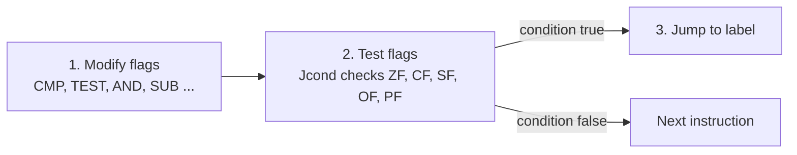
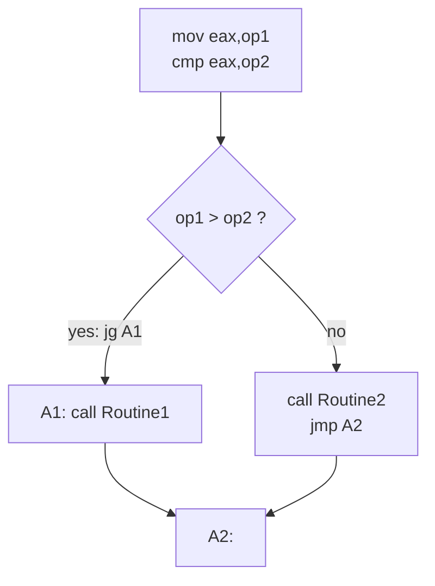
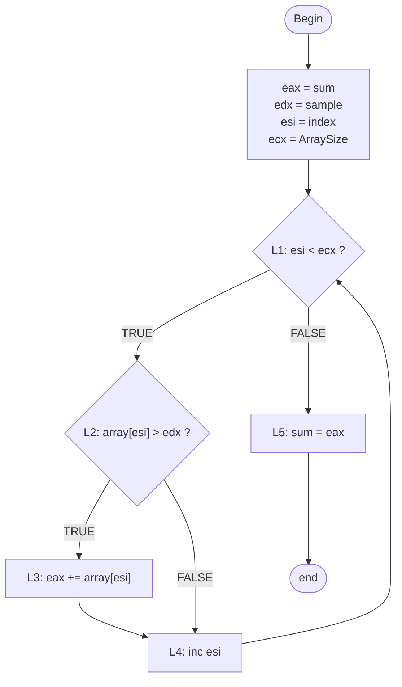
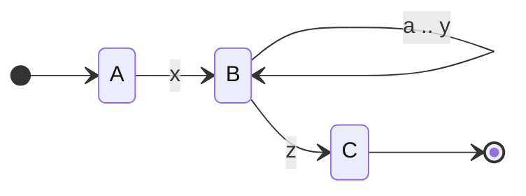
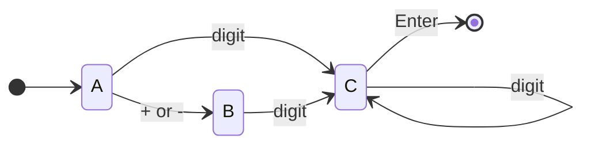

수업 자료 7장과 9장 밑에 참고(9장은 정처기?등 문제를 내면 이거 낼 것 같애)
14장 이렇게 문제낼수 있음~이라고 하심

# x86 어셈블리: 조건 처리 (Conditional Processing)


> Kip R. Irvine, *Assembly Language for x86 Processors* — Chapter 6. Conditional Processing 강의 정리
>
> 슬라이드 내용을 절 순서대로 정리하고, 슬라이드에 없는 동작 원리와 플래그 계산 과정, 추가 예제, 자주 하는 실수를 보충했다. 슬라이드에서 빠진 **64비트 모드의 불리언 명령어**(6.2.10절)와 **유한 상태 기계**(6.6절)도 교재를 바탕으로 넣었다.
> 마지막 슬라이드의 과제인 **복습 문제와 프로그래밍 연습**은 [부록 E](#부록-e-복습-문제-review-questions)와 [부록 F](#부록-f-프로그래밍-연습-풀이-포함)에 답과 풀이를 접어서 실었다.
> 슬라이드의 오류와 주의할 점은 본문에 상자로 표시하고 [부록 G](#부록-g-슬라이드-정정-사항-모음)에 모아 두었다.
> 예제 코드의 주석에 적힌 값, 점프를 하는지 안 하는지, 실행 결과는 직접 어셈블하고 실행해서 확인한 것이다([예제 값 확인 방법](#예제-값-확인-방법)).

---

## 한눈에 보기 (TL;DR)

- 어셈블리에는 if, while 같은 구조가 없다. **플래그를 바꾸는 명령어**(CMP, TEST, AND, SUB 등)와 **플래그를 보고 점프하는 명령어**(조건부 점프 Jcond)를 짝지어 만든다.
- `AND`는 비트를 지우고(마스크), `OR`는 비트를 켜고, `XOR`는 비트를 뒤집는다. 셋 다 CF와 OF를 0으로 만들고 결과에 따라 SF, ZF, PF를 정한다. `NOT`은 모든 비트를 뒤집지만 플래그는 바꾸지 않는다.
- `TEST`는 결과를 버리는 AND, `CMP`는 결과를 버리는 SUB다. 피연산자는 그대로 두고 플래그만 바꾼다.
- 부호 없는 비교는 CF와 ZF로 판단하고(JA, JAE, JB, JBE), 부호 있는 비교는 SF, OF, ZF로 판단한다(JG, JGE, JL, JLE). 같은 비트 패턴이라도 어느 점프를 쓰느냐에 따라 결과가 달라진다.
- `LOOPZ`/`LOOPE`는 ZF = 1인 동안, `LOOPNZ`/`LOOPNE`는 ZF = 0인 동안 ECX가 0이 될 때까지 반복한다.
- if문은 보통 **조건을 뒤집은 점프**로 then 블록을 건너뛰게 만든다. AND 조건과 OR 조건은 앞의 조건만으로 결과가 정해지면 뒤의 조건을 검사하지 않는다(단락 평가).
- 여러 갈래 중 하나를 고르는 코드는 "값과 프로시저 주소"의 표를 검색해서 처리할 수 있다(표 기반 선택).
- 유한 상태 기계는 상태와 전이로 입력을 검증한다. 상태 하나가 레이블 하나, 전이 하나가 점프 하나가 된다.
- MASM의 `.IF`, `.WHILE`, `.REPEAT` 디렉티브는 CMP와 조건부 점프를 대신 만들어 준다. 피연산자 중에 부호 있는 형(SDWORD 변수나 `SDWORD PTR`)이 있을 때만 부호 있는 점프를 만들고, 레지스터끼리는 부호 없는 비교가 된다. 64비트 MASM(ML64)에서는 쓸 수 없다.

---

## 목차

| 구분 | 내용 |
|---|---|
| [들어가며](#들어가며-5장에서-6장으로) | 5장과의 연결, C 언어의 조건문과 어셈블리의 대응 |
| [6.1 조건 분기](#61-조건-분기-conditional-branching) | 이 장의 큰 그림, 결정을 내리는 세 단계 |
| [6.2 불리언과 비교 명령어](#62-불리언과-비교-명령어-boolean-and-comparison-instructions) | 상태 플래그, AND, 대문자 변환, OR, 비트 맵 집합, XOR, 패리티, NOT, TEST, CMP, 플래그 직접 조작, 64비트 모드 |
| [6.3 조건부 점프](#63-조건부-점프-conditional-jumps) | Jcond, 네 가지 점프 그룹, 부호 있는 비교와 부호 없는 비교, 상태 비트 검사, 최댓값과 최솟값, 키 입력 대기, 배열 검색, 문자열 암호화 |
| [6.4 조건부 루프 명령어](#64-조건부-루프-명령어-conditional-loop-instructions) | LOOPZ/LOOPE, LOOPNZ/LOOPNE, 배열에서 값 찾기 |
| [6.5 조건 구조](#65-조건-구조-conditional-structures) | IF문, 화이트 박스 테스트, 복합 조건식, WHILE 루프, 루프 안의 IF, 표 기반 선택, 컴파일러의 번역 |
| [6.6 응용: 유한 상태 기계](#66-응용-유한-상태-기계-finite-state-machines) | 문자열 검증, 부호 있는 정수 검증 (슬라이드에 없는 절) |
| [6.7 조건부 제어 흐름 디렉티브](#67-조건부-제어-흐름-디렉티브-conditional-control-flow-directives) | .IF/.ELSEIF/.ELSE, 만들어지는 코드, 부호 있는 비교와 부호 없는 비교, 복합 조건, .REPEAT/.WHILE, .BREAK/.CONTINUE |
| [부록 A](#부록-a-명령어와-플래그-요약) | 명령어별 플래그 변화, 조건부 점프 전체 표, 디렉티브 요약 |
| [부록 B](#부록-b-조건부-점프의-기계어와-분기-없는-코드) | 조건부 점프의 기계어, 점프 거리, SETcc와 CMOVcc |
| [부록 C](#부록-c-자주-하는-실수와-오류-메시지) | 자주 하는 실수와 오류 메시지 |
| [부록 D](#부록-d-핵심-용어-정리) | 핵심 용어 정리 |
| [부록 E](#부록-e-복습-문제-review-questions) | 복습 문제: 단답형, 알고리즘 작성 (정답 접기) |
| [부록 F](#부록-f-프로그래밍-연습-풀이-포함) | 프로그래밍 연습 (풀이 포함) |
| [부록 G](#부록-g-슬라이드-정정-사항-모음) | 슬라이드 정정 사항 모음 |
| [참고 자료](#참고-자료) | 예제 값 확인 방법, 교재, 공식 문서 |

---

## 들어가며: 5장에서 6장으로

5장까지의 프로그램은 거의 위에서 아래로 한 줄씩 실행되었다. 흐름을 바꾸는 것은 `LOOP`와 `CALL`/`RET` 정도였다. 하지만 실제 프로그램은 입력이 올바른지 확인하고, 값의 크기에 따라 다른 일을 하고, 원하는 값을 찾을 때까지 반복해야 한다. 6장은 이렇게 **조건에 따라 실행 흐름을 바꾸는 방법**을 다룬다.

고급 언어의 조건문은 어셈블리에서 다음처럼 바뀐다.

| C 언어 | 어셈블리 (6장) | 설명 |
|---|---|---|
| `a & b`, `a \| b`, `a ^ b`, `~a` | `and`, `or`, `xor`, `not` | 비트 연산 (6.2) |
| `if (a == b) { ... }` | `cmp a,b` 다음 `jne` 로 블록을 건너뛴다 | 조건을 뒤집어 점프한다 (6.5) |
| `if (a > b)` (a, b가 `int`) | `cmp` 다음 `jle` | 부호 있는 비교 (6.3) |
| `if (a > b)` (a, b가 `unsigned`) | `cmp` 다음 `jbe` | 부호 없는 비교 (6.3) |
| `&&`, `\|\|` | 조건마다 CMP와 점프 | 단락 평가 (6.5) |
| `while (조건) { ... }` | 위에서 조건을 검사하고 끝에서 `jmp`로 돌아간다 | WHILE 루프 (6.5) |
| `do { ... } while (조건);` | 끝에서 조건을 검사한다 | `.REPEAT`/`.UNTIL` (6.7) |
| `switch (c) { case ... }` | 값과 주소의 표를 검색한다 | 표 기반 선택 (6.5) |
| `if`, `while`을 그대로 쓰고 싶다 | `.IF`, `.ELSEIF`, `.ELSE`, `.ENDIF`, `.WHILE` | MASM 디렉티브 (6.7) |

이 장은 다음 순서로 진행된다.

1. **불리언 명령어와 플래그** (6.2) — 비트를 다루는 AND, OR, XOR, NOT과 비교하는 TEST, CMP가 플래그를 어떻게 바꾸는지 본다.
2. **조건부 점프** (6.3, 6.4) — 플래그를 보고 점프하는 명령어들을 네 그룹으로 나누어 익힌다. 부호 있는 비교와 부호 없는 비교의 차이가 핵심이다.
3. **조건 구조** (6.5, 6.6) — if, AND/OR 조건, while, 여러 갈래 선택, 유한 상태 기계를 점프로 만든다.
4. **디렉티브** (6.7) — 같은 구조를 `.IF`, `.WHILE` 같은 MASM 디렉티브로 짧게 쓰고, 어셈블러가 어떤 코드를 만드는지 확인한다.

---

## 6.1 조건 분기 (Conditional Branching)

> Assembly language, as primitive as it is, provides all the tools you need for decision-making logic.

슬라이드 2의 첫 문장이다. 어셈블리는 원시적인 언어지만 결정을 내리는 데 필요한 도구는 모두 갖추고 있다는 뜻이다. 그 도구는 생각보다 단순하다. **값을 비교해서 플래그를 바꾸는 명령어**와 **플래그를 보고 점프하는 명령어**, 이 두 가지뿐이다. 고급 언어의 if, while, switch는 모두 이 두 가지의 조합으로 바뀐다.

슬라이드 2가 꼽은 이 장의 주제와, 각 주제를 다루는 곳은 다음과 같다.

| 슬라이드의 주제 | 내용 | 다루는 곳 |
|---|---|---|
| Boolean Operations | AND, OR, NOT 같은 불리언 연산으로 논리식을 계산한다 | 6.2 |
| IF Statements | IF문을 어셈블리로 쓰는 방법과 컴파일러가 IF문을 번역하는 방식 | 6.5, 6.7 |
| Bit Manipulation | 이진수의 특정 비트만 켜고 끄는 방법 | 6.2 |
| Data Encryption | XOR를 이용한 간단한 암호화 | 6.2, 6.3 |
| Signed vs Unsigned Numbers | 부호 있는 수와 부호 없는 수의 비교가 어떻게 다른가 | 6.2, 6.3, 6.7 |

### 결정을 내리는 세 단계

어셈블리에서 "만약 조건이 맞으면"은 언제나 다음 세 단계로 이루어진다(슬라이드 20).



1. **플래그를 바꾼다.** CMP, AND, SUB 같은 명령어가 계산 결과에 따라 상태 플래그를 정한다.
2. **플래그를 검사한다.** 조건부 점프 명령어가 원하는 플래그 조합인지 확인한다.
3. **점프한다.** 조건이 맞으면 지정한 레이블로 가고, 맞지 않으면 바로 다음 명령어를 실행한다.

가장 작은 예를 보자. EAX가 5보다 크면 EBX에 1을 넣는다.

```asm
    mov  eax,7
    cmp  eax,5                  ; 1단계: 7 - 5를 계산해 플래그만 바꾼다
    jg   Bigger                 ; 점프한다 (2, 3단계: 7 > 5이므로 Bigger로 간다)
    mov  ebx,0                  ; 실행되지 않는다
    jmp  Done
Bigger:
    mov  ebx,1                  ; EBX = 1
Done:
```

CMP는 결과를 저장하지 않고 플래그만 남긴다. JG(jump if greater)는 그 플래그가 "왼쪽이 더 크다"를 나타낼 때 점프한다. 이 장의 나머지는 결국 **1단계에 무엇을 쓰고, 2단계에 어떤 점프를 고르느냐**의 이야기다.

---
## 6.2 불리언과 비교 명령어 (Boolean and Comparison Instructions)

불리언 대수(Boolean algebra)의 기본 연산 AND, OR, XOR, NOT은 x86에서 같은 이름의 명령어로 제공된다. 이 명령어들은 두 피연산자의 **같은 위치에 있는 비트끼리** 연산한다. 여기에 결과를 저장하지 않고 플래그만 바꾸는 TEST와 CMP가 더해져 조건 처리의 1단계(플래그 바꾸기)를 담당한다.

| 명령어 | 하는 일 | 결과 | 플래그 |
|---|---|---|---|
| `AND` | 목적지와 원본의 비트별 AND | 목적지에 저장 | CF = 0, OF = 0, SF·ZF·PF는 결과대로 |
| `OR` | 비트별 OR | 목적지에 저장 | AND와 같다 |
| `XOR` | 비트별 배타적 OR | 목적지에 저장 | AND와 같다 |
| `NOT` | 모든 비트를 뒤집는다 | 목적지에 저장 | 바뀌지 않는다 |
| `TEST` | 비트별 AND를 계산하고 결과는 버린다 | 저장하지 않는다 | AND와 같다 |
| `CMP` | 목적지 − 원본을 계산하고 결과는 버린다 | 저장하지 않는다 | CF, OF, SF, ZF, AF, PF 모두 결과대로 |

위의 다섯 줄이 슬라이드 4의 Table 6-1(Selected Boolean Instructions)이고, 마지막 줄의 CMP는 이 절의 뒷부분에서 다룬다. AND, OR, XOR, TEST를 실행한 뒤의 AF(보조 올림 플래그)는 Intel 설명서에서 "정의되지 않음"(undefined)이다. 어떤 값이 될지 정해져 있지 않으니 AF를 보고 판단하면 안 된다.

### CPU 상태 플래그 (The CPU Status Flags)

불리언 명령어와 비교 명령어는 결과를 **상태 플래그**에 남긴다. 슬라이드 5가 정리한 다섯 플래그에 위치와 쓰임새를 덧붙이면 다음과 같다.

| 플래그 | EFLAGS 비트 | 1이 되는 경우 | 주로 쓰는 곳 |
|---|---|---|---|
| **CF** (Carry) | 0 | 부호 없는 연산에서 맨 위 비트 밖으로 올림이나 빌림이 생겼다 | 부호 없는 비교 (JB, JA) |
| **PF** (Parity) | 2 | 결과의 **하위 8비트**에 1인 비트가 짝수 개 | 패리티 검사 (JP, JNP) |
| **AF** (Auxiliary Carry) | 4 | 3번 비트에서 4번 비트로 올림이나 빌림이 생겼다 | BCD 연산 (이 장에서는 쓰지 않는다) |
| **ZF** (Zero) | 6 | 결과가 0이다 | 같은지 비교 (JE, JZ) |
| **SF** (Sign) | 7 | 결과의 맨 위 비트가 1이다 (부호 있는 수로 보면 음수) | JS, 부호 있는 비교 |
| **OF** (Overflow) | 11 | 부호 있는 수로 본 결과가 표현 범위를 넘었다 | 부호 있는 비교, JO |

```text
 EFLAGS (low 12 bits)

 bit:   11   10    9    8    7    6    5    4    3    2    1    0
      +----+----+----+----+----+----+----+----+----+----+----+----+
      | OF | DF | IF | TF | SF | ZF |  0 | AF |  0 | PF |  1 | CF |
      +----+----+----+----+----+----+----+----+----+----+----+----+
        ^                   ^    ^         ^         ^         ^
        status flags: OF, SF, ZF, AF, PF, CF        (DF = control flag, TF and IF = system flags)
```

조건 처리에서는 **어떤 명령어가 플래그를 바꾸고 어떤 명령어가 안 바꾸는지** 아는 것이 중요하다. CMP와 조건부 점프 사이에 플래그를 바꾸는 명령어가 끼면 비교 결과가 사라지기 때문이다.

| 구분 | 명령어 |
|---|---|
| 플래그를 결과에 따라 바꾼다 | ADD, SUB, CMP, NEG, AND, OR, XOR, TEST |
| CF만 그대로 두고 나머지를 바꾼다 | INC, DEC |
| 플래그를 바꾸지 않는다 | MOV, MOVZX, MOVSX, XCHG, LEA, PUSH, POP, NOT, JMP, 조건부 점프, LOOP, CALL, RET |

MOV는 플래그를 바꾸지 않으므로 CMP와 점프 사이에 넣어도 된다. 반대로 INC는 CF를 건드리지 않아서, 올림이 생겨도 CF로는 알 수 없다.

```asm
    mov  eax,5
    cmp  eax,5                  ; ZF = 1
    mov  ebx,100                ; ZF = 1   MOV는 플래그를 바꾸지 않는다
    je   Same                   ; 점프한다
    mov  ecx,1                  ; 실행되지 않는다
Same:
    mov  al,0FFh
    add  al,1                   ; AL = 0, ZF = 1, CF = 1   올림이 생겨 CF = 1
    mov  al,0FFh
    clc                         ; CF = 0
    inc  al                     ; AL = 0, ZF = 1, CF = 0   INC는 CF를 바꾸지 않는다
```

### AND 명령어 (AND Instruction)

AND는 두 피연산자의 같은 위치 비트끼리 AND를 계산해서 **목적지 피연산자**에 넣는다. 두 비트가 모두 1일 때만 1이 된다.

```text
AND destination,source
```

| 허용되는 형태 | 예 |
|---|---|
| `AND reg,reg` | `and eax,ebx` |
| `AND reg,mem` | `and al,status` |
| `AND reg,imm` | `and al,11110110b` |
| `AND mem,reg` | `and flags,al` |
| `AND mem,imm` | `and BYTE PTR [esi],11011111b` |

두 피연산자는 크기가 같아야 하고, **메모리끼리는 연산할 수 없다**. 이 규칙은 OR, XOR, TEST, CMP에도 똑같이 적용된다. 메모리 두 개를 다루려면 한쪽을 먼저 레지스터로 옮긴다.

| x | y | x AND y |
|:---:|:---:|:---:|
| 0 | 0 | 0 |
| 0 | 1 | 0 |
| 1 | 0 | 0 |
| 1 | 1 | 1 |

진리표를 비트 단위로 다시 읽으면 AND의 쓰임새가 보인다. **0과 AND하면 무조건 0, 1과 AND하면 원래 값 그대로**다. 그래서 지우고 싶은 자리에 0, 남기고 싶은 자리에 1을 둔 값을 만들어 AND하면 원하는 비트만 지울 수 있다. 이런 값을 **비트 마스크**(bit mask)라고 한다. 슬라이드 7의 그림은 마스크 00001111이 위쪽 4비트를 지우고 아래쪽 4비트를 그대로 남기는 모습이다.

```text
            0 0 1 1 1 0 1 1
     AND    0 0 0 0 1 1 1 1      <- mask
            ---------------
            0 0 0 0 1 0 1 1
            \_____/ \_____/
            cleared unchanged
```

슬라이드의 예제에 플래그를 함께 적으면 다음과 같다.

```asm
    mov  al,10101110b
    and  al,11110110b           ; AL = 10100110b, CF = 0, OF = 0, SF = 1, ZF = 0, PF = 1
```

결과의 맨 위 비트가 1이므로 SF = 1, 결과가 0이 아니므로 ZF = 0, 1인 비트가 4개(짝수)이므로 PF = 1이다. CF와 OF는 결과와 상관없이 항상 0이 된다.

> [!TIP]
> **AND로 할 수 있는 일**
>
> | 하고 싶은 일 | 코드 | 설명 |
> |---|---|---|
> | 특정 비트 지우기 | `and al,11110111b` | 3번 비트만 0으로 |
> | 일부 비트만 꺼내기 | `and eax,0FFh` | 하위 8비트만 남긴다 |
> | 2의 거듭제곱의 배수로 내리기 | `and ebx,0FFFFFFF0h` | 아래 4비트를 지우면 16의 배수 |
> | 2의 거듭제곱으로 나눈 나머지 | `and ecx,0Fh` | 아래 4비트가 16으로 나눈 나머지 |

```asm
    mov  eax,12345678h
    and  eax,0FFh               ; EAX = 00000078h   하위 8비트만 남는다
    mov  ebx,1037
    and  ebx,0FFFFFFF0h         ; EBX = 1024   16의 배수로 내림
    mov  ecx,1037
    and  ecx,0Fh                ; ECX = 13   1037을 16으로 나눈 나머지
```

### 문자를 대문자로 바꾸기 (Converting Characters to Upper Case)

ASCII 코드에서 소문자와 대문자는 **5번 비트 하나만 다르다**. 소문자는 5번 비트가 1이고 대문자는 0이다. 그 차이가 20h(32)이다.

| 문자 | 16진수 | 2진수 (5번 비트) |
|---|---|---|
| `'a'` | 61h | 0 1 **1** 0 0 0 0 1 |
| `'A'` | 41h | 0 1 **0** 0 0 0 0 1 |
| `'z'` | 7Ah | 0 1 **1** 1 1 0 1 0 |
| `'Z'` | 5Ah | 0 1 **0** 1 1 0 1 0 |

따라서 5번 비트만 0인 마스크 11011111b로 AND하면 소문자가 대문자가 된다(슬라이드 8). 배열의 모든 바이트에 차례로 적용하는 코드다.

```asm
.data
array BYTE 50 DUP(?)

.code
    mov  ecx,LENGTHOF array
    mov  esi,OFFSET array
L1: and  BYTE PTR [esi],11011111b   ; 5번 비트를 지운다
    inc  esi
    loop L1
```

`BYTE PTR`은 꼭 필요하다. `[esi]`만으로는 메모리 피연산자의 크기를 알 수 없고 즉시값 11011111b도 크기를 정해 주지 않으므로, 몇 바이트를 AND할지 어셈블러에게 알려야 한다.

> [!CAUTION]
> 이 방법은 배열에 **영문 소문자만** 있을 때 맞다. 소문자가 아닌 글자도 5번 비트가 지워져서 망가진다. 특히 공백(20h = 0010 0000)은 00h, 즉 문자열 끝 표시가 되어 버린다.

직접 확인해 보자. "abc xyz"에 위 방법을 그대로 쓰면 공백이 널 문자로 바뀌어 WriteString이 "ABC"까지만 출력한다.

```asm
; AND로 대문자 만들기: 소문자가 아닌 글자까지 바꾸면?
INCLUDE Irvine32.inc

.data
text BYTE "abc xyz",0

.code
main PROC
    mov  ecx,LENGTHOF text - 1      ; 널 문자를 뺀 7글자
    mov  esi,OFFSET text
L1: and  BYTE PTR [esi],11011111b   ; 5번 비트를 지운다
    inc  esi
    loop L1
    mov  edx,OFFSET text
    call WriteString                ; 공백이 00h가 되어 "ABC"에서 끝난다
    call Crlf
    exit
main ENDP
END main
```

```text
ABC
```

6.3절에서 배울 조건부 점프로 "소문자일 때만" 바꾸면 문제가 사라진다. `'a'`보다 작거나 `'z'`보다 크면 AND를 건너뛴다. 문자 코드는 음수가 아니므로 부호 없는 비교(JB, JA)를 쓴다.

```asm
; 소문자일 때만 대문자로 바꾸기
INCLUDE Irvine32.inc

.data
text BYTE "abc xyz 2025!",0

.code
main PROC
    mov  ecx,LENGTHOF text - 1
    mov  esi,OFFSET text
L1: mov  al,[esi]
    cmp  al,'a'
    jb   L2                         ; 'a'보다 작으면 소문자가 아니다
    cmp  al,'z'
    ja   L2                         ; 'z'보다 크면 소문자가 아니다
    and  BYTE PTR [esi],11011111b   ; 소문자만 대문자로
L2: inc  esi
    loop L1
    mov  edx,OFFSET text
    call WriteString
    call Crlf
    exit
main ENDP
END main
```

```text
ABC XYZ 2025!
```

### OR 명령어 (OR Instruction)

OR는 같은 위치 비트끼리 OR를 계산해서 목적지에 넣는다. 둘 중 하나라도 1이면 1이다. 허용되는 피연산자 형태와 플래그 규칙은 AND와 같다(CF = 0, OF = 0, SF·ZF·PF는 결과대로).

| x | y | x OR y |
|:---:|:---:|:---:|
| 0 | 0 | 0 |
| 0 | 1 | 1 |
| 1 | 0 | 1 |
| 1 | 1 | 1 |

**1과 OR하면 무조건 1, 0과 OR하면 원래 값 그대로**다. 그래서 OR는 원하는 비트를 켜는(set) 데 쓴다.

```text
            0 0 1 1 1 0 1 1
     OR     0 0 0 0 1 1 1 1      <- mask
            ---------------
            0 0 1 1 1 1 1 1
            \_____/ \_____/
           unchanged  set
```

```asm
    mov  al,11100011b
    or   al,00000100b           ; AL = 11100111b, CF = 0, OF = 0, SF = 1, ZF = 0, PF = 1
```

OR의 대표적인 쓰임새를 실행해 보면 다음과 같다.

```asm
    mov  al,5
    or   al,00110000b           ; AL = 35h   숫자 5가 문자 '5'(35h)가 된다
    mov  al,'G'
    or   al,00100000b           ; AL = 67h   'G'(47h)가 'g'(67h)가 된다
    mov  bl,-3
    or   bl,bl                  ; BL = 0FDh, ZF = 0, SF = 1   값은 그대로이고 음수이므로 SF = 1
```

- **0부터 9까지의 숫자를 ASCII 문자로**: 숫자 문자 `'0'`부터 `'9'`는 30h부터 39h이므로 4번, 5번 비트를 켜면(`or al,30h`) 숫자가 문자가 된다.
- **대문자를 소문자로**: 5번 비트를 켠다(`or al,20h`). AND로 대문자를 만든 것의 반대다.
- **값을 바꾸지 않고 부호와 0 여부 알아보기**: 자기 자신과 OR하면 값은 그대로지만 플래그가 정해진다.

| `or al,al` 뒤의 ZF | SF | AL의 값 (부호 있는 수로) |
|:---:|:---:|---|
| 0 | 0 | 0보다 크다 |
| 1 | 0 | 0이다 |
| 0 | 1 | 0보다 작다 |

같은 일을 `test al,al`로도 할 수 있다(TEST 절 참고). 요즘 컴파일러는 대부분 TEST를 쓴다.

### 비트 맵 집합 (Bit-Mapped Sets)

원소가 0부터 31까지의 작은 정수뿐인 집합은 DWORD 하나로 나타낼 수 있다. **n번 비트가 1이면 n이 집합의 원소**라고 약속하는 것이다. 이렇게 하면 원소 32개짜리 집합이 4바이트에 들어가고, 집합 연산이 명령어 하나로 끝난다. 이런 표현을 **비트 맵 집합**(bit-mapped set) 또는 비트 벡터(bit vector)라고 한다.

슬라이드 10의 SetX는 0, 1, 2, 31번 비트가 1이므로 원소가 0, 1, 2, 31인 집합이다.

```text
 bit:    31 30 29 28 ...  7  6  5  4  3  2  1  0
 SetX:    1  0  0  0 ...  0  0  0  0  0  1  1  1     -> { 0, 1, 2, 31 }
```

> [!WARNING]
> 슬라이드는 `SetX = 10000000 00000000 00000000 00000111`처럼 8비트마다 띄어 썼는데, 이것은 읽기 좋게 쓴 표기다. MASM은 숫자 중간의 공백을 허용하지 않으므로 실제 코드에서는 `10000000000000000000000000000111b`처럼 붙여 쓰고 끝에 `b`를 붙인다.

| 집합 연산 | 명령어 | 판단 방법 |
|---|---|---|
| 원소인지 확인 | `test` (또는 `and`) | 해당 비트만 1인 마스크와 연산해서 ZF = 0이면 원소 |
| 여집합 (complement) | `not` | 모든 비트를 뒤집는다 |
| 교집합 (intersection) | `and` | 두 집합에 모두 있는 원소 |
| 합집합 (union) | `or` | 어느 한쪽에라도 있는 원소 |
| 차집합 X − Y (보충) | Y를 `not`한 다음 `and` | X에만 있는 원소 |
| 대칭 차집합 (보충) | `xor` | 한쪽에만 있는 원소 |

슬라이드 10과 11의 예를 한 번에 실행해 본 결과다. SetY는 슬라이드 11의 비트열 그대로다.

```asm
SetX = 10000000000000000000000000000111b    ; 원소 0, 1, 2, 31
SetY = 10000010101000000000011101100011b    ; 원소 0, 1, 5, 6, 8, 9, 10, 21, 23, 25, 31

    mov  eax,SetX
    and  eax,10000b             ; ZF = 1   원소 4는 SetX에 없다 (슬라이드의 방법)
    mov  eax,SetX
    test eax,10000b             ; EAX = 80000007h, ZF = 1   TEST는 EAX를 바꾸지 않는다
    mov  eax,SetX
    not  eax                    ; EAX = 7FFFFFF8h   여집합
    mov  eax,SetX
    and  eax,SetY               ; EAX = 80000003h   교집합 { 0, 1, 31 }
    mov  eax,SetX
    or   eax,SetY               ; EAX = 82A00767h   합집합
    mov  ebx,SetY
    not  ebx
    mov  eax,SetX
    and  eax,ebx                ; EAX = 00000004h   차집합 SetX - SetY = { 2 }
    mov  eax,SetX
    xor  eax,SetY               ; EAX = 02A00764h   대칭 차집합
```

슬라이드의 `and eax,10000b`는 원소인지 확인한 다음 EAX의 원래 값을 잃어버린다. 같은 집합을 계속 검사하려면 값을 바꾸지 않는 TEST가 낫다. 슬라이드 11의 교집합과 합집합을 2진수로 놓고 보면 다음과 같다.

```text
          10000000000000000000000000000111    (SetX)
   AND    10000010101000000000011101100011    (SetY)
   ---------------------------------------
          10000000000000000000000000000011    (intersection = 80000003h)

          10000000000000000000000000000111    (SetX)
   OR     10000010101000000000011101100011    (SetY)
   ---------------------------------------
          10000010101000000000011101100111    (union = 82A00767h)
```

> [!NOTE]
> **보충: BT 명령어.** 비트 하나를 검사할 때는 마스크를 만들 필요 없이 `BT`(bit test)를 쓸 수도 있다. `bt eax,n`은 EAX의 n번 비트를 CF에 복사한다. 원소 번호가 변수에 들어 있을 때 특히 편하다(`bt eax,ecx`).
>
> ```asm
> SetX = 10000000000000000000000000000111b
>     mov  eax,SetX
>     bt   eax,31                 ; CF = 1   31번 비트를 CF에 복사한다
>     bt   eax,4                  ; CF = 0
> ```

### XOR 명령어 (XOR Instruction)

XOR(배타적 OR, exclusive-OR)는 두 비트가 **서로 다를 때만** 1이다. 결과는 목적지에 들어가고, 피연산자 형태와 플래그 규칙은 AND, OR와 같다.

| x | y | x ⊕ y |
|:---:|:---:|:---:|
| 0 | 0 | 0 |
| 0 | 1 | 1 |
| 1 | 0 | 1 |
| 1 | 1 | 0 |

**1과 XOR하면 뒤집히고, 0과 XOR하면 그대로**다. 그래서 XOR는 원하는 비트만 반전(toggle)할 때 쓴다.

```text
            0 0 1 1 1 0 1 1
     XOR    0 0 0 0 1 1 1 1      <- mask
            ---------------
            0 0 1 1 0 1 0 0
            \_____/ \_____/
           unchanged inverted
```

슬라이드 12의 두 번째 진리표는 XOR의 가장 중요한 성질을 보여 준다. 어떤 값 x를 y로 XOR한 다음 **같은 y로 한 번 더 XOR하면 원래의 x로 돌아온다**.

| x | y | x ⊕ y | (x ⊕ y) ⊕ y |
|:---:|:---:|:---:|:---:|
| 0 | 0 | 0 | 0 |
| 0 | 1 | 1 | 0 |
| 1 | 0 | 1 | 1 |
| 1 | 1 | 0 | 1 |

마지막 열이 첫 열 x와 똑같다. y를 비밀 키로 쓰면 첫 번째 XOR가 암호화, 두 번째 XOR가 복호화가 된다. 6.3절의 문자열 암호화 프로그램이 이 성질을 이용한다.

```asm
    mov  al,00111011b
    xor  al,00001111b           ; AL = 00110100b   아래 4비트만 뒤집힌다
    xor  al,00001111b           ; AL = 00111011b   한 번 더 하면 원래 값
    mov  al,'a'
    xor  al,00100000b           ; AL = 41h   'a'가 'A'가 된다
    xor  al,00100000b           ; AL = 61h   다시 'a'로 (대소문자 전환)
    mov  eax,12345678h
    xor  eax,eax                ; EAX = 0, ZF = 1, CF = 0, OF = 0
```

| XOR의 쓰임새 | 코드 | 설명 |
|---|---|---|
| 비트 뒤집기 | `xor al,00001111b` | 마스크가 1인 자리만 반전 |
| 레지스터를 0으로 | `xor eax,eax` | 기계어가 2바이트(`33 C0`)로 `mov eax,0`(5바이트)보다 짧다. 단, 플래그가 바뀐다 |
| 대소문자 바꾸기 | `xor al,20h` | 5번 비트를 반전 |
| 두 값이 같은지 | `xor eax,ebx` | 같으면 결과가 0이라 ZF = 1 (EAX 값은 바뀐다) |
| 간단한 암호화 | `xor buffer[esi],KEY` | 6.3절 Encrypt.asm |

> [!NOTE]
> **보충: 임시 변수 없이 두 값 바꾸기.** XOR를 세 번 쓰면 두 레지스터의 값을 맞바꿀 수 있다. 원리를 이해하는 재미로 알아 두자. 실제로는 XCHG 한 번이 더 간단하다.
>
> ```asm
>     mov  eax,5
>     mov  ebx,9
>     xor  eax,ebx                ; EAX = 12
>     xor  ebx,eax                ; EBX = 5
>     xor  eax,ebx                ; EAX = 9
> ```

### 패리티 플래그 확인 (Checking the Parity Flag)

**패리티**(parity)는 1인 비트의 개수가 짝수인지 홀수인지를 말한다. 1이 짝수 개면 짝수 패리티(even parity), 홀수 개면 홀수 패리티(odd parity)다. 데이터를 보내거나 저장할 때 오류를 찾아내는 데 쓰인다(부록 F의 연습 9).

PF는 연산 결과의 **하위 8비트만** 보고 1이 짝수 개면 1이 된다. 값을 바꾸지 않고 PF만 정하고 싶으면 **0과 XOR**하면 된다(슬라이드 13). 0과 XOR해도 값은 그대로이기 때문이다.

```asm
    mov  al,10110101b           ; 1이 5개 (홀수)
    xor  al,0                   ; PF = 0   홀수 패리티
    mov  al,11001100b           ; 1이 4개 (짝수)
    xor  al,0                   ; PF = 1   짝수 패리티
    mov  ax,64C1h               ; 0110 0100 1100 0001 (1이 6개)
    xor  ah,al                  ; PF = 1   16비트 전체로도 짝수 패리티
```

마지막 두 줄은 PF가 8비트만 본다는 한계를 넘는 방법이다. 위 바이트와 아래 바이트를 XOR한 결과의 패리티는 16비트 전체의 패리티와 같다. 같은 자리의 두 비트가 모두 1이면 XOR 결과에서 둘 다 사라지는데, 1이 두 개씩 사라지면 짝수와 홀수는 바뀌지 않기 때문이다.

```text
 AX = 64C1h   =  0110 0100   1100 0001     six 1 bits  -> even
                    AH          AL
 AH XOR AL    =  1010 0101                 four 1 bits -> even, PF = 1
```

같은 원리로 32비트 값의 패리티도 바이트 네 개를 차례로 XOR하면 구할 수 있다.

```asm
.data
val DWORD 12345678h                 ; 1이 13개
.code
    mov  al,BYTE PTR val            ; AL = 78h
    xor  al,BYTE PTR val+1          ; AL = 2Eh   78h XOR 56h
    xor  al,BYTE PTR val+2          ; AL = 1Ah   2Eh XOR 34h
    xor  al,BYTE PTR val+3          ; AL = 08h, PF = 0   32비트 전체에 1이 홀수 개
```

PF를 보고 점프하는 명령어는 JP(= JPE, jump if parity even)와 JNP(= JPO, jump if parity odd)다.

### NOT 명령어 (NOT Instruction)

NOT은 피연산자의 모든 비트를 뒤집는다. 그 결과를 **1의 보수**(one's complement)라고 한다. 피연산자는 하나이고 레지스터나 메모리만 올 수 있다.

```text
NOT reg
NOT mem
```

```text
     NOT    0 0 1 1 1 0 1 1
            ---------------
            1 1 0 0 0 1 0 0      <- inverted
```

**NOT은 플래그를 하나도 바꾸지 않는다.** 결과가 0이 아니어도 ZF가 그대로 남는 것을 확인해 보자.

```asm
    mov  al,11110000b
    not  al                     ; AL = 00001111b
    xor  eax,eax                ; ZF = 1
    stc                         ; CF = 1
    not  eax                    ; EAX = 0FFFFFFFFh, ZF = 1, CF = 1   NOT은 플래그를 바꾸지 않는다
```

NOT과 비슷한 명령어로 NEG(4장)가 있다. NEG는 **2의 보수**를 만들어 부호를 바꾼다. 2의 보수는 1의 보수에 1을 더한 값이므로 `NEG x`는 `NOT x` 다음에 `INC x`를 한 것과 같은 값이 된다. 다만 플래그는 다르다. 특히 NEG는 피연산자가 0이 아니면 CF = 1로 만들지만, NOT은 플래그를 바꾸지 않고 INC는 CF를 바꾸지 않는다.

```asm
    mov  bl,5
    not  bl                     ; BL = 0FAh   부호 있는 수로 -6
    inc  bl                     ; BL = 0FBh   -5 (1의 보수 + 1 = 2의 보수)
    mov  cl,5
    neg  cl                     ; CL = 0FBh   NEG는 한 번에 2의 보수를 만든다
```

### TEST 명령어 (TEST Instruction)

TEST는 두 피연산자의 비트별 AND를 계산해서 **플래그만 바꾸고 결과는 버린다**. AND와 다른 점은 목적지 피연산자를 바꾸지 않는다는 것 하나뿐이다. 플래그는 AND와 똑같이 CF = 0, OF = 0, SF·ZF·PF는 결과대로 정해진다.

TEST는 특정 비트가 1인지 알아볼 때 쓴다. 검사할 자리만 1인 마스크로 TEST하면, 그 자리 중 하나라도 1이면 결과가 0이 아니라서 ZF = 0이 되고, 모두 0이면 ZF = 1이 된다(슬라이드 15).

```text
  0 0 1 0 0 1 0 1   <- input value          0 0 1 0 0 1 0 0   <- input value
  0 0 0 0 1 0 0 1   <- test value           0 0 0 0 1 0 0 1   <- test value
  0 0 0 0 0 0 0 1   <- result: ZF = 0       0 0 0 0 0 0 0 0   <- result: ZF = 1
```

```asm
    mov  al,00100101b
    test al,00001001b           ; AL = 00100101b, ZF = 0   0번 비트가 1이다 (AL은 그대로)
    mov  al,00100100b
    test al,00001001b           ; ZF = 1   0번과 3번 비트가 모두 0이다
    mov  eax,7
    test eax,1                  ; ZF = 0   0번 비트가 1이면 홀수
    test eax,eax                ; ZF = 0, SF = 0   자기 자신과 TEST하면 0인지, 음수인지 알 수 있다
```

> [!IMPORTANT]
> TEST로 여러 비트를 검사하면 "그중 **하나라도** 1인가"를 알 수 있다. "**모두** 1인가"는 TEST로 알 수 없다. 그때는 AND로 해당 비트만 남긴 다음 마스크와 CMP로 비교한다(6.3절의 상태 비트 검사).
>
> | 알고 싶은 것 | 코드 | 판단 |
> |---|---|---|
> | 0번이나 3번 비트 중 하나라도 1인가 | `test al,00001001b` | ZF = 0이면 그렇다 |
> | 0번과 3번 비트가 모두 0인가 | `test al,00001001b` | ZF = 1이면 그렇다 |
> | 0번과 3번 비트가 모두 1인가 | `and al,00001001b` 다음 `cmp al,00001001b` | ZF = 1이면 그렇다 |

### CMP 명령어 (CMP Instruction)

CMP(compare)는 **목적지 − 원본**을 계산해 보고 결과는 버린다. 두 피연산자는 바뀌지 않고, 실제로 뺄셈을 했을 때와 똑같이 OF, SF, ZF, CF, AF, PF가 정해진다. 고급 언어의 비교식은 거의 모두 CMP로 바뀐다(슬라이드 16).

```text
CMP destination,source

if A > B ...                        ->  cmp A,B
while X > 0 and X < 200 ...         ->  cmp X,0  /  cmp X,200
if check_for_error( N ) = true      ->  call ...  /  cmp eax,TRUE
```

피연산자 규칙은 SUB와 같다. 레지스터나 메모리를 레지스터, 메모리, 즉시값과 비교할 수 있지만, 메모리끼리는 비교할 수 없고 즉시값이 첫 번째 피연산자가 될 수도 없다(`cmp 5,eax`는 오류).

뺄셈 결과에서 두 수의 관계를 읽는 방법은 수를 부호 없는 수로 보느냐 부호 있는 수로 보느냐에 따라 다르다.

| CMP 결과 (부호 없는 비교) | ZF | CF |
|---|:---:|:---:|
| 목적지 < 원본 | 0 | 1 |
| 목적지 > 원본 | 0 | 0 |
| 목적지 = 원본 | 1 | 0 |

| CMP 결과 (부호 있는 비교) | 플래그 |
|---|---|
| 목적지 < 원본 | SF ≠ OF |
| 목적지 > 원본 | SF = OF 이고 ZF = 0 |
| 목적지 = 원본 | ZF = 1 |

> [!NOTE]
> 슬라이드 16의 부호 있는 비교 표는 "목적지 > 원본"을 `SF = OF`라고만 적었다. 두 값이 같을 때도 결과가 0이라 SF = 0, OF = 0이 되어 SF = OF가 성립하므로, "크다"를 정확히 판단하려면 **ZF = 0**도 함께 봐야 한다. SF = OF만 보면 "크거나 같다"가 된다. JG가 `ZF = 0 이고 SF = OF`, JGE가 `SF = OF`로 판단하는 이유다(6.3절).

슬라이드 17의 예제를 실행한 결과다.

```asm
    mov  ax,5
    cmp  ax,10                  ; ZF = 0, CF = 1   5 < 10
    mov  ax,1000
    mov  cx,1000
    cmp  cx,ax                  ; ZF = 1, CF = 0   같다
    mov  si,105
    cmp  si,0                   ; ZF = 0, CF = 0   105 > 0
```

**왜 부호 있는 비교는 SF ≠ OF로 판단할까?** 뺄셈 결과가 범위를 넘지 않으면 결과의 부호(SF)가 곧 답이다. 결과가 음수면 목적지가 작다. 그런데 범위를 넘으면(OF = 1) 결과의 부호가 거꾸로 뒤집혀 나온다. 그래서 "SF가 1이고 넘침이 없다" 또는 "SF가 0이지만 넘침이 있다", 즉 SF와 OF가 다를 때가 "작다"이다. 8비트로 네 경우를 실행해 보면 확실해진다.

```asm
    mov  al,5
    cmp  al,10                  ; SF = 1, OF = 0, CF = 1   5 - 10 = -5 (넘침 없음)
    mov  al,10
    cmp  al,5                   ; SF = 0, OF = 0, CF = 0   10 - 5 = 5
    mov  al,-128
    cmp  al,1                   ; SF = 0, OF = 1, CF = 0   -128 - 1 = -129는 범위를 넘어 7Fh가 된다
    mov  al,127
    cmp  al,-1                  ; SF = 1, OF = 1, CF = 1   127 - (-1) = 128은 범위를 넘어 80h가 된다
```

| 비교 | 뺄셈 결과 | SF | OF | SF ≠ OF | 실제 관계 (부호 있는 수) |
|---|---|:---:|:---:|:---:|---|
| 5 vs 10 | FBh | 1 | 0 | 예 | 5 < 10 |
| 10 vs 5 | 05h | 0 | 0 | 아니요 | 10 > 5 |
| −128 vs 1 | 7Fh | 0 | 1 | 예 | −128 < 1 |
| 127 vs −1 | 80h | 1 | 1 | 아니요 | 127 > −1 |

SF만 보면 세 번째와 네 번째 줄에서 답이 틀린다. 마지막 줄은 CF = 1이라는 점도 눈여겨보자. 부호 없는 수로 보면 7Fh(127)는 FFh(255)보다 작기 때문이다. **같은 CMP가 부호 없는 수로는 "작다", 부호 있는 수로는 "크다"를 동시에 알려 주고, 어느 쪽을 쓸지는 다음에 오는 점프가 정한다.**

### 플래그 하나씩 켜고 끄기 (Setting and Clearing Individual CPU Flags)

특정 플래그를 원하는 값으로 만드는 방법을 모았다(슬라이드 18). CF는 전용 명령어가 있지만 나머지는 불리언 명령어의 성질을 이용한다.

```asm
    test al,0                   ; ZF = 1   0과 AND한 결과는 항상 0
    and  al,0                   ; ZF = 1, AL = 0   ZF는 1이 되지만 AL이 지워진다
    or   al,1                   ; ZF = 0, AL = 1   결과가 0이 아니므로 ZF = 0
    or   al,80h                 ; SF = 1, AL = 81h   맨 위 비트를 켠다
    and  al,7Fh                 ; SF = 0, AL = 1   맨 위 비트를 끈다
    stc                         ; CF = 1
    clc                         ; CF = 0
    mov  al,7Fh                 ; AL = 7Fh   +127
    inc  al                     ; AL = 80h, OF = 1   +127 + 1은 -128이 된다 (부호 있는 넘침)
    or   eax,0                  ; OF = 0   불리언 명령어는 항상 OF = 0으로 만든다
```

| 플래그 | 1로 만들기 | 0으로 만들기 | 주의 |
|---|---|---|---|
| CF | `stc` | `clc` | `cmc`는 뒤집는다 |
| ZF | `test al,0` | `or al,1` | OR는 AL을 바꾼다 |
| SF | `or al,80h` | `and al,7Fh` | 둘 다 AL을 바꾼다 |
| OF | 넘침이 나는 연산 (`mov al,7Fh` 다음 `inc al`) | `or eax,0` 같은 불리언 명령어 | 불리언 명령어는 CF도 0으로 만든다 |
| DF (방향) | `std` | `cld` | 문자열 명령어에서 쓴다 (9장) |
| IF (인터럽트) | `sti` | `cli` | Windows 사용자 프로그램에서는 쓸 수 없다 (5장 부록 B) |

### 64비트 모드의 불리언 명령어 (Boolean Instructions in 64-Bit Mode)

슬라이드 19는 제목만 있고 내용이 비어 있다. 교재 6.2.10절의 내용을 보충한다.

64비트 모드에서도 AND, OR, XOR, NOT, TEST, CMP는 32비트 모드와 똑같이 동작하고, RAX 같은 64비트 레지스터와 QWORD 메모리를 피연산자로 쓸 수 있다. 다만 다음 세 가지 규칙 때문에 결과가 예상과 다를 수 있다.

1. **즉시값은 최대 32비트이고, 64비트 피연산자와 연산할 때 부호 확장된다.** `and rax,80808080h`의 상수는 맨 위 비트(31번)가 1이므로 FFFFFFFF80808080h로 늘어난다. 반대로 31번 비트가 0인 상수는 위쪽 32비트가 0으로 채워진다.
2. **32비트 레지스터에 결과를 쓰면 64비트 레지스터의 위쪽 32비트가 0이 된다.** `and eax,...`를 실행하면 RAX의 위쪽 절반이 지워진다.
3. **8비트, 16비트 레지스터에 쓰면 나머지 비트는 그대로다.** `and ax,...`는 RAX의 위쪽 48비트를 건드리지 않는다.

```asm
.data
allones QWORD 0FFFFFFFFFFFFFFFFh
.code
    mov  rax,allones
    and  rax,80h                ; RAX = 0000000000000080h
    mov  rax,allones
    and  rax,808080h            ; RAX = 0000000000808080h
    mov  rax,allones
    and  rax,80808080h          ; RAX = FFFFFFFF80808080h   상수가 FFFFFFFF80808080h로 부호 확장된다
    mov  rax,allones
    and  rax,7FFFFFFFh          ; RAX = 000000007FFFFFFFh   31번 비트가 0인 상수는 위쪽이 0으로 채워진다
    mov  rax,allones
    and  eax,80808080h          ; RAX = 0000000080808080h   32비트 연산은 위쪽 32비트를 0으로 만든다
    mov  rax,allones
    and  ax,8080h               ; RAX = FFFFFFFFFFFF8080h   16비트 연산은 나머지 비트를 건드리지 않는다
```

> [!NOTE]
> 교재의 예제 프로그램(BooleanOps.asm)은 `and rax,80808080h`에 "하위 32비트에만 영향을 준다"(affects lower 32 bits)라는 주석을 달았다. 결과만 보면 맞지만 이유는 **상수가 부호 확장되어 위쪽 32비트가 모두 1인 마스크가 되었기 때문**이다. 위의 `and rax,7FFFFFFFh`처럼 31번 비트가 0인 상수를 쓰면 위쪽 32비트가 지워진다. 64비트 마스크가 꼭 필요하면 먼저 `mov rbx,상수`로 64비트 레지스터에 넣고 `and rax,rbx`처럼 레지스터끼리 연산하자.

---
## 6.3 조건부 점프 (Conditional Jumps)

### 조건 구조 (Conditional Structures)

x86 명령어 집합에는 if나 while 같은 고급 논리 구조가 따로 없다. 대신 **비교와 점프를 조합**해서 어떤 구조든 만들 수 있다(슬라이드 20). 6.1절에서 본 세 단계, 즉 플래그를 바꾸고, 플래그를 검사하고, 조건이 맞으면 점프하는 과정이 모든 조건 구조의 바탕이다.

슬라이드 21의 두 예제를 실제 값으로 실행해 보자. 첫 번째는 CMP로, 두 번째는 AND로 플래그를 바꾼다.

```asm
    mov  eax,0
    cmp  eax,0                  ; ZF = 1
    jz   L1                     ; 점프한다 (JZ는 ZF가 1이면 점프)
    mov  ebx,1                  ; 실행되지 않는다
L1:
    mov  dl,01001111b
    and  dl,10110000b           ; DL = 0, ZF = 1   4, 5, 7번 비트가 모두 0이었다
    jnz  L2                     ; 점프하지 않는다 (JNZ는 ZF가 0일 때만 점프)
    mov  ecx,2                  ; ECX = 2
L2:
```

두 번째 예제는 "DL의 4, 5, 7번 비트 중 하나라도 1이면 L2로 간다"는 뜻이다. 플래그를 바꾸는 명령어가 CMP가 아니어도 된다는 점을 기억하자. AND, SUB, INC처럼 플래그를 바꾸는 명령어라면 무엇이든 조건부 점프 앞에 올 수 있다.

### Jcond 명령어 (Jcond Instruction)

**조건부 점프 명령어**는 상태 플래그가 정해진 조건을 만족하면 목적지 레이블로 분기한다(슬라이드 22). 조건을 만족하지 않으면 아무 일도 하지 않고 바로 다음 명령어로 넘어간다. 교재는 이런 명령어들을 통틀어 Jcond라고 부른다. cond 자리에 조건을 나타내는 글자가 들어간다.

```text
Jcond destination
```

| 명령어 | 뜻 | 점프하는 조건 |
|---|---|---|
| `JC` | Jump if carry | CF = 1 |
| `JNC` | Jump if not carry | CF = 0 |
| `JZ` | Jump if zero | ZF = 1 |
| `JNZ` | Jump if not zero | ZF = 0 |

조건부 점프에 대해 알아 둘 점이 세 가지 있다.

- **조건부 점프는 플래그를 바꾸지 않는다.** 그래서 CMP 하나 뒤에 조건부 점프를 여러 개 이어 놓고 같은 플래그를 여러 번 검사할 수 있다. 아래 예제들이 이 성질을 이용한다.
- **목적지는 보통 같은 프로시저 안의 레이블**이다. 5장에서 본 것처럼 프로시저 안의 레이블은 그 프로시저 안에서만 보인다.
- **점프 거리는 어셈블러가 알아서 정한다.** 32비트 모드의 조건부 점프는 가까운 곳(−128부터 +127바이트)이면 2바이트짜리 짧은 점프로, 먼 곳이면 6바이트짜리 점프로 어셈블된다. 자세한 기계어는 [부록 B](#부록-b-조건부-점프의-기계어와-분기-없는-코드)에 있다.

### CMP 명령어와 함께 쓰기 (Using the CMP Instruction)

조건부 점프는 대개 CMP 바로 뒤에 온다. 슬라이드 23의 세 예제를 이어서 실행한 결과다. 레이블 이름만 겹치지 않게 바꾸었다.

```asm
    mov  eax,5
    cmp  eax,5
    je   L1                     ; 점프한다 (같으면 점프)
    nop                         ; 실행되지 않는다
L1: mov  ax,5
    cmp  ax,6
    jl   L2                     ; 점프한다 (5 < 6)
    nop                         ; 실행되지 않는다
L2: mov  ax,5
    cmp  ax,4
    jg   L3                     ; 점프한다 (5 > 4)
    nop                         ; 실행되지 않는다
L3:
```

> [!TIP]
> **읽는 법.** `cmp a,b` 다음의 조건부 점프는 "**a** (조건) **b**이면 점프"로 읽는다. `cmp ax,6` 다음 `jl`은 "AX < 6이면", `cmp ax,4` 다음 `jg`는 "AX > 4이면"이다. CMP의 피연산자 순서를 바꾸면 조건도 반대로 바뀌므로 순서에 주의하자.

### 조건부 점프의 종류 (Types of Conditional Jump Instructions)

x86의 조건부 점프는 무엇을 기준으로 판단하느냐에 따라 네 그룹으로 나눌 수 있다(슬라이드 24).

| 그룹 | 판단 기준 | 표 |
|---|---|---|
| 1. 플래그 값 | 특정 플래그 하나가 0인지 1인지 | Table 6-2 |
| 2. 같음 | 두 피연산자가 같은지, 또는 CX/ECX/RCX가 0인지 | Table 6-3 |
| 3. 부호 없는 비교 | 두 피연산자를 부호 없는 수로 비교 | Table 6-4 |
| 4. 부호 있는 비교 | 두 피연산자를 부호 있는 수로 비교 | Table 6-5 |

**Table 6-2. 특정 플래그 값에 따른 점프** (슬라이드 25)

| 명령어 | 뜻 | 조건 |
|---|---|---|
| `JZ` | Jump if zero | ZF = 1 |
| `JNZ` | Jump if not zero | ZF = 0 |
| `JC` | Jump if carry | CF = 1 |
| `JNC` | Jump if not carry | CF = 0 |
| `JO` | Jump if overflow | OF = 1 |
| `JNO` | Jump if not overflow | OF = 0 |
| `JS` | Jump if signed (부호 플래그가 1, 즉 음수) | SF = 1 |
| `JNS` | Jump if not signed | SF = 0 |
| `JP` | Jump if parity (even) | PF = 1 |
| `JNP` | Jump if not parity (odd) | PF = 0 |

**Table 6-3. 같음에 따른 점프** (슬라이드 26)

| 명령어 | 뜻 | 실제로 검사하는 것 |
|---|---|---|
| `JE` | Jump if equal (*leftOp* = *rightOp*) | ZF = 1 (JZ와 같은 명령어) |
| `JNE` | Jump if not equal (*leftOp* ≠ *rightOp*) | ZF = 0 (JNZ와 같은 명령어) |
| `JCXZ` | Jump if CX = 0 | 플래그가 아니라 CX 레지스터 |
| `JECXZ` | Jump if ECX = 0 | ECX 레지스터 |
| `JRCXZ` | Jump if RCX = 0 (64비트 모드) | RCX 레지스터 |

JCXZ, JECXZ, JRCXZ는 플래그를 보지 않고 레지스터 값을 직접 검사한다. 루프에 들어가기 전에 카운터가 0인지 확인하는 데 주로 쓴다. ECX = 0인 채로 LOOP에 들어가면 2³²번 반복하기 때문이다(4장). 이 세 명령어는 짧은 점프(−128부터 +127바이트)만 할 수 있다.

**Table 6-4. 부호 없는 비교에 따른 점프** (슬라이드 28)

| 명령어 | 뜻 | 플래그 조건 |
|---|---|---|
| `JA` | Jump if above (*leftOp* > *rightOp*) | CF = 0 이고 ZF = 0 |
| `JNBE` | Jump if not below or equal (JA와 같다) | |
| `JAE` | Jump if above or equal (*leftOp* ≥ *rightOp*) | CF = 0 |
| `JNB` | Jump if not below (JAE와 같다) | |
| `JB` | Jump if below (*leftOp* < *rightOp*) | CF = 1 |
| `JNAE` | Jump if not above or equal (JB와 같다) | |
| `JBE` | Jump if below or equal (*leftOp* ≤ *rightOp*) | CF = 1 또는 ZF = 1 |
| `JNA` | Jump if not above (JBE와 같다) | |

**Table 6-5. 부호 있는 비교에 따른 점프** (슬라이드 29)

| 명령어 | 뜻 | 플래그 조건 |
|---|---|---|
| `JG` | Jump if greater (*leftOp* > *rightOp*) | ZF = 0 이고 SF = OF |
| `JNLE` | Jump if not less than or equal (JG와 같다) | |
| `JGE` | Jump if greater than or equal (*leftOp* ≥ *rightOp*) | SF = OF |
| `JNL` | Jump if not less (JGE와 같다) | |
| `JL` | Jump if less (*leftOp* < *rightOp*) | SF ≠ OF |
| `JNGE` | Jump if not greater than or equal (JL과 같다) | |
| `JLE` | Jump if less than or equal (*leftOp* ≤ *rightOp*) | ZF = 1 또는 SF ≠ OF |
| `JNG` | Jump if not greater (JLE와 같다) | |

> [!TIP]
> **이름 외우는 법.** 이름에 **A**(above), **B**(below)가 있으면 부호 없는 비교, **G**(greater), **L**(less)가 있으면 부호 있는 비교다. **E**는 equal(같다), **N**은 not이다. `JNBE`는 "not below or equal", 즉 "above"이므로 JA와 같다.
>
> 표에서 "(JA와 같다)"처럼 표시한 명령어들은 이름만 다르고 **기계어가 완전히 같다**. 예를 들어 JE와 JZ는 둘 다 `74`로 시작한다. 그래서 디버거의 디스어셈블리 창에서는 소스에 쓴 이름과 다른 이름이 보일 수 있다(`jnbe`라고 썼는데 `ja`로 표시되는 식).

### 같은지 비교하는 점프의 예 (Equality Comparisons)

슬라이드 27의 네 예제를 이어서 실행했다. 두 번째 예제처럼 CMP 대신 SUB의 결과로 점프해도 된다. 세 번째 예제는 CX가 FFFFh에서 1 늘어나 16비트를 넘으면서 0이 되는 경우다.

```asm
; 예 1: CMP로 같은지 비교한다
    mov  edx,0A523h
    cmp  edx,0A523h
    jne  NotEq1                 ; 점프하지 않는다
    je   L1                     ; 점프한다
NotEq1:
    mov  eax,1                  ; 실행되지 않는다
L1:
; 예 2: SUB의 결과로도 점프할 수 있다
    mov  bx,1234h
    sub  bx,1234h               ; BX = 0, ZF = 1
    jne  NotEq2                 ; 점프하지 않는다
    je   L2                     ; 점프한다
NotEq2:
    mov  eax,2                  ; 실행되지 않는다
L2:
; 예 3: CX가 0인가
    mov  cx,0FFFFh
    inc  cx                     ; CX = 0   FFFFh + 1은 16비트를 넘어 0이 된다
    jcxz L3                     ; 점프한다
    mov  eax,3                  ; 실행되지 않는다
L3:
; 예 4: ECX가 0인가
    xor  ecx,ecx                ; ECX = 0
    jecxz L4                    ; 점프한다
    mov  eax,4                  ; 실행되지 않는다
L4:
```

### 부호 있는 비교의 예 (Signed Comparisons)

슬라이드 30의 네 예제다. 첫 번째 예제에서 -1은 FFFFFFFFh로 저장되므로 부호 없는 수로 보면 아주 큰 수다. 하지만 JNL, JNLE, JL은 부호 있는 비교라서 -1 < 0으로 판단한다.

```asm
; 예 1
    mov  edx,-1
    cmp  edx,0
    jnl  Skip1                  ; 점프하지 않는다 (-1 >= 0은 거짓)
    jnle Skip1                  ; 점프하지 않는다 (-1 > 0은 거짓)
    jl   L1                     ; 점프한다 (-1 < 0은 참)
Skip1:
    mov  eax,1                  ; 실행되지 않는다
L1:
; 예 2
    mov  bx,+32
    cmp  bx,-35
    jng  Skip2                  ; 점프하지 않는다 (+32 <= -35는 거짓)
    jnge Skip2                  ; 점프하지 않는다 (+32 < -35는 거짓)
    jge  L2                     ; 점프한다 (+32 >= -35는 참)
Skip2:
    mov  eax,2                  ; 실행되지 않는다
L2:
; 예 3
    mov  ecx,0
    cmp  ecx,0
    jg   Skip3                  ; 점프하지 않는다 (0 > 0은 거짓)
    jnl  L3                     ; 점프한다 (0 >= 0은 참)
Skip3:
    mov  eax,3                  ; 실행되지 않는다
L3:
; 예 4
    mov  ecx,0
    cmp  ecx,0
    jl   Skip4                  ; 점프하지 않는다 (0 < 0은 거짓)
    jng  L4                     ; 점프한다 (0 <= 0은 참)
Skip4:
    mov  eax,4                  ; 실행되지 않는다
L4:
```

### 부호 있는 비교와 부호 없는 비교는 무엇이 다른가 (보충)

CPU는 레지스터에 든 값이 부호 있는 수인지 부호 없는 수인지 모른다. 같은 비트 패턴을 어떻게 해석할지는 **프로그래머가 고른 점프 명령어**가 정한다. 8비트를 예로 들면 7Fh와 80h 사이에서 두 해석이 갈라진다.

```text
 bit pattern :   00h ........ 7Fh | 80h ........ FFh
 unsigned    :     0 ........ 127 | 128 ........ 255
 signed      :     0 ....... +127 | -128 ........ -1
```

그래서 +127(7Fh)과 -128(80h)을 비교하면 부호 없는 점프와 부호 있는 점프의 결과가 정반대가 된다.

```asm
    mov  al,+127                ; AL = 7Fh
    cmp  al,-128                ; -128은 80h로 저장된다
    ja   IsAbove                ; 점프하지 않는다 (부호 없는 수로 7Fh < 80h)
    jg   IsGreater              ; 점프한다 (부호 있는 수로 +127 > -128)
IsAbove:
    mov  ebx,1                  ; 실행되지 않는다
IsGreater:
    mov  ebx,2                  ; EBX = 2
```

| 비교하는 값의 성격 | 고를 점프 | 예 |
|---|---|---|
| 주소, 개수, 크기, 문자 코드, 배열 인덱스 | 부호 없는 점프 (JA, JAE, JB, JBE) | 문자가 `'a'`부터 `'z'` 사이인가 |
| 음수가 될 수 있는 정수 | 부호 있는 점프 (JG, JGE, JL, JLE) | 온도, 잔액, 두 값의 차이 |

> [!IMPORTANT]
> 변수를 `SDWORD`로 선언하든 `DWORD`로 선언하든 CMP와 조건부 점프의 동작은 똑같다. 자료형은 어셈블러를 위한 정보일 뿐 CPU는 보지 않는다. **어떤 점프를 쓸지는 프로그래머가 값의 의미를 보고 정해야 한다.** 예외는 6.7절의 `.IF` 같은 디렉티브로, 어셈블러가 변수의 자료형을 보고 점프를 골라 준다.

### 조건부 점프 응용 (Conditional Jump Applications)

#### 상태 비트 검사 (Testing Status Bits)

하드웨어 장치는 자신의 상태를 바이트의 각 비트로 알려 주는 경우가 많다. 슬라이드 31은 그런 상태 바이트 `status`를 검사하는 세 가지 방법을 보여 준다. 상태가 10001100b, 즉 2, 3, 7번 비트만 1이라고 하고 실행하면 다음과 같다.

```asm
.data
status BYTE 10001100b               ; 2, 3, 7번 비트만 1이라고 하자
.code
    mov  al,status
    test al,00100000b               ; ZF = 1   5번 비트가 0이다
    jnz  DeviceOffline              ; 점프하지 않는다
    mov  al,status
    test al,00010011b               ; ZF = 1   0, 1, 4번 비트가 모두 0이다
    jnz  InputDataByte              ; 점프하지 않는다
    mov  al,status
    and  al,10001100b               ; AL = 10001100b   2, 3, 7번 비트만 남긴다
    cmp  al,10001100b               ; ZF = 1   세 비트가 모두 1이다
    je   ResetMachine               ; 점프한다
```

1. **5번 비트 검사**: TEST로 5번 비트가 1인지 본다. 1이면(ZF = 0) DeviceOffline으로 간다.
2. **0, 1, 4번 비트 중 하나라도 1인가**: 세 비트를 한꺼번에 TEST한다. 하나라도 1이면 InputDataByte로 간다.
3. **2, 3, 7번 비트가 모두 1인가**: TEST로는 "모두"를 알 수 없으므로 AND로 세 비트만 남긴 다음 마스크와 같은지 CMP한다. 같으면 세 비트가 모두 1이므로 ResetMachine으로 간다.

#### 두 정수 중 큰 값 (Larger of Two Integers)

EAX와 EBX 중 큰 값을 EDX에 넣는다(슬라이드 32). 일단 EAX가 크다고 가정해서 EDX에 넣어 두고, 가정이 틀렸을 때만 EBX로 바꾼다. "가정하고, 틀리면 고친다"는 패턴은 else 블록이 필요 없어서 점프가 하나로 줄어든다.

```asm
    mov  eax,7
    mov  ebx,12
    mov  edx,eax                    ; EAX가 크다고 가정한다
    cmp  eax,ebx                    ; EAX >= EBX이면
    jae  L1                         ; 점프하지 않는다 (7 < 12)
    mov  edx,ebx                    ; EDX = 12   가정이 틀렸으니 EBX로 바꾼다
L1:                                 ; EDX에 큰 값이 들어 있다
```

슬라이드의 코드는 **JAE, 즉 부호 없는 비교**를 쓴다. 음수가 들어올 수 있으면 답이 틀린다. -5와 3을 넣어 보면 차이가 드러난다.

```asm
    mov  eax,-5
    mov  ebx,3
    mov  edx,eax
    cmp  eax,ebx
    jae  A1                         ; 점프한다 (부호 없는 수로 FFFFFFFBh >= 3)
    mov  edx,ebx                    ; 실행되지 않는다
A1:                                 ; 여기서 EDX는 -5다. 부호 있는 수로 보면 틀린 답
    mov  edx,eax
    cmp  eax,ebx
    jge  G1                         ; 점프하지 않는다 (-5 < 3)
    mov  edx,ebx                    ; EDX = 3   JGE를 쓰면 맞는 답
G1:
```

#### 세 정수 중 가장 작은 값 (Smallest of Three Integers)

V1, V2, V3 중 가장 작은 값을 AX에 넣는다(슬라이드 32). 같은 "가정하고 고치기"를 두 번 한다. 슬라이드는 값을 `?`로 두었는데, 여기서는 7, 3, 5를 넣고 실행했다. 부호 없는 WORD이므로 JBE를 쓴다.

```asm
.data
V1 WORD 7
V2 WORD 3
V3 WORD 5
.code
    mov  ax,V1                      ; V1이 가장 작다고 가정한다
    cmp  ax,V2                      ; AX <= V2이면
    jbe  L1                         ; 점프하지 않는다 (7 > 3)
    mov  ax,V2                      ; AX = 3   아니면 V2를 AX로
L1: cmp  ax,V3                      ; AX <= V3이면
    jbe  L2                         ; 점프한다 (3 <= 5)
    mov  ax,V3                      ; 실행되지 않는다
L2:                                 ; AX에 가장 작은 값이 들어 있다
```

#### 키를 누를 때까지 반복 (Loop until Key Pressed)

사용자가 키를 누를 때까지 기다리는 루프다(슬라이드 33). Irvine32의 ReadKey는 **기다리지 않는** 키보드 검사 프로시저다. 눌린 키가 없으면 곧바로 ZF = 1로 돌아오고, 있으면 ZF = 0과 함께 AL에 문자 코드를 돌려준다.

```asm
.data
char BYTE ?
.code
L1: mov  eax,10                     ; 10밀리초 동안 쉰다
    call Delay
    call ReadKey                    ; 눌린 키가 있는지 확인
    jz   L1                         ; 없으면 다시
    mov  char,AL                    ; char = 78h   x를 눌렀다면 'x'(78h)가 저장된다
```

- **`mov eax,10`이 루프 안에 있는 이유**: ReadKey는 키가 없을 때도 EAX를 바꾼다. 라이브러리 소스를 보면 내부에서 부른 Windows API의 반환값이 EAX에 남는다. 그래서 Delay에 넘길 값을 루프를 돌 때마다 다시 넣어야 한다.
- **Delay를 부르는 이유**: 교재는 10밀리초를 쉬면서 Windows가 입력 이벤트를 처리할 시간을 주어야 키 입력을 놓치지 않는다고 설명한다. 쉬지 않고 검사만 반복하면 CPU를 계속 차지하는 문제도 있다.
- 이렇게 장치의 상태를 계속 물어보는 방식을 **폴링**(polling)이라고 한다. 반대 방식인 인터럽트는 5장 부록 B에서 다루었다.

#### 배열에서 0이 아닌 첫 값 찾기 (Application: Sequential Search of an Array)

배열을 처음부터 차례로 보면서 0이 아닌 첫 번째 값을 찾는 프로그램이다(슬라이드 34, 35). 찾으면 그 값을 출력하고, 끝까지 없으면 메시지를 출력한다.

```asm
; Scanning an Array                 (ArrayScan.asm)
; Scan an array for the first nonzero value.
INCLUDE Irvine32.inc

.data
intArray SWORD 0,0,0,0,1,20,35,-12,66,4,0
;intArray SWORD 1,0,0,0                     ; 다른 시험 데이터
;intArray SWORD 0,0,0,0                     ; 다른 시험 데이터
;intArray SWORD 0,0,0,1                     ; 다른 시험 데이터
noneMsg  BYTE "A non-zero value was not found",0

.code
main PROC
    mov  ebx,OFFSET intArray        ; 배열을 가리킨다
    mov  ecx,LENGTHOF intArray      ; 루프 카운터
L1: cmp  WORD PTR [ebx],0           ; 0과 비교
    jnz  found                      ; 0이 아닌 값을 찾았다
    add  ebx,2                      ; 다음 원소로
    loop L1                         ; 루프를 계속한다
    jmp  notFound                   ; 끝까지 못 찾았다

found:                              ; 찾은 값을 출력한다
    movsx eax,WORD PTR [ebx]        ; 부호 확장해서 EAX로
    call WriteInt
    jmp  quit

notFound:                           ; "not found" 메시지를 출력한다
    mov  edx,OFFSET noneMsg
    call WriteString

quit:
    call Crlf
    exit
main ENDP
END main
```

```text
+1
```

- **CMP 다음 JNZ**: 원소가 0이 아니면 루프를 빠져나와 found로 간다. 0이면 다음 원소로 넘어간다.
- **루프가 끝까지 돌면** LOOP 다음의 `jmp notFound`가 실행된다. found로 점프한 경우에는 이 줄에 오지 않는다.
- **MOVSX**: SWORD 원소를 32비트로 부호 확장해야 WriteInt가 음수도 올바르게 출력한다(4장).
- `add ebx,2`의 2는 SWORD의 크기다. `add ebx,TYPE intArray`라고 쓰면 배열의 자료형을 바꿔도 코드를 고칠 필요가 없다.

주석으로 막아 둔 다른 시험 데이터로 바꿔서 실행한 결과는 다음과 같다. 첫 원소가 답인 경우, 끝까지 없는 경우, 마지막 원소가 답인 경우처럼 **경계가 되는 경우를 일부러 시험**하는 것이 좋은 테스트다.

| intArray | 출력 |
|---|---|
| `0,0,0,0,1,20,35,-12,66,4,0` | `+1` |
| `1,0,0,0` | `+1` |
| `0,0,0,0` | `A non-zero value was not found` |
| `0,0,0,1` | `+1` |

#### 간단한 문자열 암호화 (Application: Simple String Encryption)

XOR의 "같은 키로 두 번 XOR하면 원래대로" 성질을 이용한 암호화 프로그램이다(슬라이드 36부터 39). 사용자가 입력한 평문(plain text)의 모든 바이트를 키와 XOR해서 암호문(cipher text)을 만들고, 같은 프로시저를 한 번 더 불러 복호화한다.

```asm
; Encryption Program                (Encrypt.asm)
INCLUDE Irvine32.inc

KEY = 239                           ; 1부터 255 사이의 아무 값
BUFMAX = 128                        ; 버퍼의 최대 크기

.data
sPrompt  BYTE "Enter the plain text:",0
sEncrypt BYTE "Cipher text:",0
sDecrypt BYTE "Decrypted:",0
buffer   BYTE BUFMAX+1 DUP(0)
bufSize  DWORD ?

.code
main PROC
    call InputTheString             ; 평문을 입력받는다
    call TranslateBuffer            ; 버퍼를 암호화한다
    mov  edx,OFFSET sEncrypt        ; 암호문을 출력한다
    call DisplayMessage
    call TranslateBuffer            ; 버퍼를 복호화한다
    mov  edx,OFFSET sDecrypt        ; 복호화한 문장을 출력한다
    call DisplayMessage
    exit
main ENDP

;-----------------------------------------------------
InputTheString PROC
;
; Prompts user for a plaintext string. Saves the string
; and its length.
; Receives: nothing
; Returns: nothing
;-----------------------------------------------------
    pushad                          ; 32비트 레지스터를 저장한다
    mov  edx,OFFSET sPrompt         ; 안내 문구를 출력한다
    call WriteString
    mov  ecx,BUFMAX                 ; 버퍼 크기 (널 문자 자리 포함)
    mov  edx,OFFSET buffer          ; 버퍼를 가리킨다
    call ReadString                 ; 문자열을 입력받는다
    mov  bufSize,eax                ; 입력한 글자 수를 저장한다
    call Crlf
    popad
    ret
InputTheString ENDP

;-----------------------------------------------------
DisplayMessage PROC
;
; Displays the encrypted or decrypted message.
; Receives: EDX points to the message
; Returns: nothing
;-----------------------------------------------------
    pushad
    call WriteString
    mov  edx,OFFSET buffer          ; 버퍼를 출력한다
    call WriteString
    call Crlf
    call Crlf
    popad
    ret
DisplayMessage ENDP

;-----------------------------------------------------
TranslateBuffer PROC
;
; Translates the string by exclusive-ORing each
; byte with the encryption key byte.
; Receives: nothing
; Returns: nothing
;-----------------------------------------------------
    pushad
    mov  ecx,bufSize                ; 루프 카운터
    mov  esi,0                      ; 버퍼의 0번 인덱스
L1:
    xor  buffer[esi],KEY            ; 한 바이트를 변환한다
    inc  esi                        ; 다음 바이트로
    loop L1
    popad
    ret
TranslateBuffer ENDP
END main
```

`Attack at dawn.`을 입력하고 실행한 결과다. 암호문은 콘솔에 알아볼 수 없는 글자로 나오는데, 어떤 글자로 보이는지는 콘솔의 코드 페이지(영문 Windows의 437, 한국어 Windows의 949 등)에 따라 달라서 여기서는 설명으로 대신했다. 949처럼 2바이트 글자를 쓰는 코드 페이지에서는 81h 이상인 바이트 두 개가 한 글자로 합쳐져 보이므로 글자 수도 15개보다 적어 보일 수 있다.

```text
Enter the plain text:Attack at dawn.

Cipher text:(알아볼 수 없는 바이트 15개가 출력된다)

Decrypted:Attack at dawn.
```

암호문의 실제 바이트 값은 다음과 같다. 239는 16진수로 EFh다.

| 평문 | `A` | `t` | `t` | `a` | `c` | `k` | 공백 | `a` | `t` | 공백 | `d` | `a` | `w` | `n` | `.` |
|---|---|---|---|---|---|---|---|---|---|---|---|---|---|---|---|
| 평문 코드 | 41 | 74 | 74 | 61 | 63 | 6B | 20 | 61 | 74 | 20 | 64 | 61 | 77 | 6E | 2E |
| XOR EFh | AE | 9B | 9B | 8E | 8C | 84 | CF | 8E | 9B | CF | 8B | 8E | 98 | 81 | C1 |

- **같은 프로시저로 암호화와 복호화**: TranslateBuffer를 두 번 부르면 `(x ⊕ KEY) ⊕ KEY = x`이므로 원래 문장이 돌아온다.
- **키로 239를 쓰면 좋은 점**: 슬라이드는 1부터 255 사이의 아무 값이나 된다고만 했지만, 키보드로 입력하는 글자(20h부터 7Eh)는 맨 위 비트가 0이고 239(EFh)는 맨 위 비트가 1이다. 그래서 XOR한 결과는 언제나 맨 위 비트가 1이라 **00h가 나올 수 없다**. 키를 `'A'`(41h)처럼 128보다 작은 값으로 하면 평문의 `'A'`가 00h가 되어, DisplayMessage의 WriteString이 그 자리에서 출력을 멈춘다. 복호화는 bufSize만큼 처리하므로 여전히 제대로 된다.
- **ReadString의 ECX**: ECX에는 널 문자 자리까지 포함한 버퍼 크기를 넣는다(5장). ECX = 128이므로 실제로는 127글자까지 입력할 수 있다. 슬라이드의 주석 "maximum character count"는 엄밀하게는 "버퍼 크기"다.
- **실제 암호로는 쓸 수 없다**: 한 바이트 키는 256가지뿐이라 모두 시도해 보면 금방 풀린다. 부록 F의 연습 7은 여러 글자로 된 키를 쓰도록 발전시킨다.

> [!WARNING]
> **아무것도 입력하지 않고 Enter를 누르면 프로그램이 비정상 종료된다.** ReadString이 0을 돌려주어 bufSize = 0이 되고, TranslateBuffer가 ECX = 0으로 LOOP에 들어간다. LOOP는 ECX를 먼저 1 줄이므로 FFFFFFFFh가 되어 2³²번 가까이 반복하면서 버퍼 뒤의 메모리까지 계속 XOR하다가, 쓸 수 없는 주소에 닿는 순간 접근 위반으로 멈춘다(리눅스 대역 라이브러리로 실행해 보니 SIGSEGV로 종료되었다). LOOP 앞에 JECXZ를 넣으면 해결된다.
>
> ```asm
> TranslateBuffer PROC
>     pushad
>     mov  ecx,bufSize                ; 루프 카운터
>     jecxz L2                        ; 입력이 비어 있으면 아무것도 하지 않는다
>     mov  esi,0
> L1: xor  buffer[esi],KEY
>     inc  esi
>     loop L1
> L2: popad
>     ret
> TranslateBuffer ENDP
> ```

---
## 6.4 조건부 루프 명령어 (Conditional Loop Instructions)

4장의 LOOP는 ECX만 보고 반복한다. 배열에서 값을 찾는 루프처럼 **"정해진 횟수만큼, 단 어떤 조건이 맞는 동안만"** 반복하고 싶을 때는 조건부 루프 명령어를 쓴다.

### LOOPZ와 LOOPE (LOOPZ and LOOPE Instructions)

LOOPZ(loop if zero)는 LOOP와 똑같이 동작하되 조건이 하나 더 있다. **ZF가 1이어야** 목적지로 점프한다(슬라이드 41).

```text
LOOPZ destination

ECX = ECX - 1
if ECX > 0 and ZF = 1, jump to destination
```

LOOPE(loop if equal)는 LOOPZ와 같은 명령어다. "같은 동안 반복한다", 즉 직전의 CMP가 같다고 판단하는 동안 반복한다고 읽으면 된다.

### LOOPNZ와 LOOPNE (LOOPNZ and LOOPNE Instructions)

LOOPNZ(loop if not zero)는 LOOPZ의 짝이다. ECX를 1 줄인 뒤 **부호 없는 값으로 0보다 크고 ZF가 0인 동안** 반복한다(슬라이드 42). LOOPNE(loop if not equal)도 같은 명령어다.

```text
LOOPNZ destination

ECX = ECX - 1
if ECX > 0 and ZF = 0, jump to destination
```

| 명령어 | 같은 명령어 | 반복을 계속하는 조건 | 끝나는 경우 |
|---|---|---|---|
| `LOOP` | | ECX ≠ 0 | ECX = 0 |
| `LOOPZ` | `LOOPE` | ECX ≠ 0 이고 ZF = 1 | ECX = 0 또는 ZF = 0 |
| `LOOPNZ` | `LOOPNE` | ECX ≠ 0 이고 ZF = 0 | ECX = 0 또는 ZF = 1 |

(ECX는 1을 뺀 다음의 값이다.) 슬라이드에 없는 내용 세 가지를 덧붙인다.

- **LOOP 계열은 플래그를 바꾸지 않는다.** ECX를 1 줄이는 일이 ZF에 영향을 주지 않는다. 그래서 LOOPZ와 LOOPNZ가 보는 ZF는 루프 본문의 CMP나 TEST가 만든 값이다. 본문에서 그 뒤에 플래그를 바꾸는 명령어를 쓰면 안 되는 이유이기도 하다(아래 예제의 PUSHFD/POPFD).
- **끝나는 이유가 두 가지**다. 조건이 깨져서 끝났는지, ECX가 0이 되어서 끝났는지는 루프 다음에서 ZF를 다시 검사해서 구별한다.
- **짧은 점프만 가능하다.** LOOP, LOOPZ, LOOPNZ는 −128부터 +127바이트 안으로만 점프할 수 있다. 루프 본문이 길면 `dec ecx`와 `jnz`처럼 조건부 점프로 바꿔 쓴다. 64비트 모드에서는 RCX를 카운터로 쓴다.

### 예제: 배열에서 0 이상인 첫 값 찾기 (LOOPNZ)

슬라이드 43의 왼쪽 예제는 음수들 사이에서 **부호 비트가 0인 첫 원소**, 즉 0 이상인 첫 값을 찾는다. 교재의 Loopnz.asm처럼 찾은 값을 출력하는 부분을 붙여 완전한 프로그램으로 만들었다.

```asm
; Scanning for a Positive Value     (Loopnz.asm)
INCLUDE Irvine32.inc

.data
array    SWORD -3, -6, -1, -10, 10, 30, 40, 4
sentinel SWORD 0

.code
main PROC
    mov  esi,OFFSET array
    mov  ecx,LENGTHOF array
next:
    test WORD PTR [esi],8000h       ; 부호 비트를 검사한다
    pushfd                          ; 플래그를 스택에 넣는다
    add  esi,TYPE array
    popfd                           ; 플래그를 스택에서 꺼낸다
    loopnz next                     ; 음수인 동안 계속
    jnz  quit                       ; 끝까지 못 찾았다
    sub  esi,TYPE array             ; ESI가 찾은 값을 가리키게 한다
quit:
    movsx eax,WORD PTR [esi]        ; EAX = 10
    call WriteInt
    call Crlf
    exit
main ENDP
END main
```

```text
+10
```

- `test WORD PTR [esi],8000h`는 16비트 원소의 맨 위 비트(부호 비트)를 검사한다. 음수면 결과가 0이 아니라서 ZF = 0이고, LOOPNZ는 ZF = 0인 동안 반복하므로 **음수인 동안 계속 넘어간다**.
- **PUSHFD와 POPFD가 필요한 이유**: ESI를 다음 원소로 옮기는 ADD가 ZF를 바꾸기 때문이다. TEST가 만든 ZF를 ADD 앞에서 저장하고 뒤에서 되살려야 LOOPNZ가 올바른 ZF를 본다.
- **루프가 끝난 뒤**: ZF = 1이면 0 이상인 값을 찾아서 끝난 것이다. ESI는 이미 다음 원소로 넘어가 있으므로 SUB로 한 칸 되돌린다. ZF = 0이면 끝까지 음수뿐이었던 것이고, ESI는 배열 바로 뒤의 `sentinel`을 가리킨다. 이런 표시용 값을 **센티널**(sentinel, 보초 값)이라고 한다. 이 경우에는 0이 출력된다.

> [!TIP]
> **PUSHFD/POPFD 없이 쓰는 방법.** ADD를 TEST보다 먼저 하면 플래그를 저장할 필요가 없다. 대신 TEST가 방금 지나온 원소를 보도록 `[esi - TYPE array]`로 주소를 고친다.
>
> ```asm
> .data
> array SWORD -3, -6, -1, -10, 10, 30, 40, 4
> .code
>     mov  esi,OFFSET array
>     mov  ecx,LENGTHOF array
> next:
>     add  esi,TYPE array                     ; 먼저 다음 원소로 옮긴다
>     test WORD PTR [esi - TYPE array],8000h  ; 방금 지나온 원소의 부호 비트
>     loopnz next
>     jnz  quit
>     sub  esi,TYPE array
> quit:
>     movsx eax,WORD PTR [esi]                ; EAX = 10
> ```

### 예제: 0이 아닌 첫 값 찾기 (LOOPE)

슬라이드 43의 오른쪽 예제는 반대로 **0인 동안 넘어가서** 0이 아닌 첫 원소를 찾는다. CMP로 0과 비교해서 같으면 ZF = 1이므로 LOOPE(= LOOPZ)를 쓴다.

```asm
.data
array    SWORD 50 DUP(?)
sentinel SWORD 0FFFFh

.code
    mov  esi,OFFSET array
    mov  ecx,LENGTHOF array
L1: cmp  WORD PTR [esi],0           ; 0과 비교
    pushfd
    add  esi,TYPE array
    popfd
    loope L1                        ; 0인 동안 계속
    jz   quit                       ; 끝까지 0이었다
    sub  esi,TYPE array             ; ESI가 찾은 값을 가리키게 한다
quit:
```

배열 값이 `?`라서 결과를 확인하기 어려우니, 같은 코드를 프로시저로 만들어 두 배열로 시험해 보자. 하나는 중간에 -7이 있고, 하나는 모두 0이다. 모두 0인 배열에서는 ESI가 센티널 0FFFFh를 가리키므로 -1이 출력된다.

```asm
; 0이 아닌 첫 값 찾기 (LOOPE)
INCLUDE Irvine32.inc

.data
array1    SWORD 0, 0, 0, -7, 3, 0
sentinel1 SWORD 0FFFFh
array2    SWORD 0, 0, 0, 0
sentinel2 SWORD 0FFFFh

.code
main PROC
    mov  esi,OFFSET array1
    mov  ecx,LENGTHOF array1
    call FindNonZero
    movsx eax,WORD PTR [esi]        ; EAX = -7
    call WriteInt
    call Crlf

    mov  esi,OFFSET array2
    mov  ecx,LENGTHOF array2
    call FindNonZero
    movsx eax,WORD PTR [esi]        ; EAX = -1   센티널을 가리킨다
    call WriteInt
    call Crlf
    exit
main ENDP

;-----------------------------------------------------
FindNonZero PROC
; SWORD 배열에서 0이 아닌 첫 원소를 찾는다.
; Receives: ESI = 배열의 주소, ECX = 원소 개수 (1 이상)
; Returns:  ESI = 찾은 원소의 주소. 없으면 배열 바로 뒤의 주소
;-----------------------------------------------------
L1: cmp  WORD PTR [esi],0
    pushfd
    add  esi,TYPE SWORD
    popfd
    loope L1                        ; 0인 동안 계속
    jz   quit                       ; 끝까지 0이었다
    sub  esi,TYPE SWORD
quit:
    ret
FindNonZero ENDP
END main
```

```text
-7
-1
```

---
## 6.5 조건 구조 (Conditional Structures)

**조건 구조**(conditional structure)는 조건에 따라 서로 다른 동작을 하도록 만드는 고급 언어의 구문이다. if, if-else, while 같은 것들이다. 이 절에서는 이런 구조를 CMP와 조건부 점프로 옮기는 방법을 정리한다. 컴파일러가 C 코드를 번역할 때도 바로 이 방법을 쓴다.

### 블록 구조 IF문 (Block-Structured IF Statements)

IF문은 **불리언 식**과, 그 식이 참일 때 실행할 **문장 블록**으로 이루어진다. ELSE가 있으면 거짓일 때 실행할 블록이 하나 더 붙는다. 어셈블리로 옮길 때의 기본 원칙은 다음과 같다.

> **조건을 뒤집은 점프로 블록을 건너뛴다.** "참이면 블록을 실행한다"를 "거짓이면 블록을 건너뛴다"로 바꾸어 쓰면 점프가 하나로 줄어든다.

#### 예 1: 같을 때만 두 변수에 값 넣기

```c
if (op1 == op2)
{
    X = 1;
    Y = 2;
}
```

슬라이드 45는 두 가지 번역을 보여 준다. op1과 op2가 모두 5일 때 실행한 결과다.

```asm
.data
op1 DWORD 5
op2 DWORD 5
X   DWORD 0
Y   DWORD 0
.code
; 방법 1: 조건을 뒤집어(JNE) 블록을 건너뛴다
    mov  eax,op1
    cmp  eax,op2                ; op1 == op2?
    jne  L1                     ; 점프하지 않는다 (같으므로 블록을 실행한다)
    mov  X,1                    ; X = 1
    mov  Y,2                    ; Y = 2
L1:
; 방법 2: 조건 그대로(JE) 점프하고, 거짓이면 JMP로 건너뛴다
    mov  eax,op1
    cmp  eax,op2                ; op1 == op2?
    je   L2                     ; 점프한다
    jmp  L3                     ; 실행되지 않는다
L2: mov  X,1
    mov  Y,2
L3:
```

두 방법의 결과는 같지만 방법 1이 명령어가 하나 적고 흐름도 단순하다. 조건을 뒤집을 때는 다음 표를 쓰면 된다. 부호 있는 수인지 부호 없는 수인지에 따라 점프가 다르다는 점에 주의하자.

| 고급 언어의 조건 | 블록을 건너뛰는 점프 (부호 있는 수) | (부호 없는 수) |
|---|---|---|
| `a == b` | `JNE` | `JNE` |
| `a != b` | `JE` | `JE` |
| `a > b` | `JLE` | `JBE` |
| `a >= b` | `JL` | `JB` |
| `a < b` | `JGE` | `JAE` |
| `a <= b` | `JG` | `JA` |

#### 예 2: 기본값을 넣어 두고 조건이 맞을 때만 바꾸기

```text
clusterSize = 8192;
if terrabytes < 16
    clusterSize = 4096;
```

먼저 기본값 8192를 넣어 두고, 디스크가 16TB보다 작을 때만 4096으로 바꾼다(슬라이드 46). 6.3절의 "가정하고 고치기"와 같은 패턴이라 ELSE가 필요 없다. `terrabytes`가 8일 때 실행한 결과다.

```asm
.data
clusterSize DWORD ?
terrabytes  DWORD 8
.code
    mov  clusterSize,8192       ; 큰 클러스터라고 가정한다
    cmp  terrabytes,16          ; 16TB보다 작은가?
    jae  next                   ; 점프하지 않는다 (8 < 16)
    mov  clusterSize,4096       ; clusterSize = 4096   작은 클러스터로 바꾼다
next:
```

용량은 음수가 될 수 없으므로 부호 없는 점프 JAE를 썼다. 변수 이름 `terrabytes`는 terabytes의 철자가 틀린 것이지만 이름일 뿐이라 동작에는 문제가 없다.

#### 예 3: IF-ELSE

```text
if op1 > op2
    call Routine1
else
    call Routine2
end if
```



슬라이드 47의 번역은 ELSE 블록을 바로 아래에 두고, 조건이 참일 때 THEN 블록(A1)으로 점프한다. ELSE 블록 끝의 `jmp A2`가 THEN 블록을 건너뛰게 한다. op1 = 10, op2 = 20으로 실행하면 조건이 거짓이라 Routine2가 불린다.

```asm
.data
op1 DWORD 10
op2 DWORD 20
.code
    mov  eax,op1                ; op1을 레지스터로 옮긴다
    cmp  eax,op2                ; op1 > op2?
    jg   A1                     ; 점프하지 않는다 (10 > 20은 거짓)
    call Routine2               ; 아니면 Routine2를 부른다
    jmp  A2                     ; IF문을 빠져나간다
A1: call Routine1               ; 실행되지 않는다
A2:
```

THEN 블록을 먼저 두고 싶으면 조건을 뒤집어 `jng A1`로 ELSE 블록에 점프하게 쓰면 된다. 어느 쪽이든 **블록 하나의 끝에는 다른 블록을 건너뛰는 JMP가 반드시 필요하다**. 이 JMP를 빠뜨리면 두 블록이 모두 실행된다(아래 화이트 박스 테스트에서 직접 확인한다).

### 화이트 박스 테스트 (White Box Testing)

조건문이 겹겹이 쌓이면 실행 경로가 많아진다. **화이트 박스 테스트**(white box testing)는 코드의 내부 구조를 보면서 **모든 실행 경로가 한 번씩 실행되도록** 입력을 골라 시험하는 방법이다. 내부를 보지 않고 입력과 출력만 보는 블랙 박스 테스트와 대비된다.

슬라이드 48의 중첩 IF문을 보자.

```text
if op1 == op2
    if X > Y
        call Routine1
    else
        call Routine2
    end if
else
    call Routine3
end if
```

어셈블리로 옮긴 코드에 줄 번호를 주석으로 붙였다.

```asm
    mov  eax,op1                ; [1]
    cmp  eax,op2                ; [2] op1 == op2?
    jne  L2                     ; [3] 아니면 Routine3으로
; 안쪽의 IF-ELSE문
    mov  eax,X                  ; [4]
    cmp  eax,Y                  ; [5] X > Y?
    jg   L1                     ; [6] 그렇다면 Routine1로
    call Routine2               ; [7] 아니면 Routine2를 부르고
    jmp  L3                     ; [8] 빠져나간다
L1: call Routine1               ; [9] Routine1을 부르고
    jmp  L3                     ; [10] 빠져나간다
L2: call Routine3               ; [11]
L3:                             ; [12]
```

경로는 세 가지(Routine1, Routine2, Routine3)이고, 교재의 Table 6-6은 네 가지 입력으로 모든 경로를 시험한다.

| op1 | op2 | X | Y | 실행되는 줄 | 부르는 프로시저 |
|---|---|---|---|---|---|
| 10 | 20 | 30 | 40 | 1, 2, 3, 11, 12 | Routine3 |
| 10 | 20 | 40 | 30 | 1, 2, 3, 11, 12 | Routine3 |
| 10 | 10 | 30 | 40 | 1, 2, 3, 4, 5, 6, 7, 8, 12 | Routine2 |
| 10 | 10 | 40 | 30 | 1, 2, 3, 4, 5, 6, 9, 10, 12 | Routine1 |

표를 그대로 프로그램으로 만들어 실행해 보자. 시험 데이터를 배열에 넣고 하나씩 꺼내 중첩 IF문을 실행한다. 각 Routine은 자기 이름을 출력한다.

```asm
; 중첩 IF문 화이트 박스 테스트
INCLUDE Irvine32.inc

.data
op1   DWORD ?
op2   DWORD ?
X     DWORD ?
Y     DWORD ?
tests DWORD 10,20,30,40             ; 시험 데이터: op1, op2, X, Y
      DWORD 10,20,40,30
      DWORD 10,10,30,40
      DWORD 10,10,40,30
NUM_TESTS = ($ - tests) / 16        ; 한 줄이 16바이트
msg1  BYTE "Routine1 ",0
msg2  BYTE "Routine2 ",0
msg3  BYTE "Routine3 ",0

.code
main PROC
    mov  esi,OFFSET tests
    mov  ecx,NUM_TESTS
T1: mov  eax,[esi]
    mov  op1,eax
    mov  eax,[esi+4]
    mov  op2,eax
    mov  eax,[esi+8]
    mov  X,eax
    mov  eax,[esi+12]
    mov  Y,eax
    call NestedIf
    call Crlf
    add  esi,16                     ; 다음 시험 데이터
    loop T1
    exit
main ENDP

NestedIf PROC
    mov  eax,op1                    ; [1]
    cmp  eax,op2                    ; [2]
    jne  L2                         ; [3]
    mov  eax,X                      ; [4]
    cmp  eax,Y                      ; [5]
    jg   L1                         ; [6]
    call Routine2                   ; [7]
    jmp  L3                         ; [8]
L1: call Routine1                   ; [9]
    jmp  L3                         ; [10]
L2: call Routine3                   ; [11]
L3: ret                             ; [12]
NestedIf ENDP

Routine1 PROC
    push edx
    mov  edx,OFFSET msg1
    call WriteString
    pop  edx
    ret
Routine1 ENDP

Routine2 PROC
    push edx
    mov  edx,OFFSET msg2
    call WriteString
    pop  edx
    ret
Routine2 ENDP

Routine3 PROC
    push edx
    mov  edx,OFFSET msg3
    call WriteString
    pop  edx
    ret
Routine3 ENDP
END main
```

```text
Routine3
Routine3
Routine2
Routine1
```

이제 일부러 버그를 넣어 보자. **[10]번 줄의 `jmp L3`을 지우고** 다시 실행하면 마지막 줄이 `Routine1 Routine3`이 된다. Routine1을 부른 다음 빠져나가지 못하고 바로 아래의 Routine3까지 실행하기 때문이다. 만약 시험 데이터에 네 번째 줄(Routine1 경로)이 없었다면 이 버그는 발견되지 않았을 것이다. 모든 경로를 시험해야 하는 이유다.

### 복합 조건식 (Compound Expressions)

조건이 여러 개 이어진 식도 점프 몇 개로 만들 수 있다. 핵심은 **단락 평가**(short-circuit evaluation)다. 앞의 조건만으로 전체 결과가 정해지면 뒤의 조건은 아예 검사하지 않는다.

| 복합 조건 | 첫 번째 식이 참이면 | 첫 번째 식이 거짓이면 |
|---|---|---|
| A AND B | 두 번째 식을 검사한다 | 전체가 거짓이므로 블록을 건너뛴다 |
| A OR B | 전체가 참이므로 블록으로 바로 간다 | 두 번째 식을 검사한다 |

#### 논리 AND 연산자 (Logical AND Operator)

```text
if (al > bl) AND (bl > cl)
    X = 1
end if
```

슬라이드 49는 두 가지 번역을 보여 준다. 첫 번째는 조건을 그대로 쓰고(JA), 거짓일 때 JMP로 빠져나간다. AL = 5, BL = 3, CL = 1이면 두 조건이 모두 참이다.

```asm
.data
X BYTE 0
.code
    mov  al,5
    mov  bl,3
    mov  cl,1
    cmp  al,bl                  ; 첫 번째 식
    ja   L1                     ; 점프한다 (5 > 3)
    jmp  next
L1: cmp  bl,cl                  ; 두 번째 식
    ja   L2                     ; 점프한다 (3 > 1)
    jmp  next
L2: mov  X,1                    ; X = 1   둘 다 참
next:
```

두 번째 번역은 조건을 뒤집어(JBE) **하나라도 거짓이면 바로 빠져나간다**. 명령어가 7개에서 5개로 줄었다. 이번에는 CL = 4로 두 번째 조건을 거짓으로 만들어 실행했다.

```asm
.data
X BYTE 0
.code
    mov  al,5
    mov  bl,3
    mov  cl,4
    cmp  al,bl                  ; 첫 번째 식
    jbe  next                   ; 점프하지 않는다 (5 > 3은 참)
    cmp  bl,cl                  ; 두 번째 식
    jbe  next                   ; 점프한다 (3 > 4는 거짓)
    mov  X,1                    ; 실행되지 않는다
next:
```

#### 논리 OR 연산자 (Logical OR Operator)

```text
if (al > bl) OR (bl > cl)
    X = 1
```

OR는 첫 번째 식이 참이면 두 번째 식을 볼 필요 없이 블록으로 간다(슬라이드 50). 첫 번째 식이 거짓일 때만 두 번째 식을 뒤집은 점프로 검사한다. AL = 1, BL = 3, CL = 2이면 첫 번째 식은 거짓, 두 번째 식은 참이다.

```asm
.data
X BYTE 0
.code
    mov  al,1
    mov  bl,3
    mov  cl,2
    cmp  al,bl                  ; 1: AL과 BL을 비교한다
    ja   L1                     ; 점프하지 않는다 (1 > 3은 거짓이므로 두 번째 식을 본다)
    cmp  bl,cl                  ; 2: BL과 CL을 비교한다
    jbe  next                   ; 점프하지 않는다 (3 > 2는 참)
L1: mov  X,1                    ; X = 1
next:
```

슬라이드의 예제들은 레지스터 값을 부호 없는 수로 보고 JA와 JBE를 썼다. 부호 있는 수라면 JG와 JLE로 바꾼다.

> [!TIP]
> **단락 평가가 꼭 필요한 경우.** "포인터가 0이 아니고, 그 포인터가 가리키는 글자가 x이면" 같은 조건에서 두 번째 식은 첫 번째 식이 참일 때만 계산해도 안전하다. ESI = 0인데 `[esi]`를 읽으면 접근 위반이 나기 때문이다. C 언어의 `&&`와 `||`도 같은 방식으로 단락 평가를 한다.
>
> ```asm
> ; if (ESI != 0 && *ESI == 'x') EBX = 1
>     mov  esi,0                  ; 가리키는 곳이 없다 (널 포인터)
>     mov  ebx,0
>     test esi,esi                ; 첫 번째 식: ESI != 0 ?
>     jz   skip                   ; 점프한다 (거짓이므로 두 번째 식은 계산하지 않는다)
>     cmp  BYTE PTR [esi],'x'     ; 실행되지 않는다
>     jne  skip
>     mov  ebx,1
> skip:
> ```

### WHILE 루프 (WHILE Loops)

WHILE 루프는 **조건을 먼저 검사**하고, 참인 동안 블록을 반복한다. 처음부터 조건이 거짓이면 블록을 한 번도 실행하지 않는다. 어셈블리로는 루프 맨 위에서 조건을 검사해 거짓이면 루프 밖으로 점프하고, 블록 끝에서 JMP로 맨 위로 돌아가게 만든다(슬라이드 51).

```c
while (val1 < val2)
{
    val1++;
    val2--;
}
```

val1 = 1, val2 = 6으로 실행했다. val1은 EAX에 두고 계산한 뒤 끝에서 한 번만 저장한다.

```asm
.data
val1 DWORD 1
val2 DWORD 6
.code
    mov  eax,val1               ; 변수를 EAX로 복사한다
beginwhile:
    cmp  eax,val2               ; val1 < val2가 아니면
    jnl  endwhile               ;   루프를 빠져나간다
    inc  eax                    ; val1++
    dec  val2                   ; val2--
    jmp  beginwhile             ; 루프를 반복한다
endwhile:
    mov  val1,eax               ; val1 = 4, val2 = 3   val1의 새 값을 저장한다
```

| 반복 | 조건 (val1 < val2) | 반복 뒤 val1 | 반복 뒤 val2 |
|---|---|---|---|
| 1 | 1 < 6 참 | 2 | 5 |
| 2 | 2 < 5 참 | 3 | 4 |
| 3 | 3 < 4 참 | 4 | 3 |
| 4 | 4 < 3 거짓, 끝 | 4 | 3 |

슬라이드의 코드는 `jnl`, 즉 부호 있는 비교를 쓴다. C 코드의 변수가 `int`라고 본 것이다. `unsigned`라면 `jae`로 바꾼다.

> [!NOTE]
> **보충: 조건을 아래에서 검사하는 WHILE.** 위 코드는 반복할 때마다 조건부 점프 하나와 JMP 하나를 실행한다. 처음에 조건 검사로 한 번 점프해 두고 **조건을 루프 끝에서 검사**하면 반복마다 점프가 하나로 줄어든다. 결과는 같다. 6.7절의 `.WHILE` 디렉티브와 컴파일러가 실제로 만드는 코드가 이런 모양이다.
>
> ```asm
> .data
> val1 DWORD 1
> val2 DWORD 6
> .code
>     mov  eax,val1
>     jmp  check                  ; 처음에는 조건부터 검사한다
> body:
>     inc  eax
>     dec  val2
> check:
>     cmp  eax,val2
>     jl   body                   ; 조건이 참이면 본문으로
>     mov  val1,eax               ; val1 = 4, val2 = 3
> ```

### 예제: 루프 안에 들어 있는 IF문 (IF Statement Nested in a Loop)

배열에서 sample보다 큰 원소만 더하는 C 코드다(슬라이드 52).

```c
int array[] = {10,60,20,33,72,89,45,65,72,18};
int sample = 50;
int ArraySize = sizeof array / sizeof sample;
int index = 0;
int sum = 0;
while( index < ArraySize )
{
    if( array[index] > sample )
    {
        sum += array[index];
    }
    index++;
}
```

슬라이드 53의 어셈블리 코드에, 교재의 Flowchart.asm처럼 결과를 출력하는 부분을 붙여 실행했다. 50보다 큰 원소는 60, 72, 89, 65, 72이고 합은 358이다.

```asm
; IF statement nested in a loop     (Flowchart.asm)
INCLUDE Irvine32.inc

.data
sum       DWORD 0
sample    DWORD 50
array     DWORD 10,60,20,33,72,89,45,65,72,18
ArraySize = ($ - Array) / TYPE array

.code
main PROC
    mov  eax,0                      ; sum
    mov  edx,sample
    mov  esi,0                      ; index
    mov  ecx,ArraySize
L1: cmp  esi,ecx                    ; esi < ecx이면
    jl   L2
    jmp  L5
L2: cmp  array[esi*4],edx           ; array[esi] > edx이면
    jg   L3
    jmp  L4
L3: add  eax,array[esi*4]
L4: inc  esi
    jmp  L1
L5: mov  sum,eax                    ; sum = 358
    call WriteInt
    call Crlf
    exit
main ENDP
END main
```

```text
+358
```

교재의 Figure 6-1(슬라이드 54)은 이 코드의 흐름도다.



- `ArraySize = ($ - Array) / TYPE array`는 배열의 바이트 수를 원소 크기로 나누어 원소 개수(10)를 구한다. `$`는 현재 위치다. 슬라이드는 `Array`와 `array`를 섞어 썼는데, MASM은 기본 설정에서 대소문자를 구분하지 않아 같은 이름이 된다(5장 참고).
- `array[esi*4]`는 인덱스 ESI에 원소 크기 4를 곱해 주소를 계산하는 **배율 인덱스** 주소 지정이다(4장).
- 흐름도의 마름모를 그대로 옮기면 `jl L2` 다음 `jmp L5`처럼 점프가 두 개씩 생긴다. 조건을 뒤집으면 하나로 줄일 수 있다.

```asm
.data
sum       DWORD 0
sample    DWORD 50
array     DWORD 10,60,20,33,72,89,45,65,72,18
ArraySize = ($ - array) / TYPE array
.code
    mov  eax,0
    mov  edx,sample
    mov  esi,0
    mov  ecx,ArraySize
L1: cmp  esi,ecx
    jge  L5                         ; 끝까지 보았으면 빠져나간다
    cmp  array[esi*4],edx
    jle  L4                         ; sample 이하이면 더하지 않는다
    add  eax,array[esi*4]
L4: inc  esi
    jmp  L1
L5: mov  sum,eax                    ; sum = 358
```

### 표 기반 선택 (Table-Driven Selection)

**표 기반 선택**(table-driven selection)은 여러 갈래 중 하나를 고르는 구조(switch문이나 긴 if-elseif)를 **표 검색**으로 바꾸는 방법이다. 검색할 값과 그 값에 해당하는 레이블이나 프로시저의 주소를 짝지어 표로 만들어 두고, 루프로 표를 검색한다(슬라이드 55).

```asm
.data
CaseTable BYTE  'A'                 ; 찾을 값
          DWORD Process_A           ; 프로시저의 주소
          BYTE  'B'
          DWORD Process_B
.code
Process_A PROC
    ret
Process_A ENDP
Process_B PROC
    ret
Process_B ENDP
```

표의 한 항목(entry)은 1바이트 문자와 4바이트 주소, 모두 5바이트다. 메모리에서는 다음처럼 늘어선다. 슬라이드의 Figure 6-2는 프로시저 주소를 00000120h, 00000130h처럼 예로 들어 보여 준다.

```text
 CaseTable
 offset   +0     +1 .. +4       +5     +6 .. +9       +10    +11 .. +14     +15    +16 .. +19
        +-----+--------------+-----+--------------+-----+--------------+-----+--------------+
        | 'A' |  Process_A   | 'B' |  Process_B   | 'C' |  Process_C   | 'D' |  Process_D   |
        +-----+--------------+-----+--------------+-----+--------------+-----+--------------+
         BYTE     DWORD       BYTE     DWORD
        <-------- entry ------>                       EntrySize = 5, NumberOfEntries = 4
```

완전한 프로그램이다(슬라이드 56, 57). 사용자가 누른 글자를 표에서 찾아, 짝지어진 프로시저를 **간접 호출**한다.

```asm
; Table of Procedure Offsets        (ProcTable.asm)
; This program contains a table with offsets of procedures.
; It uses the table to execute indirect procedure calls.
INCLUDE Irvine32.inc

.data
CaseTable BYTE  'A'                 ; 찾을 값
          DWORD Process_A           ; 프로시저의 주소
EntrySize = ($ - CaseTable)         ; 한 항목의 크기 = 5
          BYTE  'B'
          DWORD Process_B
          BYTE  'C'
          DWORD Process_C
          BYTE  'D'
          DWORD Process_D
NumberOfEntries = ($ - CaseTable) / EntrySize   ; 항목 수 = 4

prompt BYTE "Press capital A,B,C,or D: ",0
msgA   BYTE "Process_A",0
msgB   BYTE "Process_B",0
msgC   BYTE "Process_C",0
msgD   BYTE "Process_D",0

.code
main PROC
    mov  edx,OFFSET prompt          ; 입력을 요청한다
    call WriteString
    call ReadChar                   ; 글자 하나를 AL로 읽는다
    mov  ebx,OFFSET CaseTable       ; EBX가 표를 가리킨다
    mov  ecx,NumberOfEntries        ; 루프 카운터
L1:
    cmp  al,[ebx]                   ; 찾는 값인가?
    jne  L2                         ; 아니면 다음 항목으로
    call NEAR PTR [ebx + 1]         ; 맞으면 그 프로시저를 부른다
    call WriteString                ; 메시지를 출력한다
    call Crlf
    jmp  L3                         ; 검색을 끝낸다
L2:
    add  ebx,EntrySize              ; 다음 항목을 가리킨다
    loop L1                         ; 반복한다 (ECX가 0이 될 때까지)
L3:
    exit
main ENDP

Process_A PROC
    mov  edx,OFFSET msgA
    ret
Process_A ENDP

Process_B PROC
    mov  edx,OFFSET msgB
    ret
Process_B ENDP

Process_C PROC
    mov  edx,OFFSET msgC
    ret
Process_C ENDP

Process_D PROC
    mov  edx,OFFSET msgD
    ret
Process_D ENDP
END main
```

B를 눌렀을 때의 결과다. ReadChar는 누른 글자를 화면에 보여 주지 않으므로 안내 문구 바로 뒤에 결과가 붙어 나온다.

```text
Press capital A,B,C,or D: Process_B
```

- **`call NEAR PTR [ebx + 1]`**: EBX + 1 주소에 저장된 DWORD 값, 즉 프로시저의 주소를 읽어서 그곳을 호출한다. 이렇게 주소를 레지스터나 메모리에서 읽어 호출하는 것을 **간접 호출**(indirect call)이라고 한다. NEAR PTR은 같은 세그먼트 안의 4바이트 주소라는 뜻이다.
- **프로시저는 메시지 주소만 EDX에 넣고 돌아온다.** 출력은 main이 공통으로 한다.
- **EntrySize와 NumberOfEntries는 `$`로 계산한다.** 첫 항목 바로 뒤에서 `$ - CaseTable`을 구하면 항목 하나의 크기(5)이고, 표 끝에서 구한 전체 크기(20)를 그것으로 나누면 항목 수(4)다. 표에 항목을 추가해도 코드를 고칠 필요가 없다.
- **표에 없는 글자를 누르면** LOOP가 끝나 아무것도 출력하지 않고 종료한다. 소문자 b도 표에 없으므로 마찬가지다. 실용적인 프로그램이라면 L3 앞에 "잘못된 입력" 메시지를 넣고, 6.2절의 방법으로 소문자를 대문자로 바꾼 다음 검색하는 것이 좋다.

if-elseif를 여러 번 쓰는 것과 비교하면 표 기반 선택은 **항목이 늘어도 코드가 그대로**라는 장점이 있다. 데이터(표)만 늘리면 된다. 부록 F의 연습 4와 5(불리언 계산기)에서 이 방법을 직접 써 본다.

### 보충: 컴파일러는 조건문을 어떻게 번역하나

슬라이드 2는 "IF문이 컴파일러에 의해 어떻게 번역되는지"를 이 장의 주제로 꼽았다. 실제 C 컴파일러(GCC 13.3, 함수마다 따로 `-m32 -O1 -fno-pic` 옵션으로 컴파일, 인텔 표기)가 만든 코드를 보면 지금까지 배운 패턴이 그대로 나온다. 아래 출력은 GNU 어셈블러 문법이라 MASM과 표기가 조금 다르다(`.L2` 같은 레이블, `.long` 데이터, `#`로 시작하는 주석). 주석은 설명을 위해 덧붙였다.

**if-else**: 슬라이드 47과 같은 if-else문이다.

```c
void example3(int op1, int op2)
{
    if (op1 > op2)
        Routine1();
    else
        Routine2();
}
```

```text
example3:
        sub     esp, 12
        mov     eax, DWORD PTR [esp+20]     # op2
        cmp     DWORD PTR [esp+16], eax     # op1 > op2 ?
        jle     .L2                         # reversed condition: jump to the else part
        call    Routine1
.L1:
        add     esp, 12
        ret
.L2:
        call    Routine2
        jmp     .L1
```

컴파일러도 **조건을 뒤집어(JLE) ELSE 쪽으로 점프**한다. `int`는 부호 있는 형이므로 JG의 반대인 JLE를 골랐다. 인자는 8장에서 배울 스택 매개변수로 넘어온다.

**루프 안의 if**: 슬라이드 52의 코드를 함수로 만든 것이다.

```c
int sum_greater(int sample)
{
    int sum = 0;
    int index = 0;
    while (index < 10) {
        if (array[index] > sample)
            sum += array[index];
        index++;
    }
    return sum;
}
```

```text
sum_greater:
        push    esi
        push    ebx
        mov     esi, DWORD PTR [esp+12]     # sample
        mov     eax, 0                      # index
        mov     edx, 0                      # sum
.L3:
        mov     ecx, DWORD PTR array[0+eax*4]
        lea     ebx, [edx+ecx]              # candidate = sum + array[index]
        cmp     ecx, esi
        cmovg   edx, ebx                    # if array[index] > sample then sum = candidate
        add     eax, 1
        cmp     eax, 10
        jne     .L3                         # the loop test is at the bottom
        mov     eax, edx
        pop     ebx
        pop     esi
        ret
```

두 가지가 눈에 띈다. 첫째, 반복 횟수가 10으로 정해져 있으므로 **조건 검사를 루프 끝으로 옮겼다**(위의 "조건을 아래에서 검사하는 WHILE"). 둘째, 안쪽 if문이 점프 대신 **CMOVG**(조건부 이동)로 바뀌었다. 조건이 맞을 때만 값을 옮기는 명령어라서 분기 자체가 사라진다. 이유는 [부록 B](#부록-b-조건부-점프의-기계어와-분기-없는-코드)에서 설명한다.

**switch**: 'A'부터 'E'까지 다섯 가지 경우가 있는 switch문이다.

```c
int dispatch(char ch)
{
    switch (ch) {
    case 'A': return process_a();
    case 'B': return process_b();
    case 'C': return process_c();
    case 'D': return process_d();
    case 'E': return process_e();
    default:  return -1;
    }
}
```

```text
dispatch:
        sub     esp, 12
        movzx   eax, BYTE PTR [esp+16]      # ch
        sub     eax, 65                     # ch - 'A'
        cmp     al, 4
        ja      .L9                         # not 0..4 -> default
        movzx   eax, al
        jmp     [DWORD PTR .L4[0+eax*4]]    # jump through the table
.L4:
        .long   .L8                         # table of addresses
        .long   .L7
        .long   .L6
        .long   .L5
        .long   .L3
.L8:
        call    process_a
        # (the rest is omitted)
```

이것이 **점프 테이블**(jump table)이다. ProcTable.asm처럼 주소를 표에 넣어 두되, 표를 검색하지 않고 `ch - 'A'`를 **인덱스로 바로** 써서 한 번에 점프한다. `cmp al,4` 다음 `ja`가 범위 검사인데, 부호 없는 비교 하나로 ch가 'A'보다 작은 경우와 'E'보다 큰 경우를 모두 걸러 낸다. 'A'보다 작은 글자는 빼기를 하면 음수가 되고, 음수는 부호 없는 수로 보면 아주 큰 값이라 4보다 크기 때문이다. MASM으로 확인해 보면 다음과 같다.

```asm
    mov  al,'C'
    sub  al,'A'                 ; AL = 2
    cmp  al,4
    ja   OutOfRange1            ; 점프하지 않는다 ('A'부터 'E' 사이)
    mov  al,'@'                 ; '@'는 'A'(41h) 바로 앞 글자 40h
    sub  al,'A'                 ; AL = 0FFh   -1이지만 부호 없는 수로는 255
    cmp  al,4
    ja   OutOfRange2            ; 점프한다 (255 > 4)
OutOfRange1:
    mov  ebx,1                  ; 실행되지 않는다
OutOfRange2:
    mov  ebx,2                  ; EBX = 2
```

---
## 6.6 응용: 유한 상태 기계 (Finite-State Machines)

> [!NOTE]
> 이 절은 슬라이드에 없다(슬라이드 68의 목차에만 있다). 교재 6.6절의 내용을 바탕으로 보충했고, 예제 프로그램은 같은 원리로 새로 작성해서 실행해 보았다.

### 유한 상태 기계란

**유한 상태 기계**(FSM, finite-state machine)는 입력을 하나씩 읽으면서 **상태**(state)를 바꾸어 가는 기계나 프로그램이다. 그림으로 나타내면 상태는 원(노드), 상태 사이의 이동은 입력이 적힌 화살표(에지)가 된다. 이런 그림을 **방향 그래프**(directed graph)라고 한다.

| 용어 | 뜻 | 그림에서 |
|---|---|---|
| 상태 (state) | 지금까지 읽은 입력을 요약한 위치 | 원 |
| 전이 (transition) | 입력 하나를 읽고 다른 상태(또는 같은 상태)로 옮겨 가는 것 | 입력이 적힌 화살표 |
| 시작 상태 (start state) | 처음 상태. 하나뿐이다 | 아무 데서도 오지 않는 화살표가 가리키는 원 |
| 종료 상태 (terminal state) | 입력이 여기서 끝나면 올바른 입력이다. 여러 개일 수 있다 | 아래 그림에서 `[*]`로 나가는 원 |

입력을 모두 읽었을 때 종료 상태에 있으면 그 입력은 **올바르고**, 화살표가 없는 입력을 만나거나 종료 상태가 아닌 곳에서 끝나면 **틀린** 입력이다. 입력 검증, 토큰 분리(컴파일러의 어휘 분석), 통신 프로토콜 처리처럼 "규칙에 맞는 입력인가"를 판단하는 곳에 널리 쓰인다.

어셈블리로 옮기는 방법은 간단하다. **상태 하나가 레이블 하나, 전이 하나가 조건부 점프 하나**가 된다.

| FSM | 어셈블리 |
|---|---|
| 상태 | 레이블 (`StateA`, `StateB`, `StateC`) |
| 입력 하나 읽기 | 다음 글자를 AL로 읽는 코드 |
| 전이 | CMP와 조건부 점프 (`cmp al,'x'` 다음 `je StateB`) |
| 종료 상태에서 끝남 | "올바름" 처리로 점프 |
| 화살표가 없는 입력 | "틀림" 처리로 점프 |

### 문자열 검증 (Validating an Input String)

교재의 첫 예는 다음 규칙을 지키는 문자열을 받아들이는 FSM이다. 정규 표현식으로 쓰면 `x[a-y]*z`다.

- 첫 글자는 `x`이다.
- 마지막 글자는 `z`이다.
- 그 사이에는 `a`부터 `y`까지의 글자가 0개 이상 온다.



| 현재 상태 | `x` | `x`를 뺀 `a`부터 `y` | `z` | 문자열 끝 | 그 밖의 글자 |
|---|---|---|---|---|---|
| A (시작) | B | 틀림 | 틀림 | 틀림 | 틀림 |
| B | B | B | C | 틀림 | 틀림 |
| C (종료) | 틀림 | 틀림 | 틀림 | **올바름** | 틀림 |

B 상태에서는 `x`도 `a`부터 `y` 사이의 글자이므로 B에 머문다. C에서 끝나야만 올바른 문자열이므로 `z` 뒤에 글자가 더 있으면 틀린 문자열이다. 이 표를 그대로 코드로 옮긴 프로시저와, 여러 문자열로 시험하는 프로그램이다.

```asm
; FSM으로 문자열 검증하기: x[a-y]*z
INCLUDE Irvine32.inc

.data
s1      BYTE "xz",0
s2      BYTE "xabcyz",0
s3      BYTE "xaz",0
s4      BYTE "xzz",0
s5      BYTE "axyz",0
s6      BYTE "xaby",0
s7      BYTE "xa1z",0
strList DWORD s1, s2, s3, s4, s5, s6, s7
okMsg   BYTE " : valid",0
badMsg  BYTE " : invalid",0

.code
main PROC
    mov  esi,OFFSET strList
    mov  ecx,LENGTHOF strList
L1: mov  edx,[esi]                  ; 검사할 문자열의 주소
    call WriteString
    call ValidateXZ
    mov  edx,OFFSET okMsg
    cmp  eax,1
    je   L2
    mov  edx,OFFSET badMsg
L2: call WriteString
    call Crlf
    add  esi,TYPE strList           ; 다음 문자열
    loop L1
    exit
main ENDP

;-----------------------------------------------------
ValidateXZ PROC USES esi
;
; 문자열이 x로 시작하고 z로 끝나며, 그 사이에 a부터 y까지의
; 글자만 0개 이상 있는지 검사한다.
; Receives: EDX = 널로 끝나는 문자열의 주소
; Returns:  EAX = 1 (올바름) 또는 0 (틀림)
;-----------------------------------------------------
    mov  esi,edx
StateA:                             ; 시작 상태
    mov  al,[esi]
    inc  esi
    cmp  al,'x'
    jne  Reject                     ; 첫 글자는 x여야 한다
StateB:                             ; a..y를 읽는 동안 머문다
    mov  al,[esi]
    inc  esi
    cmp  al,'z'
    je   StateC                     ; z가 오면 C로
    cmp  al,'a'
    jb   Reject                     ; a보다 작은 글자(문자열 끝 포함)는 틀림
    cmp  al,'y'
    ja   Reject                     ; y보다 큰 글자는 틀림
    jmp  StateB
StateC:                             ; 종료 상태: z 다음에는 문자열이 끝나야 한다
    cmp  BYTE PTR [esi],0
    jne  Reject
    mov  eax,1
    ret
Reject:
    mov  eax,0
    ret
ValidateXZ ENDP
END main
```

```text
xz : valid
xabcyz : valid
xaz : valid
xzz : invalid
axyz : invalid
xaby : invalid
xa1z : invalid
```

- `xzz`는 C 상태에서 글자가 하나 더 남아 틀렸다. `xaby`는 B 상태에서 문자열이 끝나서(종료 상태가 아니다) 틀렸다.
- 문자열 끝의 널 문자(0)는 `'a'`보다 작으므로 B 상태의 `jb Reject`가 함께 처리한다.
- `USES esi`이므로 어셈블러가 두 RET 앞에 모두 `pop esi`를 넣어 준다(5장).

### 부호 있는 정수 검증 (Validating a Signed Integer)

두 번째 예는 키보드로 입력하는 **부호 있는 정수**를 검사한다. 규칙은 "부호(`+` 또는 `-`)가 0개 또는 1개 오고, 그 뒤에 숫자가 1개 이상 온다"이다. 정규 표현식으로는 `[+-]?[0-9]+`다. 입력은 Enter로 끝난다.



| 현재 상태 | `+` 또는 `-` | 숫자 | Enter | 그 밖의 글자 |
|---|---|---|---|---|
| A (시작) | B | C | 틀림 | 틀림 |
| B (부호를 읽었다) | 틀림 | C | 틀림 | 틀림 |
| C (숫자를 1개 이상 읽었다, 종료) | 틀림 | C | **올바름** | 틀림 |

B 상태가 따로 있는 이유는 부호만 있고 숫자가 없는 입력(`+`만 입력하고 Enter)을 틀린 것으로 처리하기 위해서다. 글자를 하나씩 ReadChar로 읽고, 화면에 보이도록 WriteChar로 다시 출력한다. 숫자인지는 Irvine32의 IsDigit으로 검사한다. IsDigit은 AL이 `'0'`부터 `'9'` 사이면 ZF = 1로 돌아온다.

```asm
; FSM으로 부호 있는 정수 검증하기: [+-]?[0-9]+
INCLUDE Irvine32.inc

ENTER_KEY = 13

.data
promptMsg  BYTE "Enter a signed integer: ",0
validMsg   BYTE "Valid signed integer",0
invalidMsg BYTE "Invalid input",0

.code
main PROC
    mov  edx,OFFSET promptMsg
    call WriteString
StateA:                             ; 시작 상태
    call GetNext                    ; 다음 글자를 AL로
    cmp  al,'+'
    je   StateB                     ; 부호가 오면 B로
    cmp  al,'-'
    je   StateB
    call IsDigit                    ; 숫자이면 ZF가 1이 된다
    jz   StateC                     ; 숫자가 오면 C로
    jmp  Invalid                    ; 그 밖의 글자는 틀림
StateB:                             ; 부호를 읽었다: 숫자가 와야 한다
    call GetNext
    call IsDigit
    jz   StateC
    jmp  Invalid
StateC:                             ; 숫자를 하나 이상 읽었다 (종료 상태)
    call GetNext
    call IsDigit
    jz   StateC                     ; 숫자가 이어지면 C에 머문다
    cmp  al,ENTER_KEY
    je   Valid                      ; Enter로 끝나면 올바른 입력
Invalid:
    mov  edx,OFFSET invalidMsg
    jmp  Done
Valid:
    mov  edx,OFFSET validMsg
Done:
    call Crlf
    call WriteString
    call Crlf
    exit
main ENDP

;-----------------------------------------------------
GetNext PROC
;
; 키보드에서 글자 하나를 읽고, Enter가 아니면 화면에 보여 준다.
; Receives: nothing
; Returns:  AL = 읽은 글자
;-----------------------------------------------------
    call ReadChar                   ; 화면에 보여 주지 않고 읽는다
    cmp  al,ENTER_KEY
    je   GN1
    call WriteChar                  ; 읽은 글자를 보여 준다
GN1:
    ret
GetNext ENDP
END main
```

`-123`을 입력하고 Enter를 누른 결과다.

```text
Enter a signed integer: -123
Valid signed integer
```

다른 입력으로 실행한 결과는 다음과 같다. 틀린 글자를 만나면 그 자리에서 검사를 멈춘다.

| 입력 (Enter까지) | 화면에 보인 입력 | 결과 | 거쳐 간 상태 |
|---|---|---|---|
| `-123` | `-123` | Valid signed integer | A → B → C → C → C → 끝 |
| `42` | `42` | Valid signed integer | A → C → C → 끝 |
| `+12a` | `+12a` | Invalid input | A → B → C → C → 틀림 (`a`) |
| `+` | `+` | Invalid input | A → B → 틀림 (Enter) |
| `--5` | `--` | Invalid input | A → B → 틀림 (두 번째 `-`) |

> [!TIP]
> 교재의 Finite.asm도 같은 상태 A, B, C로 이루어져 있고, 틀린 글자를 입력하는 즉시 "Invalid input"을 출력한다. FSM은 규칙이 복잡해져도 **상태와 전이를 표로 먼저 그리고 나서** 코드로 옮기면 실수가 크게 줄어든다. 예를 들어 소수점이 있는 실수(`-12.5`)를 받아들이려면 "소수점을 읽었다"와 "소수점 뒤의 숫자를 읽었다"라는 상태 두 개를 추가하면 된다.

---
## 6.7 조건부 제어 흐름 디렉티브 (Conditional Control Flow Directives)

32비트 MASM에는 조건문을 짧게 쓸 수 있게 해 주는 **고급 조건부 제어 흐름 디렉티브**가 있다(슬라이드 59). `.IF eax > val1`처럼 쓰면 어셈블러가 CMP와 조건부 점프, 레이블을 대신 만들어 준다. 다만 슬라이드의 말처럼 **64비트 모드에서는 쓸 수 없다**. Microsoft 문서도 이 디렉티브들을 "32-bit MASM only"로 표시한다. 64비트 MASM(ML64)에서는 지금까지 배운 CMP와 조건부 점프로 직접 써야 한다.

**Table 6-7. 조건부 제어 흐름 디렉티브**

| 디렉티브 | 설명 |
|---|---|
| `.BREAK` | `.WHILE`이나 `.REPEAT` 블록을 끝내는 코드를 만든다 |
| `.CONTINUE` | `.WHILE`이나 `.REPEAT` 블록의 처음으로 가는 코드를 만든다 (실제로는 루프 조건을 검사하는 곳으로 간다. 이 절의 끝 참고) |
| `.ELSE` | `.IF`의 조건이 거짓일 때 실행할 블록을 시작한다 |
| `.ELSEIF` *condition* | *condition*을 검사해서, 참이면 다음 `.ENDIF`나 `.ELSEIF`까지의 문장을 실행하는 코드를 만든다 |
| `.ENDIF` | `.IF`, `.ELSE`, `.ELSEIF` 뒤의 블록을 끝낸다 |
| `.ENDW` | `.WHILE` 뒤의 블록을 끝낸다 |
| `.IF` *condition* | *condition*이 참이면 블록을 실행하는 코드를 만든다 |
| `.REPEAT` | 조건이 참이 될 때까지 블록을 반복하는 코드를 만든다 (조건은 `.UNTIL`에 쓴다) |
| `.UNTIL` *condition* | `.REPEAT`와 `.UNTIL` 사이의 블록을 *condition*이 참이 될 때까지 반복하는 코드를 만든다 |
| `.UNTILCXZ` | `.REPEAT`와 `.UNTILCXZ` 사이의 블록을 CX가 0이 될 때까지 반복하는 코드를 만든다 |
| `.WHILE` *condition* | *condition*이 참인 동안 `.WHILE`과 `.ENDW` 사이의 블록을 실행하는 코드를 만든다 |

> [!NOTE]
> 표와 Microsoft 문서는 `.UNTILCXZ`를 "CX가 0이 될 때까지"라고 설명한다. 실제로 만들어지는 코드는 LOOP 명령어이고, 32비트 코드에서 LOOP는 ECX를 카운터로 쓴다. JWasm으로 어셈블해서 확인해 보니 `loop` 한 줄(`E2`)이 만들어졌다.

> [!IMPORTANT]
> 점(.)이 붙은 `.IF`와 점이 없는 `IF`는 전혀 다르다. `.IF`는 프로그램이 **실행될 때** 조건을 검사하는 코드를 만들고, `IF`는 **어셈블할 때** 어떤 코드를 넣을지 정하는 조건부 어셈블리 디렉티브다(10장 매크로에서 다룬다).

### IF문 만들기 (Creating IF Statements)

`.IF`, `.ELSE`, `.ELSEIF`, `.ENDIF`를 쓰면 여러 갈래로 나뉘는 논리를 쉽게 쓸 수 있다(슬라이드 60). 대괄호 안은 생략할 수 있고, `.ELSEIF`는 여러 번 쓸 수 있다.

```text
.IF condition1
    statements
[.ELSEIF condition2
    statements ]
[.ELSE
    statements ]
.ENDIF
```

조건(*condition*)에는 다음 연산자를 쓸 수 있다. 피연산자는 레지스터, 변수, 상수다.

**Table 6-8. 실행 시간 관계 연산자와 논리 연산자**

| 연산자 | 설명 |
|---|---|
| *expr1* `==` *expr2* | *expr1*이 *expr2*와 같으면 참 |
| *expr1* `!=` *expr2* | 같지 않으면 참 |
| *expr1* `>` *expr2* | 크면 참 |
| *expr1* `>=` *expr2* | 크거나 같으면 참 |
| *expr1* `<` *expr2* | 작으면 참 |
| *expr1* `<=` *expr2* | 작거나 같으면 참 |
| `!` *expr* | *expr*이 거짓이면 참 |
| *expr1* `&&` *expr2* | *expr1*과 *expr2*의 논리 AND |
| *expr1* `\|\|` *expr2* | *expr1*과 *expr2*의 논리 OR |
| *expr1* `&` *expr2* | *expr1*과 *expr2*의 비트 AND (결과가 0이 아니면 참) |
| `CARRY?` | CF가 1이면 참 |
| `OVERFLOW?` | OF가 1이면 참 |
| `PARITY?` | PF가 1이면 참 |
| `SIGN?` | SF가 1이면 참 |
| `ZERO?` | ZF가 1이면 참 |

`CARRY?` 같은 플래그 연산자는 바로 앞 명령어가 남긴 플래그를 검사한다. 예를 들어 `add eax,ebx` 다음 `.IF CARRY?`는 "더하기에서 올림이 생겼다면"이다.

### 어셈블러가 만드는 코드 (Generating ASM Code)

`.IF`는 결국 CMP와 조건부 점프로 바뀐다. 슬라이드 61의 예에서 어셈블러는 **조건을 뒤집은 점프**(JBE)로 블록을 건너뛰고, 건너뛸 곳에 `@C0001`이라는 레이블을 스스로 만든다. 6.5절에서 직접 했던 것과 똑같다.

```asm
.data
val1   DWORD 5
result DWORD 0
.code
    mov  eax,6
    .IF eax > val1
      mov  result,1             ; result = 1
    .ENDIF
```

어셈블러가 만든 코드는 다음과 같다. 같은 코드를 직접 써서 실행해도 결과가 같다.

```asm
.data
val1   DWORD 5
result DWORD 0
.code
    mov  eax,6
    cmp  eax,val1
    jbe  @C0001                 ; 부호 없는 비교로 점프한다
    mov  result,1               ; result = 1
@C0001:
```

- 레이블 이름 `@C0001`, `@C0002`, …는 어셈블러가 차례로 붙인다. 프로그래머가 만드는 이름과 겹치지 않도록 `@`로 시작한다.
- 만들어진 코드는 리스팅 파일(.lst)에서 볼 수 있다. 어셈블러가 만든 코드까지 리스팅에 적도록 **`/Sg` 옵션**을 켜야 한다. Visual Studio에서는 프로젝트 속성의 Microsoft Macro Assembler → Listing File 항목에서 설정한다. 디버깅 중에 디스어셈블리 창을 열어도 볼 수 있다.
- JWasm으로 어셈블한 리스팅에는 `jbe` 대신 `jna`로 표시된다. 6.3절에서 본 것처럼 JNA와 JBE는 같은 기계어(76h)다.

### 부호 있는 비교와 부호 없는 비교 (Signed and Unsigned Comparisons)

어셈블러는 `.IF`의 조건을 보고 부호 있는 점프와 부호 없는 점프 중 하나를 골라야 한다. 이때 **피연산자의 자료형**을 본다(슬라이드 62, 63). MASM 6.1 Programmer's Guide의 설명을 요약하면 "기본은 부호 없는 점프이고, 한쪽이라도 부호 있는 피연산자이면 부호 있는 점프"다.

| 피연산자 | 만들어지는 점프 |
|---|---|
| 부호 없는 변수(BYTE, WORD, DWORD)와 레지스터나 상수 | 부호 없는 점프 (JA, JB 계열) |
| 한쪽이라도 부호 있는 변수(SBYTE, SWORD, SDWORD) | 부호 있는 점프 (JG, JL 계열) |
| **레지스터끼리, 레지스터와 상수** | **부호 없는 점프** |
| `SDWORD PTR eax`처럼 PTR로 부호 있는 형을 붙인 피연산자 | 부호 있는 점프 |

슬라이드의 세 예제를 이어서 실행했다. val2 = -1이다.

```asm
.data
val1   DWORD  5
val2   SDWORD -1
result DWORD  0
.code
; 예 1: DWORD 변수와 비교한다
    mov  eax,6
    .IF eax > val1              ; 부호 없는 비교 (JBE로 건너뛴다)
      mov  result,1             ; result = 1   6 > 5
    .ENDIF
; 예 2: SDWORD 변수와 비교한다
    mov  result,0
    mov  eax,6
    .IF eax > val2              ; 부호 있는 비교 (JLE로 건너뛴다)
      mov  result,1             ; result = 1   6 > -1
    .ENDIF
; 예 3: 레지스터끼리 비교한다
    mov  result,0
    mov  eax,6
    mov  ebx,val2
    .IF eax > ebx               ; 부호 없는 비교 (JBE로 건너뛴다)
      mov  result,1             ; 실행되지 않는다 (6 > FFFFFFFFh는 거짓)
    .ENDIF
```

예 2와 예 3은 똑같이 6과 -1을 비교하는데 결과가 다르다. 예 3에서는 EBX에 -1이 들어 있어도 어셈블러는 레지스터의 값이 부호 있는 수인지 알 수 없으므로 부호 없는 비교를 만든다. 그러면 -1은 FFFFFFFFh, 즉 4294967295라서 6보다 크다. 슬라이드 63은 만들어진 코드(`jbe @C0001`)만 보여 주고 이 결과는 말하지 않으니 꼭 기억해 두자.

레지스터를 부호 있는 수로 비교하고 싶으면 PTR 연산자로 형을 붙인다.

```asm
.data
val2   SDWORD -1
result DWORD  0
.code
    mov  eax,6
    mov  ebx,val2
    .IF SDWORD PTR eax > ebx    ; 부호 있는 비교 (JLE로 건너뛴다)
      mov  result,1             ; result = 1
    .ENDIF
```

> [!WARNING]
> **`.IF eax < 0`은 언제나 거짓이다.** 레지스터와 상수의 비교는 부호 없는 비교이고, 부호 없는 수는 0보다 작을 수 없기 때문이다. 어셈블러는 오류를 내지 않으므로 알아채기 어렵다. 음수인지 알고 싶으면 PTR로 형을 붙인다.
>
> ```asm
>     mov  eax,-5
>     .IF eax < 0                 ; 부호 없는 비교라서 언제나 거짓
>       mov  ebx,1                ; 실행되지 않는다
>     .ENDIF
>     .IF SDWORD PTR eax < 0      ; 부호 있는 비교
>       mov  ebx,2                ; EBX = 2
>     .ENDIF
> ```

### 복합 조건식 (Compound Expressions)

`||`와 `&&`로 조건을 이어 쓸 수 있다(슬라이드 64). 어셈블러가 만드는 코드는 6.5절에서 손으로 쓴 것과 같은 **단락 평가** 코드다.

```text
.IF expression1 || expression2
    statements
.ENDIF

.IF expression1 && expression2
    statements
.ENDIF
```

#### 예: 좌표 범위 검사

교재의 SetCur.asm은 커서 좌표 DL이 0부터 79 사이인지 검사한다. 범위를 벗어나면 블록을 실행한다.

```asm
    mov  dl,85                  ; X 좌표
    mov  eax,0
    .IF (dl < 0) || (dl > 79)
      mov  eax,1                ; EAX = 1   범위를 벗어났다
    .ENDIF
```

DL은 레지스터이므로 `dl < 0`은 부호 없는 비교가 되어 **언제나 거짓**이다. 위의 WARNING과 같은 이유다. 그래서 이 조건은 사실상 `dl > 79` 하나만 검사한다. DL이 부호 없는 좌표라면 결과는 맞지만, 음수 좌표를 걸러 내려는 의도였다면 `SBYTE PTR dl < 0`으로 써야 한다.

#### 예: 수강 신청 (College Registration)

교재의 Regist.asm은 학생이 수강 신청을 할 수 있는지 판단한다. 평점(gradeAverage)이 350보다 높으면 신청할 수 있다. 평점이 250보다 높고 신청 학점(credits)이 16 이하여도 된다. 학점이 12 이하면 평점과 상관없이 신청할 수 있다. 평점 275, 12학점으로 실행했다.

```asm
.data
TRUE  = 1
FALSE = 0
gradeAverage WORD 275           ; 시험 값
credits      WORD 12            ; 시험 값
OkToRegister BYTE ?
.code
    mov  OkToRegister,FALSE
    .IF gradeAverage > 350
      mov  OkToRegister,TRUE
    .ELSEIF (gradeAverage > 250) && (credits <= 16)
      mov  OkToRegister,TRUE    ; OkToRegister = 1
    .ELSEIF (credits <= 12)
      mov  OkToRegister,TRUE
    .ENDIF
```

교재의 RegistAlt.asm은 MASM이 이 코드를 어떻게 바꾸는지 보여 준다. 레이블 번호는 어셈블러 버전에 따라 다를 수 있지만 논리는 같다. 같은 값으로 실행하면 결과도 같다.

```asm
.data
TRUE  = 1
FALSE = 0
gradeAverage WORD 275
credits      WORD 12
OkToRegister BYTE ?
.code
    mov  OkToRegister,FALSE
;.IF gradeAverage > 350
    cmp  gradeAverage,350
    jbe  @C0001
    mov  OkToRegister,TRUE
    jmp  @C0008
;.ELSEIF (gradeAverage > 250) && (credits <= 16)
@C0001:
    cmp  gradeAverage,250
    jbe  @C0004
    cmp  credits,16
    ja   @C0004
    mov  OkToRegister,TRUE      ; OkToRegister = 1
    jmp  @C0008
;.ELSEIF (credits <= 12)
@C0004:
    cmp  credits,12
    ja   @C0008
    mov  OkToRegister,TRUE
;.ENDIF
@C0008:
```

- `.IF`나 `.ELSEIF` 블록이 끝날 때마다 `jmp @C0008`로 `.ENDIF`까지 건너뛴다. 6.5절에서 말한 "블록 끝의 JMP"를 어셈블러가 빠짐없이 넣어 준다.
- `&&`의 두 조건은 각각 뒤집힌 점프(JBE, JA)로 바뀌어, 하나라도 거짓이면 다음 `.ELSEIF`로 넘어간다.
- gradeAverage와 credits가 WORD(부호 없는 형)이므로 JBE, JA 같은 부호 없는 점프가 쓰였다.

### .REPEAT와 .WHILE로 루프 만들기 (Creating Loops with .REPEAT and .WHILE)

`.REPEAT`는 블록을 실행한 **다음** 조건을 검사하고, `.WHILE`은 블록을 실행하기 **전에** 조건을 검사한다(슬라이드 65).

```text
.REPEAT                     .WHILE condition
    statements                  statements
.UNTIL condition            .ENDW
```

슬라이드의 두 예제는 모두 1부터 10까지 출력한다. 먼저 `.REPEAT`다. 조건이 **참이 될 때까지** 반복한다.

```asm
    mov  eax,0
    .REPEAT
      inc  eax
      call WriteDec
      call Crlf
    .UNTIL eax == 10
```

```text
1
2
3
4
5
6
7
8
9
10
```

다음은 `.WHILE`이다. 조건이 **참인 동안** 반복한다. 출력은 위와 같다.

```asm
    mov  eax,0
    .WHILE eax < 10
      inc  eax
      call WriteDec
      call Crlf
    .ENDW
```

어셈블러가 만드는 코드의 모양은 다음과 같다(JWasm으로 어셈블해서 확인했고, 레이블 번호를 정리하고 출력 프로시저 호출은 `...`으로 줄였다). `.REPEAT`는 블록 끝에서 조건을 검사해 거짓이면 처음으로 돌아간다.

```text
; .REPEAT ... .UNTIL eax == 10
@C0001:
    inc  eax
    ...
    cmp  eax,10
    jnz  @C0001                 ; not equal yet: repeat
```

`.WHILE`은 먼저 조건 검사로 점프해 두고 **조건을 루프 끝에서 검사**한다. 6.5절의 "조건을 아래에서 검사하는 WHILE"과 같은 모양이다.

```text
; .WHILE eax < 10 ... .ENDW
    jmp  @C0003                 ; test the condition first
@C0002:
    inc  eax
    ...
@C0003:
    cmp  eax,10
    jb   @C0002                 ; still true: run the block again
```

| | `.REPEAT` … `.UNTIL` | `.WHILE` … `.ENDW` |
|---|---|---|
| 조건 검사 | 블록 실행 뒤 | 블록 실행 전 |
| 블록 실행 횟수 | 최소 1번 | 0번일 수도 있다 |
| 반복하는 동안 | 조건이 거짓인 동안 | 조건이 참인 동안 |
| C 언어 | `do { } while (!조건);` | `while (조건) { }` |

> [!CAUTION]
> `.UNTIL eax == 10`은 EAX가 정확히 10이 될 때만 멈춘다. EAX가 처음부터 10보다 크면 값이 한 바퀴 돌아 10이 될 때까지 2³²번 가까이 돌고, 홀수에서 시작해 2씩 늘어나면 10을 영원히 건너뛰어 끝나지 않는다. 이런 경우에는 `.UNTIL eax >= 10`처럼 범위로 쓰는 것이 안전하다.

### 예: IF문이 들어 있는 루프 (Example: Loop Containing an IF Statement)

슬라이드 66은 `.WHILE` 안에 `.IF`/`.ELSE`를 넣은 예다.

```c
while( op1 < op2 )
{
    op1++;
    if( op1 == op3 )
        X = 2;
    else
        X = 3;
}
```

```asm
.data
X   DWORD 0
op1 DWORD 2                     ; 시험 값
op2 DWORD 4                     ; 시험 값
op3 DWORD 5                     ; 시험 값
.code
    mov  eax,op1
    mov  ebx,op2
    mov  ecx,op3
    .WHILE eax < ebx
      inc  eax
      .IF eax == ecx
        mov  X,2
      .ELSE
        mov  X,3                ; X = 3
      .ENDIF
    .ENDW
    mov  op1,eax                ; op1 = 4   (보충) 바뀐 op1을 변수에 저장한다
```

| 반복 | 조건 (EAX < EBX) | INC 뒤의 EAX | EAX == ECX (5)? | X |
|---|---|---|---|---|
| 1 | 2 < 4 참 | 3 | 아니요 | 3 |
| 2 | 3 < 4 참 | 4 | 아니요 | 3 |
| 3 | 4 < 4 거짓, 끝 | | | 3 |

C 코드는 op1 자체를 늘리지만 슬라이드의 어셈블리 코드는 EAX만 늘리고 op1에 다시 저장하지 않는다. C 코드와 똑같이 동작하게 하려면 마지막 줄처럼 `mov op1,eax`를 덧붙인다. 시험 값으로는 op1이 op3(5)에 닿지 않아 `X = 2` 쪽은 실행되지 않았다. op2를 5로 바꾸면 마지막 반복에서 EAX가 5가 되어 X = 2로 끝난다. 이렇게 두 경로를 모두 지나게 시험 값을 고르는 것이 6.5절의 화이트 박스 테스트다.

### .BREAK와 .CONTINUE (보충)

`.BREAK`는 루프를 빠져나가고, `.CONTINUE`는 남은 문장을 건너뛰고 **루프 조건을 검사하는 곳**으로 간다. 그래서 반복을 계속할 조건이면 다음 반복을 하고, 아니면 루프가 끝난다(`.REPEAT`라면 `.UNTIL`의 조건이 참일 때 끝난다). 뒤에 `.IF 조건`을 붙이면 그 조건이 참일 때만 동작한다(`.ENDIF`는 쓰지 않는다). 1부터 차례로 홀수만 더하다가 합이 10을 넘으면 멈추는 예다.

```asm
    mov  eax,0                  ; i
    mov  ebx,0                  ; 합
    .WHILE eax < 10
      inc  eax
      .CONTINUE .IF !(eax & 1)  ; 짝수면 건너뛴다
      add  ebx,eax
      .BREAK .IF ebx > 10       ; 합이 10을 넘으면 끝낸다
    .ENDW
    mov  ecx,eax                ; ECX = 7, EBX = 16   1 + 3 + 5 + 7 = 16에서 멈췄다
```

`eax & 1`은 0번 비트만 남기는 비트 AND이므로 홀수면 참, 짝수면 거짓이다. 앞에 `!`를 붙여 "짝수이면"이 되었다. 어셈블러는 이것을 `test eax,1` 다음의 조건부 점프로 바꾼다.

---
## 부록 A. 명령어와 플래그 요약

### 명령어별 플래그 변화

| 명령어 | 동작 | CF | OF | SF | ZF | PF | AF |
|---|---|:---:|:---:|:---:|:---:|:---:|:---:|
| `AND` *d*,*s* | *d* = *d* AND *s* | 0 | 0 | ± | ± | ± | ? |
| `OR` *d*,*s* | *d* = *d* OR *s* | 0 | 0 | ± | ± | ± | ? |
| `XOR` *d*,*s* | *d* = *d* XOR *s* | 0 | 0 | ± | ± | ± | ? |
| `TEST` *d*,*s* | *d* AND *s*를 계산하고 버린다 | 0 | 0 | ± | ± | ± | ? |
| `NOT` *d* | *d*의 모든 비트를 뒤집는다 | — | — | — | — | — | — |
| `CMP` *d*,*s* | *d* − *s*를 계산하고 버린다 | ± | ± | ± | ± | ± | ± |
| `BT` *d*,*n* (보충) | *d*의 *n*번 비트를 CF로 | ± | ? | ? | — | ? | ? |
| `STC` / `CLC` / `CMC` | CF를 1 / 0 / 반전 | ± | — | — | — | — | — |
| `INC` / `DEC` (참고) | 1 더하기 / 빼기 | — | ± | ± | ± | ± | ± |
| `MOV`, 조건부 점프, `LOOP`/`LOOPcc`, `JECXZ` | | — | — | — | — | — | — |

±: 결과에 따라 정해진다. 0: 항상 0이 된다. —: 바뀌지 않는다. ?: 정의되지 않는다(어떤 값일지 기대하면 안 된다).

### 조건부 점프 전체 표

기계어는 직접 어셈블해서 확인한 값이다. "짧은"은 −128부터 +127바이트 범위의 2바이트 형식, "가까운"은 32비트 거리의 6바이트 형식이다. 괄호 안은 같은 기계어의 다른 이름이다.

| 명령어 (다른 이름) | 점프하는 조건 | 플래그 조건 | 짧은 | 가까운 | 그룹 |
|---|---|---|---|---|---|
| `JO` | 넘침 | OF = 1 | 70 | 0F 80 | 플래그 |
| `JNO` | 넘침 아님 | OF = 0 | 71 | 0F 81 | 플래그 |
| `JB` (`JC`, `JNAE`) | 아래 (부호 없는 <) | CF = 1 | 72 | 0F 82 | 부호 없는 |
| `JAE` (`JNC`, `JNB`) | 위이거나 같음 (부호 없는 ≥) | CF = 0 | 73 | 0F 83 | 부호 없는 |
| `JE` (`JZ`) | 같음 | ZF = 1 | 74 | 0F 84 | 같음 |
| `JNE` (`JNZ`) | 같지 않음 | ZF = 0 | 75 | 0F 85 | 같음 |
| `JBE` (`JNA`) | 아래이거나 같음 (부호 없는 ≤) | CF = 1 또는 ZF = 1 | 76 | 0F 86 | 부호 없는 |
| `JA` (`JNBE`) | 위 (부호 없는 >) | CF = 0 이고 ZF = 0 | 77 | 0F 87 | 부호 없는 |
| `JS` | 음수 | SF = 1 | 78 | 0F 88 | 플래그 |
| `JNS` | 음수 아님 | SF = 0 | 79 | 0F 89 | 플래그 |
| `JP` (`JPE`) | 짝수 패리티 | PF = 1 | 7A | 0F 8A | 플래그 |
| `JNP` (`JPO`) | 홀수 패리티 | PF = 0 | 7B | 0F 8B | 플래그 |
| `JL` (`JNGE`) | 작음 (부호 있는 <) | SF ≠ OF | 7C | 0F 8C | 부호 있는 |
| `JGE` (`JNL`) | 크거나 같음 (부호 있는 ≥) | SF = OF | 7D | 0F 8D | 부호 있는 |
| `JLE` (`JNG`) | 작거나 같음 (부호 있는 ≤) | ZF = 1 또는 SF ≠ OF | 7E | 0F 8E | 부호 있는 |
| `JG` (`JNLE`) | 큼 (부호 있는 >) | ZF = 0 이고 SF = OF | 7F | 0F 8F | 부호 있는 |
| `JCXZ` | CX = 0 | 플래그가 아니라 CX | 67 E3 | 없음 | 같음 |
| `JECXZ` | ECX = 0 | 플래그가 아니라 ECX | E3 | 없음 | 같음 |
| `LOOP` | ECX − 1 ≠ 0 | | E2 | 없음 | 루프 |
| `LOOPE` (`LOOPZ`) | ECX − 1 ≠ 0 이고 ZF = 1 | | E1 | 없음 | 루프 |
| `LOOPNE` (`LOOPNZ`) | ECX − 1 ≠ 0 이고 ZF = 0 | | E0 | 없음 | 루프 |

`JCXZ`의 `67`은 32비트 코드에서 16비트 레지스터 CX를 쓰라고 알려 주는 접두사(주소 크기 접두사)다.

### 디렉티브 요약

| 디렉티브 | 만들어지는 코드 |
|---|---|
| `.IF` … `.ELSEIF` … `.ELSE` … `.ENDIF` | CMP와 조건을 뒤집은 점프로 블록을 건너뛰고, 블록 끝마다 `.ENDIF`로 가는 JMP |
| `.WHILE` … `.ENDW` | 조건 검사로 가는 JMP, 블록, 끝에서 조건을 검사해 참이면 블록 처음으로 점프 |
| `.REPEAT` … `.UNTIL` | 블록, 끝에서 조건을 검사해 거짓이면 처음으로 점프 |
| `.REPEAT` … `.UNTILCXZ` | 블록, LOOP (32비트 코드에서는 ECX를 쓴다) |
| `.BREAK` [`.IF` *조건*] | 루프 밖으로 점프 |
| `.CONTINUE` [`.IF` *조건*] | 루프의 다음 반복(조건 검사)으로 점프 |
| 비교 연산자 | 피연산자에 부호 있는 형(SBYTE, SWORD, SDWORD 또는 PTR로 지정)이 있으면 JG/JL 계열, 아니면 JA/JB 계열 |

---

## 부록 B. 조건부 점프의 기계어와 분기 없는 코드

이 부록은 슬라이드의 범위를 넘는 보충 내용이다. 조건부 점프가 기계어로 어떻게 저장되는지, 그리고 요즘 컴파일러가 왜 점프를 피하려고 하는지를 정리한다.

### 짧은 점프와 가까운 점프

32비트 모드의 조건부 점프에는 두 가지 형식이 있다. 둘 다 목적지를 **다음 명령어의 주소로부터 얼마나 떨어져 있는지**(상대 거리)로 저장한다.

| 형식 | 크기 | 기계어 | 거리 |
|---|---|---|---|
| 짧은 점프 (short) | 2바이트 | `7x` + 1바이트 거리 | −128부터 +127바이트 |
| 가까운 점프 (near) | 6바이트 | `0F 8x` + 4바이트 거리 | 32비트 범위 전체 |

어셈블러는 목적지가 가까우면 짧은 형식을, 멀면 가까운 형식을 고른다. 다음은 JWasm 리스팅의 일부를 정리한 것이다. 왼쪽이 주소, 가운데가 기계어다.

```text
 address   machine code          source
 0000002E  74 01                 je   Short1        ; next address 30h + 01h = 31h
 00000030  90                    nop
 00000031                    Short1:
 00000031  0F 84 C8 00 00 00     je   Far1          ; next address 37h + C8h = FFh
 00000037  90 90 90 ...          (200 nop instructions)
 000000FF                    Far1:
```

8086과 80286에는 가까운 형식의 조건부 점프가 없었다. 그래서 MASM은 멀리 있는 목적지로 가는 조건부 점프를 "조건을 뒤집은 짧은 점프 + JMP"로 바꿔 써 주었다(MASM 6.1 Programmer's Guide의 "jump extension"). 32비트 코드에서는 6바이트 형식이 있으므로 그럴 필요가 없다.

> [!WARNING]
> **LOOP, LOOPZ, LOOPNZ, JCXZ, JECXZ에는 짧은 형식밖에 없다.** 거리는 LOOP 다음 명령어의 주소에서 재고 LOOP 자신이 2바이트이므로, 레이블부터 LOOP 앞까지가 126바이트를 넘으면 MASM이 `jump destination too far : by N byte(s)` 오류를 낸다. 이때는 조건부 점프로 바꿔 쓴다. DEC는 ZF를 바꾸므로 JNZ로 검사할 수 있다. 같은 이유로 멀리 있는 `jecxz L1`은 `test ecx,ecx` 다음 `jz L1`로 바꾼다.
>
> ```asm
>     mov  ecx,3
>     mov  eax,0
> L1: add  eax,10                 ; (긴 루프 본문이라고 하자)
>     dec  ecx
>     jnz  L1                     ; LOOP L1과 같은 일을 거리 제한 없이 한다
>     mov  ebx,eax                ; EBX = 30
> ```

### 기계어 속의 조건 번호

조건부 점프의 기계어를 표로 늘어놓으면 규칙이 보인다. 짧은 형식 `70`부터 `7F`까지, 끝 4비트가 **조건 번호**이고, 그 맨 아래 비트가 1이면 조건이 **반대**가 된다.

| 끝 4비트 | 0 (조건) | 1 (반대 조건) |
|---|---|---|
| 000x | `70` JO | `71` JNO |
| 001x | `72` JB | `73` JAE |
| 010x | `74` JE | `75` JNE |
| 011x | `76` JBE | `77` JA |
| 100x | `78` JS | `79` JNS |
| 101x | `7A` JP | `7B` JNP |
| 110x | `7C` JL | `7D` JGE |
| 111x | `7E` JLE | `7F` JG |

가까운 형식(`0F 80`부터 `0F 8F`)도 같은 번호를 쓰고, 아래에서 소개할 SETcc(`0F 90`부터 `0F 9F`)와 CMOVcc(`0F 40`부터 `0F 4F`)도 같은 조건 번호를 쓴다. 예를 들어 끝 4비트가 `C`이면 언제나 "작음(SF ≠ OF)"이다(`7C` JL, `0F 8C` JL, `0F 9C` SETL, `0F 4C` CMOVL).

### 분기 예측과 분기 없는 코드: SETcc, CMOVcc

요즘 CPU는 명령어 여러 개를 겹쳐서 처리하는 **파이프라인**을 쓰고, 조건부 점프를 만나면 어느 쪽으로 갈지 미리 **예측**(branch prediction)해서 계속 실행한다. 예측이 틀리면 그동안 처리하던 명령어를 버리고 다시 시작해야 하므로 여러 사이클을 손해 본다. 그래서 컴파일러는 간단한 if문을 **점프가 없는 코드**로 바꾸기도 한다. 6.5절의 GCC 출력에서 본 CMOVG가 그 예다.

| 명령어 | 동작 | 등장 | 예 |
|---|---|---|---|
| `SETcc` *r/m8* | 조건이 참이면 바이트에 1, 거짓이면 0을 넣는다 | 80386 | `setg cl` |
| `CMOVcc` *reg*,*r/m* | 조건이 참일 때만 값을 옮긴다 | Pentium Pro (`.686` 필요) | `cmovl edx,ebx` |

cc 자리에는 조건부 점프와 같은 조건(E, NE, A, B, G, L, …)이 들어간다. Irvine32.inc가 포함하는 SmallWin.inc는 `.686P`를 지정하므로 CMOVcc를 그대로 쓸 수 있다.

```asm
    mov  eax,7
    mov  ebx,3
    cmp  eax,ebx
    setg cl                     ; CL = 1   7 > 3이면 1
    setl ch                     ; CH = 0   7 < 3이 아니므로 0
    mov  edx,eax                ; 일단 EAX가 크다고 가정한다
    cmp  eax,ebx
    cmovl edx,ebx               ; EDX = 7   EAX < EBX일 때만 EBX를 옮긴다 (최댓값)
    mov  eax,-5
    mov  edx,eax
    cmp  eax,ebx
    cmovl edx,ebx               ; EDX = 3   -5 < 3이므로 EBX를 옮겼다
```

- `CMOVL`을 쓴 최댓값 계산은 6.3절의 "두 정수 중 큰 값"과 같은 일을 점프 없이 한다. 부호 없는 수라면 `CMOVB`를 쓴다.
- SETcc는 C 언어의 비교식 결과(`x = (a > b);`)를 만들 때 쓴다. 결과가 바이트라서 보통 `movzx eax,cl`로 넓힌다.
- 점프 없는 코드가 언제나 빠른 것은 아니다. 조건이 거의 항상 같은 쪽으로 나는 점프는 예측이 잘 맞아서 비용이 거의 없다. 성능 판단은 컴파일러와 실제 측정에 맡기고, 이 장에서는 **조건부 점프로 정확하게 쓰는 것**에 집중하자.

---
## 부록 C. 자주 하는 실수와 오류 메시지

### 어셈블할 때 걸리는 오류

오류 번호와 문구는 MASM(ml.exe) 기준이다. 어셈블러 버전에 따라 조금 다를 수 있다.

| 코드 | 원인 | 고치는 법 |
|---|---|---|
| `cmp var1,var2` | 메모리끼리는 비교할 수 없다. **A2070: invalid instruction operands** | 한쪽을 레지스터로 옮긴 다음 비교한다 |
| `cmp 5,eax` | 즉시값은 첫 번째 피연산자가 될 수 없다 | `cmp eax,5`로 쓰고 점프 조건을 거꾸로 고른다 |
| `and al,bx` | 두 피연산자의 크기가 다르다. **A2022: instruction operands must be the same size** | 크기를 맞춘다 |
| `and [esi],0DFh` | 메모리 피연산자의 크기를 알 수 없다(instruction operand must have size) | `and BYTE PTR [esi],0DFh`. JWasm 같은 어셈블러는 경고만 내고 WORD로 가정하기도 하므로 반드시 PTR로 크기를 적는다 |
| `SetX = 10000000 00000111b` | 숫자 중간에 공백을 넣을 수 없다. 문법 오류 | 공백 없이 붙여 쓴다 |
| `test:`처럼 명령어 이름으로 만든 레이블 | 예약어는 이름으로 쓸 수 없다. 문법 오류 | `check:`, `L_test:`처럼 다른 이름을 쓴다 |
| 짧은 점프 범위(다음 명령어 기준 −128부터 +127바이트)를 벗어난 `loop L1`, `jecxz L1` | 짧은 점프만 가능하다. `jump destination too far : by N byte(s)` | `loop L1`은 `dec ecx` 다음 `jnz L1`로, `jecxz L1`은 `test ecx,ecx` 다음 `jz L1`로 바꾼다 (부록 B) |
| 64비트 프로그램(ML64)의 `.IF`, `.WHILE` | 32비트 MASM에서만 지원한다 | CMP와 조건부 점프로 직접 쓴다 |

### 어셈블도 되고 실행도 되지만 틀리게 동작하는 실수

| 실수 | 증상 | 고치는 법 |
|---|---|---|
| 음수가 될 수 있는 값을 JA, JB로 비교 | -1이 가장 큰 수로 취급된다 (6.3절의 -5와 3) | JG, JL 계열을 쓴다 |
| 주소, 크기처럼 부호 없는 값을 JG, JL로 비교 | 80000000h 이상인 값이 음수로 취급된다 | JA, JB 계열을 쓴다 |
| CMP의 피연산자 순서를 바꿔 씀 | 조건이 반대로 동작한다 | `cmp a,b` 다음 점프는 "a (조건) b"로 읽는다 |
| CMP와 조건부 점프 사이에 ADD, INC, AND 같은 명령어를 넣음 | 플래그가 바뀌어 엉뚱한 곳으로 점프한다 | 순서를 바꾸거나 PUSHFD/POPFD로 감싼다 (6.4절) |
| INC나 DEC 뒤에 JC, JNC | INC와 DEC는 CF를 바꾸지 않는다 | `add eax,1`, `sub eax,1`을 쓴다 |
| NOT 뒤에 JZ, JNZ | NOT은 플래그를 바꾸지 않는다 | NOT 다음에 `test eax,eax`를 넣는다 |
| TEST로 "여러 비트가 모두 1인가"를 검사 | TEST는 "하나라도 1인가"만 알려 준다 | AND로 남긴 다음 마스크와 CMP (6.3절) |
| 검사만 하려고 AND를 씀 | 검사한 값이 바뀌어 버린다 | 값을 바꾸지 않는 TEST를 쓴다 |
| THEN 블록 끝의 JMP를 빠뜨림 | THEN과 ELSE 블록이 둘 다 실행된다 | 블록마다 끝에서 JMP. 화이트 박스 테스트로 확인한다 (6.5절) |
| ECX = 0인 채로 LOOP, LOOPZ, LOOPNZ에 들어감 | 최대 2³²번 반복한다(LOOPZ와 LOOPNZ는 ZF 조건이 깨지면 먼저 끝난다). 본문이 메모리를 차례로 건드리면 접근 위반으로 비정상 종료할 수 있다 | LOOP 앞에서 JECXZ로 검사한다 (6.3절의 Encrypt.asm) |
| PF로 16비트나 32비트 값의 패리티를 판단 | PF는 하위 8비트만 본다 | 바이트끼리 XOR한 다음 PF를 본다 (6.2절) |
| `and 11011111b`로 모든 글자를 대문자로 바꿈 | 공백, 숫자, 기호가 망가진다. 공백은 널 문자가 된다 | `'a'`부터 `'z'` 사이인지 먼저 확인한다 (6.2절) |
| 음수를 생각하고 `.IF eax < 0`, `.IF eax > ebx`를 씀 | 레지스터 비교는 부호 없는 비교라 결과가 다르다 | `SDWORD PTR eax`처럼 형을 붙인다 (6.7절) |
| `.UNTIL eax == 10`인데 EAX가 10을 건너뜀 | 루프가 끝나지 않는다 | `.UNTIL eax >= 10`처럼 범위로 쓴다 |
| XOR 키가 평문의 어떤 글자와 같음 | 암호문에 00h가 생겨 문자열이 그 자리에서 끝난다 | 키를 80h 이상으로 하거나 길이로 처리한다 (6.3절) |
| 표 기반 선택에서 항목 크기를 잘못 더함 | 표의 엉뚱한 곳을 값으로 읽는다 | `EntrySize = ($ - CaseTable)`처럼 어셈블러가 계산하게 한다 (6.5절) |

---

## 부록 D. 핵심 용어 정리

| 용어 | 영어 | 뜻 |
|---|---|---|
| 불리언 연산 | Boolean operation | AND, OR, XOR, NOT처럼 참과 거짓(1과 0)을 다루는 연산. x86에서는 비트마다 계산한다 |
| 비트 마스크 | bit mask | 특정 비트만 골라 지우거나 켜거나 검사하려고 AND, OR, XOR, TEST의 원본으로 쓰는 값 |
| 비트 맵 집합 | bit-mapped set | n번 비트가 1이면 n이 원소라고 약속해서 집합을 비트로 나타내는 방법. 비트 벡터라고도 한다 |
| 여집합, 교집합, 합집합 | complement, intersection, union | 비트 맵 집합에서는 각각 NOT, AND, OR로 계산한다 |
| 패리티 | parity | 1인 비트 개수의 짝수와 홀수. PF는 결과의 하위 8비트가 짝수 패리티면 1 |
| 1의 보수 | one's complement | 모든 비트를 뒤집은 값. NOT의 결과 |
| 2의 보수 | two's complement | 1의 보수에 1을 더한 값. NEG의 결과이고, 음수를 나타내는 방법 |
| 상태 플래그 | status flags | 연산 결과를 나타내는 EFLAGS의 비트들. CF, PF, AF, ZF, SF, OF |
| 조건부 점프 | conditional jump (Jcond) | 플래그나 CX/ECX가 조건을 만족할 때만 점프하는 명령어 |
| 짧은 점프, 가까운 점프 | short jump, near jump | 거리를 1바이트(−128부터 +127)로 저장하는 형식과 4바이트로 저장하는 형식 |
| 부호 없는 비교 | unsigned comparison | CF와 ZF로 판단하는 비교. JA, JAE, JB, JBE (above, below) |
| 부호 있는 비교 | signed comparison | SF, OF, ZF로 판단하는 비교. JG, JGE, JL, JLE (greater, less) |
| 조건부 루프 | conditional loop | ECX뿐 아니라 ZF도 보고 반복하는 LOOPZ/LOOPE, LOOPNZ/LOOPNE |
| 센티널 | sentinel | 데이터 끝에 두는 표시용 값. 검색에 실패했을 때 그 값을 가리키게 하는 데 쓴다 |
| 폴링 | polling | 장치의 상태를 반복해서 물어보며 기다리는 방식. ReadKey 루프가 예 |
| 블록 구조 IF문 | block-structured IF statement | 조건식과 그 조건에 따라 실행할 문장 블록으로 이루어진 구조 |
| 단락 평가 | short-circuit evaluation | 앞의 조건만으로 결과가 정해지면 뒤의 조건을 계산하지 않는 방식 |
| 화이트 박스 테스트 | white box testing | 코드 구조를 보면서 모든 실행 경로를 지나도록 입력을 골라 시험하는 방법 |
| 블랙 박스 테스트 | black box testing | 내부 구조를 보지 않고 입력과 출력만으로 시험하는 방법 |
| 표 기반 선택 | table-driven selection | 값과 프로시저 주소의 표를 검색해서 여러 갈래 중 하나를 고르는 방법 |
| 간접 호출 | indirect call | 메모리나 레지스터에 든 주소로 프로시저를 부르는 것. `call NEAR PTR [ebx + 1]` |
| 점프 테이블 | jump table | 주소를 담은 표를 인덱스로 바로 찾아 점프하는 방법. 컴파일러가 switch문을 번역할 때 쓴다 |
| 유한 상태 기계 | finite-state machine (FSM) | 입력에 따라 정해진 개수의 상태 사이를 옮겨 다니며 입력을 처리하는 기계나 프로그램 |
| 상태, 전이 | state, transition | FSM의 노드와, 입력에 따라 노드 사이를 옮겨 가는 화살표 |
| 시작 상태, 종료 상태 | start state, terminal state | FSM이 처음 있는 상태와, 입력이 거기서 끝나면 올바른 입력으로 보는 상태 |
| 방향 그래프 | directed graph | 노드와 방향이 있는 에지로 이루어진 그림. FSM을 나타낸다 |
| 조건부 제어 흐름 디렉티브 | conditional control flow directives | `.IF`, `.WHILE`, `.REPEAT` 등 CMP와 점프를 대신 만들어 주는 MASM 디렉티브 |
| 부호 확장, 0 확장 | sign extension, zero extension | 작은 값을 큰 크기로 늘릴 때 위쪽을 부호 비트로 채우거나 0으로 채우는 것 |
| 분기 예측 | branch prediction | CPU가 조건부 점프의 방향을 미리 짐작해서 실행을 계속하는 기술 |
| 조건부 이동, 조건부 설정 | conditional move (CMOVcc), conditional set (SETcc) | 점프 없이 조건에 따라 값을 옮기거나 0/1을 만드는 명령어 |

---
## 부록 E. 복습 문제 (Review Questions)

마지막 슬라이드의 과제 중 **Review questions and Exercises**에 해당한다. 교재 6.10절과 같은 유형(단답형, 알고리즘 작성)으로 문제를 새로 만들었다. 실제 과제로 나온 문제의 번호와 값은 교재에서 확인하자. **정답 보기**를 누르면 답과 해설이 펼쳐지고, 답에 나오는 값은 모두 실행해서 확인했다.

### 단답형 (Short Answer)

**E1.** 다음 코드를 실행한 뒤 BX의 값은?

```text
mov bx,0F0F0h
and bx,3C3Ch
```

<details>
<summary>정답 보기</summary>

BX = 3030h. 바이트마다 F0h AND 3Ch = 30h이다(1111 0000 AND 0011 1100 = 0011 0000).

```asm
    mov  bx,0F0F0h
    and  bx,3C3Ch               ; BX = 3030h
```

</details>

**E2.** 다음 코드를 실행한 뒤 AL의 값을 2진수로 쓰라.

```text
mov al,01101101b
or  al,10000010b
```

<details>
<summary>정답 보기</summary>

AL = 11101111b. 어느 한쪽이라도 1인 자리가 1이 된다.

```asm
    mov  al,01101101b
    or   al,10000010b           ; AL = 11101111b
```

</details>

**E3.** 다음 코드를 실행한 뒤 AX의 값은? 같은 결과를 내는 명령어 하나를 더 들라.

```text
mov ax,1234h
xor ax,0FFFFh
```

<details>
<summary>정답 보기</summary>

AX = EDCBh. 모든 비트가 1인 값과 XOR하면 모든 비트가 뒤집히므로 `not ax`와 결과가 같다. 다만 XOR는 플래그를 바꾸고 NOT은 바꾸지 않는다.

```asm
    mov  ax,1234h
    xor  ax,0FFFFh              ; AX = 0EDCBh
    mov  ax,1234h
    not  ax                     ; AX = 0EDCBh
```

</details>

**E4.** 다음 코드를 실행한 뒤 AL, CF, ZF, SF, PF의 값은?

```text
mov al,0F0h
and al,0Fh
```

<details>
<summary>정답 보기</summary>

AL = 0, CF = 0, ZF = 1, SF = 0, PF = 1. 결과가 0이므로 ZF = 1이고, 1인 비트가 0개(짝수)이므로 PF = 1이다. AND는 CF를 항상 0으로 만든다.

```asm
    mov  al,0F0h
    and  al,0Fh                 ; AL = 0, CF = 0, ZF = 1, SF = 0, PF = 1
```

</details>

**E5.** 각 명령어 다음의 CF, ZF, SF를 쓰라.

```text
mov  al,00010010b
test al,00000100b       ; (a)
mov  al,9
cmp  al,4               ; (b)
mov  al,4
cmp  al,9               ; (c)
```

<details>
<summary>정답 보기</summary>

- (a) CF = 0, ZF = 1, SF = 0. 2번 비트가 0이라서 AND 결과가 0이다.
- (b) CF = 0, ZF = 0, SF = 0. 9 − 4 = 5.
- (c) CF = 1, ZF = 0, SF = 1. 4 − 9를 하면 빌림이 생기고 결과 FBh의 맨 위 비트가 1이다.

```asm
    mov  al,00010010b
    test al,00000100b           ; CF = 0, ZF = 1, SF = 0
    mov  al,9
    cmp  al,4                   ; CF = 0, ZF = 0, SF = 0
    mov  al,4
    cmp  al,9                   ; CF = 1, ZF = 0, SF = 1
```

</details>

**E6.** `mov al,80h` 다음 `cmp al,7Fh`를 실행하면 CF, ZF, SF, OF는? 이어서 `ja`와 `jg`가 있다면 각각 점프하는가?

<details>
<summary>정답 보기</summary>

80h − 7Fh = 01h이므로 CF = 0, ZF = 0, SF = 0이고, 음수(−128)에서 양수(127)를 빼서 양수가 나왔으므로 OF = 1이다.

- JA는 CF = 0 이고 ZF = 0이면 점프하므로 **점프한다**. 부호 없는 수로 128 > 127이다.
- JG는 ZF = 0 이고 SF = OF이면 점프하는데 SF(0) ≠ OF(1)이므로 **점프하지 않는다**. 부호 있는 수로 −128 < 127이다.

```asm
    mov  al,80h
    cmp  al,7Fh                 ; CF = 0, ZF = 0, SF = 0, OF = 1
    ja   L1                     ; 점프한다
    nop                         ; 실행되지 않는다
L1: mov  al,80h
    cmp  al,7Fh
    jg   L2                     ; 점프하지 않는다
    mov  ebx,1                  ; EBX = 1
L2:
```

</details>

**E7.** 플래그가 아니라 레지스터 값을 보고 점프하는 조건부 점프 세 가지는?

<details>
<summary>정답 보기</summary>

JCXZ(CX = 0), JECXZ(ECX = 0), JRCXZ(RCX = 0, 64비트 모드). 셋 다 짧은 점프만 할 수 있다.

</details>

**E8.** JA와 JNBE는 어떤 플래그 조건에서 점프하는가? 두 명령어는 무엇이 다른가?

<details>
<summary>정답 보기</summary>

CF = 0 이고 ZF = 0일 때 점프한다. 두 명령어는 이름만 다르고 기계어(77h)가 같다.

</details>

**E9.** JG와 JGE의 플래그 조건을 각각 쓰라.

<details>
<summary>정답 보기</summary>

JG: ZF = 0 이고 SF = OF. JGE: SF = OF. 두 값이 같으면 SF = OF = 0이 되므로, "크다"를 판단하려면 ZF = 0이 추가로 필요하다.

</details>

**E10.** 다음 코드를 실행한 뒤 EDX의 값은?

```text
mov edx,1
mov eax,-1
cmp eax,1
ja  L1
mov edx,0
L1:
```

<details>
<summary>정답 보기</summary>

EDX = 1. -1은 FFFFFFFFh이고 JA는 부호 없는 비교이므로 FFFFFFFFh > 1이 참이라 점프한다. `mov edx,0`은 실행되지 않는다.

```asm
    mov  edx,1
    mov  eax,-1
    cmp  eax,1
    ja   L1                     ; 점프한다
    mov  edx,0                  ; 실행되지 않는다
L1:
    mov  ebx,edx                ; EBX = 1
```

</details>

**E11.** E10에서 `ja`를 `jg`로 바꾸면 EDX는?

<details>
<summary>정답 보기</summary>

EDX = 0. JG는 부호 있는 비교라서 -1 > 1이 거짓이다.

```asm
    mov  edx,1
    mov  eax,-1
    cmp  eax,1
    jg   L1                     ; 점프하지 않는다
    mov  edx,0                  ; EDX = 0
L1:
```

</details>

**E12.** 다음 코드는 Target으로 점프하는가?

```text
mov eax,-10
cmp eax,-40
jg  Target
```

<details>
<summary>정답 보기</summary>

점프한다. 부호 있는 수로 -10 > -40이다.

```asm
    mov  eax,-10
    cmp  eax,-40
    jg   Target                 ; 점프한다
    nop                         ; 실행되지 않는다
Target:
```

</details>

**E13.** 다음 코드는 Target으로 점프하는가?

```text
mov eax,-7
cmp eax,100
ja  Target
```

<details>
<summary>정답 보기</summary>

점프한다. JA는 부호 없는 비교이고 -7은 FFFFFFF9h, 즉 아주 큰 수라서 100보다 크다. "음수인데 왜?"라는 생각이 들었다면 6.3절의 부호 있는 비교와 부호 없는 비교를 다시 보자.

```asm
    mov  eax,-7
    cmp  eax,100
    ja   Target                 ; 점프한다
    nop                         ; 실행되지 않는다
Target:
```

</details>

**E14.** 다음 코드를 실행한 뒤 EAX와 ECX의 값은?

```text
    mov  ecx,5
    mov  eax,0
L1: inc  eax
    cmp  eax,3
    loopnz L1
```

<details>
<summary>정답 보기</summary>

EAX = 3, ECX = 2. 세 번째 반복에서 EAX가 3이 되어 CMP가 ZF = 1을 만들고, LOOPNZ는 ECX를 2로 줄인 뒤 ZF = 1이라서 반복을 멈춘다.

```asm
    mov  ecx,5
    mov  eax,0
L1: inc  eax
    cmp  eax,3
    loopnz L1
    mov  edx,ecx                ; EDX = 2, EAX = 3
```

</details>

**E15.** AL = 0B4h일 때 `xor al,0`을 실행하면 PF는? 이 방법으로 32비트 값의 패리티를 바로 알 수 있는가?

<details>
<summary>정답 보기</summary>

PF = 1. 0B4h = 1011 0100으로 1이 4개(짝수)다. PF는 결과의 하위 8비트만 보므로 32비트 값의 패리티는 바로 알 수 없다. 바이트 네 개를 XOR로 합친 다음 검사한다(6.2절).

```asm
    mov  al,0B4h
    xor  al,0                   ; AL = 0B4h, PF = 1
```

</details>

**E16.** 64비트 모드에서 다음 두 코드를 실행한 뒤 RAX의 값은 각각 얼마인가?

```text
mov rax,-1                      mov rax,-1
and rax,0F0F0F0F0h              and eax,0F0h
```

<details>
<summary>정답 보기</summary>

왼쪽은 RAX = FFFFFFFFF0F0F0F0h이다. 상수 F0F0F0F0h는 31번 비트가 1이라 FFFFFFFFF0F0F0F0h로 부호 확장된다. 오른쪽은 RAX = 00000000000000F0h이다. 32비트 레지스터 EAX에 결과를 쓰면 위쪽 32비트가 0이 된다.

```asm
    mov  rax,-1
    and  rax,0F0F0F0F0h         ; RAX = FFFFFFFFF0F0F0F0h
    mov  rax,-1
    and  eax,0F0h               ; RAX = 00000000000000F0h
```

</details>

**E17.** `mov ebx,-1` 다음 `.IF eax > ebx`를 쓰면 어셈블러는 어떤 점프를 만드는가? EAX = 6이면 블록이 실행되는가?

<details>
<summary>정답 보기</summary>

부호 없는 비교의 점프(JBE, JWasm에서는 같은 기계어인 JNA로 표시)를 만든다. 레지스터에는 자료형이 없으므로 기본인 부호 없는 비교가 된다. EBX = FFFFFFFFh이므로 6 > FFFFFFFFh는 거짓이라 블록은 **실행되지 않는다**. 부호 있는 비교를 원하면 `.IF SDWORD PTR eax > ebx`로 쓴다.

</details>

**E18.** `val SDWORD ?`로 선언한 변수를 `.IF val > 0`으로 검사하면 어떤 점프가 만들어지는가?

<details>
<summary>정답 보기</summary>

부호 있는 비교의 점프(JLE 계열)다. 피연산자 중 하나가 부호 있는 형(SDWORD)이기 때문이다.

</details>

**E19.** 단락 평가(short-circuit evaluation)란 무엇인가? `if (a > b) AND (b > c)`에서 첫 번째 식이 거짓이면 어떻게 되는가?

<details>
<summary>정답 보기</summary>

앞의 식만으로 전체 결과가 정해지면 나머지 식을 계산하지 않는 방식이다. AND에서 첫 번째 식이 거짓이면 전체가 거짓이므로 두 번째 식(b > c)은 검사하지 않고 블록을 건너뛴다. OR에서는 첫 번째 식이 참이면 두 번째 식을 검사하지 않는다.

</details>

**E20.** 6.6절의 `x[a-y]*z` 유한 상태 기계가 받아들이는 문자열을 모두 고르라. ① `xyz` ② `xz` ③ `zx` ④ `xyzz` ⑤ `xaaaz`

<details>
<summary>정답 보기</summary>

①, ②, ⑤. ③은 첫 글자가 x가 아니고, ④는 z 다음에 글자가 더 있어서 종료 상태 C에서 끝나지 않는다.

</details>

**E21.** `.REPEAT`/`.UNTIL` 블록과 `.WHILE`/`.ENDW` 블록은 각각 최소 몇 번 실행되는가?

<details>
<summary>정답 보기</summary>

`.REPEAT`는 블록을 실행한 뒤 조건을 검사하므로 최소 1번, `.WHILE`은 먼저 조건을 검사하므로 0번일 수도 있다.

</details>

**E22.** `.IF`와 `IF`(점 없음)의 차이는?

<details>
<summary>정답 보기</summary>

`.IF`는 프로그램이 실행될 때 조건을 검사하는 CMP와 점프 코드를 만든다. `IF`는 어셈블할 때 조건을 계산해서 어떤 코드를 넣을지 정하는 조건부 어셈블리 디렉티브다.

</details>

**E23.** 각 항목이 `BYTE 'A'`와 `DWORD Process_A`로 이루어진 표에서 항목 하나의 크기는? EBX가 항목의 시작을 가리킬 때 `call NEAR PTR [ebx + 1]`은 무엇을 하는가?

<details>
<summary>정답 보기</summary>

1 + 4 = 5바이트. `[ebx + 1]`에는 문자 다음에 저장된 프로시저 주소(DWORD)가 있으므로, 그 주소를 읽어 프로시저를 호출한다(간접 호출).

</details>

**E24.** TEST와 AND, CMP와 SUB는 각각 무엇이 다른가?

<details>
<summary>정답 보기</summary>

TEST는 AND와 같은 계산을 해서 같은 방식으로 플래그를 바꾸지만 결과를 목적지에 저장하지 않는다. CMP도 SUB와 같은 계산과 플래그 변화를 하지만 결과를 저장하지 않는다. 그래서 TEST와 CMP는 피연산자를 바꾸지 않고 검사만 할 때 쓴다.

</details>

### 알고리즘 작성 (Algorithm Workbench)

**W1.** AL의 0번과 1번 비트를 0으로, 7번 비트를 1로 만들고 나머지 비트는 그대로 두는 코드를 쓰라.

<details>
<summary>정답 보기</summary>

지울 비트는 AND로, 켤 비트는 OR로 처리한다. AL = 00110111b로 시험했다.

```asm
    mov  al,00110111b
    and  al,11111100b           ; AL = 00110100b   0번, 1번 비트를 지운다
    or   al,10000000b           ; AL = 10110100b   7번 비트를 켠다
```

</details>

**W2.** EAX가 짝수이면 EBX = 1, 홀수이면 EBX = 0으로 만드는 코드를 TEST로 쓰라.

<details>
<summary>정답 보기</summary>

0번 비트가 0이면 짝수다. EAX = 14로 시험했다.

```asm
    mov  eax,14
    mov  ebx,0
    test eax,1                  ; ZF = 1   0번 비트가 0이면 짝수
    jnz  Done                   ; 점프하지 않는다
    mov  ebx,1                  ; EBX = 1
Done:
```

</details>

**W3.** 다음 의사 코드를 CMP와 조건부 점프로 쓰라. 모든 값은 부호 있는 정수이고, 단락 평가를 하라.

```text
if (val1 > ecx) AND (ecx > edx)
    X = 1
else
    X = 2
```

<details>
<summary>정답 보기</summary>

두 조건을 뒤집은 점프(JNG)로 하나라도 거짓이면 ELSE 블록으로 간다. val1 = 10, ECX = 5, EDX = 7로 시험하면 두 번째 조건이 거짓이라 X = 2가 된다.

```asm
.data
val1 SDWORD 10
X    DWORD 0
.code
    mov  ecx,5
    mov  edx,7
    cmp  val1,ecx
    jng  L1                     ; 점프하지 않는다 (10 > 5)
    cmp  ecx,edx
    jng  L1                     ; 점프한다 (5 > 7은 거짓)
    mov  X,1                    ; 실행되지 않는다
    jmp  next
L1: mov  X,2                    ; X = 2
next:
```

</details>

**W4.** 다음 의사 코드를 쓰라. 값은 부호 있는 정수다.

```text
if (ebx > ecx) OR (ebx > val1)
    X = 1
else
    X = 2
```

<details>
<summary>정답 보기</summary>

첫 번째 조건이 참이면 바로 THEN 블록으로 가고, 거짓이면 두 번째 조건을 검사한다. EBX = 3, ECX = 5, val1 = 1로 시험하면 두 번째 조건이 참이라 X = 1이다.

```asm
.data
val1 SDWORD 1
X    DWORD 0
.code
    mov  ebx,3
    mov  ecx,5
    cmp  ebx,ecx
    jg   L1                     ; 점프하지 않는다 (3 > 5는 거짓)
    cmp  ebx,val1
    jg   L1                     ; 점프한다 (3 > 1)
    mov  X,2                    ; 실행되지 않는다
    jmp  next
L1: mov  X,1                    ; X = 1
next:
```

</details>

**W5.** 다음 의사 코드를 CMP와 점프로 쓰라. N은 SDWORD 변수다.

```text
count = 0
while N > 0
    if (N is odd) OR (N == 4)
        count = count + 1
    N = N - 1
end while
```

<details>
<summary>정답 보기</summary>

WHILE의 조건은 맨 위에서 뒤집은 점프(JNG)로 검사한다. 안쪽 IF의 OR 조건은 홀수이면 바로 참으로 가고, 아니면 N == 4를 검사한다. N = 6으로 시험하면 5, 4, 3, 1에서 count가 늘어 4가 된다.

```asm
.data
N     SDWORD 6
count DWORD 0
.code
top:
    cmp  N,0
    jng  done                   ; N > 0이 아니면 끝
    test N,1
    jnz  yes                    ; 홀수이면 참 (OR의 첫 번째 식)
    cmp  N,4
    jne  next                   ; 4도 아니면 거짓
yes:
    inc  count
next:
    dec  N
    jmp  top
done:
    mov  eax,count              ; EAX = 4
```

</details>

**W6.** BYTE 문자열에서 처음 나오는 공백의 인덱스를 EAX에 넣는 코드를 LOOPNE로 쓰라. 공백이 없으면 EAX = -1로 한다.

<details>
<summary>정답 보기</summary>

6.4절의 팁처럼 ESI를 먼저 옮기고 방금 지나온 글자를 CMP하면 PUSHFD/POPFD가 필요 없다. 루프가 끝난 뒤 ZF = 1이면 찾은 것이다. "find the space"에서 공백은 4번 인덱스다.

```asm
.data
text BYTE "find the space",0
.code
    mov  esi,OFFSET text
    mov  ecx,LENGTHOF text - 1
L1: inc  esi                    ; 먼저 다음 글자로 옮긴다
    cmp  BYTE PTR [esi-1],' '   ; 방금 지나온 글자가 공백인가
    loopne L1                   ; 공백이 아닌 동안 반복
    jne  NotFound               ; 끝까지 공백이 없었다
    mov  eax,esi
    sub  eax,OFFSET text        ; 지나온 글자 수
    dec  eax                    ; EAX = 4   한 칸 더 지나왔으므로 1을 뺀다
    jmp  Done
NotFound:
    mov  eax,-1
Done:
```

</details>

**W7.** AL의 2번과 5번 비트가 **모두** 1이면 L1으로 점프하는 코드를 쓰라.

<details>
<summary>정답 보기</summary>

TEST는 "하나라도 1인가"만 알려 주므로 AND로 두 비트만 남기고 마스크와 비교한다. AL = 00100110b로 시험했다.

```asm
    mov  al,00100110b
    and  al,00100100b           ; AL = 00100100b   2번, 5번 비트만 남긴다
    cmp  al,00100100b           ; ZF = 1   둘 다 1이다
    je   L1                     ; 점프한다
    mov  ebx,0                  ; 실행되지 않는다
L1:
```

</details>

**W8.** EAX의 점수가 60 이상이면 BL = 'P', 아니면 BL = 'F'로 만드는 코드를 `.IF` 디렉티브로 쓰라.

<details>
<summary>정답 보기</summary>

점수는 음수가 아니므로 부호 없는 비교여도 문제없다. EAX = 72로 시험했다. 'P'는 50h다.

```asm
    mov  eax,72
    .IF eax >= 60
      mov  bl,'P'               ; BL = 50h
    .ELSE
      mov  bl,'F'
    .ENDIF
```

</details>

**W9.** 64비트 모드에서 RAX를 64비트 마스크 FFFF0000FFFF0000h로 AND하라. 왜 `and rax,0FFFF0000FFFF0000h`로는 안 되는가?

<details>
<summary>정답 보기</summary>

AND의 즉시값은 최대 32비트라서 64비트 상수를 바로 쓸 수 없다. 64비트 상수는 MOV로 레지스터에 넣을 수 있으므로 먼저 RBX에 넣고 레지스터끼리 AND한다.

```asm
    mov  rax,123456789ABCDEF0h
    mov  rbx,0FFFF0000FFFF0000h
    and  rax,rbx                ; RAX = 123400009ABC0000h
```

</details>

**W10.** AL의 글자가 대문자('A'부터 'Z')인지 **비교 한 번으로** 판단하는 코드를 쓰라.

<details>
<summary>정답 보기</summary>

6.5절의 점프 테이블에서 본 방법이다. `'A'`를 빼면 대문자는 0부터 25가 되고, `'A'`보다 작은 글자는 음수, 즉 부호 없는 수로 아주 큰 값이 된다. 그래서 부호 없는 비교 `cmp ah,25` 하나로 범위를 검사할 수 있다.

```asm
    mov  al,'Q'
    mov  ah,al
    sub  ah,'A'                 ; AH = 16
    cmp  ah,'Z' - 'A'
    ja   NotUpper               ; 점프하지 않는다 (0부터 25 사이)
    mov  ebx,1                  ; EBX = 1   대문자다
    jmp  Done2
NotUpper:
    mov  ebx,0
Done2:
```

</details>

---
## 부록 F. 프로그래밍 연습 (풀이 포함)

마지막 슬라이드의 과제 중 **Programming exercises**에 해당한다. 교재 6.11절 Programming Exercises와 같은 주제의 문제를 이 장까지 배운 명령어와 Irvine32 라이브러리로 풀었다. 문제의 세부 조건(값의 범위, 출력 형식 등)은 교재와 다를 수 있으니 실제 과제로 나온 문제의 번호와 조건은 교재에서 확인하자. 먼저 직접 풀어 본 다음 **풀이 보기**를 펼쳐 비교해 보자. 모든 풀이는 그대로 붙여 넣어 실행할 수 있는 완전한 프로그램이고, 실행 결과를 확인했다(난수를 쓰는 문제는 출력 형식과 값의 범위, 판정이 맞는지를 확인했다).

**연습 1. 범위 안에 있는 원소의 합.** SDWORD 배열에서 j 이상 k 이하인 원소들의 합을 EAX로 돌려주는 프로시저를 만들라. 배열의 주소, 원소 개수, j, k는 레지스터로 넘기고, EAX 말고는 모든 레지스터를 보존한다. 서로 다른 범위로 두 번 불러 시험하라.

<details>
<summary>풀이 보기</summary>

원소가 j보다 작거나(JL) k보다 크면(JG) 더하지 않고 건너뛴다. 음수가 있는 배열이므로 부호 있는 점프를 쓴다. 두 번째 호출 때도 ESI와 ECX가 그대로여야 하므로 USES로 보존한다. ECX = 0일 때 LOOP가 2³²번 도는 것을 막으려고 JECXZ도 넣었다.

```asm
; 연습 1: 범위 안에 있는 원소의 합
INCLUDE Irvine32.inc

.data
array SDWORD 10, -20, 30, 45, 15, -5, 60, 25

.code
main PROC
    mov  esi,OFFSET array
    mov  ecx,LENGTHOF array
    mov  ebx,10                     ; j
    mov  edx,30                     ; k
    call SumInRange                 ; EAX = 80   10 + 30 + 15 + 25
    call WriteInt
    call Crlf
    mov  ebx,-20                    ; j
    mov  edx,0                      ; k
    call SumInRange                 ; EAX = -25   -20 + -5
    call WriteInt
    call Crlf
    exit
main ENDP

;-----------------------------------------------------
SumInRange PROC USES ecx esi
;
; 배열에서 j 이상 k 이하인 원소들의 합을 구한다.
; Receives: ESI = SDWORD 배열의 주소, ECX = 원소 개수,
;           EBX = j (하한), EDX = k (상한)
; Returns:  EAX = 합
;-----------------------------------------------------
    mov  eax,0
    jecxz L3                        ; 원소가 없으면 합은 0
L1: cmp  [esi],ebx
    jl   L2                         ; j보다 작으면 건너뛴다
    cmp  [esi],edx
    jg   L2                         ; k보다 크면 건너뛴다
    add  eax,[esi]
L2: add  esi,TYPE SDWORD
    loop L1
L3: ret
SumInRange ENDP
END main
```

```text
+80
-25
```

</details>

**연습 2. 점수를 학점으로 바꾸기.** 0부터 100 사이의 점수를 EAX로 받아 AL에 학점 문자를 돌려주는 프로시저 CalcGrade를 만들라. 90 이상은 A, 80 이상은 B, 70 이상은 C, 60 이상은 D, 그 밖에는 F다. 다른 레지스터는 보존한다. 경계값으로 시험한 다음, 50부터 100 사이의 난수 10개로도 시험하라.

<details>
<summary>풀이 보기</summary>

높은 점수부터 차례로 비교하면 "90 이상이 아니면서 80 이상"처럼 범위를 두 번 검사할 필요가 없다. 점수는 음수가 아니므로 부호 없는 점프 JAE를 썼다. 난수는 `RandomRange`에 51을 넘겨 0부터 50을 얻고 50을 더한다. **경계값**(90과 89, 60과 59처럼 판정이 바뀌는 자리)을 꼭 시험하자.

```asm
; 연습 2: 점수를 학점으로 바꾸기 (CalcGrade)
INCLUDE Irvine32.inc

.data
boundary DWORD 100, 90, 89, 80, 79, 70, 69, 60, 59, 0
msgBound BYTE "Boundary test:",0
msgRand  BYTE "Random scores:",0

.code
main PROC
    mov  edx,OFFSET msgBound
    call WriteString
    call Crlf
    mov  esi,OFFSET boundary
    mov  ecx,LENGTHOF boundary
L1: mov  eax,[esi]
    call ShowGrade
    add  esi,TYPE boundary
    loop L1

    mov  edx,OFFSET msgRand
    call WriteString
    call Crlf
    call Randomize
    mov  ecx,10
L2: mov  eax,51
    call RandomRange                ; EAX: 0 .. 50
    add  eax,50                     ; EAX: 50 .. 100
    call ShowGrade
    loop L2
    exit
main ENDP

;-----------------------------------------------------
ShowGrade PROC USES eax
; EAX의 점수와 학점을 한 줄에 출력한다 (예: "90 A").
;-----------------------------------------------------
    call WriteDec
    push eax
    mov  al,' '
    call WriteChar
    pop  eax
    call CalcGrade                  ; AL = 학점
    call WriteChar
    call Crlf
    ret
ShowGrade ENDP

;-----------------------------------------------------
CalcGrade PROC
; Receives: EAX = 0부터 100 사이의 점수
; Returns:  AL = 'A', 'B', 'C', 'D', 'F' 중 하나 (다른 레지스터는 그대로)
;-----------------------------------------------------
    cmp  eax,90
    jae  GradeA
    cmp  eax,80
    jae  GradeB
    cmp  eax,70
    jae  GradeC
    cmp  eax,60
    jae  GradeD
    mov  al,'F'
    ret
GradeA:
    mov  al,'A'
    ret
GradeB:
    mov  al,'B'
    ret
GradeC:
    mov  al,'C'
    ret
GradeD:
    mov  al,'D'
    ret
CalcGrade ENDP
END main
```

실행 예다. 아래쪽 10줄은 실행할 때마다 달라진다.

```text
Boundary test:
100 A
90 A
89 B
80 B
79 C
70 C
69 D
60 D
59 F
0 F
Random scores:
84 B
96 A
75 C
88 B
66 D
51 F
57 F
69 D
75 C
90 A
```

</details>

**연습 3. 수강 신청.** 6.7절의 수강 신청 예제(Regist.asm)를 `.IF` 대신 CMP와 조건부 점프로 다시 써라. 평점과 학점을 입력받고, 학점이 1보다 작거나 30보다 크면 오류 메시지를 출력한다. 판정 결과는 "The student can register." 또는 "The student cannot register."로 출력한다.

<details>
<summary>풀이 보기</summary>

먼저 학점의 범위를 검사하고, 그다음 `.IF`/`.ELSEIF`의 세 조건을 위에서부터 차례로 검사한다. 어느 조건이든 참이면 CanRegister로 간다. `&&` 조건은 첫 번째 식이 거짓이면 다음 `.ELSEIF`(Check12)로 넘어가게 했다. ReadInt는 부호 있는 정수를 돌려주므로 부호 있는 점프(JL, JG, JNG)를 썼다.

```asm
; 연습 3: 수강 신청 (CMP와 조건부 점프로)
INCLUDE Irvine32.inc

.data
promptGPA    BYTE "Grade average (0-400): ",0
promptCred   BYTE "Credits (1-30): ",0
msgYes       BYTE "The student can register.",0
msgNo        BYTE "The student cannot register.",0
msgError     BYTE "Error: credits must be between 1 and 30.",0
gradeAverage SDWORD ?
credits      SDWORD ?

.code
main PROC
    mov  edx,OFFSET promptGPA
    call WriteString
    call ReadInt
    mov  gradeAverage,eax
    mov  edx,OFFSET promptCred
    call WriteString
    call ReadInt
    mov  credits,eax

; 학점이 1부터 30 사이인지 검사한다
    cmp  credits,1
    jl   BadCredits
    cmp  credits,30
    jg   BadCredits

; .IF gradeAverage > 350
    cmp  gradeAverage,350
    jg   CanRegister
; .ELSEIF (gradeAverage > 250) && (credits <= 16)
    cmp  gradeAverage,250
    jng  Check12
    cmp  credits,16
    jng  CanRegister
; .ELSEIF (credits <= 12)
Check12:
    cmp  credits,12
    jng  CanRegister
; 어느 조건도 아니다
    mov  edx,OFFSET msgNo
    jmp  Show
CanRegister:
    mov  edx,OFFSET msgYes
    jmp  Show
BadCredits:
    mov  edx,OFFSET msgError
Show:
    call WriteString
    call Crlf
    exit
main ENDP
END main
```

평점 275, 12학점을 입력한 결과다.

```text
Grade average (0-400): 275
Credits (1-30): 12
The student can register.
```

여러 입력으로 실행한 결과다. 판정이 바뀌는 경계(250, 350, 12, 16학점)를 골고루 넣었다.

| 평점 | 학점 | 결과 | 이유 |
|---|---|---|---|
| 275 | 12 | can register | 평점 > 250 이고 학점 ≤ 16 |
| 380 | 25 | can register | 평점 > 350 |
| 300 | 18 | cannot register | 평점이 350 이하이고 학점이 16보다 많다 |
| 200 | 14 | cannot register | 평점이 250 이하이고 학점이 12보다 많다 |
| 200 | 12 | can register | 학점 ≤ 12 |
| 300 | 0 | Error | 학점이 1보다 작다 |
| 300 | 31 | Error | 학점이 30보다 크다 |

</details>

**연습 4, 5. 불리언 계산기.** 다음 메뉴를 보여 주고, 사용자가 고른 연산을 수행하는 32비트 불리언 계산기를 만들라.

```text
1. x AND y
2. x OR y
3. NOT x
4. x XOR y
5. Exit program
```

연습 4는 **표 기반 선택**(6.5절)으로 메뉴 번호에 맞는 프로시저를 부르고 연산 이름을 출력하는 부분이다. 연습 5는 각 프로시저가 16진수 피연산자를 입력받아 연산한 결과를 16진수로 출력하게 완성하는 부분이다. 두 연습을 합친 풀이를 싣는다.

<details>
<summary>풀이 보기</summary>

CaseTable에 메뉴 번호 문자와 프로시저 주소를 짝지어 넣고, 6.5절의 ProcTable.asm과 같은 방법으로 검색해서 `call NEAR PTR [ebx + 1]`로 부른다. 5번(ExitProgram)은 그 자리에서 프로그램을 끝낸다. 표에 없는 키를 누르면 "Invalid choice"를 출력한다. ReadHex는 16진수를 입력받아 EAX로 돌려주고, WriteHex는 EAX를 16진수 8자리로 출력한다.

```asm
; 연습 4, 5: 불리언 계산기 (표 기반 선택)
INCLUDE Irvine32.inc

.data
menu      BYTE "---- Boolean Calculator ----",0Dh,0Ah
          BYTE "1. x AND y",0Dh,0Ah
          BYTE "2. x OR y",0Dh,0Ah
          BYTE "3. NOT x",0Dh,0Ah
          BYTE "4. x XOR y",0Dh,0Ah
          BYTE "5. Exit program",0Dh,0Ah
          BYTE "Enter your choice: ",0
CaseTable BYTE  '1'
          DWORD AND_op
EntrySize = ($ - CaseTable)
          BYTE  '2'
          DWORD OR_op
          BYTE  '3'
          DWORD NOT_op
          BYTE  '4'
          DWORD XOR_op
          BYTE  '5'
          DWORD ExitProgram
NumberOfEntries = ($ - CaseTable) / EntrySize
msgAnd    BYTE "x AND y",0
msgOr     BYTE "x OR y",0
msgNot    BYTE "NOT x",0
msgXor    BYTE "x XOR y",0
msgBad    BYTE "Invalid choice",0
prompt1   BYTE "Input the first 32-bit hexadecimal operand:  ",0
prompt2   BYTE "Input the second 32-bit hexadecimal operand: ",0
resultMsg BYTE "The 32-bit hexadecimal result is:            ",0

.code
main PROC
Menu1:
    mov  edx,OFFSET menu
    call WriteString
    call ReadChar                   ; 메뉴 번호 (화면에 보이지 않는다)
    call WriteChar                  ; 누른 키를 보여 준다
    call Crlf
    mov  ebx,OFFSET CaseTable
    mov  ecx,NumberOfEntries
L1: cmp  al,[ebx]                   ; 표의 값과 같은가?
    jne  L2
    call NEAR PTR [ebx + 1]         ; 고른 연산의 프로시저를 부른다
    jmp  L3
L2: add  ebx,EntrySize              ; 다음 항목
    loop L1
    mov  edx,OFFSET msgBad          ; 표에 없는 키
    call WriteString
    call Crlf
L3: call Crlf
    jmp  Menu1
main ENDP

;-----------------------------------------------------
ShowName PROC                       ; EDX = 연산 이름
    call WriteString
    call Crlf
    ret
ShowName ENDP

ReadTwo PROC                        ; 피연산자 두 개를 읽는다: EAX = x, EBX = y
    mov  edx,OFFSET prompt1
    call WriteString
    call ReadHex
    mov  ebx,eax                    ; x를 잠시 EBX에 둔다
    mov  edx,OFFSET prompt2
    call WriteString
    call ReadHex                    ; EAX = y
    xchg eax,ebx                    ; EAX = x, EBX = y
    ret
ReadTwo ENDP

ShowResult PROC                     ; EAX = 결과
    mov  edx,OFFSET resultMsg
    call WriteString
    call WriteHex
    call Crlf
    ret
ShowResult ENDP

;-----------------------------------------------------
AND_op PROC
    mov  edx,OFFSET msgAnd
    call ShowName
    call ReadTwo
    and  eax,ebx
    call ShowResult
    ret
AND_op ENDP

OR_op PROC
    mov  edx,OFFSET msgOr
    call ShowName
    call ReadTwo
    or   eax,ebx
    call ShowResult
    ret
OR_op ENDP

NOT_op PROC
    mov  edx,OFFSET msgNot
    call ShowName
    mov  edx,OFFSET prompt1
    call WriteString
    call ReadHex
    not  eax
    call ShowResult
    ret
NOT_op ENDP

XOR_op PROC
    mov  edx,OFFSET msgXor
    call ShowName
    call ReadTwo
    xor  eax,ebx
    call ShowResult
    ret
XOR_op ENDP

ExitProgram PROC
    exit                            ; 프로그램을 끝낸다
ExitProgram ENDP
END main
```

1번(0F0F0F0F AND 12345678), 3번(NOT 0000FFFF), 표에 없는 9번, 5번을 차례로 고른 결과다.

```text
---- Boolean Calculator ----
1. x AND y
2. x OR y
3. NOT x
4. x XOR y
5. Exit program
Enter your choice: 1
x AND y
Input the first 32-bit hexadecimal operand:  0F0F0F0F
Input the second 32-bit hexadecimal operand: 12345678
The 32-bit hexadecimal result is:            02040608

---- Boolean Calculator ----
1. x AND y
2. x OR y
3. NOT x
4. x XOR y
5. Exit program
Enter your choice: 3
NOT x
Input the first 32-bit hexadecimal operand:  0000FFFF
The 32-bit hexadecimal result is:            FFFF0000

---- Boolean Calculator ----
1. x AND y
2. x OR y
3. NOT x
4. x XOR y
5. Exit program
Enter your choice: 9
Invalid choice

---- Boolean Calculator ----
1. x AND y
2. x OR y
3. NOT x
4. x XOR y
5. Exit program
Enter your choice: 5
```

- 메뉴를 늘리려면 CaseTable에 항목을 추가하고 프로시저를 하나 더 만들면 된다. main은 고칠 필요가 없다. 이것이 표 기반 선택의 장점이다.
- 2번(OR)과 4번(XOR)도 같은 방식으로 동작한다. 예를 들어 FFFF0000 XOR 12345678의 결과는 EDCB5678이다.

</details>

**연습 6. 확률에 따라 색 고르기.** 20줄을 출력하되 줄마다 글자색을 무작위로 고르라. 흰색은 30%, 파란색은 10%, 초록색은 60%의 확률로 나오게 한다.

<details>
<summary>풀이 보기</summary>

0부터 9까지의 난수를 하나 뽑아서 0, 1, 2이면 흰색, 3이면 파란색, 4부터 9이면 초록색으로 하면 각각 30%, 10%, 60%가 된다. 부호 없는 비교 JBE와 JE로 범위를 나눈다. 레이블 이름을 `White`, `Blue`로 지으면 Irvine32.inc의 색 상수 `white`, `blue`와 같은 이름이 되어(MASM은 기본적으로 대소문자를 구분하지 않는다) 기호 재정의 오류가 나므로 `PickWhite`, `PickBlue`로 지었다. 어떤 색이 골라졌는지 눈으로 확인할 수 있도록 색 이름을 출력했다. 끝나면 콘솔 기본색으로 되돌린다.

```asm
; 연습 6: 확률에 따라 글자색 고르기
INCLUDE Irvine32.inc

.data
nameWhite BYTE "white",0
nameBlue  BYTE "blue",0
nameGreen BYTE "green",0

.code
main PROC
    call Randomize
    mov  ecx,20
L1: mov  eax,10
    call RandomRange                ; EAX: 0 .. 9
    cmp  eax,2
    jbe  PickWhite                  ; 0, 1, 2: 30%
    cmp  eax,3
    je   PickBlue                   ; 3: 10%
    mov  eax,green                  ; 4 .. 9: 60%
    mov  edx,OFFSET nameGreen
    jmp  Show
PickWhite:
    mov  eax,white
    mov  edx,OFFSET nameWhite
    jmp  Show
PickBlue:
    mov  eax,blue
    mov  edx,OFFSET nameBlue
Show:
    call SetTextColor
    call WriteString
    call Crlf
    loop L1
    mov  eax,lightGray + (black * 16)   ; 기본색으로 되돌린다
    call SetTextColor
    exit
main ENDP
END main
```

실행 예다(실행할 때마다 달라지고, 화면에서는 각 줄이 그 색으로 보인다).

```text
green
green
green
green
green
white
green
green
green
green
green
white
green
blue
blue
blue
white
white
green
white
```

20줄로는 비율이 정확히 나오지 않으니 여러 번 실행해서 살펴보자. 같은 판정 코드로 10000줄을 출력해서 세어 보면 흰색, 파란색, 초록색이 대략 30%, 10%, 60%로 나온다.

</details>

**연습 7. 여러 글자 키로 암호화하기.** 6.3절의 암호화 프로그램을 고쳐서 키를 사용자가 여러 글자로 입력하게 하라. 평문의 각 바이트를 키의 글자와 차례로 XOR하고, 키가 평문보다 짧으면 키를 처음부터 다시 쓴다.

<details>
<summary>풀이 보기</summary>

평문 인덱스 ESI와 키 인덱스 EDI를 따로 두고, EDI가 키 길이에 닿으면 0으로 되돌린다. 암호문은 화면에 알아볼 수 없는 글자로 나오므로 WriteHexB로 한 바이트씩 16진수로 출력했다(EBX = 1이면 2자리). 평문이나 키가 비어 있으면 아무것도 하지 않는다.

```asm
; 연습 7: 여러 글자 키로 암호화하기
INCLUDE Irvine32.inc

BUFMAX = 128

.data
sPrompt  BYTE "Enter the plain text: ",0
sKey     BYTE "Enter the key:        ",0
sCipher  BYTE "Cipher text (hex):    ",0
sDecrypt BYTE "Decrypted:            ",0
buffer   BYTE BUFMAX+1 DUP(0)
bufSize  DWORD ?
key      BYTE BUFMAX+1 DUP(0)
keySize  DWORD ?

.code
main PROC
    mov  edx,OFFSET sPrompt
    call WriteString
    mov  edx,OFFSET buffer
    mov  ecx,BUFMAX
    call ReadString
    mov  bufSize,eax
    mov  edx,OFFSET sKey
    call WriteString
    mov  edx,OFFSET key
    mov  ecx,BUFMAX
    call ReadString
    mov  keySize,eax

    call TranslateBuffer            ; 암호화
    call ShowCipher
    call TranslateBuffer            ; 복호화 (같은 키로 한 번 더)
    mov  edx,OFFSET sDecrypt
    call WriteString
    mov  edx,OFFSET buffer
    call WriteString
    call Crlf
    exit
main ENDP

;-----------------------------------------------------
TranslateBuffer PROC USES eax ecx esi edi
;
; buffer의 각 바이트를 key의 글자와 차례로 XOR한다.
; 키를 끝까지 쓰면 처음부터 다시 쓴다.
;-----------------------------------------------------
    mov  ecx,bufSize
    jecxz T3                        ; 평문이 비어 있다
    cmp  keySize,0
    je   T3                         ; 키가 비어 있다
    mov  esi,0                      ; 평문 인덱스
    mov  edi,0                      ; 키 인덱스
T1: mov  al,key[edi]
    xor  buffer[esi],al
    inc  esi
    inc  edi
    cmp  edi,keySize
    jb   T2                         ; 키가 남아 있으면 그대로
    mov  edi,0                      ; 키를 처음부터 다시 쓴다
T2: loop T1
T3: ret
TranslateBuffer ENDP

;-----------------------------------------------------
ShowCipher PROC USES eax ebx ecx edx esi
; buffer의 내용을 16진수 바이트로 출력한다.
;-----------------------------------------------------
    mov  edx,OFFSET sCipher
    call WriteString
    mov  ecx,bufSize
    jecxz S2
    mov  esi,0
    mov  ebx,1                      ; WriteHexB로 1바이트(2자리)씩
S1: movzx eax,buffer[esi]
    call WriteHexB
    mov  al,' '
    call WriteChar
    inc  esi
    loop S1
S2: call Crlf
    ret
ShowCipher ENDP
END main
```

평문 `Attack at dawn.`과 키 `Key#42`를 입력한 결과다. 키가 6글자이므로 평문의 7번째 글자부터 키를 다시 처음부터 쓴다.

```text
Enter the plain text: Attack at dawn.
Enter the key:        Key#42
Cipher text (hex):    0A 11 0D 42 57 59 6B 04 0D 03 50 53 3C 0B 57
Decrypted:            Attack at dawn.
```

한 글자 키는 256가지만 시도하면 풀리지만, 키가 길어지면 경우의 수가 크게 늘어난다. 그래도 이런 반복 키 XOR는 키 길이를 알아내면 한 글자 키 문제로 나뉘어 풀리기 때문에 실제 보안에는 쓰지 않는다.

</details>

**연습 8. PIN 검증.** 5자리 PIN의 자리별 허용 범위가 다음과 같다고 하자. PIN 문자열의 주소를 받아 모두 범위 안이면 EAX = 0을, 아니면 범위를 벗어난 **첫 자리의 번호**(1부터 5)를 돌려주는 프로시저 Validate_PIN을 만들라. 다른 레지스터는 보존하고, 올바른 PIN과 틀린 PIN으로 네 번 이상 시험한다.

| 자리 | 1 | 2 | 3 | 4 | 5 |
|---|---|---|---|---|---|
| 허용 범위 | 5부터 9 | 2부터 5 | 4부터 8 | 1부터 4 | 3부터 6 |

<details>
<summary>풀이 보기</summary>

자리별 최솟값과 최댓값을 배열 두 개에 넣고, 같은 인덱스로 비교한다. 문자에서 `'0'`을 빼서 숫자로 바꾸는데, 숫자가 아닌 글자(예: 공백 20h)는 빼기 결과가 음수, 즉 부호 없는 수로 아주 큰 값이 되므로 부호 없는 비교 JB/JA가 함께 걸러 낸다.

```asm
; 연습 8: PIN 검증
INCLUDE Irvine32.inc

.data
minDigit BYTE 5, 2, 4, 1, 3         ; 자리별 최솟값
maxDigit BYTE 9, 5, 8, 4, 6         ; 자리별 최댓값
pin1     BYTE "52413",0
pin2     BYTE "43534",0
pin3     BYTE "64537",0
pin4     BYTE "55555",0
pin5     BYTE "5 413",0
pinList  DWORD pin1, pin2, pin3, pin4, pin5
msgValid BYTE ": Valid",0
msgBad   BYTE ": Invalid (digit ",0
msgClose BYTE ")",0

.code
main PROC
    mov  esi,OFFSET pinList
    mov  ecx,LENGTHOF pinList
L1: mov  edx,[esi]                  ; PIN 문자열의 주소
    call WriteString
    push esi
    mov  esi,edx
    call Validate_PIN               ; 결과는 EAX (0이면 올바른 PIN)
    pop  esi
    cmp  eax,0
    jne  L2
    mov  edx,OFFSET msgValid
    call WriteString
    jmp  L3
L2: mov  edx,OFFSET msgBad
    call WriteString
    call WriteDec
    mov  edx,OFFSET msgClose
    call WriteString
L3: call Crlf
    add  esi,TYPE pinList
    loop L1
    exit
main ENDP

;-----------------------------------------------------
Validate_PIN PROC USES ecx edi
;
; Receives: ESI = 5자리 PIN 문자열의 주소
; Returns:  EAX = 0 (올바름) 또는 범위를 벗어난 첫 자리의 번호 (1 .. 5)
;-----------------------------------------------------
    mov  ecx,5
    mov  edi,0                      ; 자리 인덱스 (0부터)
V1: movzx eax,BYTE PTR [esi+edi]
    sub  eax,'0'                    ; 문자를 숫자로
    cmp  al,minDigit[edi]
    jb   Bad                        ; 최솟값보다 작다
    cmp  al,maxDigit[edi]
    ja   Bad                        ; 최댓값보다 크다
    inc  edi
    loop V1
    mov  eax,0                      ; 다섯 자리 모두 범위 안
    ret
Bad:
    mov  eax,edi
    inc  eax                        ; 자리 번호는 1부터 센다
    ret
Validate_PIN ENDP
END main
```

```text
52413: Valid
43534: Invalid (digit 1)
64537: Invalid (digit 5)
55555: Invalid (digit 4)
5 413: Invalid (digit 2)
```

</details>

**연습 9. 패리티 검사.** 바이트 배열 전체의 1인 비트 개수가 짝수이면 EAX = 1(True), 홀수이면 EAX = 0(False)을 돌려주는 프로시저를 만들라. 배열의 주소와 길이를 넘기고, EAX 말고는 모든 레지스터를 보존한다. 짝수 패리티 배열과 홀수 패리티 배열(각각 10바이트 이상)로 시험하라.

<details>
<summary>풀이 보기</summary>

6.2절에서 본 것처럼 XOR 결과의 패리티는 두 값의 패리티를 합친 것과 같다. 그래서 모든 바이트를 XOR로 하나로 합친 다음 **마지막에 한 번만** PF를 검사하면 된다. 루프 안의 INC가 PF를 바꾸더라도 아직 PF를 쓰지 않으므로 상관없다. 루프를 돌 때마다 PF를 검사하는 방식이라면 INC처럼 PF를 바꾸는 명령어 때문에 PF를 저장하고 복원해야 하는데, 이 방법은 그럴 필요가 없다.

```asm
; 연습 9: 패리티 검사
INCLUDE Irvine32.inc

.data
evenArray BYTE 11h, 22h, 33h, 44h, 55h, 66h, 77h, 88h, 99h, 0AAh    ; 1이 34개
oddArray  BYTE 11h, 22h, 33h, 44h, 55h, 66h, 77h, 88h, 99h, 0ABh    ; 1이 35개
msgEven   BYTE "even parity, EAX = ",0
msgOdd    BYTE "odd parity,  EAX = ",0

.code
main PROC
    mov  esi,OFFSET evenArray
    mov  ecx,LENGTHOF evenArray
    call EvenParity                 ; EAX = 1
    call ShowParity
    mov  esi,OFFSET oddArray
    mov  ecx,LENGTHOF oddArray
    call EvenParity                 ; EAX = 0
    call ShowParity
    exit
main ENDP

;-----------------------------------------------------
EvenParity PROC USES ecx esi
;
; Receives: ESI = 바이트 배열의 주소, ECX = 길이
; Returns:  EAX = 1 (1인 비트가 짝수 개) 또는 0 (홀수 개)
;-----------------------------------------------------
    mov  eax,0
    jecxz P1                        ; 빈 배열은 1이 0개이므로 짝수
P0: xor  al,[esi]                   ; 모든 바이트를 XOR로 합친다
    inc  esi
    loop P0
P1: test al,al                      ; 합친 바이트로 PF를 정한다
    mov  eax,1                      ; MOV는 플래그를 바꾸지 않는다
    jp   P2                         ; 짝수 패리티면 1
    mov  eax,0
P2: ret
EvenParity ENDP

;-----------------------------------------------------
ShowParity PROC USES edx            ; EvenParity의 결과를 EAX로 받는다
;-----------------------------------------------------
    mov  edx,OFFSET msgEven
    cmp  eax,1
    je   SP1
    mov  edx,OFFSET msgOdd
SP1:
    call WriteString
    call WriteDec
    call Crlf
    ret
ShowParity ENDP
END main
```

```text
even parity, EAX = 1
odd parity,  EAX = 0
```

`test al,al`과 `jp` 사이의 `mov eax,1`은 플래그를 바꾸지 않으므로 PF가 그대로 남는다(6.2절의 "플래그를 바꾸지 않는 명령어"). 덕분에 결과를 먼저 1로 정해 두고 홀수일 때만 0으로 고칠 수 있다.

</details>

---
## 부록 G. 슬라이드 정정 사항 모음

| 위치 | 슬라이드 표기 | 올바른 내용 |
|---|---|---|
| 6.2 Bit-Mapped Sets (10쪽) | `SetX = 10000000 00000000 00000000 00000111` | 읽기 좋게 띄어 쓴 표기다. MASM 코드에서는 공백 없이 붙여 쓰고 `b`를 붙인다: `10000000000000000000000000000111b` |
| 6.2 CMP Instruction (16쪽) | 부호 있는 비교 표의 "Destination > source: SF = OF" | 같을 때도 SF = OF이므로 "크다"는 **SF = OF 이고 ZF = 0**이다. SF = OF만으로는 "크거나 같다"(JGE) |
| 6.3 Encryption Program (37쪽) | `mov ecx,BUFMAX ; maximum character count` | ReadString의 ECX는 널 문자 자리까지 포함한 버퍼 크기다. 실제로는 BUFMAX − 1 = 127글자까지 입력할 수 있다 |
| 6.3 Encryption Program (39쪽) | TranslateBuffer가 bufSize를 그대로 LOOP 카운터로 쓴다 | 아무것도 입력하지 않으면 ECX = 0으로 LOOP에 들어가 비정상 종료한다. LOOP 앞에 `jecxz`를 넣는다 |
| 6.7 Table 6-7 (59쪽) | `.UNTILCXZ`: "until CX equals zero" | 만들어지는 코드는 LOOP이고, 32비트 코드에서는 ECX가 카운터다 |
| 6.7 Table 6-7 (59쪽) | `.CONTINUE`: "jump to the top of a .WHILE or .REPEAT block" | 실제로는 루프 조건을 검사하는 코드로 점프한다(MASM 6.1 Programmer's Guide, JWasm 리스팅). `.REPEAT`에서는 `.UNTIL`의 조건이 참이면 루프가 끝난다 |

틀린 것은 아니지만 주의할 점도 모았다.

| 위치 | 내용 | 설명 |
|---|---|---|
| 6.2 Converting Characters to Upper Case (8쪽) | 배열의 모든 바이트에 `and BYTE PTR [esi],11011111b` | 영문 소문자만 있을 때 맞다. 공백은 00h가 되고 숫자와 기호도 망가진다. `'a'`부터 `'z'`인지 먼저 확인한다 |
| 6.2 Bit-Mapped Sets (10쪽) | `and eax,10000b`로 원소인지 확인 | 결과는 맞지만 EAX의 집합 값이 사라진다. 값을 지키려면 TEST를 쓴다 |
| 6.3 Larger of Two Integers (32쪽) | JAE로 비교 | 부호 없는 수에만 맞다. 음수가 있으면 JGE를 쓴다 |
| 6.3 Loop until Key Pressed (33쪽) | `mov eax,10`이 루프 안에 있다 | ReadKey가 키가 없을 때도 EAX를 바꾸기 때문에 꼭 필요하다(라이브러리 소스로 확인) |
| 6.5 Example 2 (46쪽) | `terrabytes` | terabytes의 철자가 틀렸지만 변수 이름이라 동작에는 영향이 없다 |
| 6.5 IF statement nested in a loop (53쪽) | `ArraySize = ($ - Array) / TYPE array` | `Array`와 `array`를 섞어 썼다. MASM 기본 설정은 대소문자를 구분하지 않아 동작한다 |
| 6.5 ProcTable.asm (57쪽) | 표에 없는 글자를 누르면 아무것도 출력하지 않는다 | 실용 프로그램이라면 "잘못된 입력" 메시지를 넣는다 |
| 6.7 Comparing Registers (63쪽) | `.IF eax > ebx`가 `jbe`로 바뀐다 | EBX = val2 = -1이므로 부호 없는 비교에서는 6 > FFFFFFFFh가 거짓이라 `result`가 바뀌지 않는다. 부호 있는 비교는 `SDWORD PTR`로 지정한다 |
| 6.7 Loop Containing an IF Statement (66쪽) | 어셈블리 코드가 op1을 저장하지 않는다 | C 코드와 같게 하려면 루프 뒤에 `mov op1,eax`를 넣는다 |
| 3, 6, 19, 40, 44, 58, 67쪽 | 제목만 있고 내용이 없다 | 19쪽 자리의 교재 6.2.10절(64비트 모드의 불리언 명령어)은 본문에서 보충했다 |
| 68쪽 (목차) | 6.6 Application: Finite-State Machines | 목차에만 있고 슬라이드가 없다. 본문 6.6절에서 보충했다 |

슬라이드에 없어서 보충한 부분은 다음과 같다.

| 내용 | 근거 |
|---|---|
| EFLAGS에서 상태 플래그의 위치, 플래그를 바꾸지 않는 명령어 | Intel 설명서 |
| 부호 있는 비교가 SF ≠ OF로 판단하는 원리와 네 가지 경우 | Intel 설명서, 직접 실행 |
| 비트 맵 집합의 차집합과 대칭 차집합, BT 명령어 | 직접 실행, Intel 설명서 |
| 16비트, 32비트 값의 패리티 구하기 | 직접 실행 |
| 64비트 모드의 불리언 명령어 (부호 확장과 0 확장 규칙) | 교재 6.2.10절과 예제 BooleanOps.asm, Intel 설명서, 직접 실행 |
| 조건부 점프의 플래그 조건, 기계어, 짧은 점프와 가까운 점프 | Intel 설명서, 직접 어셈블 |
| 화이트 박스 테스트 프로그램과 버그 실험, 단락 평가가 필요한 경우 | 직접 실행 |
| 컴파일러가 if, while, switch를 번역한 코드 | GCC 13으로 직접 컴파일 |
| 유한 상태 기계 (6.6절) | 교재 6.6절, 예제는 새로 작성해 실행 |
| `.IF`의 부호 규칙, `.BREAK`/`.CONTINUE`, 만들어지는 코드 | MASM 6.1 Programmer's Guide, Microsoft 문서, 교재 예제(Regist.asm, RegistAlt.asm), JWasm |
| SETcc, CMOVcc, 분기 예측 | Intel 설명서 |
| 복습 문제와 프로그래밍 연습 (부록 E, F) | 교재 6.10절, 6.11절과 같은 유형으로 새로 작성 |

---

## 참고 자료

### 예제 값 확인 방법

이 문서의 예제는 눈으로만 검토하지 않고 실제로 돌려서 확인했다.

- `asm` 코드 블록 102개를 모두 MASM 호환 어셈블러(JWasm 2.21)로 어셈블했다. 조각 코드는 프로그램 틀을 씌웠고, 정의되지 않은 레이블이나 프로시저(Routine1 같은 것)가 있는 조각은 빈 레이블과 프로시저를 붙여서 어셈블했다.
- 만들어진 실행 파일을 디버거(gdb)로 한 명령어씩 실행하면서 주석에 적힌 레지스터, 플래그, 변수 값 217개를 실제 값과 비교했다. CALL 줄에 적은 값은 프로시저가 돌아온 뒤의 값과 비교했다.
- 조건부 점프 줄의 "점프한다", "점프하지 않는다"와 "실행되지 않는다"라고 적은 줄 90곳은, 실행 중에 실제로 점프했는지와 그 줄이 한 번도 실행되지 않았는지를 확인했다.
- Irvine32 프로시저는 교재 라이브러리 소스의 동작과 출력 형식(WriteInt의 부호, WriteHex의 자릿수, ReadString의 ECX 규칙, ReadChar가 Enter에 0Dh를 돌려주는 것, Random32의 난수 공식 등)을 따르는 리눅스용 대역 라이브러리를 만들어 실행했다. 실행 결과 21개를 실제 출력과 비교했다. 그중 19개는 한 글자씩 비교했고, 난수를 쓰는 2개는 형식과 값의 범위, 판정이 맞는지를 비교했다.
- 본문의 표에 적은 다른 입력의 결과(ArrayScan의 다른 시험 데이터, 정수 FSM의 입력 다섯 가지, 화이트 박스 테스트의 버그 실험, 수강 신청의 입력 일곱 가지, 키가 41h일 때와 빈 입력일 때의 Encrypt.asm, 연습 6의 10000줄 비율)도 같은 방법으로 따로 실행해 확인했다.
- 6.5절의 컴파일러 출력은 GCC 13.3으로 함수마다 따로 `gcc -m32 -O1 -fno-pic -fno-asynchronous-unwind-tables -fno-stack-protector -masm=intel -S`를 실행해 만든 것이다(어셈블러 지시어를 빼고 주석을 덧붙였다). PIC 옵션을 빼면 `__x86.get_pc_thunk.bx`, `@PLT` 같은 코드가 섞여 나온다. 부록 A와 B의 기계어는 직접 어셈블한 리스팅에서 옮겼다.

다만 다음은 확인 범위 밖이다.

- Windows의 `ml.exe`나 Visual Studio에서 직접 빌드하고 실행한 것은 아니다. 명령어의 동작은 같지만 레이블 번호처럼 어셈블러에 따라 달라지는 부분이 있다. 리스팅에 표시되는 점프 이름도 다를 수 있다(JWasm은 `jbe` 대신 같은 기계어의 `jna`로 표시한다).
- 대역 라이브러리는 글자색을 실제로 그리지 않는다. 연습 6의 색은 SetTextColor에 넘긴 값으로 확인했다.
- 부록 C의 MASM 오류 번호와 문구는 Microsoft 문서와 실제 사용자들의 오류 메시지를 바탕으로 적었고 ml.exe로 재현해 보지는 못했다.

### 문헌과 링크

- Kip R. Irvine, *Assembly Language for x86 Processors* (7th / 8th Edition), Pearson — Chapter 6. Conditional Processing
- [Kip Irvine 교재 공식 사이트](https://www.asmirvine.com/)
- [intelligentcm 블로그 — Assembly 카테고리](https://intelligentcm.tistory.com/category/Assembly)
- [Irvine32 라이브러리와 교재 예제 프로그램 (GitHub)](https://github.com/Eazybright/Irvine32) (ReadKey 소스, Finite.asm, Regist.asm, RegistAlt.asm, BooleanOps.asm 등)
- [Microsoft Learn — .IF (32-bit MASM)](https://learn.microsoft.com/en-us/cpp/assembler/masm/dot-if)
- [Microsoft Learn — .WHILE (32-bit MASM)](https://learn.microsoft.com/en-us/cpp/assembler/masm/dot-while)
- [Microsoft Learn — .REPEAT (32-bit MASM)](https://learn.microsoft.com/en-us/cpp/assembler/masm/dot-repeat)
- [Microsoft Learn — MASM 디렉티브 참조](https://learn.microsoft.com/en-us/cpp/assembler/masm/directives-reference)
- [MASM 6.1 Programmer's Guide, Chapter 7: Controlling Program Flow](https://pic.hallikainen.org/techref/language/masm/masmC07.htm) (점프 확장, LOOP의 거리 제한, `.IF`의 부호 규칙, `.BREAK`/`.CONTINUE`)
- [Intel® 64 and IA-32 Architectures Software Developer's Manuals](https://www.intel.com/content/www/us/en/developer/articles/technical/intel-sdm.html) (AND, OR, XOR, NOT, TEST, CMP, Jcc, LOOPcc, BT, SETcc, CMOVcc, EFLAGS)

<br>

> 이 문서는 강의 슬라이드를 바탕으로 개인 학습용으로 정리한 노트입니다.
